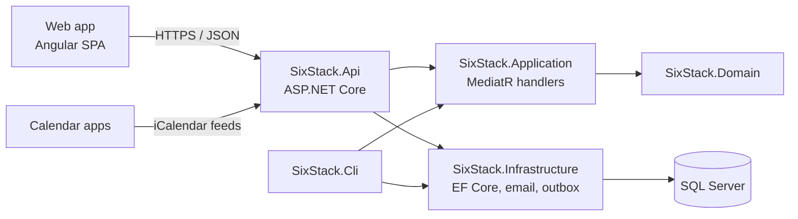

<p align="center">
  <picture>
    <source media="(prefers-color-scheme: dark)" srcset="docs/assets/logo-dark.svg">
    
  </picture>
</p>

<p align="center">
  <strong>Every dev event in the 6ix.</strong><br>
  Meetups and conferences across Toronto and the GTA, plus global talks you can stream. All in one calendar.
</p>

<p align="center">
  <a href="https://github.com/QuinntyneBrown/6ixstack/actions/workflows/ci.yml"></a>
  
  
  
</p>

<p align="center">
  <a href="#getting-started">Getting started</a> ·
  <a href="#documentation">Documentation</a> ·
  <a href="CONTRIBUTING.md">Contributing</a> ·
  <a href="https://github.com/QuinntyneBrown/6ixstack/issues">Report a bug</a>
</p>

---

## About

6ixstack is a free, community-run calendar of developer events in Toronto, the Greater Toronto Area (GTA) and
online. Visitors find events without an account. Organizers submit events with only an email address.
Volunteer moderators review every submission before it is published.

## Features

| Area           | What you can do                                                                                               |
| -------------- | ------------------------------------------------------------------------------------------------------------- |
| Discovery      | Browse upcoming events by day in Toronto time, filter by format and topic, search, and open a month calendar. |
| Event map      | See where events happen on a map, with stream origins and a two-week timeline you can play.                   |
| Event detail   | Read full details for in-person, hybrid, streaming, past and cancelled events.                                |
| Directory      | Browse communities and speakers, each with their own page and events.                                         |
| Calendar feeds | Subscribe to ready-made or custom iCalendar feeds in Google Calendar, Outlook or Apple Calendar.              |
| Add and share  | Add a single event to your calendar or share its link.                                                        |
| Submissions    | Submit an event for free; report a problem with a listing.                                                    |
| Organizers     | Sign in with a magic link, see your events and their status, edit or cancel them.                             |
| Moderation     | Review submissions with automated checks, then approve or reject with a reason.                               |
| Notifications  | Get in-app and email notifications about review outcomes, reports and event changes.                          |
| Accounts       | Manage your profile and notification preferences, sign out, or delete your account.                           |

Every screen is responsive from phone to desktop, supports light and dark themes, meets WCAG 2.2 AA, and
uses no tracking.

## Architecture



| Component                      | Technology                | Responsibility                                                              |
| ------------------------------ | ------------------------- | --------------------------------------------------------------------------- |
| `frontend/projects/sixstack`   | Angular, service worker   | The web app: pages, dialogs and notifications.                              |
| `frontend/projects/components` | Angular, Storybook        | The `sx-*` component library on Fluent UI v9 design tokens.                 |
| `frontend/projects/api`        | TypeScript                | Typed API contracts, injection tokens and clients.                          |
| `src/SixStack.Api`             | ASP.NET Core              | Controllers, authentication, authorization, rate limiting, problem details. |
| `src/SixStack.Application`     | MediatR, FluentValidation | Commands, queries, validators and DTOs.                                     |
| `src/SixStack.Domain`          | .NET                      | Entities and enums, with no dependencies.                                   |
| `src/SixStack.Infrastructure`  | EF Core, SQL Server       | Persistence, migrations, email, geocoding, outbox, seeder.                  |
| `src/SixStack.Cli`             | .NET console              | Migrate, seed and reset the database; list, read, add, update and delete events. |

The API never applies migrations on startup. Run the CLI `migrate` command instead. See the
[detailed designs](docs/detailed-designs/README.md) for the full architecture.

## Getting started

### Prerequisites

- [.NET 10 SDK](https://dotnet.microsoft.com/download)
- [Node.js 24 LTS](https://nodejs.org/) and npm
- SQL Server 2022, SQL Server Express LocalDB, or the SQL Server container image
- [Git LFS](https://git-lfs.com/), for the demo videos

### Clone and build

```bash
git clone https://github.com/QuinntyneBrown/6ixstack.git
cd 6ixstack
git lfs pull
dotnet build SixStack.sln
cd frontend && npm ci
```

### Set up the database

Set the connection string, then migrate and seed:

```bash
export ConnectionStrings__Default="Server=localhost;Database=SixStack;Trusted_Connection=True;TrustServerCertificate=True"
dotnet run --project src/SixStack.Cli -- migrate
dotnet run --project src/SixStack.Cli -- seed
```

Seeding is idempotent and safe to re-run. `reset` drops and recreates the database.

To try the app without SQL Server, use SQLite, as the end-to-end tests do
([ADR 0001](docs/adr/0001-sqlite-for-tests-and-demos.md)):

```bash
export Database__Provider=Sqlite
export ConnectionStrings__Default="Data Source=sixstack.db"
dotnet run --project src/SixStack.Cli -- reset
```

### Manage events from the command line

`sixstack events` lists, reads, adds, updates and soft-deletes events in whatever database
`ConnectionStrings__Default` points at ([design](docs/detailed-designs/platform/event-admin-cli/README.md),
[ADR 0011](docs/adr/0011-cli-event-administration.md)). Reads need nothing else:

```bash
dotnet run --project src/SixStack.Cli -- events list --status published --from 2026-11-03 --to 2026-11-09
dotnet run --project src/SixStack.Cli -- events get whats-new-in-dotnet-11-previews --json
```

Writes run the web app's validation and edit rules, record an audit entry, and need a moderator account as the
actor plus `--yes` (or `--dry-run` to preview without writing):

```bash
export SIXSTACK_ACTOR=jordan@6ixstack.dev   # a moderator in the seed data
dotnet run --project src/SixStack.Cli -- events add --file event.json --dry-run
dotnet run --project src/SixStack.Cli -- events update whats-new-in-dotnet-11-previews --title "What's new in .NET 11" --yes
dotnet run --project src/SixStack.Cli -- events delete whats-new-in-dotnet-11-previews --yes
```

Every command takes `--json` and prints one JSON document for scripts and agents. Exit codes: 0 success,
1 usage error, 2 validation error, 3 not found, 4 conflict, 5 actor missing or not a moderator, 6 not confirmed,
10 unexpected error. `sixstack events --help` and `sixstack events <command> --help` list the options. To run it
against production, see [Managing production events](infra/README.md#managing-production-events).

### Manage events over the API

A moderator can also manage events over HTTPS, which needs no connection string or firewall rule
([design](docs/detailed-designs/platform/event-admin-api/README.md),
[ADR 0012](docs/adr/0012-event-administration-api.md)). Issue a personal API token once from the CLI; it is
printed once and stored only as a salted hash:

```bash
dotnet run --project src/SixStack.Cli -- tokens create --name laptop-agent --actor jordan@6ixstack.dev --yes
```

With the API running ([Run the app](#run-the-app)), send it as a bearer token to `/api/admin/events` (`GET`,
`POST`, `PATCH`, `DELETE`). Writes take `?dryRun=true` to preview; `PATCH` and `DELETE` need `If-Match` with the
version that `GET` returns as its `ETag`:

```bash
export SIXSTACK_API_TOKEN=sxk_...   # from tokens create
curl -H "Authorization: Bearer $SIXSTACK_API_TOKEN" "http://localhost:5100/api/admin/events?search=azure"
```

Every write is audited "via API" under the token's moderator. `tokens list` and `tokens revoke <id>` manage
your tokens; Swagger documents the endpoints with the bearer scheme.

### Run the app

```bash
# Terminal 1: the API, with Swagger at /swagger
dotnet run --project src/SixStack.Api

# Terminal 2: the web app at http://localhost:4200
cd frontend && npm start
```

In development, emails such as sign-in links go to a local dev mailbox instead of being sent.

## Development

### Tests

| Suite           | Command                                                             | Notes                                                                                       |
| --------------- | ------------------------------------------------------------------- | ------------------------------------------------------------------------------------------- |
| Backend         | `dotnet test`                                                       | In-memory SQLite and EF Core InMemory. No database server needed.                           |
| SQL Server only | `SIXSTACK_TEST_SQLSERVER=1 dotnet test --filter Category=SqlServer` | Runs `[SqlServerFact]` tests against a real SQL Server.                                     |
| End to end      | `cd frontend && npm run e2e`                                        | Playwright in Chromium against the API on a seeded SQLite database, with visual regression. |

### Frontend tasks

Run these from `frontend/`:

| Command                                         | Purpose                                                    |
| ----------------------------------------------- | ---------------------------------------------------------- |
| `npm run lint`                                  | angular-eslint                                             |
| `npm run format` / `npm run format:check`       | Prettier                                                   |
| `npm run tokens` / `npm run tokens:check`       | Generate or verify design tokens from the TypeScript theme |
| `npm run storybook` / `npm run build-storybook` | Component library docs                                     |
| `npm run perf-test`                             | Component performance scenarios                            |
| `npm run demo -- <nn>-<journey>`                | Record a journey's narrated demo video into `docs/demos/`  |
| `npm run e2e:serve`                             | Run the API on seeded SQLite and the app, for manual checks |

A husky pre-commit hook formats and lints staged frontend files. CI runs every check above on each pull request.

## Repository structure

```text
SixStack.sln
src/                 .NET projects: Domain, Application, Infrastructure, Api, Cli
tests/               one test project per src project
frontend/            Angular workspace: sixstack, api, components, perf-test, e2e
docs/                requirements, designs, mocks, design system, journeys, prompts, demos
.github/             CI workflows
```

[AGENTS.md](AGENTS.md) holds the full, binding layout and conventions.

## Documentation

| Document                                            | Contents                                                                                |
| --------------------------------------------------- | --------------------------------------------------------------------------------------- |
| [Requirements](docs/specs/L1.md)                    | L1 high-level and [L2 detailed](docs/specs/L2.md) requirements with acceptance criteria |
| [Detailed designs](docs/detailed-designs/README.md) | One design per feature, with C4, class and sequence diagrams                            |
| [Mocks](docs/mocks/README.md)                       | Static HTML mocks of every page, dialog and notification, in every state                |
| [Design system](docs/design-system/README.md)       | Tokens, foundations, components and patterns                                            |
| [User journeys](docs/journey.md)                    | Planned journeys in value order, with effort                                            |
| [Implementation prompts](docs/prompts/)             | The scaffold prompt, then one prompt per journey                                        |
| [Demo videos](docs/demos/)                          | A narrated walkthrough of each journey                                                  |
| [Agent instructions](AGENTS.md)                     | Architecture rules and the delivery workflow                                            |

## Contributing

Contributions are welcome. Every change to behaviour starts with a requirement, a detailed design and a mock,
and is built in small slices with acceptance tests written first. Read [CONTRIBUTING.md](CONTRIBUTING.md)
before you open a pull request.

This project follows the [Code of Conduct](CODE_OF_CONDUCT.md).

## Security

Please don't report security issues in public issues. See [SECURITY.md](SECURITY.md).

## Support

See [SUPPORT.md](SUPPORT.md) for how to get help and where to report a problem with an event listing.

## License

No license has been published yet. Until a `LICENSE` file is added, all rights are reserved.
