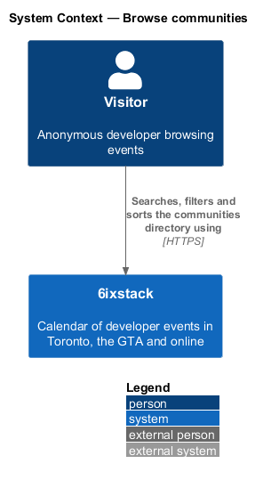
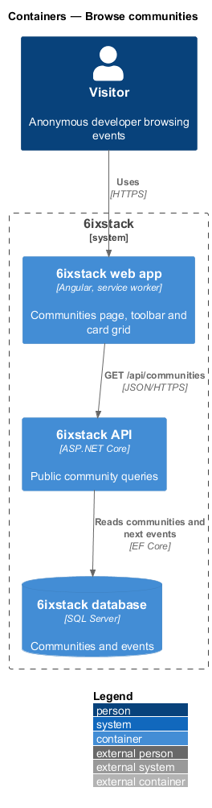
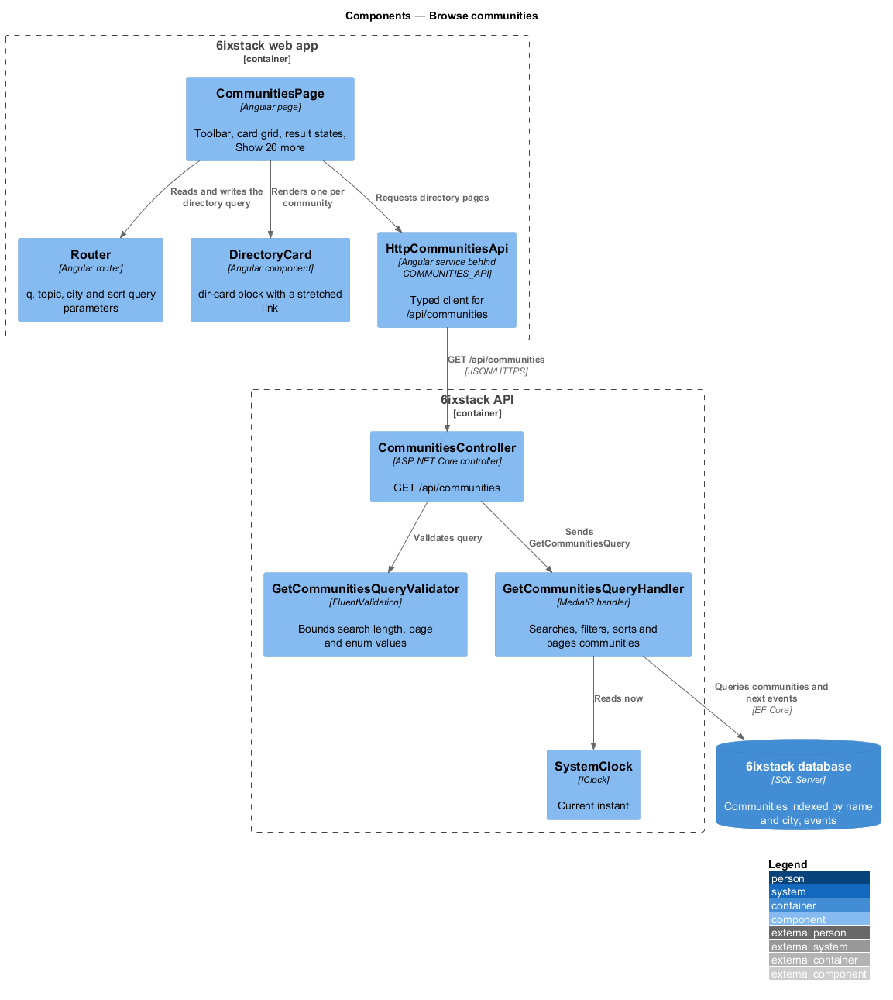
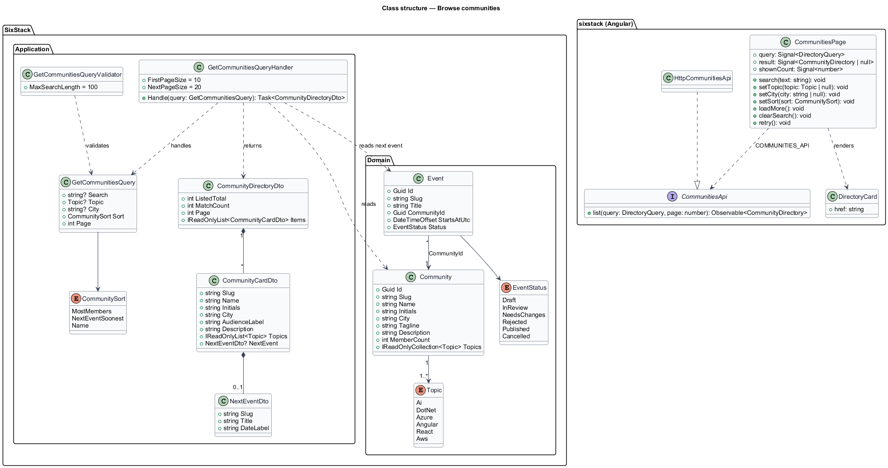
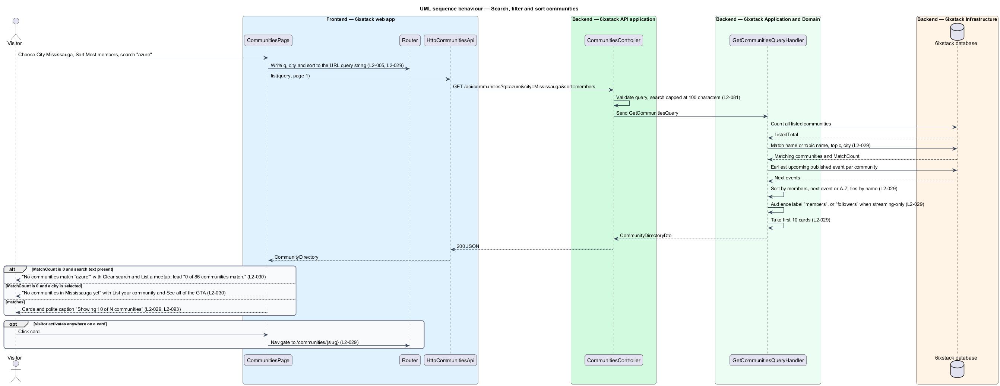
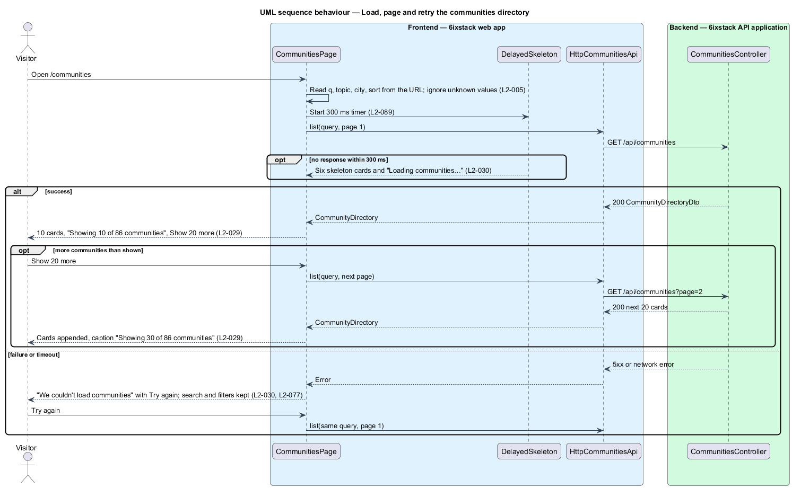

# Browse communities

## Overview

6ixstack is a calendar of developer events in Toronto, the Greater Toronto Area
(GTA) and online. Every listed event belongs to a community, and the
communities page at `/communities` is the directory of those communities. A
visitor uses it to find the meetups and conferences near them, see how large
each group is and when it next meets, and open the group's own page. This
feature covers that directory: the card grid, the search box, the topic and
city filters, the sort order, paging beyond the first screen, and the loading,
empty, no-results and error states drawn in `docs/mocks/pages/communities/`.

The feature belongs to the `directory` subsystem. The community page that each
card opens is a separate slice (`directory/view-community`). The speakers
directory (`directory/browse-speakers`) follows the same card-grid pattern.

Terms used in this design:

- **community** — meetup group, conference or streaming channel that organizes listed events, shown with an initials tile
- **community card** — tile in the directory grid showing one community's initials, name, city, audience count, description, next event and topics
- **audience count** — member count of a community, labelled "followers" for a streaming-only community and "members" otherwise
- **streaming-only community** — community that runs only online events, such as Microsoft Reactor
- **next event** — earliest published, upcoming event of a community, shown on its card with its date
- **directory query** — search text, topic, city and sort order that together select and order the cards

The directory lists all communities to anonymous visitors. No sign-in takes
part. The search, topic, city and sort values live in the URL query string so a
filtered directory can be shared (`L2-005`). Unlike the events page, the
directory does not remember its filters in browser storage.

## Description

The slice runs from the Angular page to the database through one read-only query.

- **`CommunitiesPage`** (`sx-communities-page`) — Angular page in project
  `sixstack`, at `frontend/projects/sixstack/src/app/pages/communities/`. It
  renders the title and lead line, the toolbar (search field and three
  `select` controls: Topic, City, Sort by), the card grid, and the
  "Showing 10 of 86 communities" caption with the "Show 20 more" button. It owns
  the loading, empty, no-results and error states. It reads and writes the
  directory query through the Angular `Router` query parameters `q`, `topic`,
  `city` and `sort`. Unknown values in the URL are ignored.
- **`DirectoryCard`** (`sx-directory-card`) — component in project `components`
  that keeps the mock's `dir-card` BEM block. The community name is the only
  anchor in the card. A stretched-link overlay makes activation anywhere on the
  card open the community page (`L2-029`). The card therefore holds a single
  tab stop. Hover and keyboard focus lift it.
- **`LogoTile`** (`sx-logo-tile`) and **`TopicTag`** (`sx-topic-tag`) — library
  components for the initials tile and the non-interactive topic labels. Each
  topic tag shows its name beside its hue (`L2-093`).
- **`EmptyState`**, **`Alert`**, **`Skeleton`** — library components for the
  empty and no-results panels, the danger alert and the six skeleton cards.
- **`DelayedSkeleton`** — shared helper that shows skeletons only when a request
  is still pending after 300 ms (`L2-089`).
- **`CommunitiesApi`** / **`COMMUNITIES_API`** / **`HttpCommunitiesApi`** — the
  API client contract, its injection token and its HTTP implementation in
  project `api`. The page depends on the token only.
- **`CommunitiesController`** — ASP.NET Core controller exposing
  `GET /api/communities` for anonymous callers. It validates the query and
  dispatches it. It holds no business rules.
- **`GetCommunitiesQuery`** — query carrying `Search`, `Topic` (`Topic?`),
  `City` (`string?`), `Sort` (`MostMembers`, `NextEventSoonest`, `Name`) and
  `Page`.
- **`GetCommunitiesQueryValidator`** — truncates `Search` to 100 characters,
  requires `Page` to be 1 or greater, and rejects unknown topic and sort values
  with a 400 problem response (`L2-081`).
- **`GetCommunitiesQueryHandler`** — MediatR handler. It counts all listed
  communities, then applies the search, the topic and the city. It looks up
  each matching community's next event, orders the matches by the chosen sort,
  and returns one page. The first page holds 10 cards. Each later page holds
  the next 20 (`L2-029`).
- **`CommunityDirectoryDto`** and **`CommunityCardDto`** — response contracts.
  `CommunityDirectoryDto` carries `ListedTotal` (all communities, 86 in the
  mock), `MatchCount` and the page's `Items`. `CommunityCardDto` carries
  `Slug`, `Name`, `Initials`, `City`, `AudienceLabel` ("2,140 members",
  "18,400 followers"), `Description`, `Topics` and a `NextEvent`
  (`NextEventDto`: `Slug`, `Title`, `DateLabel` such as "Thu, Nov 5"). The card
  therefore holds no formatting rules.
- **`Community`** — domain entity. This slice reads `Slug`, `Name`,
  `Initials`, `City`, `Description`, `MemberCount` and `Topics`.
- **`Event`** — domain entity. This slice reads `CommunityId`, `Status`,
  `StartsAtUtc`, `Title` and `Slug` to find each community's next event.
- **`SystemClock`** (`IClock`) — supplies the current instant so tests can fix
  "today" at Monday, November 2, 2026.

Search matches the community name and the names of its topics, case
insensitively, with `LIKE` matching in the database. Sort by most members
orders by `MemberCount` descending. Sort by next event soonest orders by the
next event's start. Sort A–Z orders by `Name`. Each sort breaks ties by `Name`.
The `Communities` table has indexes on `Name` and `City`. These keep the list
endpoint within the 300 ms p95 target of `L2-087`.

The page chooses its result state from the response:

| Condition | State | Lead line |
|-----------|-------|-----------|
| Matches exist | Card grid, caption "Showing N of M communities", "Show 20 more" while more remain | "86 meetups and conferences across Toronto and the GTA, plus the global streams we list." |
| `MatchCount` is 0, no search text, a city is selected | Empty: "No communities in {city} yet" with "List your community" (to `/submit`) and "See all of the GTA" (clears the city) | "0 communities in {city}." |
| `MatchCount` is 0 and search text is present | No results: "No communities match “{q}”" with "Clear search" and "List a {q} meetup" (to `/submit`) | "0 of {ListedTotal} communities match." |
| Request fails | Danger alert "We couldn't load communities" with Try again; toolbar values kept | "Community list unavailable right now." |
| Pending after 300 ms | Six skeleton cards and "Loading communities…" in a status region | "Loading communities…" |

Open points, not decided by the requirements or the mocks:

- The rule that marks a community as streaming-only is `<TO SUPPLY>`. The mock
  models it as the city value "Streaming". A dedicated flag on `Community` is
  the alternative.
- The source and refresh of `MemberCount` (entered by a moderator or read from
  an external group page) is `<TO SUPPLY>`.
- The card copy for a community with no upcoming event is `<TO SUPPLY>`. Its
  position under "Next event soonest" is also `<TO SUPPLY>`.
- Whether a cancelled event counts as a community's next event is `<TO SUPPLY>`.
- The source of the City options is `<TO SUPPLY>`. Oakville is listed with no
  communities, so the list is fixed rather than derived from data. It may come
  from `GET /api/reference-data` or be compiled into the app.
- The empty-state copy when only a topic filter, or a topic and city together,
  match nothing is `<TO SUPPLY>`. `L2-030` defines only the city case.
- Whether search runs on each keystroke (with a debounce interval) or on submit
  is `<TO SUPPLY>`.
- The client timeout behind "didn't respond in time" is `<TO SUPPLY>`.
- The behaviour when "Show 20 more" fails is `<TO SUPPLY>`. `L2-077` requires a
  retry that keeps the cards already shown.

## Requirements

| L2 ID | Refines (L1) | Requirement |
|-------|--------------|-------------|
| `L2-029` | `L1-005` | The communities page (`/communities`) shall list communities as cards (initials tile, name linked to its page, city, member or follower count, description, next event with date, topics), with search by name or topic, filters for topic and city, sort by most members, next event soonest or A–Z, and pages of 20 after the first 10. |
| `L2-030` | `L1-005` | The communities page shall show loading, empty, no-results and error states while keeping search and filters. |

The slice also applies these cross-cutting requirements, specified in their own
designs: URL query state (`L2-005`, `discovery/browse-events`), delayed
skeletons (`L2-089`), inline failure handling (`L2-077`), polite live regions
(`L2-093`) and input validation (`L2-081`).

## Diagrams

### System context

A visitor searches, filters and sorts the communities directory in 6ixstack. No
sign-in and no external system takes part in this slice.

### Containers

The web app calls `GET /api/communities` on the API. The API reads communities
and their next events from the SQL Server database through EF Core.

### Components

`CommunitiesPage` keeps the directory query in the router's query parameters
and requests pages through `HttpCommunitiesApi`. In the API,
`CommunitiesController` validates the query and sends it to
`GetCommunitiesQueryHandler`. The handler reads "now" from `SystemClock` to
find each next event.

### Class structure

The handler reads `Community` and `Event` entities and returns a
`CommunityDirectoryDto` composed of `CommunityCardDto` items. On the client,
`CommunitiesPage` depends on the `CommunitiesApi` contract through the
`COMMUNITIES_API` token.

### Behaviour — search, filter and sort

A toolbar change writes the query to the URL first and then requests page 1.
The handler counts all communities, applies the search, topic and city, and
then sorts and pages. The page then picks the grid, the empty state or the
no-results state from `MatchCount`.

### Behaviour — load, page and retry

Skeleton cards appear only when the response takes longer than 300 ms. A
failure keeps the toolbar values and offers Try again. "Show 20 more" appends
the next 20 cards and updates the caption.

## Decisions (journey 18)

- **Listed communities** are those with at least one published event. A submitter's placeholder community, such as
  an unverified sender's, stays out of the directory. The seed lists 15 (L2-029 and L2-030 use that number); the
  mocks keep 86 as their illustration.
- **Query values**: `sort` is `members`, `next` or `name`; `topic` is a topic key; `city` is a community city,
  including "Streaming". Unknown topic or sort values answer 400; the page ignores unknown values in its URL.
- **Next event**: the soonest published, not cancelled event that has not started. Communities without one sort last
  by next event and show no Next line.
- **Search**: case-insensitive on the name and the topic names. It runs in memory over the listed communities, which
  stay few. Move it to `LIKE` in the database when the directory grows past a few hundred.
- `DirectoryCard` renders the next-event line and topics from inputs rather than projected content, so its styles
  apply.

