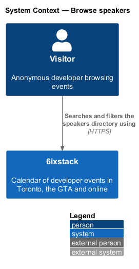
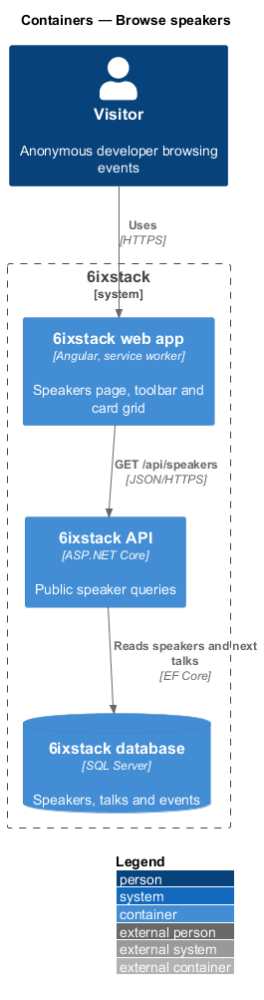
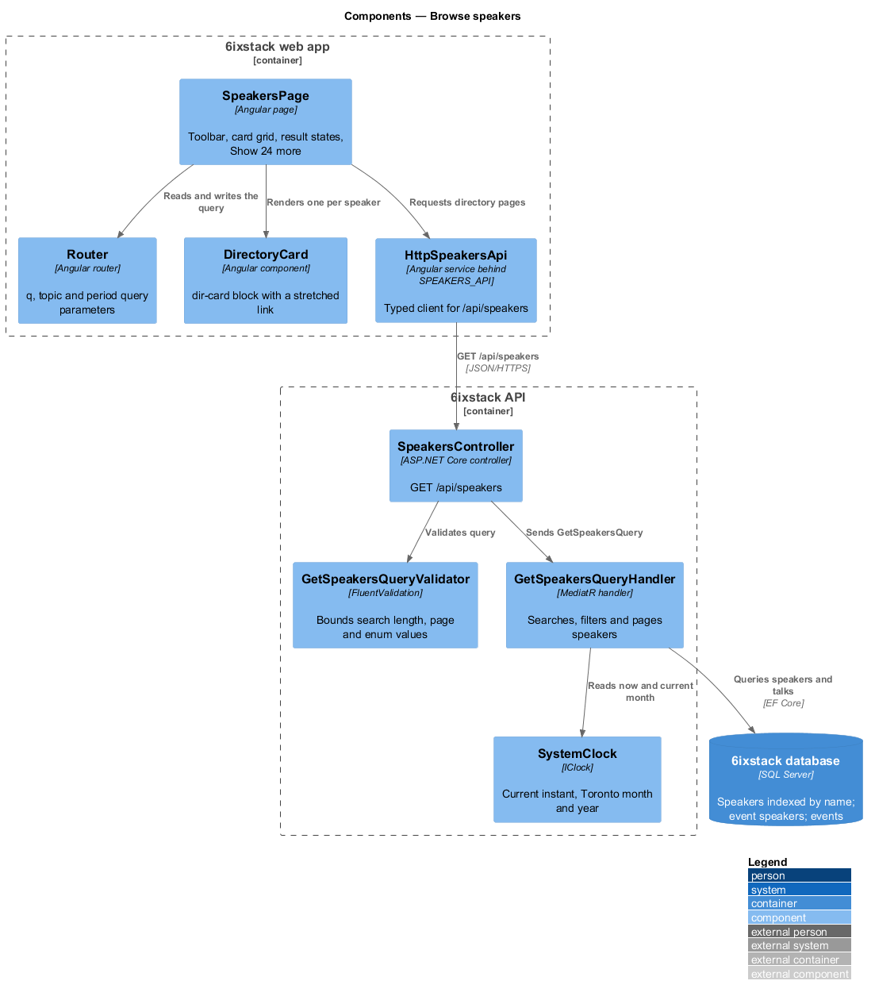
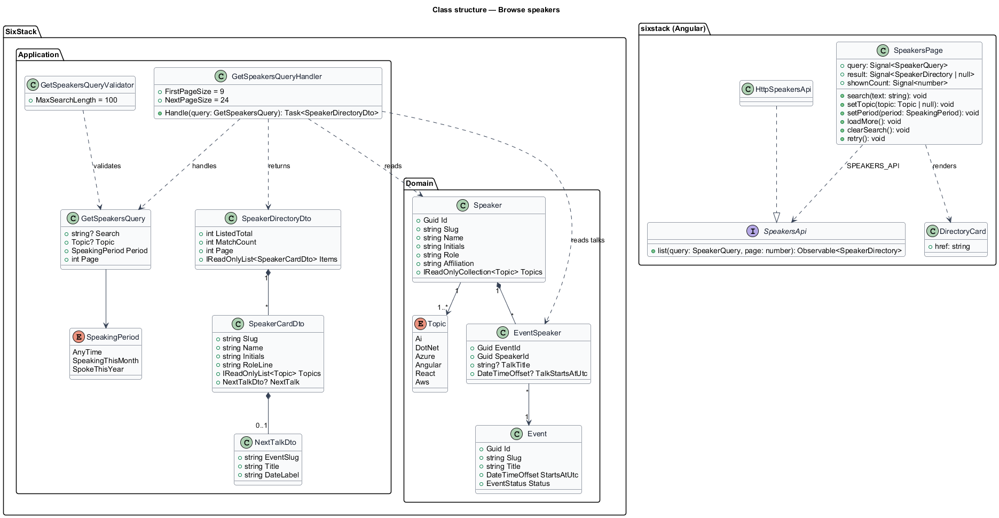
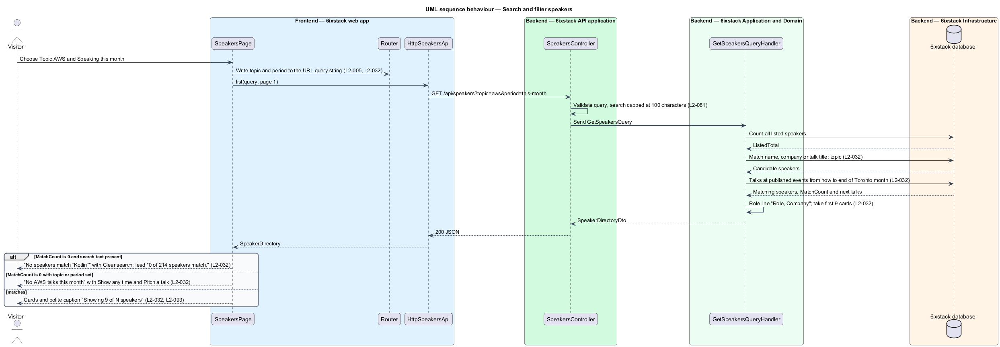
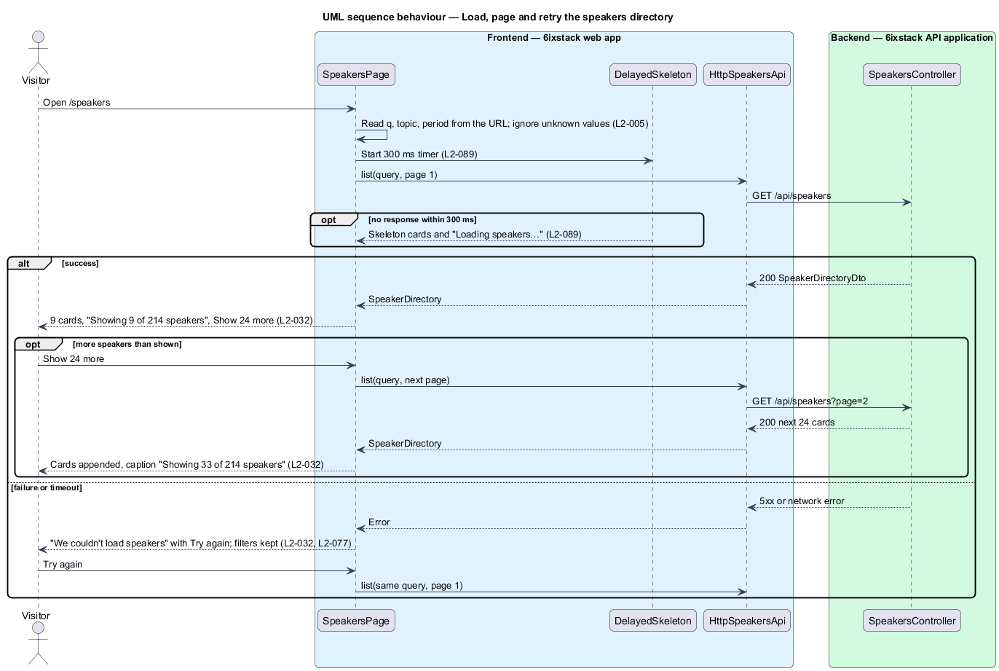

# Browse speakers

## Overview

6ixstack is a calendar of developer events in Toronto, the Greater Toronto Area
(GTA) and online. Listed events name the people who present at them. The
speakers page at `/speakers` is the directory of those people. A visitor uses
it to find who talks about a topic, who is speaking soon, and to open a
speaker's own page. Organizers use it to find speakers to invite. This feature
covers that directory: the card grid, the search box, the topic and speaking
period filters, paging beyond the first screen, and the loading, empty,
no-results and error states drawn in `docs/mocks/pages/speakers/`.

The feature belongs to the `directory` subsystem. The speaker page that each
card opens is a separate slice (`directory/view-speaker`). The communities
directory (`directory/browse-communities`) follows the same card-grid pattern.

Terms used in this design:

- **speaker** — person who presents at one or more listed events, shown with an initials avatar
- **talk** — one speaker's session at one event, with its own title and optional start time
- **speaker card** — tile in the directory grid showing one speaker's initials, name, role and company, topics and next talk
- **role line** — speaker's role and company on one line, such as "Data platform lead, Scotiabank"
- **next talk** — earliest upcoming talk of a speaker at a published event, shown with its date
- **speaking period** — filter on when a speaker talks: any time, speaking this month or spoke this year

The directory is public. No sign-in takes part. The search, topic and speaking
period values live in the URL query string so a filtered directory can be
shared (`L2-005`). No email address appears on a card (`L2-099`).

## Description

The slice runs from the Angular page to the database through one read-only query.

- **`SpeakersPage`** (`sx-speakers-page`) — Angular page in project `sixstack`,
  at `frontend/projects/sixstack/src/app/pages/speakers/`. It renders the title
  and lead line, the toolbar (search field and two `select` controls: Topic and
  Speaking), the card grid, and the "Showing 9 of 214 speakers" caption with the
  "Show 24 more" button. It owns the loading, empty, no-results and error
  states. It reads and writes the query through the Angular `Router` query
  parameters `q`, `topic` and `period`. Unknown values in the URL are ignored.
- **`DirectoryCard`** (`sx-directory-card`) — the card component shared with
  `directory/browse-communities`. It keeps the mock's `dir-card` BEM block. The
  speaker name is the card's link to `/speakers/{slug}`.
- **`Avatar`** (`sx-avatar`) and **`TopicTag`** (`sx-topic-tag`) — library
  components for the initials avatar and the non-interactive topic labels. Each
  topic tag shows its name beside its hue (`L2-093`).
- **`EmptyState`**, **`Alert`**, **`Skeleton`** — library components for the
  empty and no-results panels, the danger alert and the skeleton cards.
- **`DelayedSkeleton`** — shared helper that shows skeletons only when a request
  is still pending after 300 ms (`L2-089`).
- **`SpeakersApi`** / **`SPEAKERS_API`** / **`HttpSpeakersApi`** — the API
  client contract, its injection token and its HTTP implementation in project
  `api`. The page depends on the token only.
- **`SpeakersController`** — ASP.NET Core controller exposing
  `GET /api/speakers` for anonymous callers. It validates the query and
  dispatches it. It holds no business rules.
- **`GetSpeakersQuery`** — query carrying `Search`, `Topic` (`Topic?`),
  `Period` (`AnyTime`, `SpeakingThisMonth`, `SpokeThisYear`) and `Page`.
- **`GetSpeakersQueryValidator`** — truncates `Search` to 100 characters,
  requires `Page` to be 1 or greater, and rejects unknown topic and period
  values with a 400 problem response (`L2-081`).
- **`GetSpeakersQueryHandler`** — MediatR handler. It counts all listed
  speakers, then applies the search, the topic and the speaking period. It
  looks up each matching speaker's next talk and returns one page. The first
  page holds 9 cards. Each later page holds the next 24 (`L2-032`).
- **`SpeakerDirectoryDto`**, **`SpeakerCardDto`**, **`NextTalkDto`** — response
  contracts. `SpeakerDirectoryDto` carries `ListedTotal` (214 in the mock),
  `MatchCount` and the page's `Items`. `SpeakerCardDto` carries `Slug`, `Name`,
  `Initials`, `RoleLine`, `Topics` and `NextTalk`. `NextTalkDto` carries
  `EventSlug`, `Title` and `DateLabel` ("Thu, Nov 5").
- **`Speaker`** — domain entity. This slice reads `Slug`, `Name`, `Role`,
  `Affiliation` and `Topics`, and adds a stored `Initials` field, as `Community`
  has.
- **`EventSpeaker`** — join entity of event and speaker. This slice adds
  `string? TalkTitle` and `DateTimeOffset? TalkStartsAtUtc`. A talk without its
  own title or start uses the event's title or start.
- **`Event`** — domain entity. This slice reads `Status`, `StartsAtUtc`, `Slug`
  and `Title`.
- **`SystemClock`** (`IClock`) — supplies the current instant and the Toronto
  month and year so tests can fix "today" at Monday, November 2, 2026.

Search matches the speaker name, the affiliation (company) and the titles of
the speaker's talks at published events. Matching is case insensitive, with
`LIKE` in the database. The topic filter keeps speakers tagged with the chosen
topic. "Speaking this month" keeps speakers with a talk at a published event
between now and the end of the current Toronto month. Whether a talk at a
cancelled event counts toward the period or the next talk is `<TO SUPPLY>`. The
`Speakers` table has an index on `Name`, and `EventSpeakers` on `SpeakerId`.
These keep the list endpoint within the 300 ms p95 target of `L2-087`.

The page chooses its result state from the response:

| Condition | State | Lead line |
|-----------|-------|-----------|
| Matches exist | Card grid, caption "Showing N of M speakers", "Show 24 more" while more remain | "214 people who have spoken at GTA meetups and conferences this year." |
| `MatchCount` is 0, no search text, topic or period filter set | Empty: "No {topic} talks this month" with "Show any time" (resets the period) and "Pitch a talk" | "0 speakers match." |
| `MatchCount` is 0 and search text is present | No results: "No speakers match “{q}”" with "Clear search" | "0 of {ListedTotal} speakers match." |
| Request fails | Danger alert "We couldn't load speakers" with Try again; toolbar values kept | "Speaker list unavailable right now." |
| Pending after 300 ms | Skeleton cards and "Loading speakers…" in a status region | "Loading speakers…" |

Open points, not decided by the requirements or the mocks:

- The meaning of "Spoke this year" is `<TO SUPPLY>`. It may cover only past
  talks in the current calendar year, or every talk in that year.
- Which speakers the directory lists is `<TO SUPPLY>`. The lead line reads
  "spoken … this year", while the default period is "Any time".
- The default card order is `<TO SUPPLY>`. `L2-032` defines no sort, and the
  mock order follows no visible key.
- The empty-state heading for combinations other than a topic with "Speaking
  this month" is `<TO SUPPLY>`.
- The empty-state hint "AWS User Group Toronto is looking for speakers for
  December" has no data source in the domain model. Its source is
  `<TO SUPPLY>`.
- The target of "Pitch a talk" is `<TO SUPPLY>`. The mock links it to a
  community page without saying which community is chosen.
- The card copy for a speaker with no upcoming talk is `<TO SUPPLY>`.
- Whether search runs on each keystroke (with a debounce interval) or on submit
  is `<TO SUPPLY>`.
- The client timeout behind "didn't respond in time" is `<TO SUPPLY>`.
- The behaviour when "Show 24 more" fails is `<TO SUPPLY>`. `L2-077` requires a
  retry that keeps the cards already shown.

## Requirements

| L2 ID | Refines (L1) | Requirement |
|-------|--------------|-------------|
| `L2-032` | `L1-006` | The speakers page (`/speakers`) shall list speakers as cards (initials avatar, name linked to their page, role and company, topics, next talk with date), with search by name, company or talk, filters for topic and speaking period (any time, speaking this month, spoke this year), and pages of 24 after the first 9. |

The slice also applies these cross-cutting requirements, specified in their own
designs: URL query state (`L2-005`, `discovery/browse-events`), inline failure
handling (`L2-077`), input validation (`L2-081`), delayed skeletons (`L2-089`),
polite live regions (`L2-093`) and protection of contact details (`L2-099`).

## Diagrams

### System context

A visitor searches and filters the speakers directory in 6ixstack. No sign-in
and no external system takes part in this slice.

### Containers

The web app calls `GET /api/speakers` on the API. The API reads speakers, their
talks and the events that hold them from the SQL Server database through EF
Core.

### Components

`SpeakersPage` keeps the query in the router's query parameters and requests
pages through `HttpSpeakersApi`. In the API, `SpeakersController` validates the
query and sends it to `GetSpeakersQueryHandler`. The handler reads "now" and
the Toronto month from `SystemClock`.

### Class structure

The handler reads `Speaker`, `EventSpeaker` and `Event` entities and returns a
`SpeakerDirectoryDto` composed of `SpeakerCardDto` items. On the client,
`SpeakersPage` depends on the `SpeakersApi` contract through the
`SPEAKERS_API` token.

### Behaviour — search and filter

A toolbar change writes the query to the URL first and then requests page 1.
The handler counts all speakers, applies search, topic and period, and pages.
The page then picks the grid, the empty state or the no-results state from
`MatchCount`.

### Behaviour — load, page and retry

Skeleton cards appear only when the response takes longer than 300 ms. A
failure keeps the toolbar values and offers Try again. "Show 24 more" appends
the next 24 cards and updates the caption.

## Decisions (journey 23)

- **Listed speakers**: every speaker. The lead reads "{n} people who have spoken at GTA meetups and conferences this
  year." The seed lists 14 (L2-032 uses that number; the mocks keep 214).
- **Order**: by next talk, soonest first, then by name. Speakers with no upcoming talk come last and show no Next
  line.
- **Periods** (`period` = `any`, `month`, `year`):
  - "Speaking this month" keeps speakers with a talk at a published, not cancelled event before the Toronto month
    ends.
  - "Spoke this year" keeps speakers whose talk this year has already happened.
  - Unknown values answer 400.
- **Search**: case-insensitive on the name, role and company, and talk titles (or event titles where a talk has no
  title of its own).
- **Empty**: "No {topic} talks this month" (or "this year"; "No talks …" without a topic), "Nobody is listed to speak
  about {topic} before {month end}.", with "Show any time" (resets the period) and "Pitch a talk" (to `/submit`).
  A community's call for speakers has no data yet, so that line is left out.
- **Cards** reuse `DirectoryCard` with its person variant: avatar, topics row, then the next talk.
- The seed adds five speakers with talks earlier this year.

