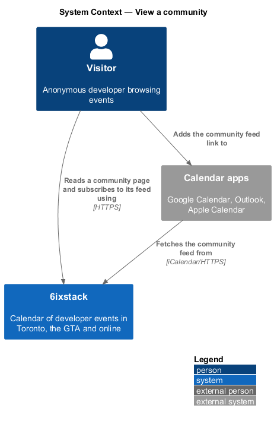
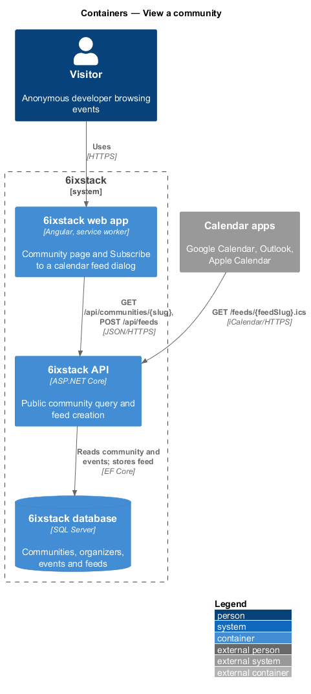
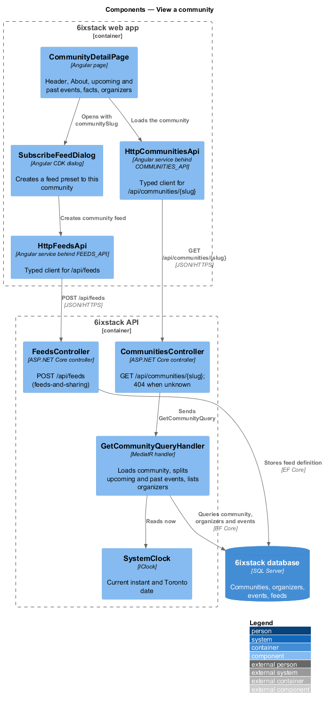
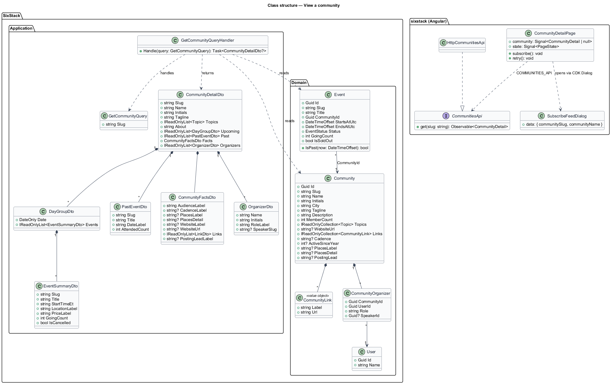
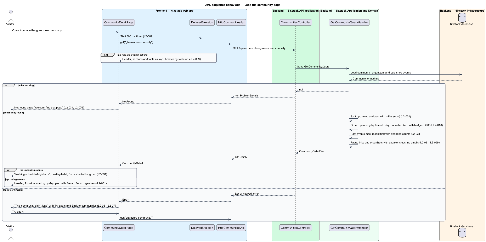
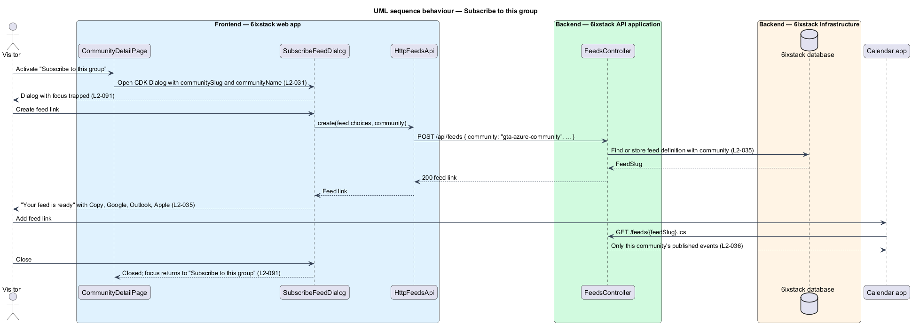

# View a community

## Overview

6ixstack is a calendar of developer events in Toronto, the Greater Toronto Area
(GTA) and online. Every listed event belongs to a community. The community page
at `/communities/{id}` tells a visitor what one group is, when it meets, what it
has run before and who runs it. It also lets the visitor subscribe to a calendar
feed of that group's events. This feature covers that page: the header, About,
Upcoming events, Past events, the facts panel, "Subscribe to this group", the
organizer list, and the loading, empty, error and not-found states drawn in
`docs/mocks/pages/community-detail/`.

The feature belongs to the `directory` subsystem. Visitors reach it from a card
in the communities directory (`directory/browse-communities`), from the
organizer link on an event page (`discovery/view-event-detail`) and from a
speaker's affiliation (`directory/view-speaker`). The "Subscribe to a calendar
feed" dialog it opens is specified in `feeds-and-sharing/build-custom-feed`.

Terms used in this design:

- **community** — meetup group, conference or streaming channel that organizes listed events
- **community slug** — URL-safe identifier of a community, used as the `{id}` segment of `/communities/{id}`
- **upcoming event** — published event of the community whose start has not passed, including a cancelled one shown with its badge
- **past event** — published event of the community whose end has passed
- **attended count** — number of people recorded as attending a past event
- **cadence** — how often the group meets and since when, such as "Monthly since 2019"
- **community feed** — calendar feed limited to the events of one community
- **organizer** — signed-in user who manages one community's events, listed with a role such as "Lead organizer"

The page is public and read-only. Every time is shown in Toronto time (ET), as
described in `platform/time-zones`.

## Description

The slice runs from the Angular page to the database through one read-only query.
A second, write path creates the community feed through the feed dialog.

- **`CommunityDetailPage`** (`sx-community-detail-page`) — Angular page in
  project `sixstack`, at `frontend/projects/sixstack/src/app/pages/community-detail/`,
  routed at `/communities/:id`. It renders the "All communities" back link, the
  `DetailHero` (initials tile, name as `h1`, tagline, topic tags), the About
  section, the Upcoming events section as `DayGroup` sections of `EventRow`
  items, and the Past events list with a "Recap" link per row. Its aside holds
  the `Facts` panel, the "Subscribe to this group" button and the Organizers
  list. It owns the loading, empty, error and not-found states.
- **`DetailHero`**, **`Facts`**, **`DayGroup`**, **`EventRow`**, **`LogoTile`**,
  **`TopicTag`**, **`Avatar`**, **`EmptyState`**, **`Skeleton`** — library
  components in project `components` that keep the mock's BEM blocks
  (`detail-hero`, `facts`, `day-group`, `event-row`, `logo-tile`, `person`,
  `empty`). `EventRow` shows the "Cancelled" badge for a cancelled upcoming
  event (`L2-010`).
- **`SubscribeFeedDialog`** — Angular CDK dialog in
  `frontend/projects/sixstack/src/app/dialogs/subscribe-feed/`. This page opens
  it with dialog data `{ communitySlug, communityName }`, so the feed it
  creates is limited to this community (`L2-031`, `L2-035`). Its states and
  validation belong to `feeds-and-sharing/build-custom-feed`.
- **`FeedsApi`** / **`FEEDS_API`** / **`HttpFeedsApi`** — the feed client in
  project `api` that the dialog calls with `POST /api/feeds`. It belongs to
  `feeds-and-sharing/build-custom-feed`.
- **`DelayedSkeleton`** — shared helper that shows the skeleton layout only when
  the request is still pending after 300 ms (`L2-089`).
- **`CommunitiesApi`** / **`COMMUNITIES_API`** / **`HttpCommunitiesApi`** — the
  API client contract, its injection token and its HTTP implementation in
  project `api`. This slice adds `get(slug)` to the contract.
- **`CommunitiesController`** — ASP.NET Core controller exposing
  `GET /api/communities/{slug}` for anonymous callers. It maps a missing
  community to a 404 problem response. It holds no business rules.
- **`GetCommunityQuery`** — query carrying the community `Slug`.
- **`GetCommunityQueryHandler`** — MediatR handler. It loads the community, its
  published events and its organizers. It splits the events into upcoming and
  past against the current instant. It groups upcoming events by Toronto
  calendar day, and orders past events from most recent. It returns `null` when
  no community has the slug.
- **`CommunityDetailDto`** — response contract carrying `Slug`, `Name`,
  `Initials`, `Tagline`, `Topics`, `About`, `Upcoming`
  (`IReadOnlyList<DayGroupDto>` of `EventSummaryDto`, shared with
  `discovery/browse-events`), `Past` (`IReadOnlyList<PastEventDto>`), `Facts`
  (`CommunityFactsDto`) and `Organizers` (`IReadOnlyList<OrganizerDto>`).
- **`PastEventDto`** — `Slug`, `Title`, `DateLabel` ("Oct 21, 2026") and
  `AttendedCount`. The "Recap" link opens the past event's detail page
  (`/events/{slug}`), as the mock links it.
- **`CommunityFactsDto`** — `AudienceLabel` ("2,140 members"), `CadenceLabel`
  ("Monthly since 2019"), `PlacesLabel` ("Mississauga and online"),
  `PlacesDetail` ("Living Arts Centre, Sheridan College"), `WebsiteLabel`
  ("gtaazure.ca"), `WebsiteUrl`, `Links` (label and `https://` URL pairs such as
  Website, Meetup, LinkedIn) and `PostingLeadLabel` for the empty state.
- **`OrganizerDto`** — `Name`, `Initials`, `RoleLabel` and `SpeakerSlug`. A
  non-null `SpeakerSlug` links the organizer to `/speakers/{slug}`. No email
  address appears in the response (`L2-099`).
- **`Community`** — domain entity. Beyond the shared fields, this slice adds
  `string? Cadence`, `int? ActiveSinceYear`, `string? PlacesLabel`,
  `string? PlacesDetail` and `string? PostingLead`.
- **`CommunityOrganizer`** — join entity of community and user. This slice adds
  `Guid? SpeakerId`, linking the organizer to a speaker profile.
- **`Event`** — domain entity. This slice reads `Status`, `StartsAtUtc`,
  `EndsAtUtc`, `Format`, `Topics`, `Venue`, `Price`, `GoingCount` and
  `IsSoldOut`, and calls `IsPast(now)`.
- **`SystemClock`** (`IClock`) — supplies the current instant so tests can fix
  "today" at Monday, November 2, 2026.

The page chooses its state from the response:

| Condition | State |
|-----------|-------|
| 200 with upcoming events | Header, About, Upcoming events by day, Past events, facts, Subscribe, Organizers |
| 200 with no upcoming events | Upcoming section shows "Nothing scheduled right now", "{Name} usually posts its next meetup {PostingLeadLabel}…" and "Subscribe to this group"; the rest of the page stays |
| 404 | Not-found page "We can't find that page" from `site/status-pages` |
| Failure or timeout | "This community didn't load" as `h1` with "Try again" and "Back to communities"; back link kept |
| Pending after 300 ms | Header, sections and facts as skeletons matching the loaded layout |

Community text (About, tagline) is plain text encoded on output (`L2-081`).
Website and social links accept `https://` URLs only (`L2-081`).

Open points, not decided by the requirements or the mocks:

- Who maintains `Cadence`, `ActiveSinceYear`, `PlacesLabel`, `PlacesDetail`
  and `PostingLead`, and whether any of them is derived from event history, is
  `<TO SUPPLY>`. No mock shows a screen that edits community details.
- The source of the attended count is `<TO SUPPLY>`. `Event` holds only
  `GoingCount`. The requirements do not state whether attended equals the
  going count when the event ends.
- The number of past events listed, and any paging of them, is `<TO SUPPLY>`.
  The mock shows three.
- Any limit on the upcoming list is `<TO SUPPLY>`.
- The display of an organizer with no speaker profile is `<TO SUPPLY>`.
  `L2-031` requires organizers "linked to their speaker pages".
- Whether `CommunityOrganizer.Role` is free text or an enumeration is
  `<TO SUPPLY>`. The mock shows "Lead organizer", "Co-organizer" and
  "Volunteer, labs".
- Whether the dialog opened by "Subscribe to this group" still offers topic and
  "Where" choices, or creates the community feed directly, is `<TO SUPPLY>`.
- How the not-found page is served "with status 404" is `<TO SUPPLY>`. The API
  returns 404. An Angular single-page app cannot set the HTTP status of the
  HTML document without server-side rendering or a server route check.
- Whether About supports Markdown links, as event descriptions do, is
  `<TO SUPPLY>`.

## Requirements

| L2 ID | Refines (L1) | Requirement |
|-------|--------------|-------------|
| `L2-031` | `L1-005` | The community page (`/communities/{id}`) shall show the community header (initials, name, tagline, topics), About, Upcoming events grouped by day, Past events with attended counts and Recap links, a facts panel (members and cadence, places, website and social links), "Subscribe to this group" and its organizers linked to their speaker pages. |

The slice also applies these cross-cutting requirements, specified in their own
designs: event row badges (`L2-010`), the feed builder (`L2-035`) and community
feed content (`L2-036`), status pages (`L2-076`), inline failure handling
(`L2-077`), input validation and output encoding (`L2-081`), delayed skeletons
(`L2-089`) and protection of contact details (`L2-099`).

## Diagrams

### System context

A visitor reads a community's page in 6ixstack and may subscribe to its feed.
The visitor's calendar app then fetches that feed from 6ixstack.

### Containers

The web app calls `GET /api/communities/{slug}` to load the page and
`POST /api/feeds` to create the community feed. The API reads and writes the
SQL Server database through EF Core. Calendar apps fetch the feed from the API.

### Components

`CommunityDetailPage` loads the community through `HttpCommunitiesApi` and opens
`SubscribeFeedDialog` for the feed. In the API, `CommunitiesController` sends
`GetCommunityQuery` to its handler. The handler reads "now" from `SystemClock`
to split upcoming from past events. `FeedsController` serves the dialog's
request and belongs to `feeds-and-sharing/build-custom-feed`.

### Class structure

`GetCommunityQueryHandler` reads `Community`, `CommunityOrganizer` and `Event`
and returns a `CommunityDetailDto`. That DTO is composed of day groups, past
events, facts and organizers. On the client, `CommunityDetailPage` depends on
the `CommunitiesApi` contract through the `COMMUNITIES_API` token.

### Behaviour — load the community page

The handler returns `null` for an unknown slug, and the controller maps it to
404. A found community splits into upcoming and past events against the
current instant. An empty upcoming list shows "Nothing scheduled right now". A
failure shows "This community didn't load" with a retry.

### Behaviour — subscribe to this group

"Subscribe to this group" opens `SubscribeFeedDialog` with the community preset.
The dialog creates a feed limited to that community. The visitor adds the link
to a calendar app, which then receives only this community's events.

## Decisions (journey 19)

- **Profile fields** live on `Community` as the design lists them (`Cadence`, `ActiveSinceYear`, `PlacesLabel`,
  `PlacesDetail`, `PostingLead`), plus `Tagline`, `About` and an owned JSON list of `Links`. The tagline and About
  fall back to the description. Only seed data fills them for now; no screen edits them yet.
- **Organizers** are `CommunityOrganizer` rows ordered by `SortOrder`. `Role` is free text ("Lead organizer"), and
  `SpeakerId` links the speaker page. An organizer without a speaker profile shows their name without a link.
- **Attended** is `AttendedCount`, falling back to the going count when none was recorded. Past lists the three most
  recent events, with no paging. Upcoming has no limit.
- **Unpublished events** (in review, needs changes) never appear on the public page. L2-031 criterion 1 follows the
  seed, where Fabric for Power BI developers is still in review.
- **Subscribe to this group** opens the subscribe dialog with the community preset, so the feed it creates holds only
  that community's events.
- **Not found**: the API answers 404, and the app shows its not-found page. A browser app cannot set the document's
  HTTP status, so "status 404" applies to the API.

