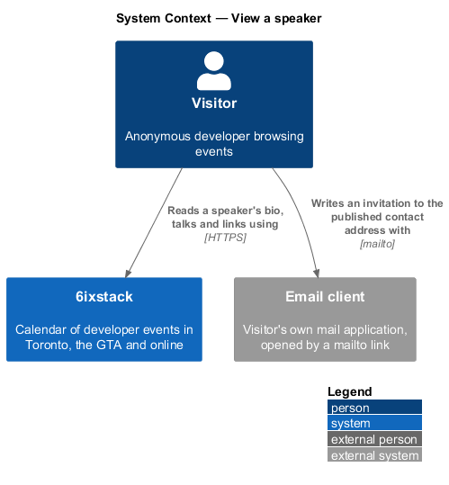
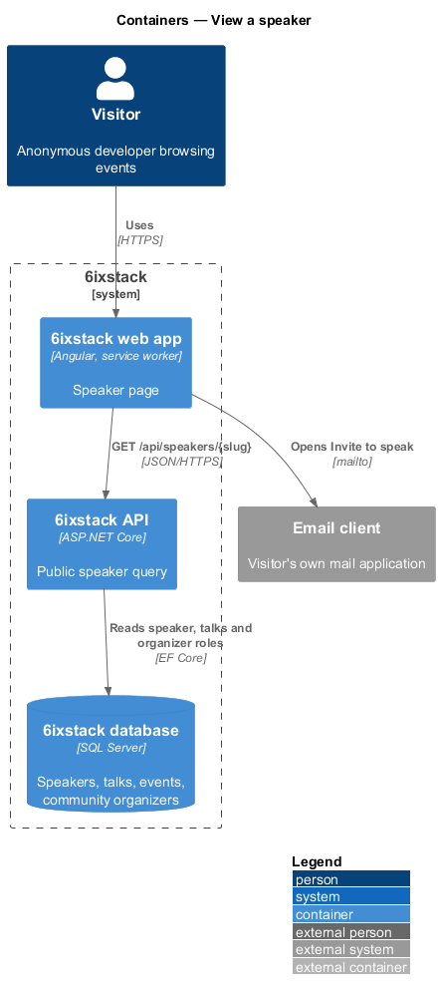
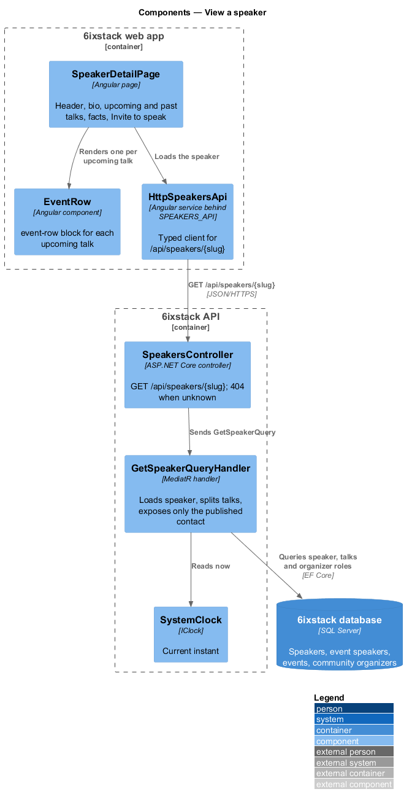
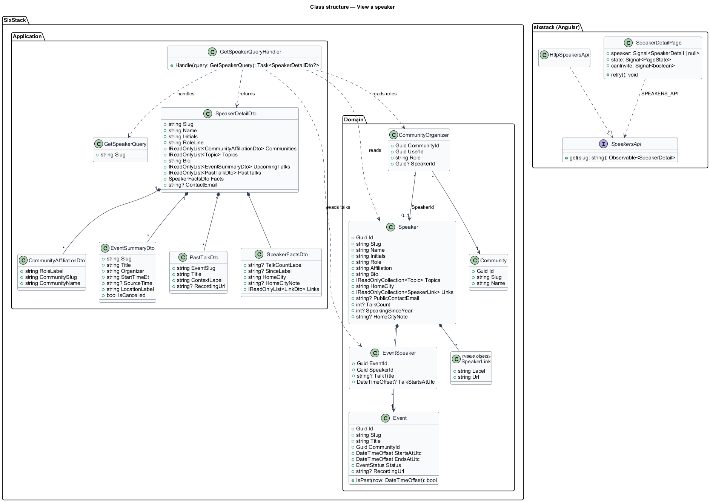
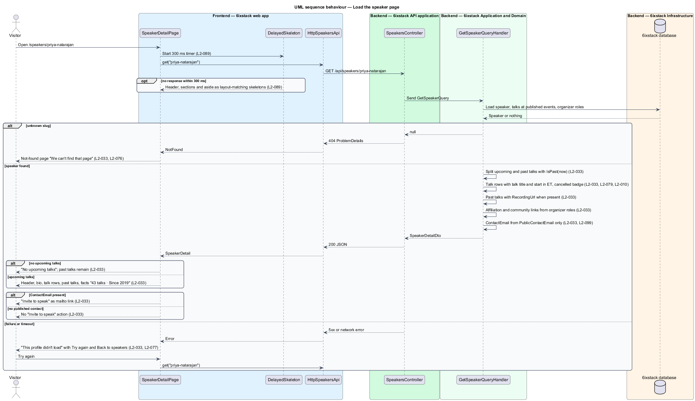

# View a speaker

## Overview

6ixstack is a calendar of developer events in Toronto, the Greater Toronto Area
(GTA) and online. Listed events name the people who present at them. The
speaker page at `/speakers/{id}` tells a visitor who one speaker is, what they
talk about, where they speak next and what they have presented before. It also
gives organizers a way to invite the speaker when the speaker has chosen to
publish a contact address. This feature covers that page: the header, the bio,
Upcoming talks, Past talks, the facts panel, "Invite to speak", and the
loading, empty, error and not-found states drawn in
`docs/mocks/pages/speaker-detail/`.

The feature belongs to the `directory` subsystem. Visitors reach it from a card
in the speakers directory (`directory/browse-speakers`), from the Speakers
section of an event page (`discovery/view-event-detail`) and from the organizer
list of a community page (`directory/view-community`).

Terms used in this design:

- **speaker** — person who presents at one or more listed events
- **speaker slug** — URL-safe identifier of a speaker, used as the `{id}` segment of `/speakers/{id}`
- **talk** — one speaker's session at one event, with its own title and optional start time
- **upcoming talk** — talk at a published event whose start has not passed
- **past talk** — talk at a published event whose end has passed
- **affiliation** — speaker's employer or organization, plus the community the speaker helps run, linked to its page
- **published contact address** — email address a speaker has chosen to make public, the only personal email 6ixstack exposes

The page is public and read-only. Every time is shown in Toronto time (ET), as
described in `platform/time-zones`.

## Description

The slice runs from the Angular page to the database through one read-only query.

- **`SpeakerDetailPage`** (`sx-speaker-detail-page`) — Angular page in project
  `sixstack`, at `frontend/projects/sixstack/src/app/pages/speaker-detail/`,
  routed at `/speakers/:id`. It renders the "All speakers" back link, the
  `DetailHero` (initials avatar, name as `h1`, role and affiliation line with
  the community link, topic tags), the About section with the bio, the Upcoming
  talks section as `EventRow` items, and the Past talks list. Its aside holds
  the `Facts` panel and, when present, the "Invite to speak" button. It owns
  the loading, empty, error and not-found states.
- **`DetailHero`**, **`Facts`**, **`EventRow`**, **`Avatar`**, **`TopicTag`**,
  **`EmptyState`**, **`Skeleton`** — library components in project
  `components` that keep the mock's BEM blocks (`detail-hero`, `facts`,
  `event-row`, `avatar`, `empty`). `EventRow` shows the "Cancelled" badge for a
  talk at a cancelled event (`L2-010`).
- **`DelayedSkeleton`** — shared helper that shows the skeleton layout only when
  the request is still pending after 300 ms (`L2-089`).
- **`SpeakersApi`** / **`SPEAKERS_API`** / **`HttpSpeakersApi`** — the API
  client contract, its injection token and its HTTP implementation in project
  `api`. This slice adds `get(slug)` to the contract.
- **`SpeakersController`** — ASP.NET Core controller exposing
  `GET /api/speakers/{slug}` for anonymous callers. It maps a missing speaker to
  a 404 problem response. It holds no business rules.
- **`GetSpeakerQuery`** — query carrying the speaker `Slug`.
- **`GetSpeakerQueryHandler`** — MediatR handler. It loads the speaker, the
  speaker's talks at published events, and any community the speaker
  organizes. It splits the talks into upcoming and past against the current
  instant. It orders upcoming talks by start and past talks from most recent.
  It returns `null` when no speaker has the slug.
- **`SpeakerDetailDto`** — response contract carrying `Slug`, `Name`,
  `Initials`, `RoleLine` ("Azure MVP · Cloud architect at Rogers"),
  `Communities` (`CommunityAffiliationDto`: `RoleLabel`, `CommunitySlug`,
  `CommunityName`, rendered as "Lead organizer of GTA Azure Community"),
  `Topics`, `Bio`, `UpcomingTalks` (`IReadOnlyList<EventSummaryDto>`, shared
  with `discovery/browse-events`), `PastTalks` (`IReadOnlyList<PastTalkDto>`),
  `Facts` (`SpeakerFactsDto`) and `ContactEmail`.
- **`EventSummaryDto`** — for a talk, `Title` holds the talk title ("Keynote:
  Fabric one year later"), `Organizer` holds the event and community ("Azure
  Data & AI Day GTA · GTA Azure Community"), and `StartTimeEt` holds the talk
  start ("9:30 AM").
- **`PastTalkDto`** — `EventSlug`, `Title`, `ContextLabel` ("GTA Azure Community
  · Oct 21, 2026") and `RecordingUrl`. The page shows "Recording" only when
  `RecordingUrl` is present (`L2-033`).
- **`SpeakerFactsDto`** — `TalkCountLabel` ("43 talks"), `SinceLabel`
  ("Since 2019"), `HomeCity` ("Mississauga"), `HomeCityNote` ("Speaks in person
  across the GTA") and `Links` (label and `https://` URL pairs such as
  priya.dev, LinkedIn, GitHub).
- **`Speaker`** — domain entity. This slice reads `Slug`, `Name`, `Initials`,
  `Role`, `Affiliation`, `Bio`, `Topics`, `HomeCity`, `Links` and
  `PublicContactEmail`. It adds `int? TalkCount`, `int? SpeakingSinceYear` and
  `string? HomeCityNote`.
- **`EventSpeaker`** — join entity of event and speaker, with `TalkTitle` and
  `TalkStartsAtUtc` (introduced in `directory/browse-speakers`).
- **`CommunityOrganizer`** — join entity of community and user, with `Role` and
  `SpeakerId` (introduced in `directory/view-community`). The handler reads it
  to build `Communities`.
- **`Event`** — domain entity. This slice reads `Status`, `StartsAtUtc`,
  `EndsAtUtc`, `RecordingUrl`, `Format`, `Venue`, `Price`, `GoingCount` and
  `IsSoldOut`, and calls `IsPast(now)`.
- **`SystemClock`** (`IClock`) — supplies the current instant so tests can fix
  "today" at Monday, November 2, 2026.

The "Invite to speak" action is a `mailto:` link to `ContactEmail`. The handler
sets `ContactEmail` from `PublicContactEmail` only. When the speaker has not
published a contact address, the field is `null` and the page renders no
"Invite to speak" action anywhere (`L2-033`). No other email of the speaker
appears in the response (`L2-099`).

The page chooses its state from the response:

| Condition | State |
|-----------|-------|
| 200 with upcoming talks | Header, About, Upcoming talks as event rows, Past talks, facts, optional Invite to speak |
| 200 with no upcoming talks | Upcoming section shows "No upcoming talks" and "{First name} isn't scheduled to speak anywhere right now."; Past talks remain |
| 404 | Not-found page "We can't find that page" from `site/status-pages` |
| Failure or timeout | "This profile didn't load" as `h1` with "Try again" and "Back to speakers"; back link kept |
| Pending after 300 ms | Header, sections and aside as skeletons matching the loaded layout |

The bio is plain text encoded on output (`L2-081`). Public links accept
`https://` URLs only (`L2-081`).

Open points, not decided by the requirements or the mocks:

- The source of "43 talks · Since 2019" is `<TO SUPPLY>`. 6ixstack started in
  2025, so a count derived from listed talks cannot reach back to 2019. The
  design therefore stores `TalkCount` and `SpeakingSinceYear`. Who maintains
  them is `<TO SUPPLY>`.
- The meaning of "affiliation linked to their community" is `<TO SUPPLY>`. The
  design links each community the speaker organizes through
  `CommunityOrganizer.SpeakerId`. Whether a speaker who is not an organizer
  also links to a community is not stated.
- The target of the "Recording" link is `<TO SUPPLY>`. `L2-033` names a
  recording, while the mock links each past talk to the past event's detail
  page.
- The date shown on each upcoming talk row is `<TO SUPPLY>`. The mock row shows
  only the start time, while `L2-033` expects "9:30 AM on November 5".
- The pronoun in the empty-state copy ("Organizers can invite her directly")
  has no source in the domain model. It is `<TO SUPPLY>`.
- The source of `HomeCityNote` is `<TO SUPPLY>`.
- The number of past talks listed, and any paging, is `<TO SUPPLY>`. The mock
  shows three.
- How the not-found page is served with HTTP status 404 is `<TO SUPPLY>`. The
  API returns 404. An Angular single-page app cannot set the HTTP status of the
  HTML document without server-side rendering or a server route check.

## Requirements

| L2 ID | Refines (L1) | Requirement |
|-------|--------------|-------------|
| `L2-033` | `L1-006` | The speaker page (`/speakers/{id}`) shall show the speaker's name, role, affiliation linked to their community, topics, bio, upcoming talks as event rows, past talks with Recording links when available, a facts panel (talk count since year, home city, public links) and "Invite to speak" only when the speaker has published a contact address. |

The slice also applies these cross-cutting requirements, specified in their own
designs: event row badges (`L2-010`), status pages (`L2-076`), inline failure
handling (`L2-077`), time zone display (`L2-079`), input validation and output
encoding (`L2-081`), delayed skeletons (`L2-089`) and protection of contact
details (`L2-099`).

## Diagrams

### System context

A visitor reads a speaker's page in 6ixstack. When the speaker has published a
contact address, "Invite to speak" opens the visitor's own email client.

### Containers

The web app calls `GET /api/speakers/{slug}` on the API. The API reads the
speaker, the speaker's talks and organizer roles from the SQL Server database
through EF Core.

### Components

`SpeakerDetailPage` loads the speaker through `HttpSpeakersApi`. In the API,
`SpeakersController` sends `GetSpeakerQuery` to its handler. The handler reads
"now" from `SystemClock` to split upcoming from past talks.

### Class structure

`GetSpeakerQueryHandler` reads `Speaker`, `EventSpeaker`, `Event` and
`CommunityOrganizer` and returns a `SpeakerDetailDto`. That DTO is composed of
affiliations, talk rows, past talks and facts. On the client,
`SpeakerDetailPage` depends on the `SpeakersApi` contract through the
`SPEAKERS_API` token.

### Behaviour — load the speaker page

The handler returns `null` for an unknown slug, and the controller maps it to
404. A found speaker splits into upcoming and past talks against the current
instant. "Invite to speak" appears only when `ContactEmail` is present. A
failure shows "This profile didn't load" with a retry.

