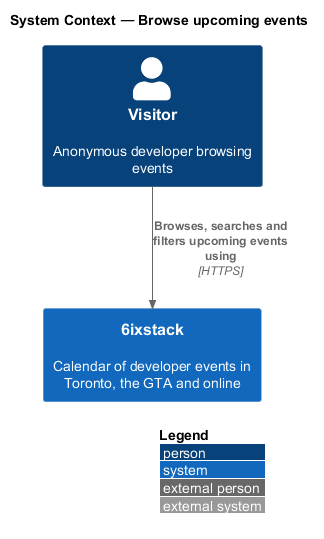
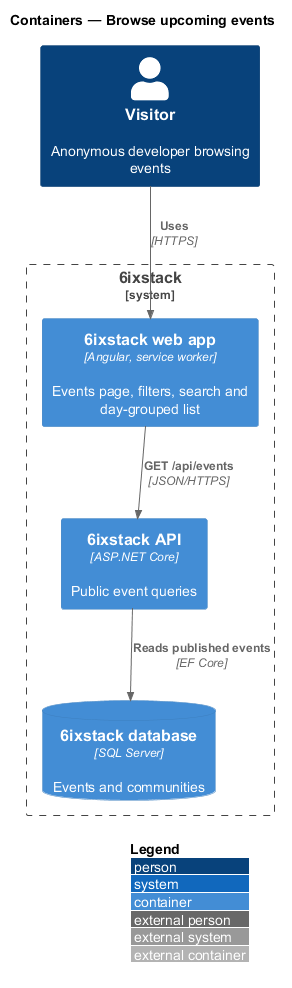
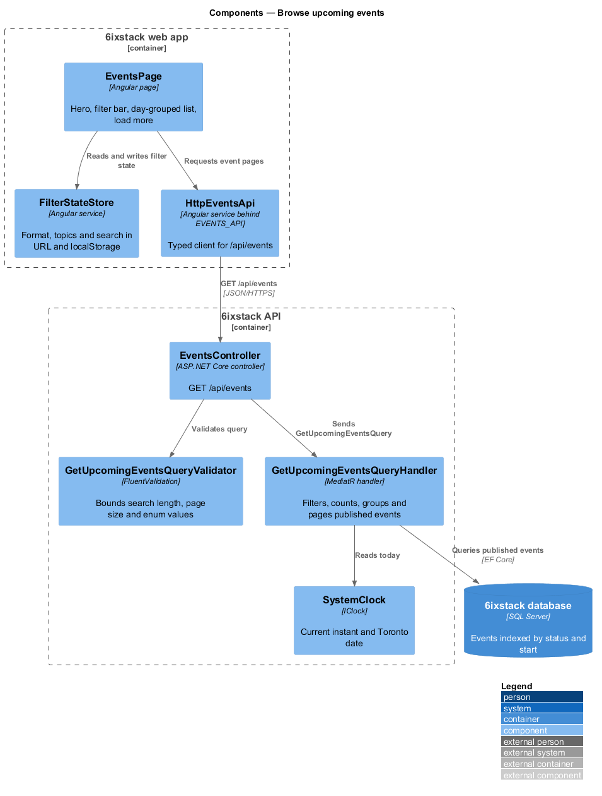
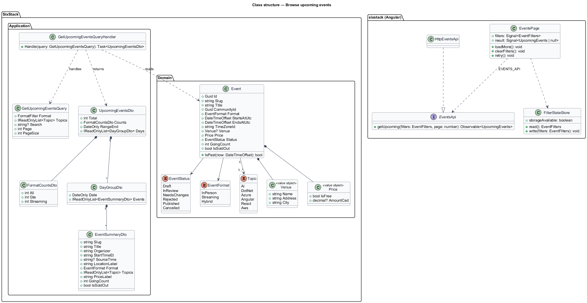
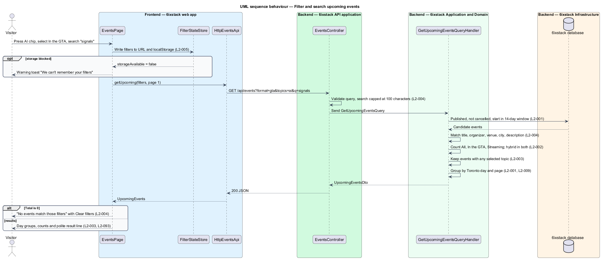
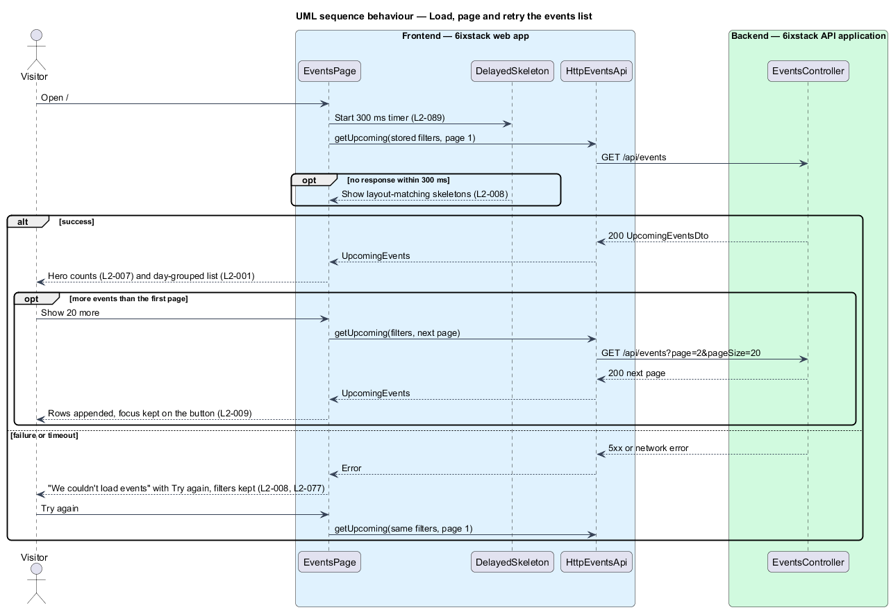

# Browse upcoming events

## Overview

6ixstack is a calendar of developer events in Toronto, the Greater Toronto Area
(GTA) and online. The events page at `/` is its home page and the main way a
visitor finds something to attend. This feature covers the list on that page:
the day-grouped events, the counts, the format switch, the topic chips, the
search box, paging beyond the first screen, and the loading, empty, error and
no-results states drawn in `docs/mocks/pages/events/`.

The feature belongs to the `discovery` subsystem. The featured event card
(`discovery/featured-event`) and the map beside the list (`discovery/event-map`)
are separate slices that read the same filter state.

Terms used in this design:

- **published event** — event a moderator approved, whether upcoming, past or cancelled
- **upcoming window** — 14 calendar days starting today in Toronto time
- **GTA event** — event whose format is in person or hybrid
- **streamable event** — event whose format is streaming or hybrid
- **day group** — set of events that start on the same Toronto calendar day, shown under one heading
- **filter state** — format, selected topics and search text that together narrow the list

The list shows only published, non-cancelled events whose start falls in the
upcoming window. Cancelled events appear only on other lists, with a badge.
Every time is shown in Toronto time (ET). A streamed event hosted elsewhere also
shows its source time, as described in `platform/time-zones`.

## Description

The slice runs from the Angular page to the database through one read-only query.

- **`EventsPage`** (`sx-events-page`) — Angular page in project `sixstack`. It
  renders the hero counts, the filter bar (`SegmentedControl`, `TopicChip`,
  search field), the result line in a polite live region, one `DayGroup` per
  day and one `EventRow` per event, and the Show 20 more control. It owns the
  loading, empty, error and no-results states.
- **`FilterStateStore`** — Angular service that mirrors the filter state into
  the URL query string (`format`, `topics`, `q`) and into `localStorage`. When
  storage is blocked it sets `storageAvailable` to `false`. The page then shows
  the warning toast from `site/toasts-and-banners` once. Unknown values in the
  URL are ignored.
- **`EventsApi`** / **`EVENTS_API`** / **`HttpEventsApi`** — the API client
  contract, its injection token and its HTTP implementation in project `api`.
  The page depends on the token only.
- **`DelayedSkeleton`** — shared helper that shows skeletons only when a request
  is still pending after 300 ms.
- **`EventsController`** — ASP.NET Core controller exposing `GET /api/events`
  for anonymous callers. It validates the query and dispatches it. It holds no
  business rules.
- **`GetUpcomingEventsQuery`** — query carrying `Format` (`All`, `Gta`,
  `Streaming`), `Topics`, `Search`, `Page` and `PageSize`.
- **`GetUpcomingEventsQueryValidator`** — truncates `Search` to 100 characters
  and limits `PageSize` to 50. It also rejects unknown enum values with a 400
  problem response.
- **`GetUpcomingEventsQueryHandler`** — MediatR handler. It selects published,
  non-cancelled events, applies the search and the topic filter, and computes
  the three format counts before applying the format filter. It then groups the
  events by Toronto calendar day and returns one page. The first page covers the
  upcoming window. Later pages continue through future events in pages of 20.
- **`UpcomingEventsDto`**, **`FormatCountsDto`**, **`DayGroupDto`**,
  **`EventSummaryDto`** — response contracts. `EventSummaryDto` carries display
  labels such as `StartTimeEt`, `SourceTime`, `LocationLabel` and `PriceLabel`.
  The Angular row therefore holds no formatting rules.
- **`Event`** — domain entity. This slice reads `Status`, `StartsAtUtc`,
  `Format`, `Topics`, `Venue`, `Price`, `GoingCount` and `IsSoldOut` from it.
- **`SystemClock`** (`IClock`) — supplies the current instant so tests can fix
  "today" at Monday, November 2, 2026.

The search runs in the database against title, organizer name, venue, city and
description. It uses case-insensitive `LIKE` matching. The `Events` table has an
index on `(Status, StartsAtUtc)` to meet the latency target in `L2-087`. A
full-text index is `<TO SUPPLY>` if the catalogue outgrows this approach.

## Requirements

| L2 ID | Refines (L1) | Requirement |
|-------|--------------|-------------|
| `L2-001` | `L1-001` | The events page (`/`) shall list every published, non-cancelled event in the upcoming window in chronological order, grouped under one heading per day ("Thursday November 5"), with a result line stating the count and "times in ET". |
| `L2-002` | `L1-001` | The events page shall offer a single-select format switch with the options All, In the GTA and Streaming, each showing the number of events that match the current search and topic filters; hybrid events count toward both In the GTA and Streaming. |
| `L2-003` | `L1-001` | The events page shall offer one toggle chip per topic; selecting one or more chips shall show only events tagged with at least one selected topic, and a "Clear filters" action shall reset topics, format and search. |
| `L2-004` | `L1-001` | The events page shall provide a search box ("Search talks, groups, or neighbourhoods") that matches, case-insensitively, against event title, organizer name, venue, city and description, combined with the format and topic filters. |
| `L2-005` | `L1-001` | The events, calendar, communities and speakers pages shall reflect search and filter state in the URL query string, and the events page shall remember the last topic and format selection in browser storage. |
| `L2-007` | `L1-001` | The events page hero shall state the number of GTA events and streamable events in the upcoming window. |
| `L2-008` | `L1-001` | The events page shall render a loading state, an empty state and an error state that keep the hero, filters and map frame in place. |
| `L2-009` | `L1-001` | The events page shall let a visitor load further upcoming events beyond the first page in pages of 20, stating how many are shown out of the total. |
| `L2-010` | `L1-001` | Event rows shall show a "Waitlist open" badge for sold-out events and a "Cancelled" badge with cancelled styling for cancelled events, and shall wrap long titles, organizers and venues without horizontal overflow. |

## Diagrams

### System context

A visitor browses, searches and filters upcoming events in 6ixstack. No sign-in
and no external system takes part in this slice.

### Containers

The web app calls `GET /api/events` on the API. The API reads published events
from the SQL Server database through EF Core.

### Components

`EventsPage` keeps the filter state in `FilterStateStore` and requests pages
through `HttpEventsApi`. In the API, `EventsController` validates the query and
sends it to `GetUpcomingEventsQueryHandler`. The handler reads "today" from
`SystemClock`.

### Class structure

The handler reads `Event` entities and returns an `UpcomingEventsDto`. That DTO
is composed of format counts and day groups of event summaries. On the client,
`EventsPage` depends on the `EventsApi` contract through the `EVENTS_API` token.

### Behaviour — filter and search

A filter change writes the state to the URL and storage first. It then requests
page 1. The handler applies `L2-001`, `L2-002`, `L2-003` and `L2-004` in a fixed
order: the window, then the search, then the counts, then the topic and format
filters. As a result, the counts always describe the current search and topics.

### Behaviour — load, page and retry

Skeletons appear only when the response takes longer than 300 ms. A failure
keeps the filters and offers Try again. Show 20 more appends the next page and
keeps focus on the button.

