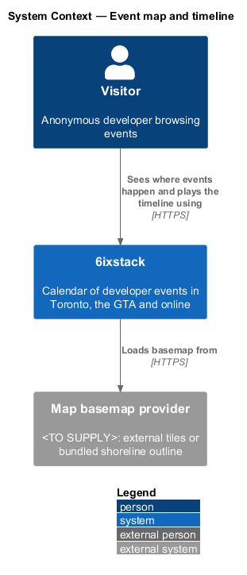
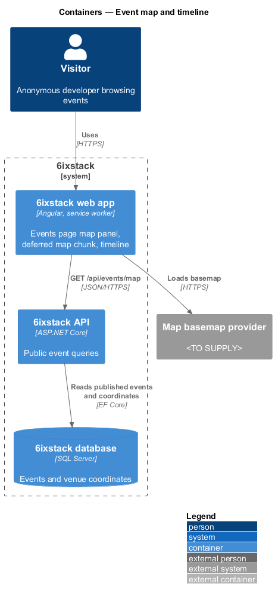
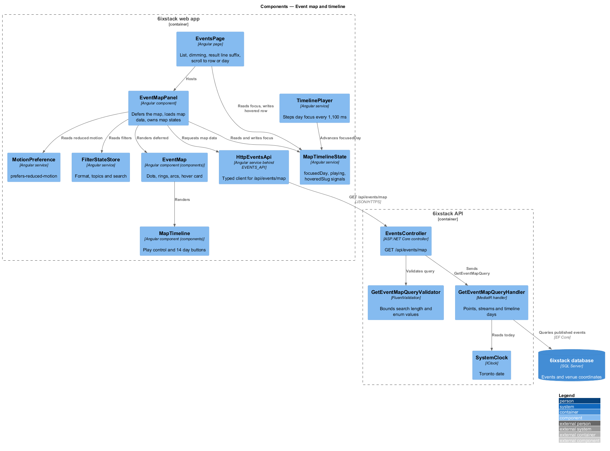
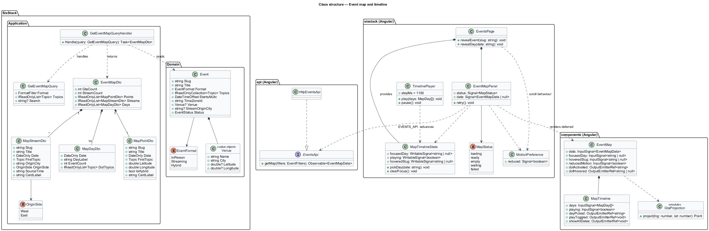
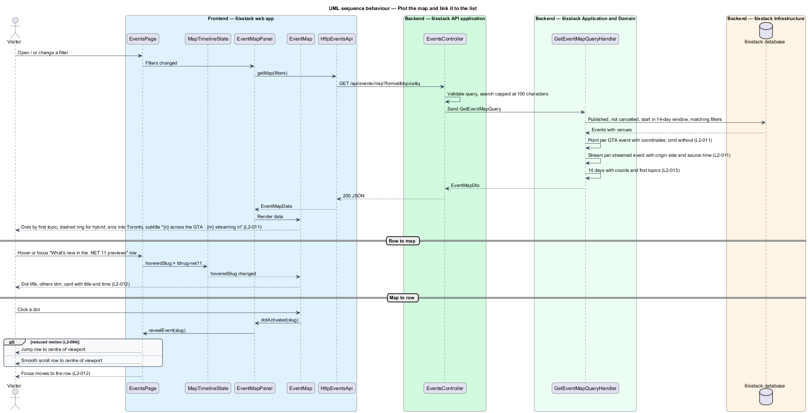
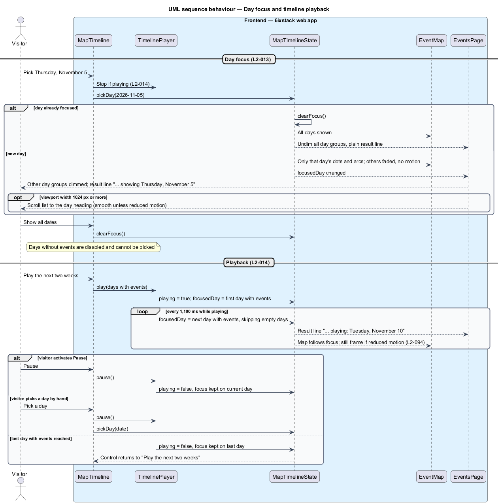
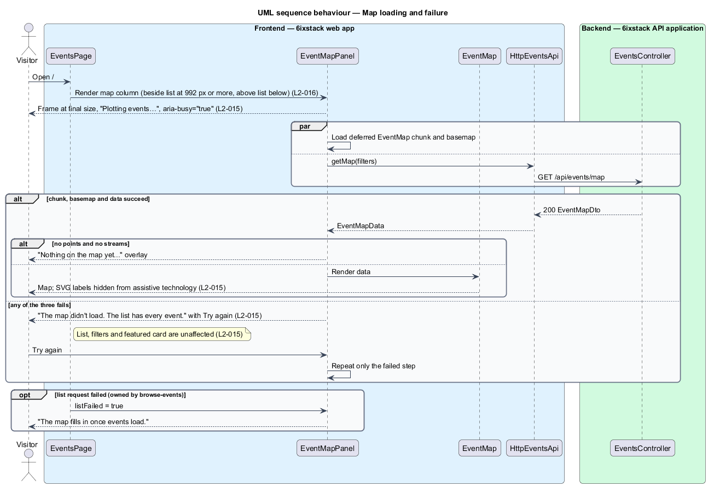

# Event map and timeline

## Overview

6ixstack is a calendar of developer events in Toronto, the Greater Toronto Area
(GTA) and online. Beside the day-grouped list on the events page (`/`) sits a
map titled "Where it's happening". The map shows where the listed events take
place across the GTA and where streamed events come from. Under the map, a
timeline of the next 14 days lets a visitor focus on one day or play through
the fortnight. This feature covers the map, its link to the list, the timeline,
playback, its failure and loading states, and its placement at each viewport
width. The states are drawn in `docs/mocks/pages/events/` (`default`, `hover`,
`day-focus`, `playing`, `loading`, `partial`).

The feature belongs to the `discovery` subsystem. It reads the filter state
owned by `discovery/browse-events` and plots the same result set the list shows.
The map is a visual aid only: the list remains the accessible route to every
event, and a map failure never affects the list, the filters or the featured
event (`discovery/featured-event`).

Terms used in this design:

- **venue dot** — circle drawn at a GTA event's venue coordinates, coloured by the event's first topic
- **hybrid ring** — dashed ring drawn around the venue dot of a hybrid event
- **stream arc** — curve drawn from a streamed event's origin city to downtown Toronto
- **origin city** — city where a streamed event is hosted
- **map timeline** — row of 14 day buttons under the map, one per day of the upcoming window
- **day focus** — state in which one timeline day is selected and the map and list narrow their emphasis to it
- **playback** — automatic stepping of the day focus through each day that has events

The upcoming window, GTA event and streamable event carry the meanings defined
in `docs/specs/L2.md`.

## Description

The slice runs from an Angular panel on the events page to the database through
one read-only query. The map loads separately from the list: its code is a
deferred chunk, and its data comes from its own endpoint.

### Frontend

- **`EventsPage`** (`sx-events-page`) — Angular page described in
  `discovery/browse-events`. In this slice it provides `MapTimelineState`,
  hosts `EventMapPanel` in the map column, dims day groups outside the focused
  day, appends "showing Thursday, November 5" or "playing: Tuesday, November
  10" to the result line, and scrolls the list. It places the map column
  beside the list and sticky at viewport widths of 992 px and above, and above
  the list at full width below 992 px (`L2-016`, `L2-095`).
- **`EventMapPanel`** (`sx-event-map-panel`) — Angular component in project
  `sixstack`. It reads the filter state from `FilterStateStore`, requests map
  data through `EVENTS_API`, and loads `EventMap` with an `@defer` block. It
  owns the map states: `loading` ("Plotting events…" with `aria-busy="true"`),
  `ready`, `waiting` (the list failed; "The map fills in once events load."),
  `empty` ("Nothing on the map yet. New events appear here as soon as they're
  approved.") and `failed` ("The map didn't load. The list has every event."
  with "Try again"). A failure of the chunk, the basemap or the map request
  sets `failed`. Try again repeats only the failed step. The panel keeps its
  final size in every state so nothing shifts (`L2-089`).
- **`EventMap`** (`sx-event-map`) — presentational component in project
  `components`, keeping the mock's BEM block `event-map`. It draws the
  basemap, the city labels, venue dots, hybrid rings, stream arcs with origin
  labels ("Redmond · 9:00 AM PT"), the title, the subtitle ("{n} across the GTA
  · {m} streaming in"), the legend (In person, Hybrid, Streaming in) and the
  hover card (title and "Thu Nov 5 · 9:00 AM"). It nudges overlapping dots
  11 px apart. The SVG has `role="img"` and a summary `aria-label`; all labels
  inside it are `aria-hidden` (`L2-015`). It emits `dotActivated(slug)` and
  `dotHovered(slug | null)`.
- **`MapTimeline`** (`sx-map-timeline`) — component in project `components`
  rendered by `EventMap`. It shows the Play control ("Play the next two weeks",
  `aria-pressed`), "Show all dates" while a day is focused, and one toggle
  button per day in a group labelled "Choose a day". Each day has an
  `aria-label` such as "Thursday, November 5: 3 events" and up to 4 topic
  dots. Days without events are disabled (`L2-013`).
- **`GtaProjection`** — pure function module in project `components`. It
  projects longitude and latitude onto the 480 × 560 map canvas with the
  cosine-of-latitude scaling used by the mock.
- **`MapTimelineState`** — Angular service provided by `EventsPage`. It holds
  `focusedDay`, `playing` and `hoveredSlug` as signals. `EventsPage`,
  `EventMapPanel` and `TimelinePlayer` share it, which keeps the list and the
  map in step.
- **`TimelinePlayer`** — Angular service. It steps `focusedDay` through the
  days with events every 1,100 ms, skips days without events, and stops on the
  last such day. Pause, a manual day pick, a filter change or leaving the page
  stops it (`L2-014`).
- **`MotionPreference`** — Angular service that reads
  `prefers-reduced-motion: reduce`. With reduced motion, `EventMap` shows a
  still frame (no comets on arcs, no ripples on dots, no animated transitions),
  and scrolling jumps instead of gliding (`L2-012`, `L2-094`).
- **`EventsApi`** / **`EVENTS_API`** / **`HttpEventsApi`** — the API client
  contract, its injection token and its HTTP implementation in project `api`.
  This slice adds `getMap(filters)`.

Linking between list and map (`L2-012`):

1. Hovering or focusing an `EventRow` sets `hoveredSlug`. The matching dot or
   arc lifts, the rest dims, and the hover card appears.
2. Activating a dot calls `EventsPage.revealEvent(slug)`. The page scrolls the
   row to the centre of the viewport and moves keyboard focus to it.
3. Picking a day sets `focusedDay`. The map hides motion and fades events on
   other days, and the list dims other day groups. At 1,024 px and above, the
   page scrolls the list to that day's heading. Picking the same day again, or
   "Show all dates", clears the focus (`L2-013`).

### Backend

- **`EventsController`** — ASP.NET Core controller. Its anonymous action
  `GET /api/events/map` takes the same `format`, `topics` and `q` parameters
  as `GET /api/events`, dispatches the query and returns `200` with an
  `EventMapDto`. It holds no business rules. This endpoint is an addition to
  the shared route list.
- **`GetEventMapQuery`** — query carrying `Format`, `Topics` and `Search`.
- **`GetEventMapQueryValidator`** — applies the same bounds as
  `GetUpcomingEventsQueryValidator`: search truncated to 100 characters and
  unknown enum values rejected with a `400` problem response.
- **`GetEventMapQueryHandler`** — MediatR handler. It selects the same events
  the first list page shows: published, not cancelled, starting in the upcoming
  window, matching the search, topic and format filters. It returns a
  `MapPointDto` for each GTA event whose venue has coordinates, a
  `MapStreamDto` for each streamed event, and one `MapDayDto` for each of the
  14 days of the window with its event count and the first topic of up to 4
  events. A GTA event without coordinates is left off the map but stays in the
  list (`L2-011`).
- **`EventMapDto`**, **`MapPointDto`**, **`MapStreamDto`**, **`MapDayDto`** —
  response contracts. Points and streams carry `Slug`, `Title`, `Date`,
  `FirstTopic` and the hover-card label, so the client holds no formatting
  rules. `MapPointDto` adds `Latitude`, `Longitude` and `IsHybrid`.
  `MapStreamDto` adds `OriginCity`, `OriginSide` (`West` or `East`) and
  `SourceTime`.
- **`Event`** and **`Venue`** — domain types. This slice reads `Status`,
  `StartsAtUtc`, `Format`, `Topics`, `TimeZoneId`, `StreamOriginCity` and the
  venue's `Latitude` and `Longitude`. Venue coordinates come from geocoding at
  submission (`moderation/automated-checks`).
- **`SystemClock`** (`IClock`) — supplies "today" in Toronto time.

Open points:

- The basemap source is `<TO SUPPLY>`. The mock draws a dotted land and lake
  pattern from a bundled shoreline outline; an external map basemap provider
  would add a third failure source to the `failed` state.
- `L2-011` draws arcs for streaming-only events; hybrid events appear as
  ringed dots at their venue, as in the mock.
- The source of an origin city's position is `<TO SUPPLY>`. `Event` stores
  `StreamOriginCity` as text, and the submit form (`L2-041`) does not collect
  it. The design derives `OriginSide` from the event's time zone offset against
  Toronto; a geocoded origin would replace that.
- The order that defines an event's "first topic" is `<TO SUPPLY>`: the order
  the organizer picked or the fixed topic order (AI, .NET, Azure, Angular,
  React, AWS).
- Whether Play starts from the first day with events or from the focused day
  is `<TO SUPPLY>`. The design starts from the first day with events.

## Requirements

| L2 ID | Refines (L1) | Requirement |
|-------|--------------|-------------|
| `L2-011` | `L1-002` | The events page shall show a "Where it's happening" map that plots each GTA event in the current result set as a dot coloured by its first topic at its venue coordinates, marks hybrid events with a dashed ring, and draws each streaming-only event as an arc from its origin city to Toronto. |
| `L2-012` | `L1-002` | Hovering or focusing an event row shall highlight its dot and show its card on the map; activating a dot shall scroll the list to that event, centred, and move keyboard focus to its row. |
| `L2-013` | `L1-002` | A timeline under the map shall show each day of the upcoming window; choosing a day with events shall filter the map to that day, dim the other days in the list and, at viewport widths of 1024 px and above, scroll the list to that day. |
| `L2-014` | `L1-002` | A "Play the next two weeks" control shall step the day focus through each day with events every 1.1 s, skipping days without events, and stop on the last such day. |
| `L2-015` | `L1-002` | The map shall load independently of the list; a map failure shall not affect the list, filters or featured event. |
| `L2-016` | `L1-002` | The map shall sit beside the list and stay sticky while the list scrolls at viewport widths of 992 px and above, and shall sit above the list at narrower widths. |

## Diagrams

### System context

A visitor sees where events happen and plays through the next two weeks. The
basemap may come from an external map basemap provider; that choice is
`<TO SUPPLY>`.

### Containers

The web app calls `GET /api/events/map` separately from the list request. The
API reads published events and venue coordinates from the SQL Server database.

### Components

`EventMapPanel` loads the deferred `EventMap` and its data. `MapTimelineState`
links the map, the timeline, `TimelinePlayer` and `EventsPage`. In the API,
`EventsController` validates the query and sends it to
`GetEventMapQueryHandler`.

### Class structure

The handler reads `Event` and `Venue` and returns an `EventMapDto` composed of
points, streams and 14 days. On the client, the shared `MapTimelineState`
signals connect the page, the panel and the player.

### Behaviour — plot the map and link it to the list

The panel requests map data with the current filters and plots dots, rings and
arcs under `L2-011`. Hovering a row highlights its dot, and activating a dot
centres and focuses its row under `L2-012`.

### Behaviour — day focus and playback

Picking a day narrows the map, dims other day groups and, at 1,024 px and
above, scrolls the list (`L2-013`). Playback steps the focus every 1,100 ms and
stops on Pause, on a manual pick or on the last day with events (`L2-014`).

### Behaviour — map loading and failure

The panel shows "Plotting events…" while loading. A failure of the chunk, the
basemap or the request switches only the panel to its failed state; the list,
filters and featured card are untouched (`L2-015`).

## Decisions (journey 16)

- **Basemap**: the bundled shoreline and city labels from the mock, drawn in the SVG, so no external provider can
  fail. The panel's failure states are the map request and the deferred chunk.
- **City labels** are centred on the city unless that would cross the 480-unit canvas edge; then they anchor 14
  units inside it (`text-anchor` end or start), so Scarborough never clips (`L2-011`).
- **Stream origins**: `Event.StreamOriginCity` (new, seeded for the streaming communities) labels the arc. The side
  comes from the source time zone's offset against Toronto at the event's start, west when behind. A stream without
  an origin city is labelled "Online".
- **First topic** follows the fixed topic order (AI, .NET, Azure, Angular, React, AWS).
- **Play** starts from the first day with events, holds the last day for one step, then stops there. A filter change
  stops playback and clears the focused day.
- **`MapTimeline` is part of `EventMap`**: the timeline is the bottom of the same panel, with no separate component.
- **Interactions**: dots and arcs respond to the pointer only. The basemap and its labels ignore the pointer, so the
  timeline under the canvas stays clickable.
- **Event detail**: the Venue section shows `EventMap` compact with the venue as a single highlighted dot and its
  card ("Thu Nov 5 · 9:00 AM"), when the venue has coordinates. `VenueFactDto` gains `City`, `Latitude` and
  `Longitude`.
- **Reduced motion**: comets and ripples are replaced by a still frame. Visual tests use it, so screenshots are
  stable.

