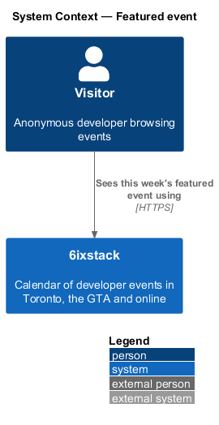
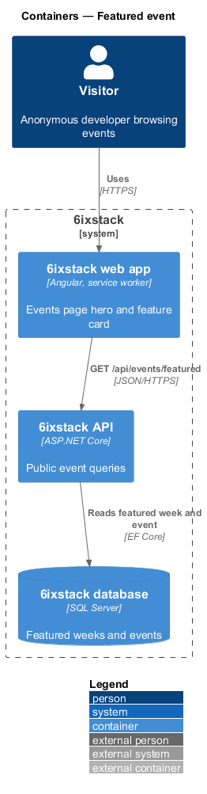
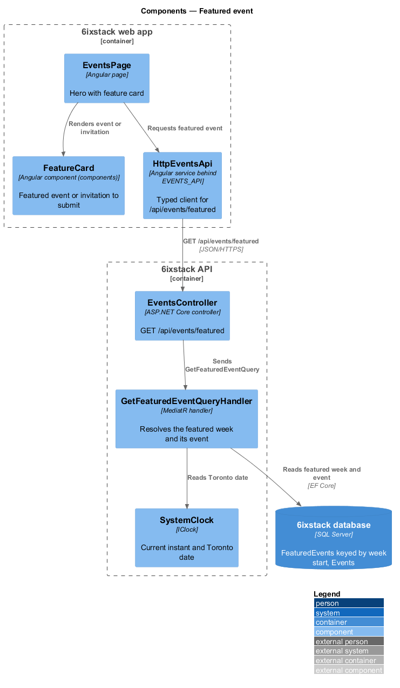
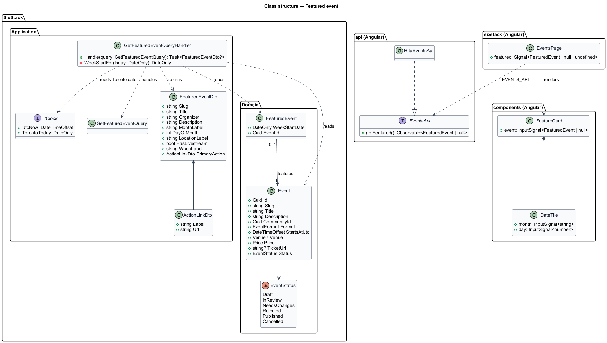
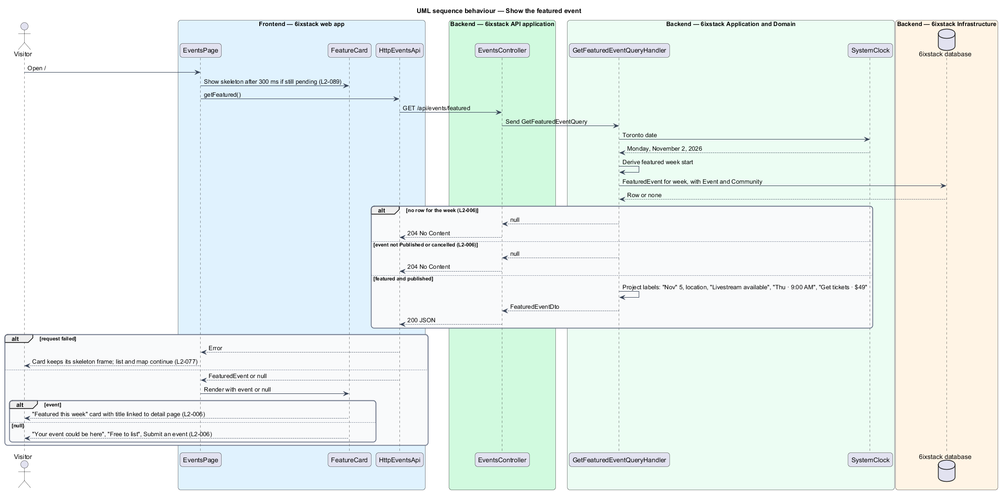

# Featured event

## Overview

6ixstack is a calendar of developer events in Toronto, the Greater Toronto Area
(GTA) and online. The events page at `/` opens with a hero headline. Beside that
headline sits one card that promotes a single event for the current week. This
feature covers that card: what it shows when an event is featured, what it shows
when none is, and how the featured event for a week is chosen at read time.

The feature belongs to the `discovery` subsystem. The day-grouped list, the
counts and the filters on the same page belong to `discovery/browse-events`. The
map beside the list belongs to `discovery/event-map`. The featured card does not
read the filter state, so changing a topic or the format leaves it unchanged.

Terms used in this design:

- **featured event** — published event a moderator selected for promotion during one week
- **featured week** — week, identified by its first date in Toronto time, to which one featured event belongs
- **feature card** — card beside the hero headline labelled "Featured this week"
- **invitation card** — variant of the feature card shown when the current week has no usable featured event

The card shows the featured event only while the event is still published and
not cancelled. A cancelled featured event drops off the card on the next page
load, and the invitation card takes its place. All times on the card are in
Toronto time (ET), as described in `platform/time-zones`.

## Description

The slice runs from the Angular events page to the database through one
read-only query.

- **`EventsPage`** (`sx-events-page`) — Angular page in project `sixstack`,
  described in `discovery/browse-events`. In this slice it requests the featured
  event once per page load and renders the result into the hero. The request is
  independent of the list request, so a slow or failed list does not hold the
  card back.
- **`FeatureCard`** (`sx-feature-card`) — presentational component in project
  `components`. It keeps the mock's BEM block `feature-card`. With an event it
  renders the label "Featured this week", a `DateTile` ("Nov", "5"), the title
  linked to the event detail page, the organizer, the description, the location,
  "Livestream available" when the event streams, the day and start time ("Thu ·
  9:00 AM") and a primary action ("Get tickets · $49"). Without an event it
  renders the invitation card: "Your event could be here", the short pitch,
  "Free to list" and a "Submit an event" link to `/submit`. In the dark theme it
  uses a raised surface instead of the ink fill (`L2-097`).
- **`EventsApi`** / **`EVENTS_API`** / **`HttpEventsApi`** — the API client
  contract, its injection token and its HTTP implementation in project `api`.
  This slice adds `getFeatured()`, which maps a `204 No Content` response to
  `null`.
- **`EventsController`** — ASP.NET Core controller. Its anonymous action
  `GET /api/events/featured` dispatches the query and returns `200` with a
  `FeaturedEventDto` or `204` when nothing is featured. It holds no business
  rules.
- **`GetFeaturedEventQuery`** — query with no parameters. The current week comes
  from the clock, not from the caller.
- **`GetFeaturedEventQueryHandler`** — MediatR handler. It reads the Toronto
  date from `IClock` and derives the featured week from it. It then loads the
  `FeaturedEvent` row for that week together with its `Event`. It returns `null`
  when there is no row, when the event is not `Published`, or when the event is
  cancelled. Otherwise it projects the event into display labels.
- **`FeaturedEventDto`** — response contract: `Slug`, `Title`, `Organizer`,
  `Description`, `MonthLabel`, `DayOfMonth`, `LocationLabel`,
  `HasLivestream`, `WhenLabel` and `PrimaryAction` (`Label`, `Url`). The card
  therefore holds no formatting rules.
- **`FeaturedEvent`** — domain entity with `WeekStartDate` and `EventId`.
  `WeekStartDate` is unique, so each week has at most one featured event.
  Selecting a different event for the same week replaces the row, which makes
  `L2-006` criterion 3 hold by construction.
- **`Event`** — domain entity. This slice reads `Status`, `Slug`, `Title`,
  `Description`, `CommunityId`, `Format`, `StartsAtUtc`, `Venue`, `Price` and
  `TicketUrl`.
- **`SystemClock`** (`IClock`) — supplies the current instant and the Toronto
  date, so tests can fix "today" at Monday, November 2, 2026.

While the events page is loading, the card shows the layout-matching skeleton
owned by `discovery/browse-events` (`L2-008`, `L2-089`). If the featured request
fails, the card keeps its skeleton frame and the rest of the page continues
(`L2-077`).

Open points:

- The first day of a featured week (Monday or Sunday) is `<TO SUPPLY>`.
- No L2 requirement or mock defines how a moderator marks an event as featured.
  The command, endpoint and screen for that action are `<TO SUPPLY>`. The action
  shall record an audit entry for the featured change (`L2-086`).
- In `events/default` the primary action reads "Get tickets · $49" but links to
  the event detail page, not the ticket site. Whether the action opens the
  organizer's ticket page (as `L2-018` does on the detail page) or the detail
  page is `<TO SUPPLY>`. The design returns the target in `PrimaryAction.Url` so
  either choice stays a handler change.
- The primary action label for a free event and for a streaming-only event is
  `<TO SUPPLY>`; `L2-018` uses "Register" for free events on the detail page.
- Whether a featured event whose start has already passed in the current week
  stays on the card is `<TO SUPPLY>`.

## Requirements

| L2 ID | Refines (L1) | Requirement |
|-------|--------------|-------------|
| `L2-006` | `L1-001` | The events page shall show one featured event beside the hero headline, labelled "Featured this week", with date tile, title, organizer, description, location, livestream availability, day and start time, and a primary action; when no event is featured, it shall show an invitation to submit one. |

## Diagrams

### System context

A visitor sees the featured event when opening 6ixstack. No external system
takes part in this slice.

### Containers

The web app calls `GET /api/events/featured` on the API. The API reads the
featured week and its event from the SQL Server database through EF Core.

### Components

`EventsPage` requests the featured event through `HttpEventsApi` and renders it
with `FeatureCard`. In the API, `EventsController` sends the query to
`GetFeaturedEventQueryHandler`, which reads the Toronto date from `SystemClock`.

### Class structure

`FeaturedEvent` references one `Event` per featured week. The handler reads both
and returns a `FeaturedEventDto` or nothing. On the client, `EventsPage` depends
on the `EventsApi` contract through the `EVENTS_API` token and passes the result
to `FeatureCard`.

### Behaviour — show the featured event

The handler resolves the current featured week and applies the `L2-006` rules in
order: a row exists, the event is published, and the event is not cancelled. Any
failed check yields `204`, and the card switches to the invitation variant.

