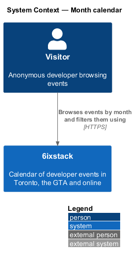
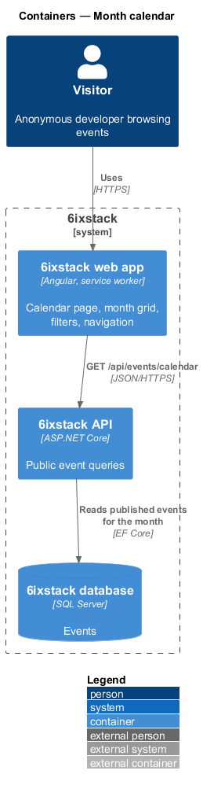
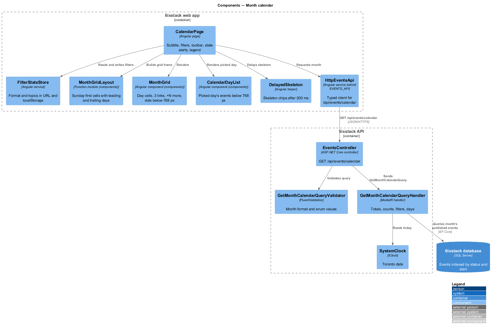
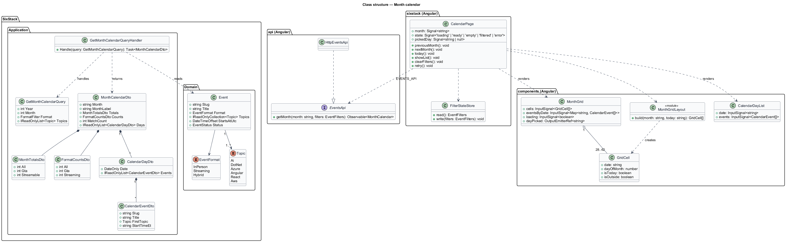
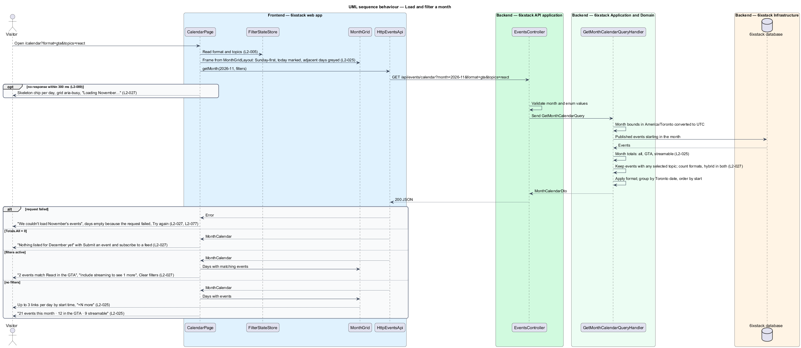
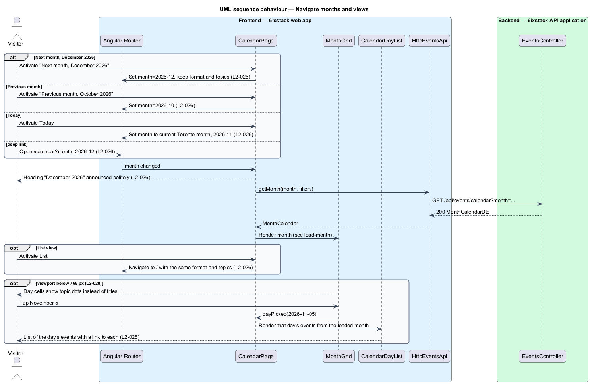

# Month calendar

## Overview

6ixstack is a calendar of developer events in Toronto, the Greater Toronto Area
(GTA) and online. Besides the day-grouped list on the events page, visitors can
see events laid out by month on the calendar page at `/calendar`. The page
shows one month as a grid of days, with up to three event links per day, the
same format and topic filters as the events page, and controls to move between
months. This feature covers the grid, the navigation, the filters, the loading,
empty, error and filtered-results states, and the small-screen layout drawn in
`docs/mocks/pages/calendar/`.

The feature belongs to the `discovery` subsystem. It shares the filter state of
`discovery/browse-events`, so a visitor can switch between the list and the
month view without losing the format or topics. Event links lead to
`discovery/view-event-detail`.

Terms used in this design:

- **visible month** — calendar month the grid currently shows, identified as `YYYY-MM`
- **month grid** — seven-column, Sunday-first table of the days of the visible month plus leading and trailing days
- **leading days** — days of the previous month that fill the first week row before the 1st
- **trailing days** — days of the next month that fill the last week row after the last day
- **day cell** — one square of the month grid
- **overflow count** — "+N more" text shown when a day has more than three events
- **month totals** — counts of all events in the visible month, of GTA events and of streamable events, before filters apply

All dates and times are in Toronto time (ET), including the boundaries of a
month and the "today" marker.

## Description

The slice runs from the Angular calendar page to the database through one
read-only query per visible month and filter combination. The grid frame is
computed on the client, so it renders before the data arrives.

### Frontend

- **`CalendarPage`** (`sx-calendar-page`) — Angular page in project `sixstack`,
  routed at `/calendar`. It renders the title "Calendar", the subtitle, the
  filter bar (`SegmentedControl` for All, In the GTA and Streaming with counts,
  and one `TopicChip` per topic), the toolbar, any state alert, the
  `MonthGrid`, and the topic legend. It reads `month`, `format` and `topics`
  from the URL. A missing `month` means the current Toronto month.
- **Toolbar** — part of `CalendarPage`. It holds the previous and next month
  links with labels such as "Previous month, October 2026" and "Next month,
  December 2026", the month heading in an `aria-live="polite"` region, a
  Today button, and a List / Month view switch (`role="group"`, Month
  `aria-pressed="true"`). List navigates to `/` with the same `format` and
  `topics` (`L2-026`).
- **`FilterStateStore`** — shared Angular service from
  `discovery/browse-events`. It mirrors the format and topics into the URL and
  `localStorage`, so the list and the calendar share one selection
  (`L2-005`).
- **`MonthGrid`** (`sx-month-grid`) — component in project `components`,
  keeping the mock's BEM block `cal`. It renders `role="grid"` with abbreviated
  column headers and one `role="gridcell"` per day. Each in-month cell shows
  the day number, up to 3 event links (topic dot and title) ordered by start
  time, and "+N more" when the day has more. The today cell carries
  `cal__day--today`. Leading and trailing cells carry `cal__day--outside` and
  show only the number. Each cell's `aria-label` states the date, "today" when
  it applies, and the event count or "no events", for example "November 2,
  today, 3 events" (`L2-025`). Below 768 px a CSS media query replaces the
  titles with topic dots and makes each in-month cell with events a button
  that emits `dayPicked(date)` (`L2-028`).
- **`MonthGridLayout`** — pure function module in project `components`. Given
  a month and the Toronto "today", it returns the cells: leading days from
  Sunday, every day of the month, and trailing days to the end of the last
  week.
- **`CalendarDayList`** (`sx-calendar-day-list`) — component in project
  `components`. Below 768 px it shows the picked day's events as a list with a
  link to each event (`L2-028`).
- **`DelayedSkeleton`** — shared helper. When the month request is still
  pending after 300 ms, each in-month cell shows one skeleton chip, the grid
  carries `aria-busy="true"`, and the subtitle reads "Loading November…"
  (`L2-027`, `L2-089`).
- **`EventsApi`** / **`EVENTS_API`** / **`HttpEventsApi`** — the API client
  contract, its injection token and its HTTP implementation in project `api`.
  This slice adds `getMonth(month, filters)`.

The page chooses its state from the response:

| Condition | Subtitle | Alert above the grid |
|-----------|----------|----------------------|
| Loading after 300 ms | "Loading November…" | none; skeleton chips |
| Request failed | "Events unavailable" | danger: "We couldn't load November's events", "The calendar is showing empty days because the request failed, not because nothing is on.", Try again |
| Month totals are 0 | "0 events this month" | info: "Nothing listed for December yet", links to `/submit` and to the subscribe-feed dialog |
| Filters active | "2 of 21 events this month match your filters" | info: "2 events match React in the GTA", "Include streaming to see 1 more", Clear filters |
| No filters | "21 events this month · 12 in the GTA · 9 streamable" | none |

In every state the grid frame, the filters and the navigation stay in place
(`L2-027`, `L2-077`). Format counts show "–" while unavailable.

### Backend

- **`EventsController`** — ASP.NET Core controller. Its anonymous action
  `GET /api/events/calendar?month=YYYY-MM&format&topics` dispatches the query
  and returns `200` with a `MonthCalendarDto`. It holds no business rules.
- **`GetMonthCalendarQuery`** — query carrying `Month` (year and month),
  `Format` (`All`, `Gta`, `Streaming`) and `Topics`.
- **`GetMonthCalendarQueryValidator`** — rejects a malformed `month` and
  unknown enum values with a `400` problem response.
- **`GetMonthCalendarQueryHandler`** — MediatR handler. It converts the first
  and last instants of the month in `America/Toronto` to UTC. It selects
  published events that start in that range and computes the month totals.
  It then applies the topic filter, computes the format counts (hybrid events
  count toward both In the GTA and Streaming), applies the format filter, and
  groups the remaining events by Toronto date ordered by start time.
- **`MonthCalendarDto`**, **`MonthTotalsDto`**, **`FormatCountsDto`**,
  **`CalendarDayDto`**, **`CalendarEventDto`** — response contracts.
  `MonthCalendarDto` carries `Month`, `MonthLabel` ("November 2026"),
  `Totals`, `Counts`, `MatchCount` and the days that have events. Each
  `CalendarEventDto` carries `Slug`, `Title`, `FirstTopic` and `StartTimeEt`.
  Every event of a day is returned, so the small-screen day list needs no
  second request; the grid shows the first 3.
- **`Event`** — domain entity. This slice reads `Status`, `StartsAtUtc`,
  `Format`, `Topics`, `Slug` and `Title`.
- **`SystemClock`** (`IClock`) — supplies the Toronto date for tests that fix
  "today" at Monday, November 2, 2026.

The query uses the `(Status, StartsAtUtc)` index on `Events` to meet the
300 ms 95th-percentile target for public lists in `L2-087`.

These points were open; journey 09 decided them:

- Cancelled events are left out of the grid and the totals, as the events list leaves them out (`L2-001`).
- The calendar ignores `q`; only format and topics are shared with the events list.
- `month` must be `YYYY-MM` between 2000-01 and 2100-12. The API answers 400 otherwise; the page falls back to the
  current Toronto month for a missing or malformed value. Navigation has no other bounds.
- "+N more" stays plain text on wide screens, as in the mock.
- On small screens the picked day's list is an inline `CalendarDayList` panel under the grid (no dialog), and a cell
  shows at most three topic dots.
- The filtered alert names the other format: "Include streaming to see N more" for In the GTA, "Include in-person
  events to see N more" for Streaming, and no such line for All. Clear filters always shows.
- `FilterStateStore` moves to `shared/filters/` and merges its parameters into the URL, so the calendar keeps
  `month`.
- `L2-025` criterion 1 now uses the seed's November totals (the mock's 21 did not match its own grid).
- The library gains `MonthGrid`, `CalendarDayList` and `ButtonGroup` (List / Month switch).

## Requirements

| L2 ID | Refines (L1) | Requirement |
|-------|--------------|-------------|
| `L2-025` | `L1-004` | The calendar page (`/calendar`) shall show a Sunday-first month grid with today marked, up to three event links per day ordered by start time followed by "+N more", leading and trailing days of adjacent months greyed, and a subtitle with the month's totals. |
| `L2-026` | `L1-004` | The calendar shall offer previous month, next month and Today controls, announce the visible month, keep the month in the URL, and offer a List / Month view switch. |
| `L2-027` | `L1-004` | The calendar shall apply the same format and topic filters as the events page, and shall show loading, empty, error and filtered-results states while keeping the grid frame and navigation. |
| `L2-028` | `L1-004` | Below 768 px, each day cell shall show topic dots instead of titles, and tapping a day shall show that day's events as a list. |

## Diagrams

### System context

A visitor browses events by month and moves between months in 6ixstack. No
external system takes part in this slice.

### Containers

The web app calls `GET /api/events/calendar` once per visible month and filter
combination. The API reads published events for that month from SQL Server.

### Components

`CalendarPage` builds the grid frame with `MonthGridLayout`, reads filters from
`FilterStateStore` and requests the month through `HttpEventsApi`. In the API,
`EventsController` validates the query and sends it to
`GetMonthCalendarQueryHandler`.

### Class structure

The handler reads `Event` entities and returns a `MonthCalendarDto` composed of
totals, format counts and days of events. On the client, `CalendarPage`
depends on the `EventsApi` contract through `EVENTS_API` and renders
`MonthGrid` and `CalendarDayList`.

### Behaviour — load and filter a month

The page draws the frame at once, shows skeleton chips only after 300 ms, and
fills the grid from the response. The handler counts before it filters, so the
subtitle and alerts can state both the month totals and the matches
(`L2-025`, `L2-027`).

### Behaviour — navigate months and views

Previous, next and Today change `month` in the URL and announce the new
heading. List opens the events page with the same filters. Below 768 px,
tapping a day shows its events as a list (`L2-026`, `L2-028`).

