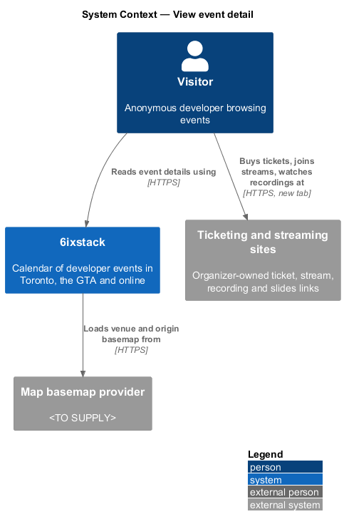
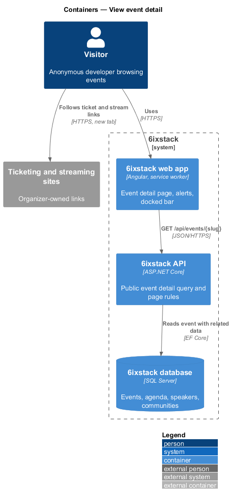
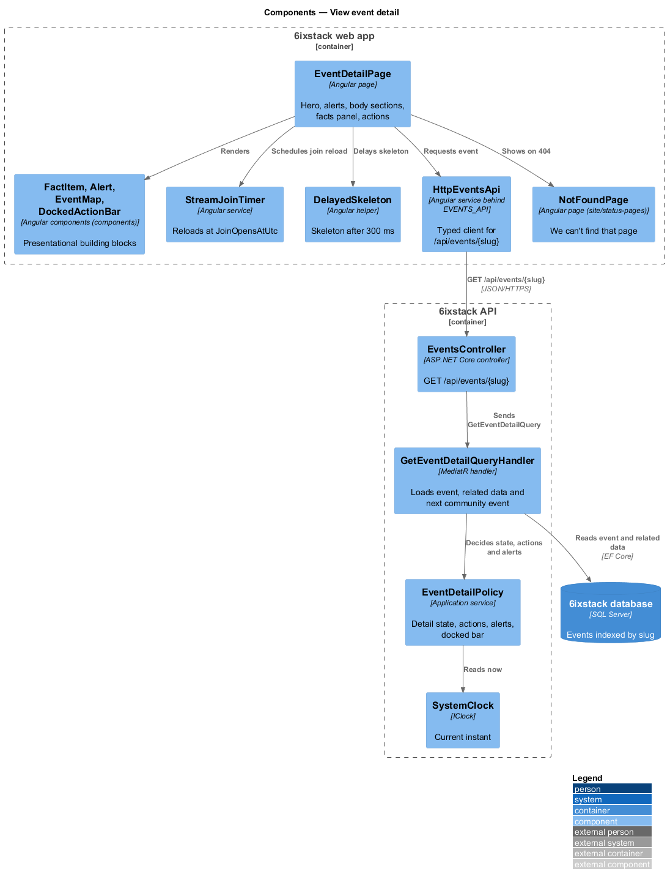
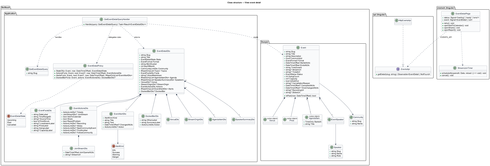
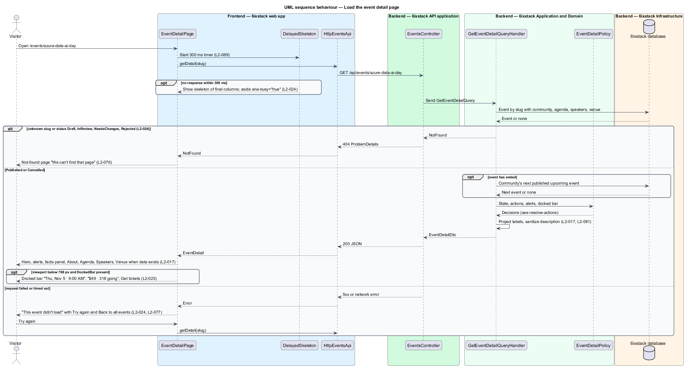
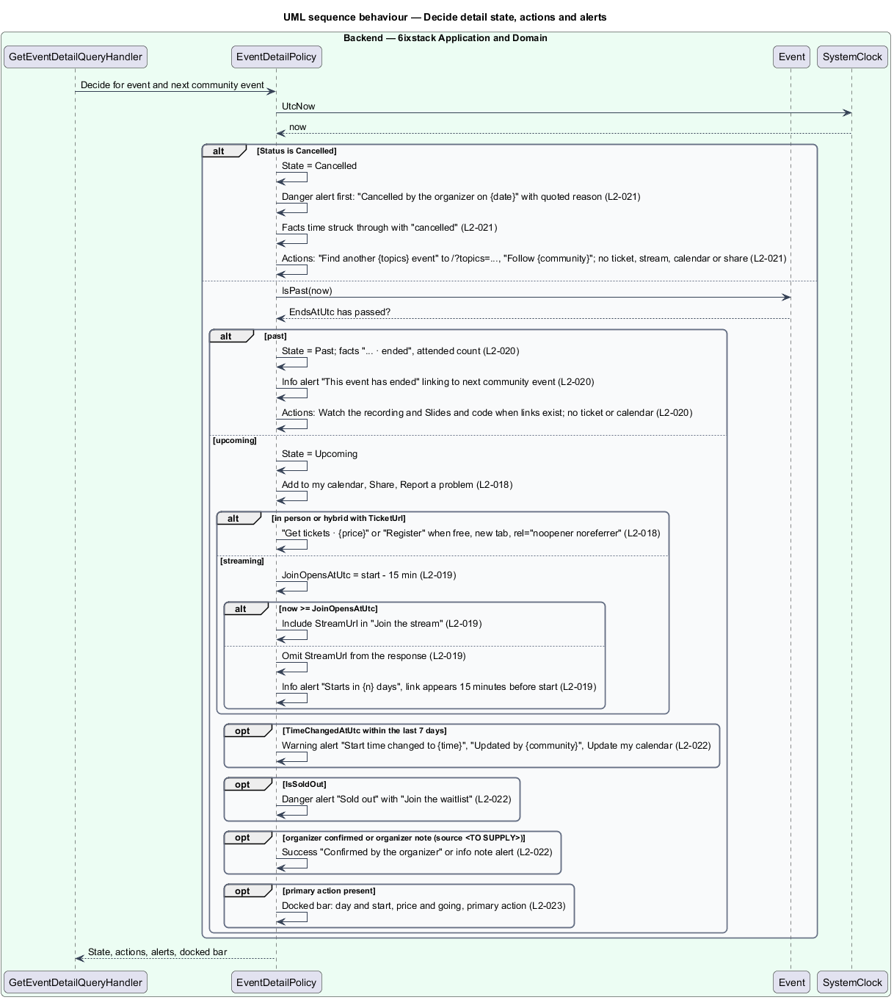
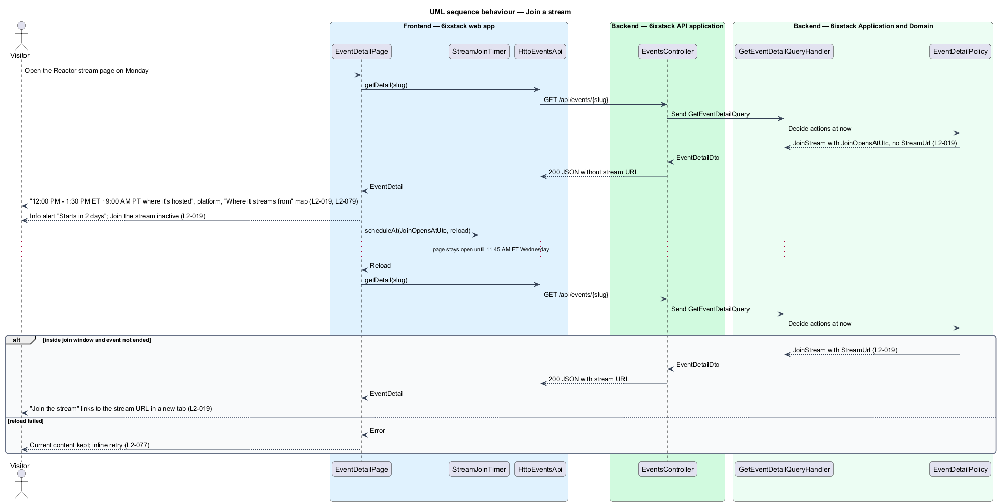

# View event detail

## Overview

6ixstack is a calendar of developer events in Toronto, the Greater Toronto Area
(GTA) and online. Every published event has its own page at `/events/{id}`, where
the `{id}` segment is the event's slug (for example
`/events/azure-data-ai-day`). The page is where a visitor decides to attend: it
holds the full facts, the agenda, the speakers, the venue or stream origin, and
the actions that suit the event's status. This feature covers that page in each
status (upcoming in person, hybrid, streaming, past and cancelled), its status
alerts, the docked ticket bar on phones, and its loading, error and not-found
states. The states are drawn in `docs/mocks/pages/event-detail/` and
`docs/mocks/notifications/event-alert/`.

The feature belongs to the `discovery` subsystem. Visitors reach it from an
event row, the featured card, the map hover card or the calendar. The dialogs
it opens belong to other slices: Add to my calendar
(`feeds-and-sharing/add-to-calendar`), Share (`feeds-and-sharing/share-event`)
and Report a problem (`submissions/report-problem`).

Terms used in this design:

- **detail state** — one of upcoming, past or cancelled, derived from the event's status and end time
- **facts panel** — aside listing date and time, venue, livestream, price and attendance
- **primary action** — most prominent button in the facts panel, such as "Get tickets · $49" or "Join the stream"
- **join window** — interval from 15 minutes before a streaming event's start until its end, during which the stream link is exposed
- **status alert** — inline alert under the title that reports a cancellation, a time change, a sell-out, an organizer confirmation, an organizer note, a countdown or an ended event
- **docked bar** — bar fixed to the bottom of the screen below 768 px that repeats the day, time, price, going count and primary action

Every time is shown in Toronto time (ET). A streaming event hosted in another
time zone also shows the source time with its zone abbreviation
(`platform/time-zones`, `L2-079`).

## Description

The slice runs from the Angular detail page to the database through one
read-only query. The API decides the detail state, the actions and the alerts,
so the page renders a ready-made model and holds no business rules.

### Frontend

- **`EventDetailPage`** (`sx-event-detail-page`) — Angular page in project
  `sixstack`, routed at `/events/:slug`. It loads the event through
  `EVENTS_API` and renders the back link "All events", the hero (`DateTile`,
  title, "by {community}" linked to `/communities/{slug}`, `TopicChip` per
  topic), the status alerts, the body sections and the facts panel. It shows
  the About, Agenda, Speakers and Venue sections only when their data exists
  (`L2-017`). Add to my calendar, Share and Report a problem open CDK dialogs
  from the slices named in the Overview.
- **`FactItem`** (`sx-fact-item`) — component in project `components`, keeping
  the mock's BEM block `fact`. It renders an icon, a label and a value.
- **`Alert`** (`sx-alert`) — component in project `components`. It renders the
  status alerts in the info, success, warning and danger variants with an
  optional action link.
- **`EventMap`** (`sx-event-map`) — component from `discovery/event-map`, used
  here in its compact form without a timeline. It shows the venue under the
  Venue section and the origin under "Where it streams from".
- **`DockedActionBar`** (`sx-docked-action-bar`) — component in project
  `components`, keeping the mock's BEM block `sticky-cta`. A CSS media query
  shows it only below 768 px. The page renders it only when the API returns a
  docked bar (`L2-023`).
- **`DelayedSkeleton`** — shared helper that shows the layout-matching skeleton
  only when the request is still pending after 300 ms. The aside carries
  `aria-busy="true"` while loading (`L2-024`, `L2-089`).
- **`StreamJoinTimer`** — Angular service used by the page for streaming
  events. When the response has `JoinOpensAtUtc` but no `StreamUrl`, it
  schedules one reload at `JoinOpensAtUtc` so "Join the stream" becomes a link
  without a page refresh (`L2-019`).
- **`TorontoTimeFormatter`** — shared service. It formats "2 hours ago" from
  the time change instant for the time-change alert.
- **`EventsApi`** / **`EVENTS_API`** / **`HttpEventsApi`** — the API client
  contract, its injection token and its HTTP implementation in project `api`.
  This slice adds `getDetail(slug)`, which maps `404` to a `NotFound` result.
- **`NotFoundPage`** — page from `site/status-pages`. The detail page navigates
  to it, without changing the URL, when the API answers `404`.

### Backend

- **`EventsController`** — ASP.NET Core controller. Its anonymous action
  `GET /api/events/{slug}` dispatches the query and returns `200` with an
  `EventDetailDto`, or a `404` problem response. It holds no business rules.
- **`GetEventDetailQuery`** — query carrying `Slug`.
- **`GetEventDetailQueryHandler`** — MediatR handler. It loads the event with
  its community, agenda, speakers and venue in one query. It treats an unknown
  slug, or an event whose status is `Draft`, `InReview`, `NeedsChanges` or
  `Rejected`, as not found (`L2-024`). For a past event it also loads the
  community's next published, upcoming event. It then asks
  `EventDetailPolicy` for the state, actions and alerts and projects the
  result into display labels.
- **`EventDetailPolicy`** — application service holding the page rules. Given
  the event, the community's next event and the current instant, it returns:
  - the detail state: `Cancelled` when the status is `Cancelled`, otherwise
    `Past` when `Event.IsPast(now)` is true, otherwise `Upcoming`;
  - for an upcoming in-person or hybrid event with a `TicketUrl`, a primary
    action "Get tickets · {price}", or "Register" when free, opened in a new
    tab with `rel="noopener noreferrer"` (`L2-018`);
  - for an upcoming streaming event, a join action with `JoinOpensAtUtc` set to
    15 minutes before the start, and `StreamUrl` only inside the join window,
    so the link is absent from the response before then (`L2-019`);
  - Add to my calendar, Share and Report a problem for every upcoming event,
    with the caption "Tickets are sold by the organizer. 6ixstack never charges
    attendees." under the actions (`L2-018`);
  - for a past event, "Watch the recording" and "Slides and code" when
    `RecordingUrl` or `SlidesUrl` exists, a link to the community's next event,
    and no ticket or calendar action (`L2-020`);
  - for a cancelled event, "Find another {topics} event" linked to
    `/?topics=…` with the event's topics, "Follow {community}" linked to the
    community page, and no ticket, stream, calendar or share action (`L2-021`);
  - the docked bar for upcoming events with a primary action (`L2-023`);
  - the status alerts listed below.
- **Status alerts** decided by `EventDetailPolicy`:
  - cancelled — danger, shown first: "Cancelled by the organizer on November
    1" with the organizer's reason quoted (`L2-021`);
  - ended — info: "This event has ended" with a link to the community's next
    event (`L2-020`);
  - countdown — info, for a streaming event before its join window: "Starts in
    2 days" and that the stream link appears 15 minutes before the start time
    (`L2-019`);
  - time change — warning, when `TimeChangedAtUtc` is within the last 7 days:
    "Start time changed to 9:30 AM", "Updated by {community}" with the change
    instant, and an "Update my calendar" action (`L2-022`);
  - sold out — danger, when `IsSoldOut` is true: "Sold out" with "Join the
    waitlist" linked to the ticket page (`L2-022`);
  - confirmed — success: "Confirmed by the organizer" (`L2-022`);
  - organizer note — info, with the note's title and text (`L2-022`).
- **`EventDetailDto`** — response contract composed of `EventFactsDto`,
  `VenueDto`, `StreamOriginDto`, `AgendaItemDto`, `SpeakerSummaryDto`,
  `EventActionsDto`, `EventAlertDto` and `DockedBarDto`. It carries display
  labels such as `DateLabel` ("Thursday, November 5, 2026"), `TimeRangeEt`
  ("9:00 AM – 5:00 PM ET"), `SourceTime` ("9:00 AM PT"), `PriceLabel` ("$49")
  and `GoingLabel` ("318 going"). The description is returned as sanitized
  Markdown whose links render with `rel="noopener noreferrer nofollow"`
  (`L2-081`).
- **`Event`**, **`Venue`**, **`Price`**, **`AgendaItem`**, **`EventSpeaker`**,
  **`Speaker`**, **`Community`** — domain types read by this slice.
- **`SystemClock`** (`IClock`) — supplies the current instant, so tests can fix
  "now" at Monday, November 2, 2026.

The `Events` table has a unique index on `Slug` so the lookup meets the 200 ms
95th-percentile target in `L2-087`.

### Decisions (journey 02)

- The open data points become fields on `Event`: `PriceNote` ("includes lunch"), `PriceDetail` ("Student
  tickets $15 with a valid ID"), `LivestreamNote` (also used as the streaming platform line), `Capacity`,
  `AttendedCount`, `SlidesUrl`, `PreviousStartsAtUtc` and `TimeChangedAtUtc`, `ConfirmedAtUtc`, `NoteTitle` and
  `NoteText`, an ordered `AgendaItems` collection (`StartsAtLocal`, `Title`), and `Venue.TravelNotes`. The submit and
  edit forms (journeys 04 and 14) decide how organizers fill them; until then the seed holds them.
- Alerts show in this order: cancelled, ended, countdown, time change, sold out, confirmed, organizer note.
- A sold-out event keeps its ticket action (the ticket page runs the waitlist) and adds the sold-out alert.
- Only streaming events have the join window; a hybrid event's stream is described in the facts.
- Below one day the countdown reads "Starts in N hours" (or "Starts in less than an hour").
- Past events keep Report a problem and drop Share, as the `event-detail/past` mock shows no share action.
- The docked bar appears only for upcoming events with a ticket or register action.
- Directions link to `https://www.google.com/maps/search/?api=1&query={venue, address, city}` until the map
  provider is chosen (journey 16).
- The detail document itself is served by the SPA host with status 200; the page shows `NotFoundPage` when the
  API answers 404 (the host-level 404 stays open with the hosting choice, ADR 0006).
- The venue map and the stream-origin map arrive with journey 16; until then those sections show the facts only.

Open points:

- The domain model has no field for the price note ("includes lunch", "Student
  tickets $15 with a valid ID"), the livestream note or streaming platform
  ("YouTube and Microsoft Learn"), venue travel notes, the attended count of a
  past event, the organizer's confirmation, or the organizer note. The submit
  form (`L2-041`) collects none of them. Their fields and their source are
  `<TO SUPPLY>`.
- The HTTP status of the HTML document for `/events/does-not-exist` is
  `<TO SUPPLY>`. The API returns `404` for the JSON request. Returning `404`
  for the document needs either server-side rendering or a host-level slug
  check.
- The order of several status alerts shown at once, other than the cancelled
  alert first, is `<TO SUPPLY>`.
- `docs/mocks/notifications/event-alert/danger.html` says the waitlist replaces
  the ticket action, yet the same mock still shows "Get tickets · $49". Whether
  a sold-out event keeps the ticket action is `<TO SUPPLY>`.
- Whether a hybrid event offers "Join the stream" and the join window, as
  `L2-019` describes for a streaming event, is `<TO SUPPLY>`.
- The countdown wording below 1 day ("Starts in 5 hours" or similar) is
  `<TO SUPPLY>`.
- Whether past and cancelled events keep Share and Report a problem is
  `<TO SUPPLY>`; `L2-021` removes Share for cancelled events, and the
  `event-detail/past` mock shows neither.
- What the docked bar shows for a streaming event before the join window, and
  for an upcoming event without a primary action, is `<TO SUPPLY>`.
- The behaviour of an open page when a streaming event reaches its end time is
  `<TO SUPPLY>`.
- The cache policy for `GET /api/events/{slug}` is `<TO SUPPLY>`. A cached
  response without `StreamUrl` shall not be served after `JoinOpensAtUtc`.
- The Directions link target (map provider and URL format) is `<TO SUPPLY>`.

## Requirements

| L2 ID | Refines (L1) | Requirement |
|-------|--------------|-------------|
| `L2-017` | `L1-003` | The event detail page (`/events/{id}`) shall show the date tile, title, organizer linked to its community page, topics, and a facts panel (date and time range, venue with address and Directions link, livestream availability, price with notes, going count with capacity), followed by About, Agenda, Speakers and Venue sections when data exists. |
| `L2-018` | `L1-003` | An upcoming in-person or hybrid event shall offer "Get tickets · {price}" (or "Register" when free) linking to the organizer's ticket page in a new tab; every upcoming event shall offer Add to my calendar, Share and Report a problem; the panel shall state that tickets are sold by the organizer and 6ixstack never charges attendees. |
| `L2-019` | `L1-003` | A streaming event shall show both the ET time and the time where it is hosted, the streaming platform, a "Join the stream" action that becomes active 15 minutes before the start, a countdown alert before then, and a "Where it streams from" map. |
| `L2-020` | `L1-003` | An event whose end time has passed shall show "ended" with the attended count, replace ticket and calendar actions with "Watch the recording" and "Slides and code" when links exist, and link to the community's next event. |
| `L2-021` | `L1-003` | A cancelled event shall show, first, a danger alert with the cancellation date and the organizer's reason, show the struck-through time with "cancelled", remove ticket, calendar and share actions, and offer "Find another {topics} event" and "Follow {community}". |
| `L2-022` | `L1-003` | The event detail page shall show an inline alert when the organizer changed the start time (with when it changed and an "Update my calendar" action), when the event is sold out (with a waitlist link), when the organizer confirmed the details, and for an organizer-supplied note. |
| `L2-023` | `L1-003` | Below 768 px, the event detail page shall dock a bar at the bottom of the screen with the day, start time, price and going count and the primary action. |
| `L2-024` | `L1-003` | The event detail page shall show a skeleton of the final layout while loading, an error state with retry when loading fails, and the not-found page for an unknown or removed event. |

## Diagrams

### System context

A visitor reads an event's details in 6ixstack and follows its ticket, stream,
recording or slides links to sites the organizer owns.

### Containers

The web app calls `GET /api/events/{slug}` on the API, which reads the event
and its related data from SQL Server. Outbound links open the organizer's
ticketing and streaming sites in a new tab.

### Components

`EventDetailPage` loads the model through `HttpEventsApi` and renders it with
library components. In the API, `EventsController` sends the query to
`GetEventDetailQueryHandler`. The handler delegates state, action and alert
rules to `EventDetailPolicy`.

### Class structure

The handler reads `Event` and its related types and returns an
`EventDetailDto`. `EventDetailPolicy` produces the `EventDetailState`, the
`EventActionsDto` and the list of `EventAlertDto`.

### Behaviour — load the detail page

The page shows skeletons only after 300 ms. A `404` shows the not-found page,
and any other failure shows "This event didn't load" with Try again and Back to
all events (`L2-024`).

### Behaviour — decide state, actions and alerts

`EventDetailPolicy` decides the detail state first, then the actions for that
state, then the alerts. The order makes the cancellation rules of `L2-021`
override the upcoming and past rules.

### Behaviour — join a stream

Before the join window the response carries no stream URL, and the page shows
the countdown alert. At `JoinOpensAtUtc` the page reloads the event once and
"Join the stream" becomes a link (`L2-019`).

