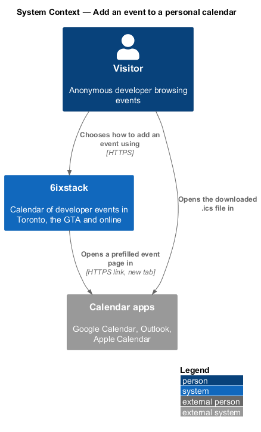
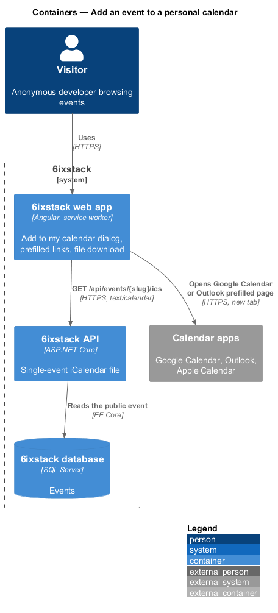
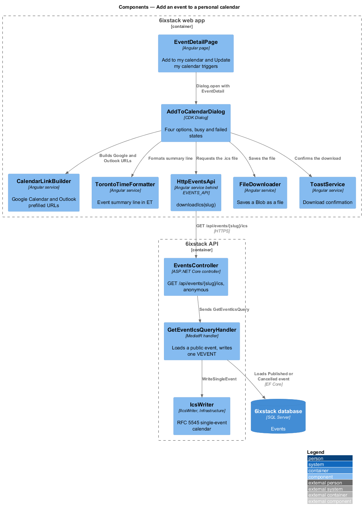
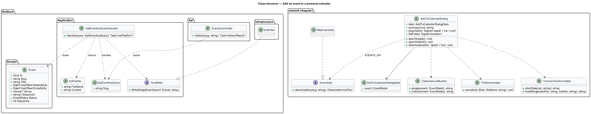
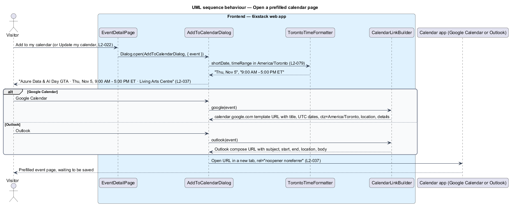
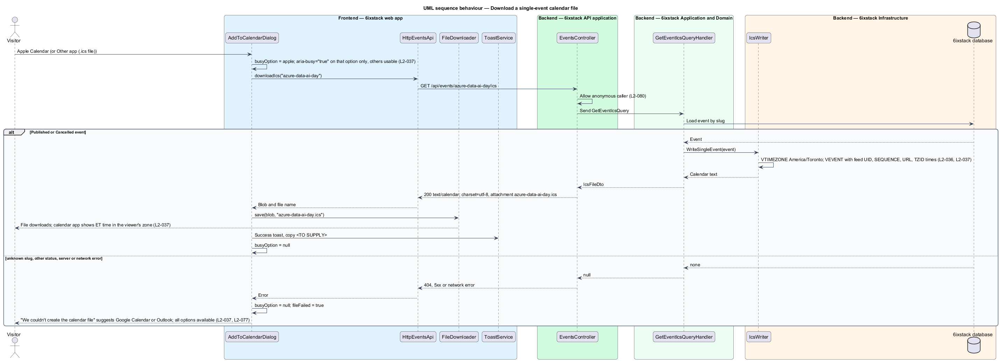

# Add an event to a personal calendar

## Overview

6ixstack is a calendar of developer events in Toronto, the Greater Toronto Area
(GTA) and online. A visitor who decides to attend one event wants it in a
personal calendar without subscribing to a whole feed. This feature covers the
"Add to my calendar" dialog that opens from the event detail page: two options
that open a prefilled event page in Google Calendar or Outlook, and two options
that download a single-event `.ics` file for Apple Calendar or any other
calendar application.

The feature belongs to the `feeds-and-sharing` subsystem. It opens from the
"Add to my calendar" button on the event detail page (`discovery/view-event-detail`)
and from the "Update my calendar" action of the time-change alert (`L2-022`).
Subscribed feeds (`feeds-and-sharing/serve-calendar-feed`) update on their own;
a saved single event does not, which is why the time-change alert offers the
dialog again.

Terms used in this design:

- **prefilled event page** — page of a web calendar that opens with the title, times, place and description already filled in, waiting for the visitor to save
- **single-event `.ics` file** — iCalendar (RFC 5545) document holding one `VEVENT`, downloaded as a file
- **event summary line** — dialog description in the form "{title} · {short date}, {start} – {end} ET · {venue}"

The dialog description for Azure Data & AI Day GTA reads "Azure Data & AI Day
GTA · Thu, Nov 5, 9:00 AM – 5:00 PM ET · Living Arts Centre". Times on the page
are Toronto time; the calendar application converts them to the viewer's time
zone when the event is saved.

## Description

The slice runs from one Angular dialog to one API endpoint. Google Calendar and
Outlook need no API call: the web app builds their URLs from the event detail it
already holds. Apple Calendar and "Other app (.ics file)" fetch the file from
the API.

- **`AddToCalendarDialog`** (`sx-add-to-calendar-dialog`) — Angular CDK dialog
  in `frontend/projects/sixstack/src/app/dialogs/add-to-calendar/`, built on
  `DialogShell` with the title "Add to my calendar" and the event summary line
  as its description. It renders four options as an option list: Google
  Calendar ("Opens a new tab"), Outlook ("Outlook.com or Microsoft 365"), Apple
  Calendar ("Downloads an .ics file") and Other app (.ics file) ("Works with any
  calendar"). It holds a `busyOption` signal and a `fileFailed` signal. The mock
  records no invalid state because the options are one-tap choices.
- **`AddToCalendarDialogData`** — dialog data carrying the `EventDetail` the
  event detail page already loaded.
- **`CalendarLinkBuilder`** — Angular service in project `sixstack`. It builds
  the Google Calendar template URL and the Outlook compose URL from the title,
  the UTC start and end instants, the location label, and a description that
  ends with the event detail URL. The Google URL passes
  `ctz=America/Toronto`. Each option opens in a new tab with
  `rel="noopener noreferrer"`.
- **`TorontoTimeFormatter`** — shared service that formats the short date and
  the time range in Toronto time for the event summary line (`L2-079`).
- **`EventsApi`** / **`EVENTS_API`** / **`HttpEventsApi`** —
  `downloadIcs(slug)` calls `GET /api/events/{slug}/ics` and returns the
  response as a `Blob` with its file name.
- **`FileDownloader`** — Angular service that saves a `Blob` under a file name
  through a temporary object URL and an anchor with the `download` attribute.
- **`ToastService`** — raises the success toast after a download.
- **`EventsController`** — `GET /api/events/{slug}/ics` allows anonymous callers
  (`L2-080`) and dispatches `GetEventIcsQuery`. It returns the file with
  content type `text/calendar; charset=utf-8` and
  `Content-Disposition: attachment; filename="{slug}.ics"`. It holds no business
  rules.
- **`GetEventIcsQuery`** / **`GetEventIcsQueryHandler`** — query by slug and its
  MediatR handler. The handler loads the event when its status is `Published`
  or `Cancelled`, and returns not found for any other status or an unknown
  slug. It calls `IIcsWriter.WriteSingleEvent` and returns an `IcsFileDto`.
- **`IIcsWriter`** / **`IcsWriter`** — the writer defined in
  `feeds-and-sharing/serve-calendar-feed`. `WriteSingleEvent` writes one
  `VCALENDAR` with the `America/Toronto` `VTIMEZONE` and one `VEVENT` carrying
  the same `UID`, `SEQUENCE`, `URL` and `STATUS` the feeds use. A calendar
  application that already holds the event from a feed therefore treats the
  file as the same event.
- **`IcsFileDto`** — `FileName` and `Content`.

Because `DTSTART` and `DTEND` carry `TZID=America/Toronto` with a matching
`VTIMEZONE`, a calendar application in another time zone shows the event at
the ET time converted to the viewer's zone (`L2-037` criterion 4).

Decisions (journey 03):

- Google Calendar and Outlook open their prefilled page in a new tab and close the dialog; they raise no toast,
  because 6ixstack cannot know whether the visitor saved the event.
- Apple Calendar and Other app download `{slug}.ics`, then close the dialog and raise a success toast
  "Calendar file downloaded" with "Open {slug}.ics to add {title} to your calendar."
- The Outlook option opens Outlook.com (`outlook.live.com/calendar/0/deeplink/compose`); Microsoft 365 users
  can import the `.ics` with Other app.
- A streaming event's summary line ends with "Streaming online".
- Past and cancelled events do not offer the dialog (`L2-020`, `L2-021`); the API still serves their `.ics`
  so a saved copy can be refreshed.
- The time-change alert's "Update my calendar" opens the same dialog.
- `SEQUENCE` is 0 until edits are versioned (journey 14); `URL` uses `Site:PublicBaseUrl`
  (default `https://6ixstack.dev`) and `UID` is `{event id}@6ixstack.dev`.

Open points in the requirement and mocks:

- The success toast copy after a file download is `<TO SUPPLY>`. The
  `app-toast/stacked` mock shows "Added to Google Calendar" with "Azure Data &
  AI Day GTA, Thu Nov 5.", which suggests a toast after the Google option too.
  Whether Google Calendar and Outlook raise a toast is `<TO SUPPLY>`.
- Whether the dialog closes after a successful option is `<TO SUPPLY>`.
- `L2-037` puts the venue in the summary line. The venue text for a streaming
  event, which has no venue, is `<TO SUPPLY>`.
- "Outlook.com or Microsoft 365" names two hosts with different compose URLs
  (`outlook.live.com` and `outlook.office.com`). Which host the option opens, or
  whether the dialog offers both, is `<TO SUPPLY>`.
- Whether a past event offers the dialog is `<TO SUPPLY>`.

## Requirements

| L2 ID | Refines (L1) | Requirement |
|-------|--------------|-------------|
| `L2-037` | `L1-008` | The "Add to my calendar" dialog shall offer Google Calendar and Outlook (open a prefilled page in a new tab), Apple Calendar and "Other app (.ics file)" (download a single-event `.ics`), with the event title, date, time range and venue in its description. |

## Diagrams

### System context

A visitor adds one event from 6ixstack to a personal calendar. Google Calendar
and Outlook receive a prefilled page; Apple Calendar and other applications
receive a downloaded file.

### Containers

The web app opens the prefilled pages directly in the calendar application.
For a file, it calls `GET /api/events/{slug}/ics`, and the API reads the event
from the database.

### Components

`AddToCalendarDialog` uses `CalendarLinkBuilder` for the two web calendars and
`HttpEventsApi` with `FileDownloader` for the file. In the API,
`EventsController` sends `GetEventIcsQuery` to its handler, which writes the
file with `IcsWriter`.

### Class structure

The dialog depends on the `EventsApi` contract through `EVENTS_API` and on two
app services. The query handler depends on `IIcsWriter` and returns an
`IcsFileDto`.

### Behaviour — open a prefilled calendar page

The dialog opens with the event summary line. Google Calendar and Outlook each
open a new tab with the event already filled in (`L2-037`).

### Behaviour — download a single-event file

Apple Calendar or Other app marks only that option busy. On success the file
downloads and a toast confirms it. On failure the alert "We couldn't create
the calendar file" suggests Google Calendar or Outlook, and every option stays
available (`L2-037`, `L2-077`).

