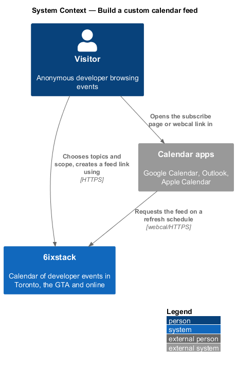
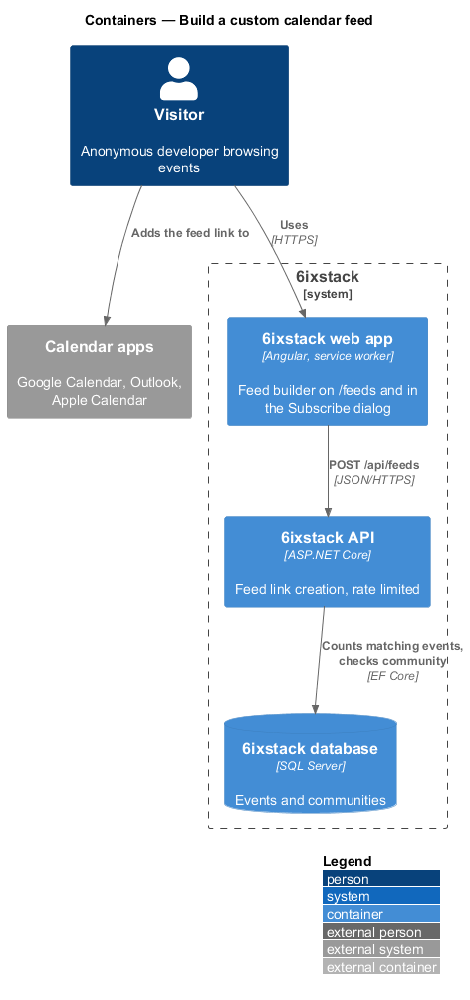
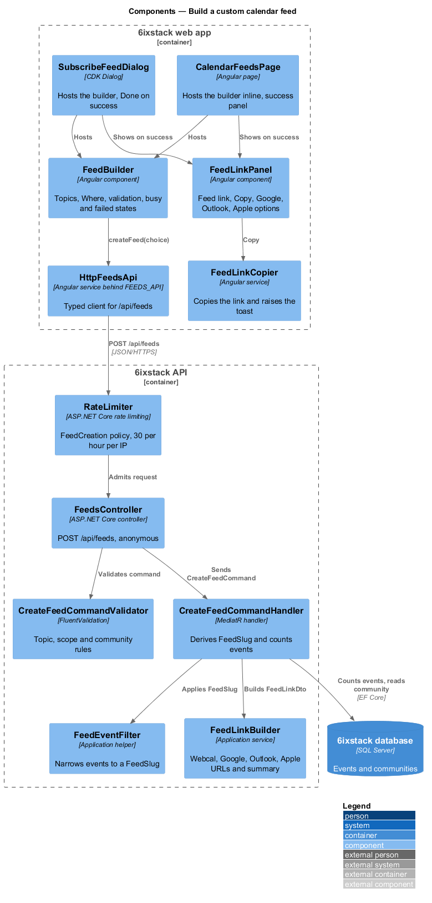
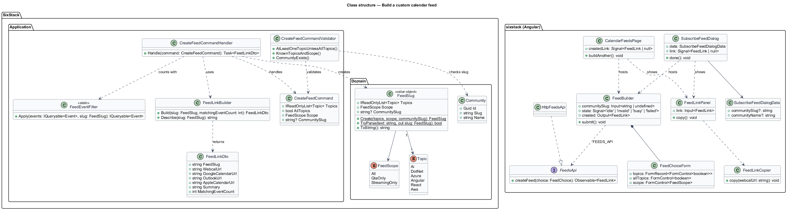
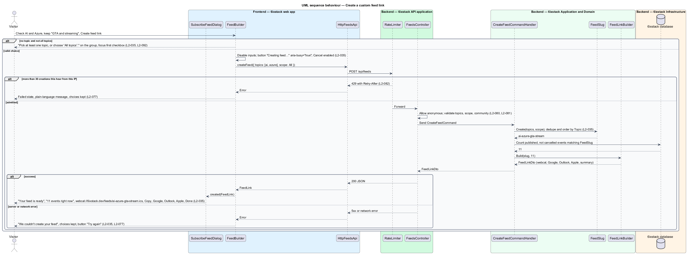
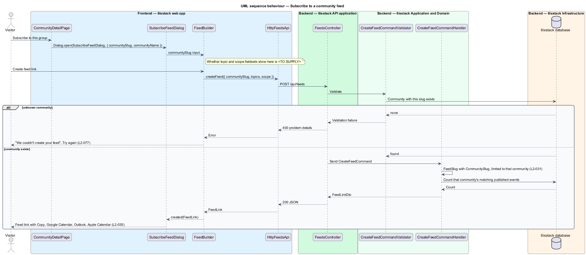

# Build a custom calendar feed

## Overview

6ixstack is a calendar of developer events in Toronto, the Greater Toronto Area
(GTA) and online. Beside the ready-made feeds (`feeds-and-sharing/ready-made-feeds`),
a visitor can build a calendar feed that matches a personal mix of topics and
formats. This feature covers that builder: choosing topics, choosing where
events take place, creating the feed link, and offering the link to the
visitor's calendar application. No account is needed.

The builder appears in two places with the same behaviour: the "Build your own"
section of the calendar feeds page (`/feeds`) and the "Subscribe to a calendar
feed" dialog. The dialog opens from the events page aside ("Get a calendar
feed"), the events no-results state, the empty calendar month, and the
community page ("Subscribe to this group", `L2-031`). The iCalendar document
that the link returns is the subject of `feeds-and-sharing/serve-calendar-feed`.

Terms used in this design:

- **feed choice** — topics, all-topics flag, feed scope and optional community a visitor selects in the builder
- **feed scope** — format part of a feed choice: "GTA and streaming", "GTA only" or "Streaming only"
- **feed slug** — canonical text form of a feed choice, used as the file name in the feed URL
- **feed link** — `webcal://` URL built from the public feed origin and the feed slug, for example `webcal://6ixstack.dev/feeds/ai-azure-gta-stream.ics`
- **community feed** — feed limited to the events of one community

Creating a feed link stores nothing about the visitor. The same feed choice
always yields the same feed link, so two visitors who pick AI and Azure in the
GTA and streaming share one feed.

## Description

The slice runs from one Angular form component, hosted by a page and by a
dialog, to one command in the API. The command validates the choice, derives
the feed slug and counts the matching events; it writes no rows.

- **`FeedBuilder`** (`sx-feed-builder`) — Angular form component in project
  `sixstack` (`app/feeds/feed-builder/`). It renders the "Topics" fieldset with
  one checkbox per topic and the "Where" fieldset with the three scope radios,
  "GTA and streaming" checked by default. It owns the idle, invalid, busy and
  failed states and emits the created `FeedLink`.
- **`FeedChoiceForm`** — typed reactive form behind `FeedBuilder`. Its
  `atLeastOneTopic` validator fails when no topic is checked and all topics is
  not chosen. On failure the component shows "Pick at least one topic, or
  choose “All topics”." on the topic group, sets `aria-invalid` and
  `aria-describedby` on the checkboxes, and moves focus to the first checkbox
  (`L2-092`).
- **`FeedLinkPanel`** (`sx-feed-link-panel`) — Angular component that shows a
  created feed: the read-only "Feed link" field with Copy, and the Google
  Calendar, Outlook and Apple Calendar options opening the URLs from the
  `FeedLink`. Copy goes through `FeedLinkCopier` from `ready-made-feeds`.
- **`CalendarFeedsPage`** — hosts `FeedBuilder` inline. On success it replaces
  the form with a success panel ("Your feed is ready", the summary,
  `FeedLinkPanel`, and "Build another feed", which restores the form) in a
  `role="status"` region.
- **`SubscribeFeedDialog`** — Angular CDK dialog in
  `frontend/projects/sixstack/src/app/dialogs/subscribe-feed/`, built on
  `DialogShell`, titled "Subscribe to a calendar feed" with the description
  "Your calendar app checks the feed every few hours, so new and changed events
  show up on their own." Its footer holds Cancel and the primary button
  ("Create feed link", "Creating feed…" with `aria-busy="true"` while busy,
  "Try again" after a failure). Cancel stays enabled while busy. On success the
  body shows the success alert and `FeedLinkPanel`, and the footer shows a
  focused Done. `SubscribeFeedDialogData` carries an optional
  `communitySlug` and `communityName` when opened from a community page.
- **`FeedsApi`** / **`FEEDS_API`** / **`HttpFeedsApi`** — `createFeed(choice)`
  calls `POST /api/feeds`. The page and dialog depend on the token only.
- **`FeedsController`** — `POST /api/feeds` allows anonymous callers
  (`L2-080`). The ASP.NET Core rate limiter applies the `FeedCreation` policy of
  30 requests per hour per IP and answers 429 with `Retry-After` when exceeded
  (`L2-082`). The controller dispatches the command and holds no business rules.
- **`CreateFeedCommand`** — command carrying `Topics`, `AllTopics`, `Scope`
  (`All`, `GtaOnly`, `StreamingOnly`) and an optional `CommunitySlug`.
- **`CreateFeedCommandValidator`** — FluentValidation rules: at least one topic
  unless `AllTopics`; only known topic and scope values; a community slug that
  names an existing community. A violation returns a 400 problem response.
- **`CreateFeedCommandHandler`** — MediatR handler. It builds a `FeedSlug`,
  counts the published, non-cancelled events that match it through
  `FeedEventFilter`, and asks `FeedLinkBuilder` for the URLs and the summary.
- **`FeedSlug`** — value object in `SixStack.Domain`. `FeedSlug.Create`
  removes duplicate topics and orders them by `Topic` declaration order, so the
  same choice always yields the same slug (`L2-035`). `ToString()` writes the
  topic tokens joined by `-`, followed by the scope token. `FeedLinkBuilder`
  appends `.ics`. `TryParse` reverses `ToString()` for `serve-calendar-feed`.
- **`FeedLinkBuilder`** — Application service that turns a `FeedSlug` into a
  `FeedLinkDto`: the webcal link from the configured public feed origin, the
  Google Calendar subscribe URL (`https://calendar.google.com/calendar/r?cid=`
  plus the encoded link), the Outlook subscribe URL
  (`https://outlook.live.com/calendar/addcalendar?url=` plus the encoded link),
  the Apple Calendar URL (the webcal link itself) and a plain-language summary
  such as "AI and Azure events, in the GTA and streaming."
- **`FeedLinkDto`** — response contract: `FeedSlug`, `WebcalUrl`,
  `GoogleCalendarUrl`, `OutlookUrl`, `AppleCalendarUrl`, `Summary` and
  `MatchingEventCount`.

The mocks fix one slug: AI and Azure in "GTA and streaming" is
`ai-azure-gta-stream`. The following parts of the slug grammar are
`<TO SUPPLY>`: the scope tokens for "GTA only" and "Streaming only", the token
for all topics, and the form of a community feed slug.

Open points in the requirement and mocks:

- `L2-035` and its error text name an "All topics" choice, but the
  `subscribe-feed` and `calendar-feeds` mocks draw only the six topic
  checkboxes. The control that represents all topics is `<TO SUPPLY>`.
- The success text "11 events right now" does not match the 14-day upcoming
  window used by the ready-made counts for AI and Azure in the mock data set.
  The window behind `MatchingEventCount` is `<TO SUPPLY>`.
- `L2-031` requires the community dialog to create "a feed limited to that
  community" but does not say whether topic and scope choices still apply.
  Whether the community dialog shows the topic and scope fieldsets is
  `<TO SUPPLY>`.
- The events no-results state offers "Get a feed for Kubernetes", but
  Kubernetes is not a `Topic`. The feed choice that action opens with is
  `<TO SUPPLY>`.
- The summary wording for choices other than the mocked one is `<TO SUPPLY>`.
- The Outlook subscribe host (`outlook.live.com` for personal accounts or
  `outlook.office.com` for Microsoft 365) is `<TO SUPPLY>`; the mock uses
  `outlook.live.com`.

While the browser is offline, the site banner disables feed creation
(`L2-075`). A 429 from the rate limiter renders the failed state with a
plain-language message (`L2-082`, `L2-077`).

## Requirements

| L2 ID | Refines (L1) | Requirement |
|-------|--------------|-------------|
| `L2-035` | `L1-007` | The feeds page and the "Subscribe to a calendar feed" dialog shall let anyone choose one or more topics (or all topics) and one of "GTA and streaming", "GTA only" or "Streaming only", and create a feed link without an account. |

## Diagrams

### System context

A visitor builds a feed in 6ixstack and adds the link to a calendar
application. The calendar application then fetches the feed from 6ixstack.

### Containers

The web app sends the feed choice to `POST /api/feeds`. The API counts matching
events in the database and returns the feed link without writing a row.

### Components

`FeedBuilder` is hosted by `CalendarFeedsPage` and by `SubscribeFeedDialog`.
It submits through `HttpFeedsApi`. In the API, the `FeedCreation` rate limit
policy runs before `FeedsController`, which validates and sends
`CreateFeedCommand`. The handler derives the `FeedSlug`, counts events through
`FeedEventFilter` and builds URLs through `FeedLinkBuilder`.

### Class structure

`CreateFeedCommandHandler` creates a `FeedSlug` from the command and returns a
`FeedLinkDto`. On the client, `FeedBuilder` owns `FeedChoiceForm` and depends
on the `FeedsApi` contract; its two hosts render `FeedLinkPanel` on success.

### Behaviour — create a feed link

An empty topic choice fails on the client before any request. A valid choice
locks the inputs and shows "Creating feed…". The API applies the rate limit,
validates, and derives a canonical slug so that equal choices give equal links
(`L2-035`). A failure keeps every choice and offers Try again.

### Behaviour — subscribe to a community

"Subscribe to this group" opens `SubscribeFeedDialog` with the community slug.
The created slug carries the community, so the feed holds only that
community's events (`L2-031`).

