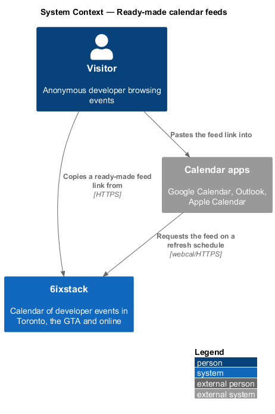
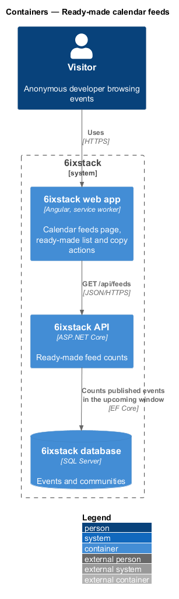
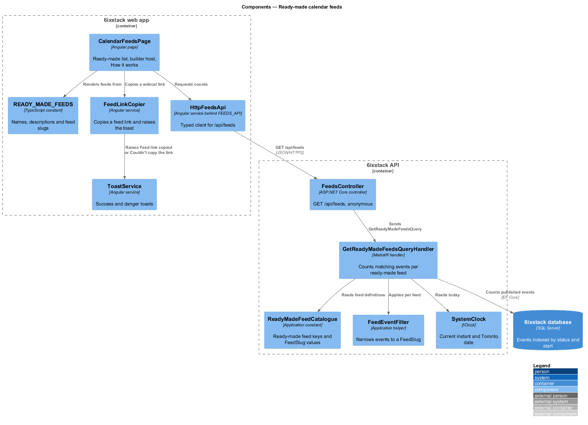
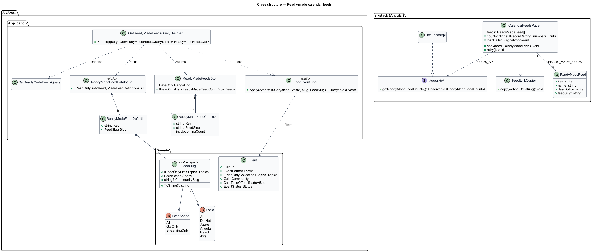
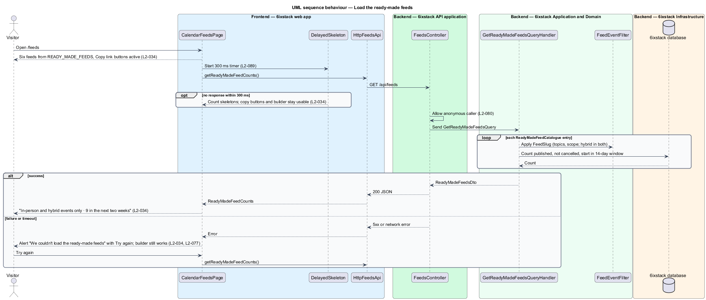
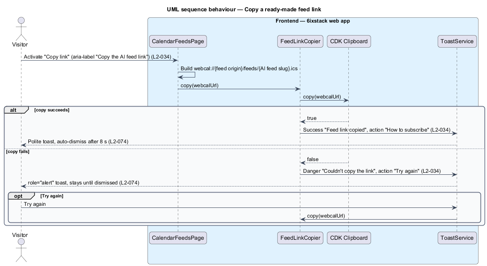

# Ready-made calendar feeds

## Overview

6ixstack is a calendar of developer events in Toronto, the Greater Toronto Area
(GTA) and online. A visitor who wants new events to appear in a personal
calendar, without checking the site, subscribes to a calendar feed. This
feature covers the first half of the calendar feeds page at `/feeds`: the list
of ready-made feeds, the upcoming-event count beside each one, and the
"Copy link" button that puts a feed's subscription address on the clipboard.

The feature belongs to the `feeds-and-sharing` subsystem. The custom feed
builder on the same page is a separate slice (`feeds-and-sharing/build-custom-feed`).
The iCalendar document behind every feed link is served by
`feeds-and-sharing/serve-calendar-feed`.

Terms used in this design:

- **calendar feed** — public URL that returns an iCalendar document a calendar application subscribes to and refreshes on its own
- **ready-made feed** — calendar feed with a fixed name and filter that 6ixstack offers on `/feeds`: Everything, In the GTA, Streaming, AI, .NET and Azure
- **feed slug** — canonical text form of a feed's filter (topics, scope and optional community) used as the file name in the feed URL
- **feed scope** — format part of a feed's filter: GTA and streaming, GTA only, or streaming only
- **webcal link** — feed URL with the `webcal://` scheme, which hands the address to the device's calendar application
- **upcoming window** — 14 calendar days starting today in Toronto time, as defined in `discovery/browse-events`

Each ready-made feed shows a description and the number of published events in
the upcoming window that match it, for example "In-person and hybrid events
only · 9 in the next two weeks". No account is needed to copy or use a feed.

## Description

The slice runs from the Angular page to the database through one read-only
count query. The feed names, descriptions and links are known to the web app
before the API answers, so the copy buttons work while the counts load.

- **`CalendarFeedsPage`** (`sx-calendar-feeds-page`) — Angular page in project
  `sixstack` at route `/feeds`. It renders the title block, the "Ready-made
  feeds" section, the "Build your own" section (hosting `FeedBuilder` from
  `feeds-and-sharing/build-custom-feed`) and the "How it works" aside. It owns
  the loading and error states of the ready-made list. The mock records no
  empty state because ready-made feeds always exist.
- **`READY_MADE_FEEDS`** — constant in project `sixstack` listing the six
  ready-made feeds in display order. Each `ReadyMadeFeed` holds a `key`, a
  `name`, a `description` and a `feedSlug`. The page builds each webcal link
  from the configured public feed origin and the slug.
- **`FeedLinkCopier`** — Angular service shared by every feed copy action. It
  copies a link with the Angular CDK `Clipboard`. On success it raises the
  success toast "Feed link copied" with the text "Paste it into Google
  Calendar, Outlook or Apple Calendar." and the action "How to subscribe". On
  failure it raises the danger toast "Couldn't copy the link" with "Try again",
  which repeats the copy. Danger toasts stay until dismissed (`L2-074`).
- **`FeedsApi`** / **`FEEDS_API`** / **`HttpFeedsApi`** — the feeds API client
  contract, its injection token and its HTTP implementation in project `api`.
  `getReadyMadeFeedCounts()` calls `GET /api/feeds`. The page depends on the
  token only.
- **`DelayedSkeleton`** — shared helper that shows count skeletons only when
  the request is still pending after 300 ms.
- **`ConnectivityService`** — reports whether the browser is online. While
  offline, the site banner disables feed actions (`L2-075`).
- **`FeedsController`** — ASP.NET Core controller. `GET /api/feeds` allows
  anonymous callers (`L2-080`) and dispatches `GetReadyMadeFeedsQuery`. It holds
  no business rules.
- **`GetReadyMadeFeedsQueryHandler`** — MediatR handler. It reads the
  `ReadyMadeFeedCatalogue`, reads "today" from `IClock`, and counts the
  published, non-cancelled events in the upcoming window that match each
  feed's `FeedSlug`. It applies the filter through `FeedEventFilter`.
- **`ReadyMadeFeedCatalogue`** — static list in `SixStack.Application` of the
  six ready-made feeds and their `FeedSlug` values. Its keys match
  `READY_MADE_FEEDS` in the web app.
- **`FeedEventFilter`** — Application helper shared with
  `build-custom-feed` and `serve-calendar-feed`. It narrows an `Event` query to
  a `FeedSlug`: any selected topic matches, `GtaOnly` keeps in-person and hybrid
  events, `StreamingOnly` keeps streaming and hybrid events, and a community
  slug keeps that community's events. Hybrid events therefore count toward both
  In the GTA and Streaming.
- **`ReadyMadeFeedsDto`** / **`ReadyMadeFeedCountDto`** — response contracts:
  the window end date and, per feed, its `Key`, `FeedSlug` and `UpcomingCount`.
- **`FeedSlug`** — value object in `SixStack.Domain` holding `Topics` (empty
  means all topics), a `FeedScope` (`All`, `GtaOnly`, `StreamingOnly`) and an
  optional community slug. Its canonical text form is defined in
  `feeds-and-sharing/build-custom-feed`.

The ready-made feed filters follow from their names: Everything is all topics
in scope `All`; In the GTA is all topics in `GtaOnly`; Streaming is all topics
in `StreamingOnly`; AI, .NET and Azure are one topic each in scope `All`. Their
slugs are `all-gta-stream`, `all-gta`, `all-stream`, `ai-gta-stream`, `dotnet-gta-stream` and
`azure-gta-stream` (grammar in `build-custom-feed`). The web app builds each link from the host it is served on
(`webcal://{host}/feeds/{slug}.ics`), so production links name `6ixstack.dev` and local ones the dev server.

Decided in journey 10: "How to subscribe" scrolls to the "How it works" aside and moves focus to its heading.
Offline, the copy buttons stay usable (copying needs no network); only creating a custom feed is disabled
(journey 11). The "Build your own" section arrives with journey 11. Counts use the same two-week window as the
events page hero. The library gains `List`/`ListItem` and `LogoTile`; "How it works" uses `NextSteps`.

## Requirements

| L2 ID | Refines (L1) | Requirement |
|-------|--------------|-------------|
| `L2-034` | `L1-007` | The calendar feeds page (`/feeds`) shall list the ready-made feeds Everything, In the GTA, Streaming, AI, .NET and Azure, each with a description, the number of events in the upcoming window and a "Copy link" button labelled with the feed name for assistive technology. |

## Diagrams

### System context

A visitor copies a ready-made feed link from 6ixstack and pastes it into a
calendar application. The calendar application then requests the feed from
6ixstack on its own schedule.

### Containers

The web app requests the counts from `GET /api/feeds`. The API counts matching
published events in the SQL Server database.

### Components

`CalendarFeedsPage` renders `READY_MADE_FEEDS` at once and fills in counts from
`HttpFeedsApi`. Copy actions go through `FeedLinkCopier`, which raises toasts
through `ToastService`. In the API, `FeedsController` sends the query to
`GetReadyMadeFeedsQueryHandler`, which applies `FeedEventFilter` per catalogue
entry.

### Class structure

The handler reads the catalogue of `FeedSlug` values and returns one count per
feed. On the client, `CalendarFeedsPage` depends on the `FeedsApi` contract
through the `FEEDS_API` token and on `FeedLinkCopier` for copying.

### Behaviour — load the ready-made feeds

The list renders from the constant with every copy button active. Counts show
skeletons after 300 ms and fill in when the response arrives. A failure
replaces the list with the alert "We couldn't load the ready-made feeds" and
Try again, and the builder keeps working (`L2-034`, `L2-077`).

### Behaviour — copy a feed link

Copy link writes the webcal link to the clipboard. Success raises the "Feed
link copied" toast; failure raises a persistent danger toast whose Try again
repeats the copy.

