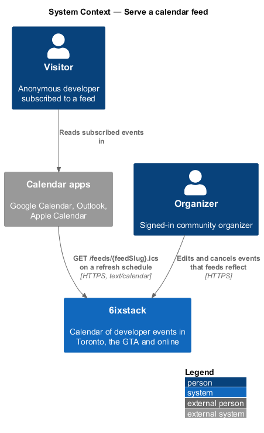
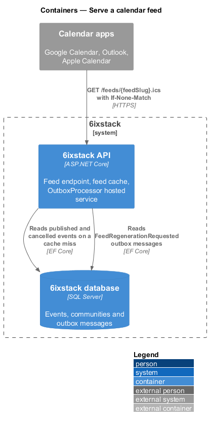
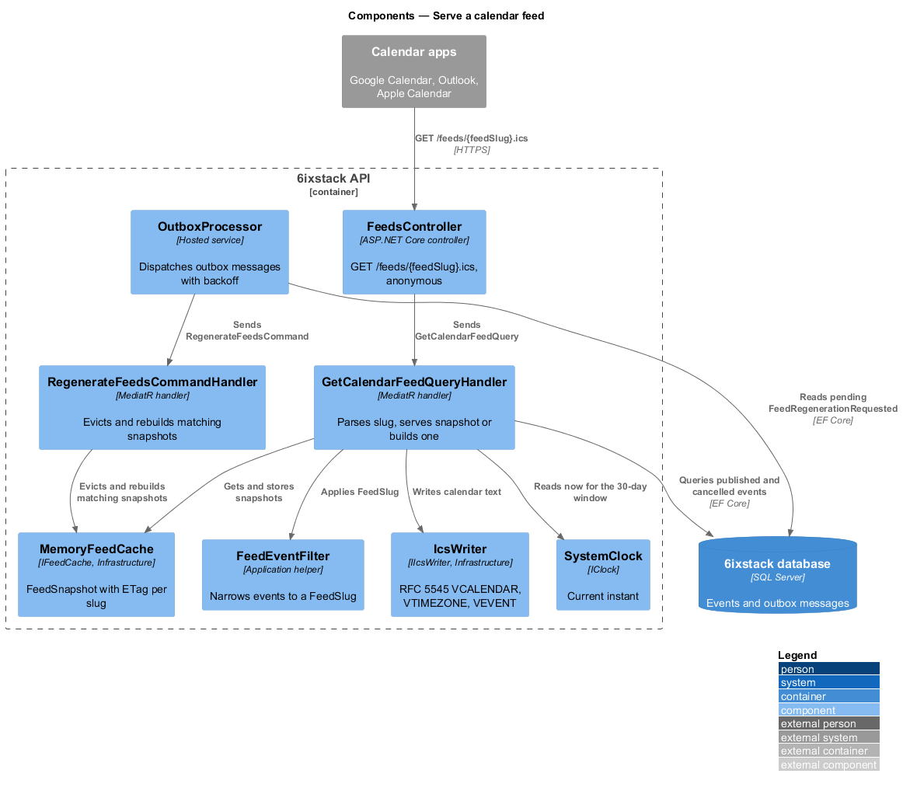
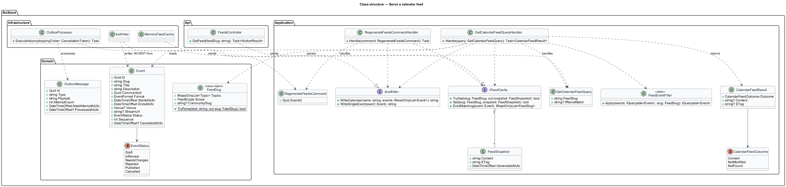
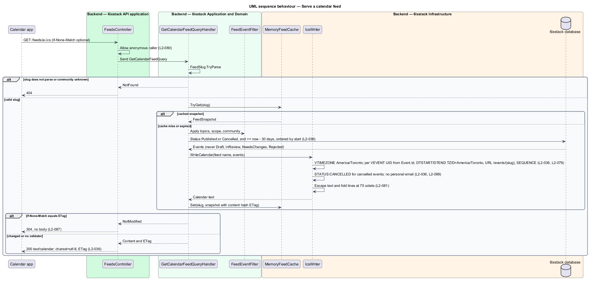
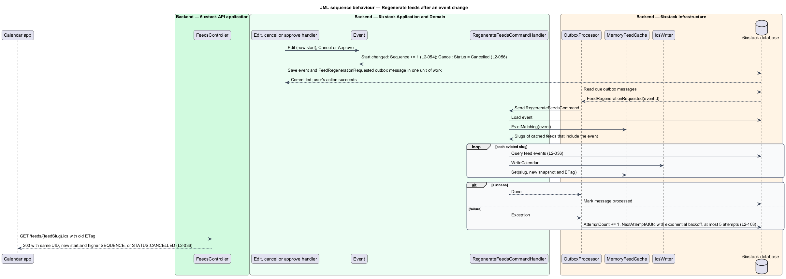

# Serve a calendar feed

## Overview

6ixstack is a calendar of developer events in Toronto, the Greater Toronto Area
(GTA) and online. Every ready-made or custom calendar feed
(`feeds-and-sharing/ready-made-feeds`, `feeds-and-sharing/build-custom-feed`)
resolves to one URL of the form `/feeds/{feedSlug}.ics`. Calendar applications
such as Google Calendar, Outlook and Apple Calendar request that URL on their
own schedule, typically every 2 to 12 hours according to the feeds page copy.
This feature covers the response: an iCalendar document of the published
events that match the feed, kept current as organizers edit, cancel and
moderators approve events.

The feature belongs to the `feeds-and-sharing` subsystem. It has no screen of
its own; its consumer is a calendar application, not a person in a browser.

Terms used in this design:

- **iCalendar document** — text document in the RFC 5545 format, with one `VCALENDAR` holding `VTIMEZONE` and `VEVENT` components
- **feed slug** — canonical text form of a feed's topics, scope and optional community, parsed back into a `FeedSlug`
- **feed window** — events from 30 days before the request onward
- **UID** — iCalendar property that identifies an event across refreshes; a calendar application updates rather than duplicates an event with a known UID
- **SEQUENCE** — iCalendar revision number of an event; a higher value tells the calendar application to replace its copy
- **feed snapshot** — rendered iCalendar text of one feed, with its entity tag, held in the feed cache
- **entity tag (ETag)** — validator header that lets a client ask whether a resource changed with `If-None-Match`

A feed holds published events and cancelled events that were published. A
cancelled event stays in the feed with `STATUS:CANCELLED`, so subscribed
calendars mark it rather than silently dropping it. Events in draft, in review,
needing changes or rejected never appear.

## Description

The slice runs from an anonymous HTTP GET to the database through one query,
with a cache in front of the query and a background job that refreshes the
cache when events change.

- **`FeedsController`** — ASP.NET Core controller. `GET /feeds/{feedSlug}.ics`
  allows anonymous callers (`L2-080`). It passes the slug and the
  `If-None-Match` header to the query. It answers `200` with content type
  `text/calendar; charset=utf-8` and an `ETag` header, `304` with no body when
  the tag matches, and `404` when the slug does not parse or names an unknown
  community. It holds no business rules.
- **`GetCalendarFeedQuery`** — query carrying the raw `FeedSlug` text and the
  optional `IfNoneMatch` value.
- **`GetCalendarFeedQueryHandler`** — MediatR handler. It parses the slug with
  `FeedSlug.TryParse`, asks `IFeedCache` for a snapshot, and on a miss builds
  one: it selects events in status `Published` or `Cancelled` inside the feed
  window, applies `FeedEventFilter`, orders them by start, and passes them to
  `IIcsWriter`. It returns a `CalendarFeedResult` of `NotFound`, `NotModified`
  or `Content`.
- **`FeedEventFilter`** — Application helper shared with `ready-made-feeds` and
  `build-custom-feed`. It applies topics (any match), scope (`GtaOnly` keeps
  in-person and hybrid, `StreamingOnly` keeps streaming and hybrid) and an
  optional community.
- **`IIcsWriter`** / **`IcsWriter`** — contract in `SixStack.Application` and
  implementation in `SixStack.Infrastructure`. `WriteCalendar` writes the
  `VCALENDAR` with `VERSION:2.0`, `PRODID`, `CALSCALE:GREGORIAN`,
  `METHOD:PUBLISH`, `X-WR-CALNAME` (the feed name) and a `VTIMEZONE` for
  `America/Toronto` with its daylight saving rules. Each `VEVENT` carries:
  - `UID` derived from `Event.Id` and the site domain, so it never changes for
    the life of the event
  - `DTSTAMP` from `IClock`, and `LAST-MODIFIED` from the event's last change
  - `DTSTART;TZID=America/Toronto` and `DTEND;TZID=America/Toronto`, converted
    from `StartsAtUtc` and `EndsAtUtc` (`L2-079`)
  - `SUMMARY` from the title, `DESCRIPTION` from the plain-text description,
    and `LOCATION` from the venue name and address or the stream URL
  - `URL` pointing at the event detail page `/events/{slug}`
  - `SEQUENCE` from `Event.Sequence`
  - `STATUS:CANCELLED` for cancelled events and `STATUS:CONFIRMED` otherwise

  The writer escapes commas, semicolons, backslashes and line breaks in text
  values and folds lines longer than 75 octets, as RFC 5545 requires
  (`L2-081`). It writes no `ORGANIZER` or `ATTENDEE` email address
  (`L2-099`). `add-to-calendar` reuses `WriteSingleEvent` from the same writer.
- **`IFeedCache`** / **`MemoryFeedCache`** — contract in `SixStack.Application`
  and in-process implementation in `SixStack.Infrastructure`. It stores one
  `FeedSnapshot` (`Content`, `ETag`, `GeneratedAtUtc`) per canonical slug.
  The `ETag` is a hash of the content. A cached response serves within 100 ms
  at the 95th percentile (`L2-087`).
- **`FeedRegenerationRequested`** — `OutboxMessage` type written through
  `IOutbox` in the same unit of work as an approval (`L2-060`), an edit of a
  published event (`L2-054`), a cancellation (`L2-056`) or an undone approval.
  Its payload is the event id.
- **`OutboxProcessor`** — hosted service in the API. It dispatches each
  `FeedRegenerationRequested` message to `RegenerateFeedsCommandHandler` and
  retries a failure with exponential backoff up to 5 attempts, without failing
  the user's action (`L2-103`).
- **`RegenerateFeedsCommandHandler`** — MediatR handler. It evicts every cached
  snapshot whose `FeedSlug` matches the changed event and rebuilds those that
  were cached, so the next request is served from cache.
- **`Event.Sequence`** — integer on the `Event` entity, incremented by
  `Event.Edit` when the start or end time changes (`L2-054` criterion 4). This
  slice reads it; `organizer/edit-event` owns the increment.

The feed URL uses the `webcal://` scheme in links and is served over HTTPS at
the same path. The API serves `/feeds/*` on the public site host, outside the
`/api` prefix; the reverse-proxy rule that routes it is `<TO SUPPLY>`.

Decided in journey 10:

- The window keeps events that end on or after the request time minus 30 days; there is no upper bound.
- No snapshot cache yet: each request builds the document, and the `ETag` (a SHA-256 of the content) still
  answers `304` to a matching `If-None-Match`. `IFeedCache` and `FeedRegenerationRequested` arrive if the
  `L2-087` budget needs them; the seed scale is far inside it.
- `Cache-Control: public, max-age=900`.
- Subscriber counting is decided with the dashboard (journey 15); this slice records no requester data.
- `PRODID:-//6ixstack//Events//EN`, `UID:{event id}@6ixstack.dev`, `X-WR-CALNAME:6ixstack: {feed name}`.
- `Event.Sequence` is added (0 for seeded events); `organizer/edit-event` increments it.
- In development the Angular dev server proxies `/feeds/` to the API; production routes it at the reverse proxy.

## Requirements

| L2 ID | Refines (L1) | Requirement |
|-------|--------------|-------------|
| `L2-036` | `L1-007` | Each feed URL shall return an iCalendar (RFC 5545) document of published events matching its filters, from 30 days in the past onward, with stable event UIDs, times in `America/Toronto`, the event detail URL, and `STATUS:CANCELLED` for cancelled events. |

## Diagrams

### System context

Calendar applications request feeds from 6ixstack without any account. A
visitor never calls this endpoint directly; the visitor's calendar
application does.

### Containers

The API serves `/feeds/{feedSlug}.ics` from its cache and reads the database on
a miss. The API's hosted `OutboxProcessor` refreshes cached feeds after event
changes.

### Components

`FeedsController` sends `GetCalendarFeedQuery` to its handler, which consults
`MemoryFeedCache` and on a miss filters events with `FeedEventFilter` and
renders them with `IcsWriter`. `OutboxProcessor` drives
`RegenerateFeedsCommandHandler` from `FeedRegenerationRequested` messages.

### Class structure

The query handler depends on `IFeedCache`, `IIcsWriter` and `IAppDbContext`
and returns a `CalendarFeedResult`. `IcsWriter` reads `Event` fields, including
`Sequence` and `Status`, to write each `VEVENT`.

### Behaviour — serve a feed

An unknown slug returns 404. A cached snapshot whose tag matches
`If-None-Match` returns 304 (`L2-087`). Otherwise the handler serves the cached
snapshot or builds one from published and cancelled events in the feed window
(`L2-036`).

### Behaviour — regenerate feeds after an event change

An approval, edit or cancellation writes a `FeedRegenerationRequested` message
in the same unit of work. `OutboxProcessor` then refreshes the matching cached
feeds, so the next request carries the same `UID`, the new times, an
incremented `SEQUENCE` or `STATUS:CANCELLED` (`L2-036`, `L2-103`).

