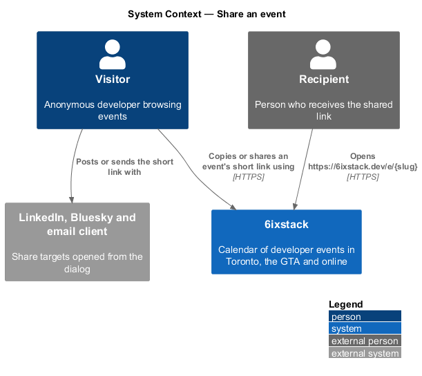
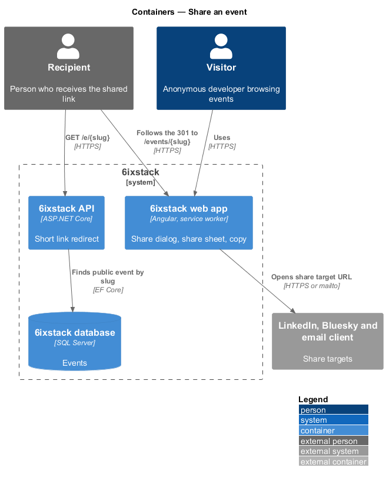
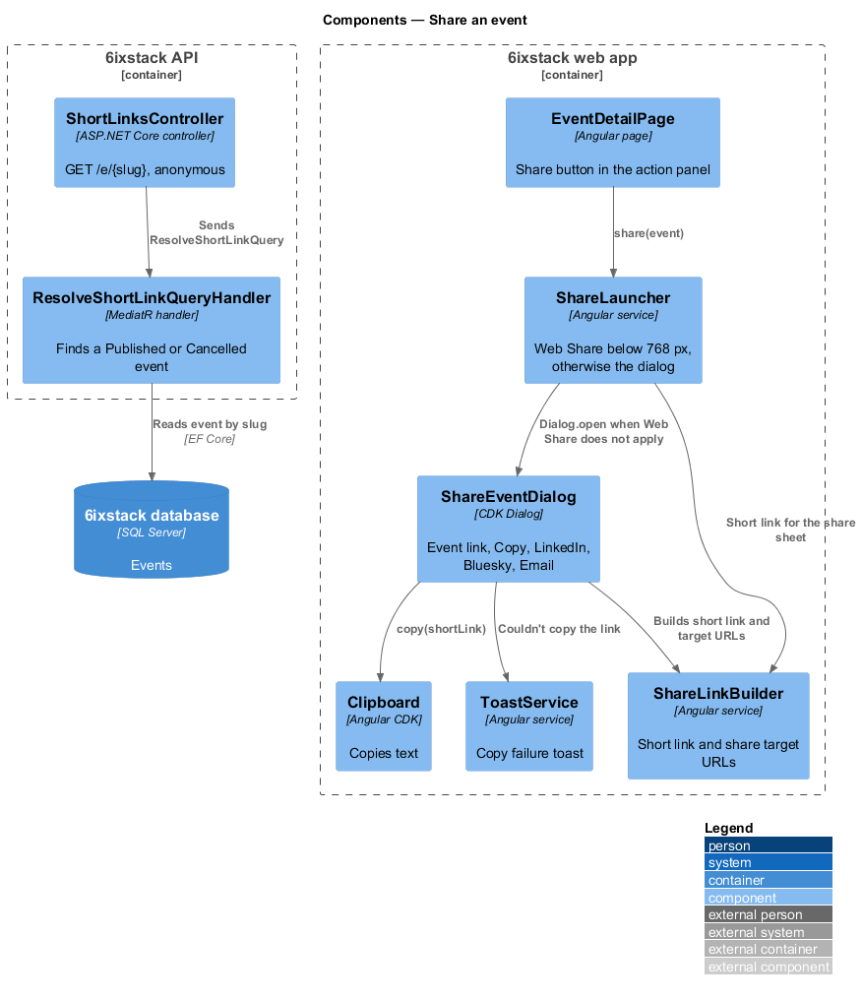
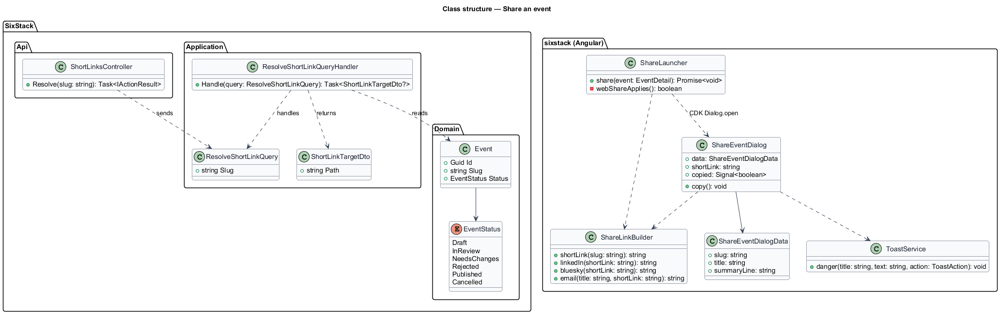
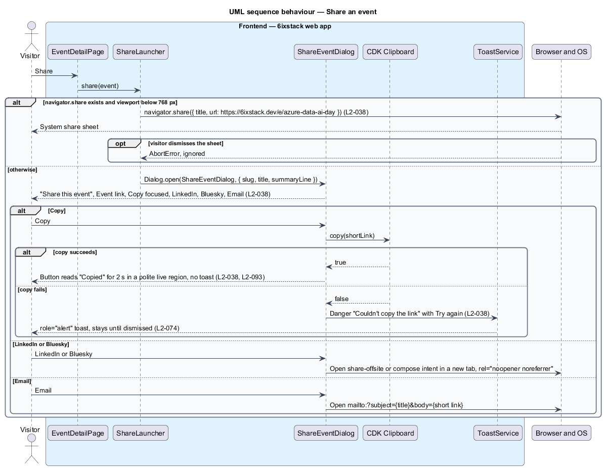
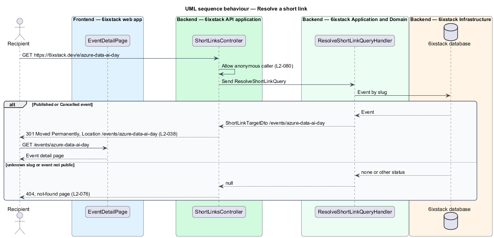

# Share an event

## Overview

6ixstack is a calendar of developer events in Toronto, the Greater Toronto Area
(GTA) and online. Word of mouth fills meetups, so a visitor who finds an event
often passes it on to a colleague or posts it on a social network. This
feature covers the "Share this event" dialog on the event detail page, the
short link it offers, the redirect that resolves the short link, and the system
share sheet that replaces the dialog on phones.

The feature belongs to the `feeds-and-sharing` subsystem. The Share button sits
in the action panel of the event detail page (`discovery/view-event-detail`),
under "Add to my calendar" (`feeds-and-sharing/add-to-calendar`).

Terms used in this design:

- **short link** — public URL of the form `https://6ixstack.dev/e/{slug}` that redirects permanently to an event's detail page
- **system share sheet** — operating-system panel opened by the Web Share API (`navigator.share`) that lists the apps a device can share to
- **share target** — external destination offered in the dialog: LinkedIn, Bluesky or Email

The short link uses the event's slug, so it never changes while the event
exists. On viewports narrower than 768 px whose browser supports the Web Share
API, Share opens the system share sheet with the event title and short link
instead of the dialog.

## Description

The slice runs from one Angular service and one dialog to one redirect
endpoint. Copying and the share targets run entirely in the browser; only the
short link touches the API, when someone opens it.

- **`ShareLauncher`** — Angular service in project `sixstack` that the event
  detail page calls when Share is activated. When `navigator.share` exists and
  the viewport matches `(max-width: 767.98px)`, it calls
  `navigator.share({ title, url })` with the event title and short link.
  Otherwise it opens `ShareEventDialog`. A share sheet the visitor dismisses
  (`AbortError`) ends quietly.
- **`ShareEventDialog`** (`sx-share-event-dialog`) — Angular CDK dialog in
  `frontend/projects/sixstack/src/app/dialogs/share-event/`, built on
  `DialogShell` with the title "Share this event" and the event summary line as
  its description. It shows the read-only "Event link" field with the short
  link and a Copy button, which receives initial focus, followed by the
  LinkedIn, Bluesky and Email options. The mock records no busy or invalid
  state because copying is local and there is nothing to fill in.
- **`ShareEventDialogData`** — dialog data carrying the event `slug`, `title`
  and summary line.
- **`ShareLinkBuilder`** — Angular service that builds the short link from the
  configured public origin and the slug, and the share target URLs:
  - LinkedIn: `https://www.linkedin.com/sharing/share-offsite/?url=` plus the
    encoded short link
  - Bluesky: `https://bsky.app/intent/compose?text=` plus the encoded short link
  - Email: `mailto:?subject=` plus the encoded title and `&body=` plus the
    encoded short link

  LinkedIn and Bluesky open in a new tab with `rel="noopener noreferrer"`.
- **Copy** — the dialog copies with the Angular CDK `Clipboard`. On success the
  button reads "Copied" with a check icon for 2 s, inside a polite live region,
  and then returns to "Copy"; no toast appears. On failure `ToastService`
  raises the danger toast "Couldn't copy the link" with "Try again", which
  repeats the copy and stays until dismissed (`L2-074`).
- **`ShortLinksController`** — ASP.NET Core controller. `GET /e/{slug}` allows
  anonymous callers (`L2-080`) and dispatches `ResolveShortLinkQuery`. It
  answers `301 Moved Permanently` with `Location: /events/{slug}`, or `404`
  when the query finds nothing. It holds no business rules.
- **`ResolveShortLinkQuery`** / **`ResolveShortLinkQueryHandler`** — query by
  slug and its MediatR handler. The handler returns the event detail path when
  an event with that slug is `Published` or `Cancelled`. It returns nothing for
  an unknown slug or an event in any other status, so the short link never
  reveals an unpublished event.
- **`ShortLinkTargetDto`** — `Path` of the event detail page.

Decided in journey 12:

- The share sheet gets the title and the short link only.
- When `navigator.share` fails for any reason other than the visitor dismissing it, the dialog opens instead.
- Bluesky gets the link only, as in the mock.
- The web app builds the short link on the host it is served from (`{origin}/e/{slug}`), like feed links, so local
  and staging links work; production serves `6ixstack.dev`. The dev server proxies `/e/` to the API; production
  routes it at the reverse proxy. An unknown short link answers the API's 404.
- `L2-038` criterion 2 and the mocks use the seed's slug, `azure-data-ai-day-gta`.

## Requirements

| L2 ID | Refines (L1) | Requirement |
|-------|--------------|-------------|
| `L2-038` | `L1-008` | The "Share this event" dialog shall show the event's short link (`https://6ixstack.dev/e/{slug}`) with a Copy button and LinkedIn, Bluesky and Email options; on devices supporting the Web Share API below 768 px, Share shall open the system share sheet instead. |

## Diagrams

### System context

A visitor shares an event link from 6ixstack to a social network, an email
client or another app. A recipient who opens the short link is redirected by
6ixstack to the event page.

### Containers

The web app builds the short link and the share target URLs itself. The API
resolves `GET /e/{slug}` against the database and redirects.

### Components

The event detail page calls `ShareLauncher`, which picks the system share sheet
or `ShareEventDialog`. The dialog builds links with `ShareLinkBuilder` and
copies with the CDK `Clipboard`. In the API, `ShortLinksController` sends
`ResolveShortLinkQuery` to its handler.

### Class structure

`ShareLauncher` depends on the CDK `Dialog` and opens `ShareEventDialog` with
`ShareEventDialogData`. The query handler reads `Event` and returns a
`ShortLinkTargetDto`.

### Behaviour — share from the event page

On a phone with Web Share support, Share opens the system share sheet. On any
other device it opens the dialog. Copy confirms in place for 2 s without a
toast; a failed copy raises a persistent danger toast (`L2-038`).

### Behaviour — resolve a short link

A short link for a public event answers 301 to `/events/{slug}`. An unknown
slug or an unpublished event answers 404 (`L2-038`).

