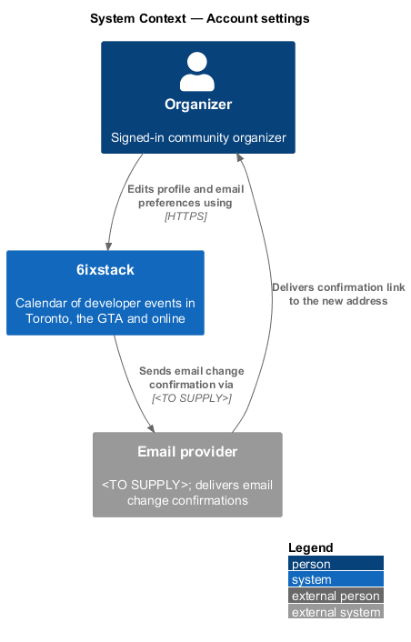
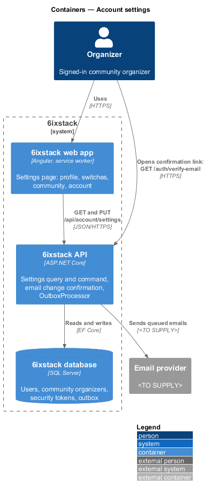
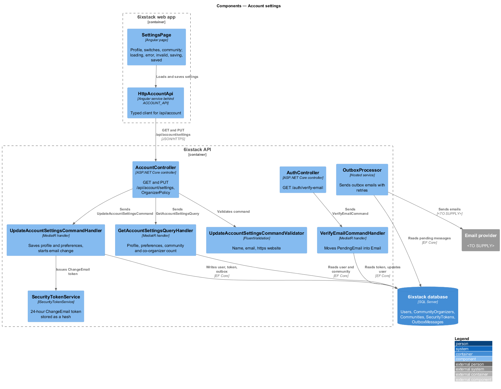
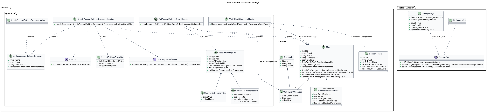
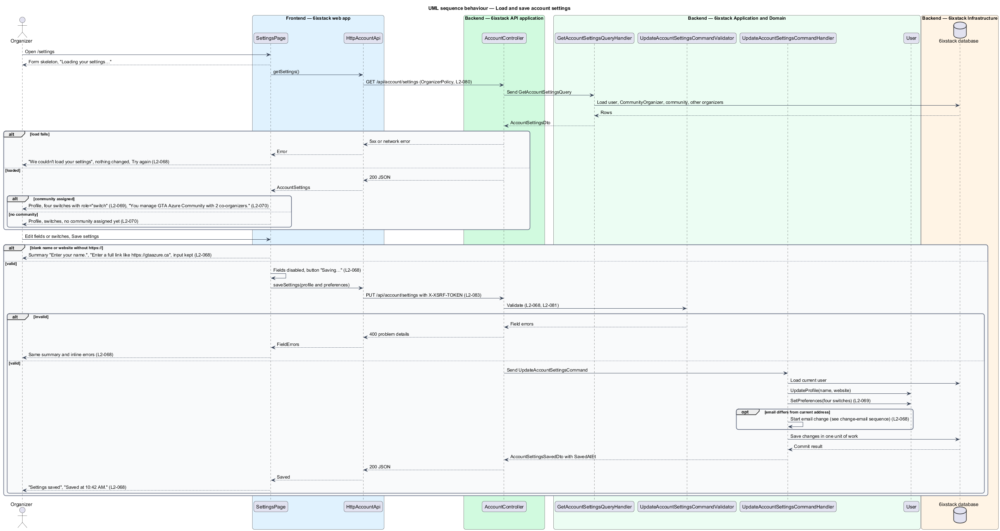
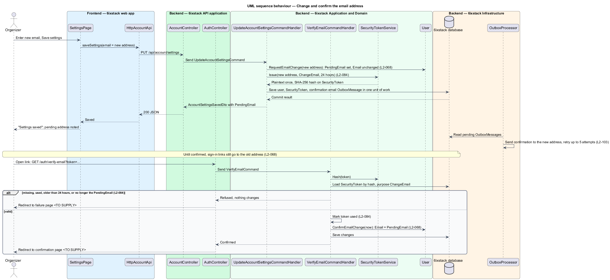

# Account settings

## Overview

6ixstack is a calendar of developer events in Toronto, the Greater Toronto Area
(GTA) and online. An organizer is a signed-in person who manages one community's
events. The settings page at `/settings` is where an organizer keeps their
profile current, chooses which notifications also arrive by email, and sees the
community they manage. The page and its states are drawn in
`docs/mocks/pages/settings/`.

The feature belongs to the `identity` subsystem. The Account section at the
bottom of the page opens two dialogs that belong to other slices: sign-out
(`identity/sessions-and-sign-out`) and account deletion
(`identity/delete-account`). The email notifications themselves are sent by
`notifications/email-notifications`, which reads the preferences saved here.

Terms used in this design:

- **profile** — organizer's name, email and website, shown to moderators and not to attendees
- **pending email** — new address an organizer has entered but not yet confirmed
- **email change confirmation** — single-use link sent to the pending email that makes it the account's address
- **notification preferences** — four on or off switches, one per email notification type
- **co-organizer** — another organizer assigned to the same community

Changing the email does not take effect at once. 6ixstack sends a confirmation
link to the new address, valid for 24 hours. The account keeps signing in with
the old address until that link is opened.

## Description

The slice runs from the Angular page through one query and one command to the
database, plus the confirmation link path.

### Frontend (project `sixstack`, clients in project `api`)

- **`SettingsPage`** (`sx-settings-page`, route `/settings`, guarded by
  `authGuard`) — Angular page with a section navigation (Profile, Email
  notifications, Community, Account) and one form holding the Profile and Email
  notifications sections. The header's Submit event button is hidden. The page
  owns these states:
  - Loading: a form skeleton with "Loading your settings…".
  - Error: "We couldn't load your settings" with "Nothing has been changed" and
    Try again.
  - Invalid: an error summary listing each problem, such as "Enter your name."
    and "Enter a full link like https://gtaazure.ca", with inline errors and the
    input kept.
  - Submitting: fields disabled and the button reads "Saving…".
  - Success: the status alert "Settings saved" with "Saved at 10:42 AM.".
- **Profile fields** — Name (required, up to 100 characters), Email (help text
  "Changing it sends a confirmation link to the new address."), Community
  (read-only), Website (optional, `https://` URL).
- **Email notification switches** — four `Switch` components from project
  `components`, each an `<input type="checkbox" role="switch">` with a visible
  label (`L2-069`):
  - "My event is approved or needs changes" (on by default)
  - "Someone reports a problem with my event" (on by default)
  - "Weekly summary of going and feed numbers" (off by default)
  - "New events from communities I follow" (off by default)
- **Community section** — "You manage GTA Azure Community with 2
  co-organizers.", with the community name linked to `/communities/{slug}`. An
  organizer without a community sees that no community is assigned yet; the
  exact wording is `<TO SUPPLY>`.
- **`AccountApi`** / **`ACCOUNT_API`** / **`HttpAccountApi`** — client
  contract, injection token and HTTP implementation for
  `GET /api/account/settings` and `PUT /api/account/settings`. The same contract
  carries `DELETE /api/account` for `identity/delete-account`.
- **Library components** — `FormField`, `ErrorSummary`, `Alert`, `Switch` and
  `Skeleton` from project `components`.

### Backend

- **`AccountController`** — ASP.NET Core controller. `GET` and
  `PUT /api/account/settings` require `OrganizerPolicy` (`L2-080`) and the
  anti-forgery check on `PUT` (`L2-083`). It dispatches and holds no business
  rules.
- **`GetAccountSettingsQuery`** / **`GetAccountSettingsQueryHandler`** — loads
  the current user, the `CommunityOrganizer` row and the community, and counts
  the other organizers of that community (`L2-070`). It returns
  `AccountSettingsDto`.
- **`AccountSettingsDto`** — `Name`, `Email`, `PendingEmail`, `WebsiteUrl`,
  `Community` (`CommunitySummaryDto` with `Slug` and `Name`, or `null`),
  `CoOrganizerCount` and `Preferences` (`NotificationPreferencesDto`).
- **`UpdateAccountSettingsCommand`** — `Name`, `Email`, `WebsiteUrl` and
  `Preferences`. Profile and preferences save together (`L2-069`).
- **`UpdateAccountSettingsCommandValidator`** — name is required, up to
  100 characters; email is a valid address; website, when present, is an
  absolute `https://` URL (`L2-068`, `L2-081`). Messages match the form copy.
  Failures return 400 problem details with field errors.
- **`UpdateAccountSettingsCommandHandler`** — calls
  `User.UpdateProfile(name, websiteUrl)` and `User.SetPreferences(preferences)`.
  When the email differs from `User.Email`, it calls
  `User.RequestEmailChange(newEmail)` to set `PendingEmail`. It then issues a
  `ChangeEmail` `SecurityToken` for the new address with a 24-hour lifetime
  (`L2-084`) and appends the confirmation email to the outbox. `User.Email` is
  unchanged, so sign-in links still go to the old address (`L2-068`). All
  writes commit in one unit of work. The handler returns
  `AccountSettingsSavedDto` with `SavedAtUtc`, the Toronto-time label
  `SavedAtEt` (for example "10:42 AM") and `PendingEmail`.
- **`User`** — entity. This feature uses `Name`, `Email`, `WebsiteUrl`,
  `PendingEmail` and `Preferences`, and adds the methods `UpdateProfile`,
  `SetPreferences`, `RequestEmailChange` and `ConfirmEmailChange`.
- **`NotificationPreferences`** — value object owned by `User` with
  `EventDecisions`, `Reports`, `WeeklySummary` and `FollowedCommunities`, each a
  `bool`. A new account starts with `true`, `true`, `false`, `false` (`L2-067`).
- **`AuthController`** / **`VerifyEmailCommandHandler`** — the confirmation link
  opens `GET /auth/verify-email?token=`, shared with `submissions/submit-event`.
  For purpose `ChangeEmail` the handler checks that the token is unused,
  unexpired and matches the current `PendingEmail`. It then marks the token used
  and calls `User.ConfirmEmailChange(now)`, which moves `PendingEmail` into
  `Email` and sets `EmailVerifiedAtUtc`. A missing, used or expired token
  changes nothing.
- **`ISecurityTokenService`**, **`IOutbox`** / **`OutboxProcessor`** — shared
  with `identity/magic-link-sign-in`. The confirmation email is sent by the
  hosted `OutboxProcessor` to the email provider with retries (`L2-103`).

The requirements leave the following points open. The design does not settle
them:

- The behaviour when the new email already belongs to another account:
  `<TO SUPPLY>`.
- Whether the old address receives a notice of the change: `<TO SUPPLY>`.
- The redirect target after the confirmation link is opened: `<TO SUPPLY>`.
- "New events from communities I follow" has no requirement that defines
  following a community. The switch is stored, but no feature reads it yet:
  `<TO SUPPLY>`.
- Whether moderators use this page (see `identity/sessions-and-sign-out`):
  `<TO SUPPLY>`.

## Requirements

| L2 ID | Refines (L1) | Requirement |
|-------|--------------|-------------|
| `L2-068` | `L1-015` | The settings page (`/settings`) shall let an organizer edit name (required, up to 100 characters), email and website (optional, `https://` URL) and see their community read-only; changing the email shall send a confirmation link to the new address and keep the old address until confirmed. |
| `L2-069` | `L1-015` | The settings page shall show one switch per email notification type from L2-067 and save their state with the profile. |
| `L2-070` | `L1-015` | The settings page shall state the community the organizer manages, linked to its page, and the number of co-organizers. |

## Diagrams

### System context

An organizer manages their profile and email preferences in 6ixstack. A changed
email address receives its confirmation link through the external email
provider.

### Containers

The web app reads and saves settings through the API. The API stores the
profile, preferences and pending email in the database and queues the
confirmation email.

### Components

`SettingsPage` calls `HttpAccountApi`. In the API, `AccountController` sends the
query or the command; the command handler issues a `ChangeEmail` token when the
address changes. `VerifyEmailCommandHandler` confirms the change later.

### Class structure

`User` owns its `NotificationPreferences` and its pending email.
`UpdateAccountSettingsCommandHandler` mutates the user and issues a
`SecurityToken` for an email change. On the client, `SettingsPage` depends on
the `AccountApi` contract through `ACCOUNT_API`.

### Behaviour — load and save settings

The page shows a skeleton while loading and Try again on failure. Saving
validates on the client and the server, locks the form while in flight, and
shows "Settings saved" with the Toronto time. The switches save with the profile
(`L2-068`, `L2-069`, `L2-070`).

### Behaviour — change and confirm the email address

A new address becomes pending, and a 24-hour confirmation link goes to it. The
account keeps signing in with the old address until the link is opened
(`L2-068`, `L2-084`).

## Decisions (journey 25)

- **Endpoints**: `GET` and `PUT /api/account/settings` (signed in), and `GET /auth/confirm-email?token=…`, which
  redirects to `/settings?email-confirmed=1|0`.
- **A new email** is stored as `User.PendingEmail`, with a 24-hour `ChangeEmail` link sent to the new address.
  Sign-in keeps the current address until the link is used. An address that belongs to another account is refused
  on the email field.
- **Website** is optional and must be a full `https://` link with a host.
- **Email switches**: decisions, reports and the weekly summary. The "communities I follow" switch waits for the
  follow feature, since nothing would send those emails yet.
- **Community line**: "You manage {community} with {n} co-organizers", counting the other organizers. Without a
  community: "No community is assigned to your account yet."
- **Account section** (Sign out, Delete account) joins with journeys 26 and 27. The section nav lists only the
  sections that exist.
- "Saved at {time}." uses the API's clock in Toronto time.
- The seed adds Nadia Chen as a GTA Azure volunteer organizer, so Priya has the 2 co-organizers that L2-070 names.

