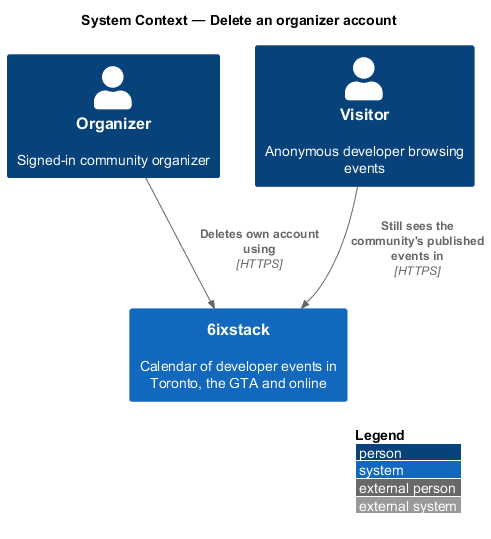
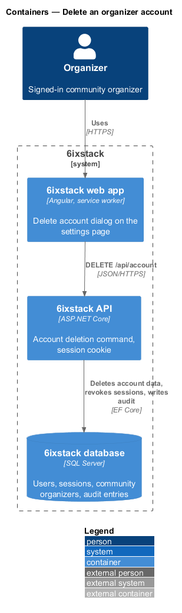
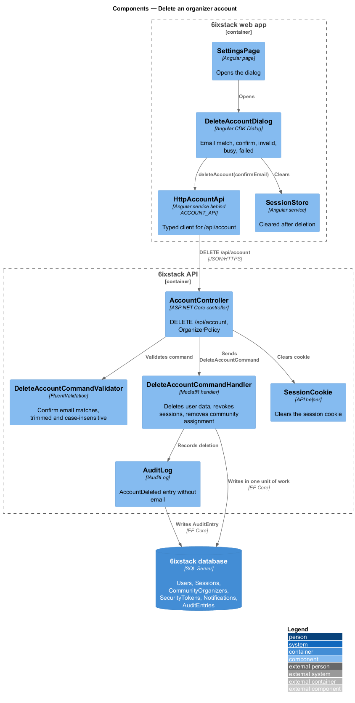
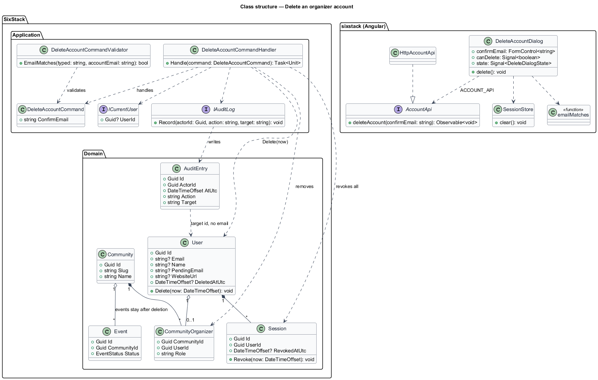
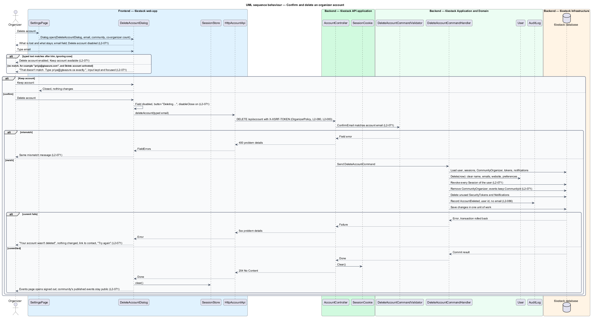

# Delete an organizer account

## Overview

6ixstack is a calendar of developer events in Toronto, the Greater Toronto Area
(GTA) and online. An organizer is a signed-in person who manages one community's
events. This feature lets an organizer delete their own account from the
settings page. Deletion removes the person's access and personal data, but the
community's published events stay public, because they belong to the community
and not to the person. The dialog and its states are drawn in
`docs/mocks/dialogs/delete-account/`.

The feature belongs to the `identity` subsystem. The dialog opens from the
Account section of `SettingsPage` (`identity/account-settings`). Sessions and
their revocation are defined in `identity/sessions-and-sign-out`. Removal of
residual personal data within 30 days and the audit trail belong to
`platform/privacy-and-retention` and `platform/security-hardening`.

Terms used in this design:

- **account deletion** — permanent removal of an organizer's account, sessions and community assignment
- **confirmation email** — account email the organizer types into the dialog before Delete account enables
- **email match** — typed text equal to the account email after trimming surrounding spaces and ignoring letter case
- **co-organizers** — other organizers of the same community, who keep managing its events after the deletion

Deletion cannot be undone. After it succeeds, every session of the account
ends, the person lands on the events page signed out, and the community's
published events remain listed.

## Description

The slice runs from the dialog through one command to the database.

### Frontend (project `sixstack`, clients in project `api`)

- **`DeleteAccountDialog`** — Angular CDK `Dialog` in
  `frontend/projects/sixstack/src/app/dialogs/delete-account/`, opened from the
  "Delete account" button on `SettingsPage`. Its title is "Delete your
  organizer account?". Its description states what is lost and what stays: "You
  lose access to edit GTA Azure Community events. Published events stay up,
  managed by your 2 co-organizers. This can't be undone." The community name and
  co-organizer count come from `AccountSettingsDto`. The body holds one field,
  "Type your email, priya@gtaazure.ca, to confirm". The footer holds "Keep
  account" and "Delete account". The dialog owns these states:
  - Default: the field is empty and Delete account is disabled, with the reason
    exposed through its accessible description.
  - Confirm: the typed text matches, Delete account enables and Keep account
    stays available.
  - Invalid: activating Delete account with a non-matching value, for example
    "priya@gtaazure.com", shows "That doesn't match. Type priya@gtaazure.ca
    exactly." with the input kept and focused.
  - Busy: the field is disabled, the button reads "Deleting…", and
    `disableClose` blocks Escape and backdrop dismissal. The close button is
    hidden.
  - Failed: "Your account wasn't deleted" says nothing changed and links to
    `/contact`; the button reads "Try again".
- **`emailMatches`** — pure function comparing the typed text with the account
  email after `trim()` and case folding. The dialog and the server apply the
  same rule.
- **`AccountApi`** / **`ACCOUNT_API`** / **`HttpAccountApi`** — client contract,
  injection token and HTTP implementation. `deleteAccount(confirmEmail)` sends
  `DELETE /api/account` with a JSON body `{ "confirmEmail": "…" }`.
- **`SessionStore`** — cleared after a successful deletion, before navigation to
  `/`, so the header shows no account controls.

### Backend

- **`AccountController`** — ASP.NET Core controller. `DELETE /api/account`
  requires `OrganizerPolicy` (`L2-080`) and the anti-forgery check (`L2-083`). On
  success it clears the session cookie through `SessionCookie` and answers 204.
  It dispatches the command and holds no business rules.
- **`DeleteAccountCommand`** — request carrying `ConfirmEmail`.
- **`DeleteAccountCommandValidator`** — rejects a `ConfirmEmail` that does not
  match the current user's email under the email match rule, with the same
  message as the dialog. This guards direct API calls.
- **`DeleteAccountCommandHandler`** — MediatR handler. In one unit of work it:
  1. calls `User.Delete(now)`, which sets `DeletedAtUtc` and clears `Name`,
     `Email`, `PendingEmail`, `WebsiteUrl` and the preferences;
  2. revokes every `Session` of the user (`L2-071`);
  3. removes the user's `CommunityOrganizer` row, leaving the community and its
     events untouched;
  4. deletes the user's unused `SecurityToken` rows and `Notification` rows;
  5. writes an `AuditEntry` through `IAuditLog` with actor, time, action
     `AccountDeleted` and target user id, and without the email (`L2-086`).

  Published events keep their `CommunityId` and stay public (`L2-071`).
- **`User`** — entity. `Delete(now)` performs the clearing above and makes the
  account invisible to sign-in and session checks.
- **`Session`** — `Revoke(now)` is shared with `identity/sessions-and-sign-out`.
  `SessionAuthenticationHandler` treats a revoked session, or a session of a
  deleted user, as anonymous.
- **`IAuditLog`** / **`AuditLog`** — shared audit writer; entries are retained
  for 2 years (`L2-086`).

Personal data outside the user row, such as `Event.SubmitterEmail` on the
person's submissions, is removed by the retention job in
`platform/privacy-and-retention` within 30 days (`L2-100`).

The requirements leave the following points open. The design does not settle
them:

- `L2-071` keeps Delete account disabled until the email matches, yet its first
  acceptance criterion activates Delete account with a non-matching email. A
  natively disabled button cannot be activated. Whether the button uses
  `aria-disabled` (focusable, shows the mismatch error on activation) or native
  `disabled` (error shown on blur instead): `<TO SUPPLY>`.
- The dialog wording when the organizer has no co-organizers or no community:
  `<TO SUPPLY>`.
- What happens to the person's submissions still in review: `<TO SUPPLY>`.
- Whether the deleted address may sign in again later and receive a new
  account: `<TO SUPPLY>`.
- Whether moderators may delete their own account through this dialog:
  `<TO SUPPLY>`.

## Requirements

| L2 ID | Refines (L1) | Requirement |
|-------|--------------|-------------|
| `L2-071` | `L1-015` | The "Delete your organizer account?" dialog shall state what is lost and what stays, require typing the account email (ignoring case and surrounding spaces) before "Delete account" enables, and on success remove the account and its sessions while published events stay under the community. |

## Diagrams

### System context

An organizer deletes their own account in 6ixstack. No external system takes
part in this slice.

### Containers

The web app sends the deletion to the API. The API removes the account and its
sessions in the database and leaves the community's events in place.

### Components

`DeleteAccountDialog` checks the email match and calls `HttpAccountApi`. In the
API, `AccountController` validates the confirmation and sends
`DeleteAccountCommand`. The handler deletes the user, revokes the sessions and
writes the audit entry.

### Class structure

`DeleteAccountCommandHandler` mutates `User`, revokes each `Session`, removes the
`CommunityOrganizer` row and writes through `IAuditLog`. `Event` keeps its
`CommunityId` and is not touched. On the client, `DeleteAccountDialog` depends on
the `AccountApi` contract through `ACCOUNT_API`.

### Behaviour — confirm and delete the account

Delete account enables only after the email matches. The busy dialog cannot be
dismissed. Success ends every session and lands on the events page signed out;
failure says nothing changed and offers Try again (`L2-071`).

