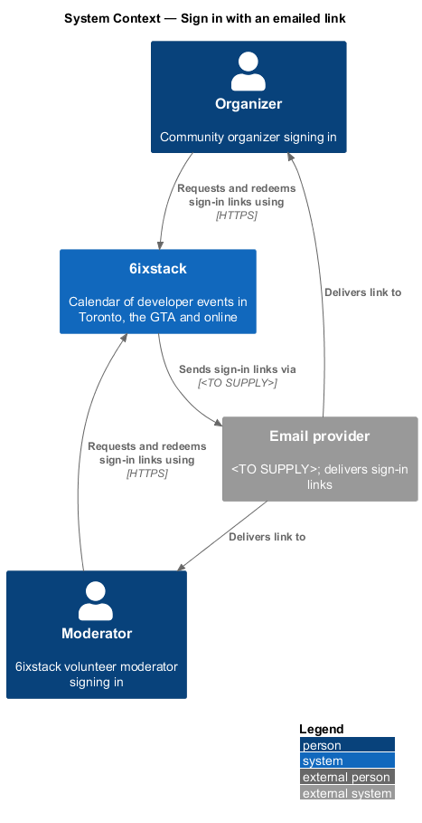
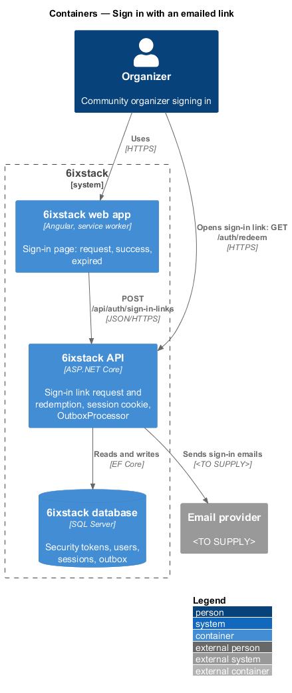
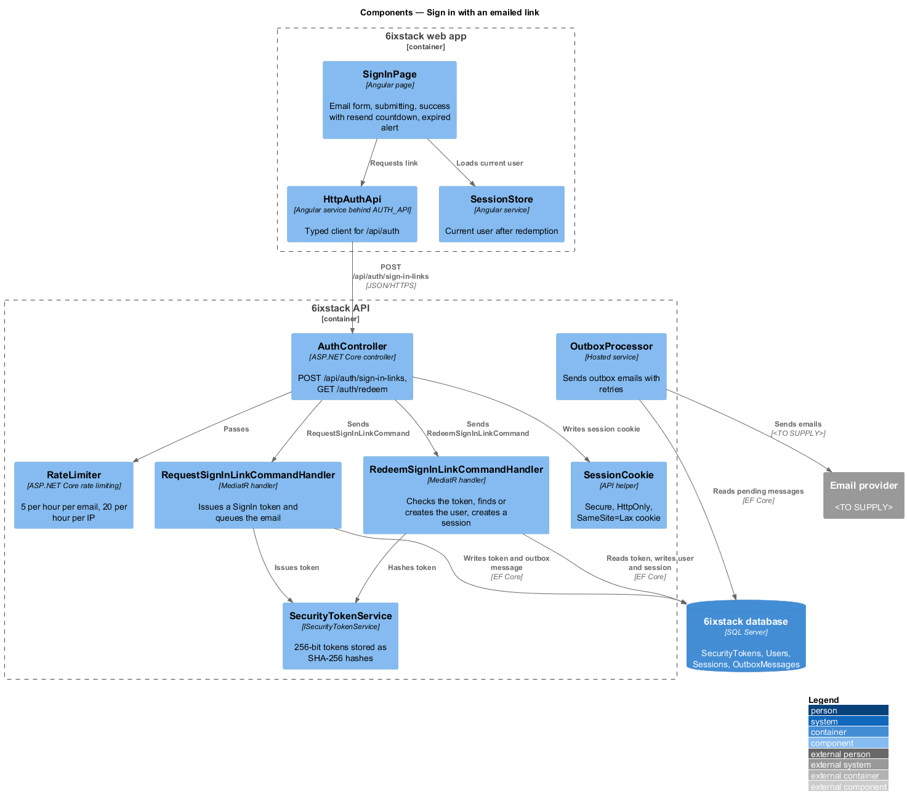
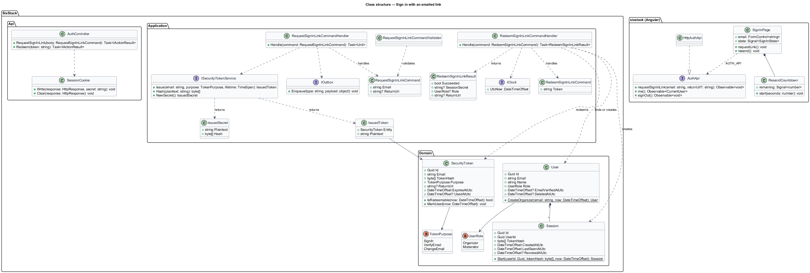
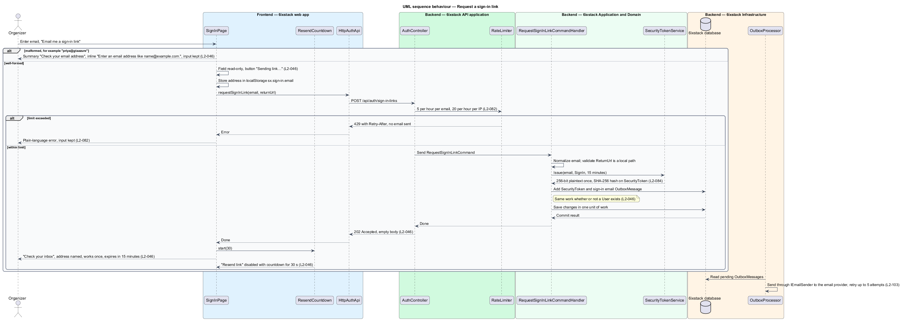
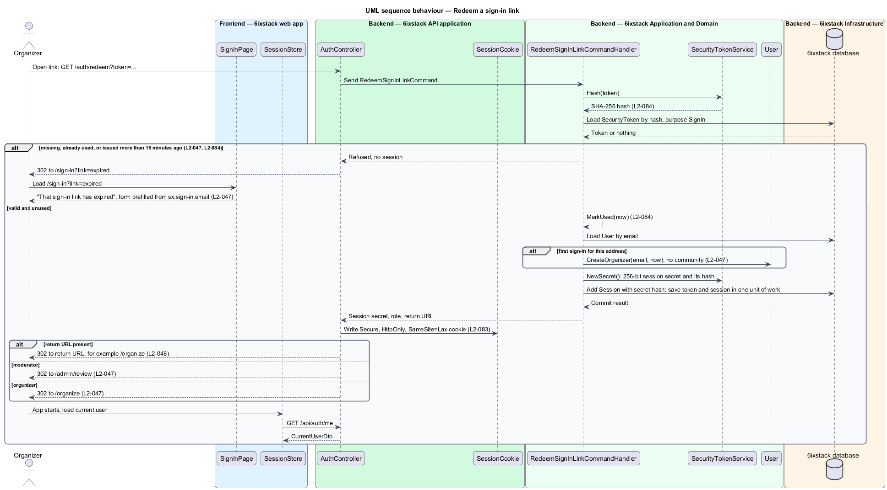

# Sign in with an emailed link

## Overview

6ixstack is a calendar of developer events in Toronto, the Greater Toronto Area
(GTA) and online. Anyone may browse and submit events without an account.
Organizers and moderators sign in to manage listings and review submissions.
6ixstack has no passwords: a person signs in by asking for a link at
`/sign-in`, then opening the link from their inbox. This feature covers both
halves of that exchange. The page and its states are drawn in
`docs/mocks/pages/sign-in/`.

The feature belongs to the `identity` subsystem. The session it starts, the
session cookie and sign-out belong to `identity/sessions-and-sign-out`. The pages
a signed-in user lands on belong to `organizer/organizer-dashboard` and
`moderation/review-queue`.

Terms used in this design:

- **sign-in link** — single-use URL emailed to an address, carrying a token that starts a session when opened
- **sign-in token** — random secret inside a sign-in link, stored by 6ixstack only as a hash
- **redeem** — open a sign-in link so 6ixstack checks its token and starts a session
- **return URL** — local path the user asked for before sign-in, opened after a successful redemption
- **first sign-in** — redemption for an email address that has no account yet

A sign-in link works once and expires 15 minutes after it is issued. The sign-in
page answers the same way for every well-formed address, so it never reveals
whether an account exists. Opening the first link for a new address creates an
organizer account with no community.

## Description

The slice has two paths: requesting a link from the page, and redeeming the link
from the inbox.

### Frontend (project `sixstack`, clients in project `api`)

- **`SignInPage`** (`sx-sign-in-page`, route `/sign-in`) — Angular page with one
  autofocused Email field and the button "Email me a sign-in link". The header's
  Submit event button is hidden on this page. The page owns these states:
  - Invalid: the summary "Check your email address" and the inline error "Enter
    an email address like name@example.com." appear, and the input is kept.
  - Submitting: the field is read-only and the button reads "Sending link…".
  - Success: "Check your inbox" names the address and says the link works once
    and expires in 15 minutes. "Resend link" is disabled for 30 seconds with a
    countdown in the button. "Use a different email" returns to the form.
  - Expired: when the URL carries `?link=expired`, the alert "That sign-in link
    has expired" appears above the form, prefilled with the last requested
    address.
- **`ResendCountdown`** — small signal-based timer used by `SignInPage`. It
  disables Resend link for 30 seconds after each send and renders the remaining
  seconds in the button label.
- **`AuthApi`** / **`AUTH_API`** / **`HttpAuthApi`** — client contract,
  injection token and HTTP implementation for `POST /api/auth/sign-in-links`.
  The same contract serves `identity/sessions-and-sign-out`.
- **`SessionStore`** — shared app service holding the current user. After a
  redemption the app loads it from `GET /api/auth/me`.
- **Last requested email** — the page keeps the address of the last request in
  `localStorage` under `sx.sign-in.email`. It uses that value to prefill the
  form after an expired link. The redirect URL never carries the address.

### Backend

- **`AuthController`** — ASP.NET Core controller. `POST /api/auth/sign-in-links`
  is anonymous and protected by two rate-limit policies: 5 requests per hour per
  email and 20 per hour per IP address (`L2-082`). Beyond those limits it answers
  429 with `Retry-After` and sends no email. `GET /auth/redeem?token=` is an
  anonymous browser navigation that answers with a redirect.
- **`RequestSignInLinkCommand`** — request carrying `Email` and an optional
  `ReturnUrl`.
- **`RequestSignInLinkCommandValidator`** — requires a well-formed email
  address. It accepts a `ReturnUrl` only when it is a local path beginning with a
  single `/`, which prevents open redirects.
- **`RequestSignInLinkCommandHandler`** — MediatR handler. It normalizes the
  email to lower case without surrounding spaces. It issues a `SignIn`
  `SecurityToken` through `ISecurityTokenService` with a 15-minute lifetime and
  appends the sign-in email to the outbox. The work is the same whether or not a
  `User` exists, so the response and its timing match in both cases (`L2-046`).
  The controller always answers 202 with an empty body.
- **`RedeemSignInLinkCommand`** — request carrying the plaintext `Token`.
- **`RedeemSignInLinkCommandHandler`** — MediatR handler. It hashes the token
  and loads the `SecurityToken` by hash. It refuses a token that is missing,
  already used or past `ExpiresAtUtc` (`L2-047`, `L2-084`). For a valid token it
  marks the token used, loads the `User` by email or creates one with role
  `Organizer` and no community, and creates a `Session`. It returns the session
  secret, the role and the stored return URL. The token update and the session
  insert commit in one unit of work, so a second redemption of the same token
  always fails.
- **`SessionCookie`** — API helper shared with
  `identity/sessions-and-sign-out`. It writes the session secret as a `Secure`,
  `HttpOnly`, `SameSite=Lax` cookie (`L2-083`).
- **`ISecurityTokenService`** / **`SecurityTokenService`** — generates
  32 random bytes (256 bits) with `RandomNumberGenerator`. It returns the
  Base64Url plaintext once and stores only its SHA-256 hash in
  `SecurityToken.TokenHash` (`L2-084`). Verification and email change tokens
  use the same service with a 24-hour lifetime. `NewSecret()` produces the
  256-bit session secret and its hash in the same way.
- **`SecurityToken`** — entity with `Id`, `Email`, `TokenHash`, `Purpose`,
  `ExpiresAtUtc` and `UsedAtUtc`. This feature adds `string? ReturnUrl` for
  sign-in tokens.
- **`User`** — entity. `User.CreateOrganizer(email, now)` creates the account on
  first sign-in with `Role = Organizer` and no `CommunityOrganizer` row
  (`L2-047`).
- **`IOutbox`** / **`OutboxProcessor`** — the sign-in email is an outbox
  message, sent by the hosted `OutboxProcessor` through `IEmailSender` to the
  email provider with retries (`L2-103`).

After a valid redemption the API redirects to the return URL. Without one, it
redirects to `/organize` for an organizer or `/admin/review` for a moderator. A
refused token redirects to `/sign-in?link=expired` and starts no session.

The requirements leave the following points open. The design does not settle
them:

- The redemption is a `GET`, so mail-security scanners that prefetch links can
  consume a token before the person opens it. Decision (journey 05): no confirm step for now; revisit if
  people report dead links.
- The prefill after an expired link works only in the browser that requested
  the link. A link opened in another browser shows an empty form.
- Whether a sign-in request for a deleted account's address creates a new
  account on redemption: decided with delete account (journey 26).
- The sign-in email (journey 05): subject "Your 6ixstack sign-in link"; body "Open this link to sign in to
  6ixstack. It works once and expires in 15 minutes: {link}. If you didn't ask for it, ignore this email."
- Sessions are server-side rows behind the data-protected cookie (ADR 0009) rather than a hashed cookie secret.
- Rate limits: 5 link requests per hour per email answer 429 with `Retry-After` and send nothing. The per-IP
  limit of 20 per hour uses ASP.NET Core rate limiting on the endpoint.
- Until journeys 15 and 06, `/organize` and `/admin/review` are guarded placeholders (ADR 0009).

## Requirements

| L2 ID | Refines (L1) | Requirement |
|-------|--------------|-------------|
| `L2-046` | `L1-011` | The sign-in page (`/sign-in`) shall accept an email address and send a single-use sign-in link valid for 15 minutes, responding identically whether or not an account exists. |
| `L2-047` | `L1-011` | Opening a valid sign-in link shall start a session and open the organizer dashboard (or the review queue for moderators); an expired or already used link shall show "That sign-in link has expired" with the email form prefilled. |
| `L2-084` | `L1-019` | Sign-in tokens shall contain at least 128 bits of cryptographic randomness, be stored only as a hash, be single use, and expire 15 minutes after issue; email verification and email change tokens shall follow the same rules with a 24-hour expiry. |

## Diagrams

### System context

An organizer or moderator asks 6ixstack for a sign-in link. 6ixstack sends it
through the external email provider, and the person opens it to sign in.

### Containers

The web app posts the request to the API. The browser opens the emailed link
directly on the API, which sets the session cookie and redirects into the web
app.

### Components

`SignInPage` posts through `HttpAuthApi`. In the API, `AuthController` sends
`RequestSignInLinkCommand` or `RedeemSignInLinkCommand`. Both handlers use
`SecurityTokenService`, and the redemption handler creates the `Session` that
`SessionCookie` writes.

### Class structure

The request handler issues a `SecurityToken` with purpose `SignIn`. The
redemption handler marks it used, finds or creates the `User`, and creates a
`Session`. On the client, `SignInPage` depends on the `AuthApi` contract through
`AUTH_API`.

### Behaviour — request a sign-in link

The page checks the address first. The API issues a hashed, 15-minute token and
queues the email for every well-formed address, so the success page is the same
whether or not an account exists (`L2-046`). Resend link stays disabled for
30 seconds.

### Behaviour — redeem a sign-in link

A valid, unused token less than 15 minutes old starts a session and opens the
dashboard or the review queue. A first sign-in creates an organizer account
(`L2-047`). A used or expired token starts no session and returns to the sign-in
page with the expired message (`L2-084`).

