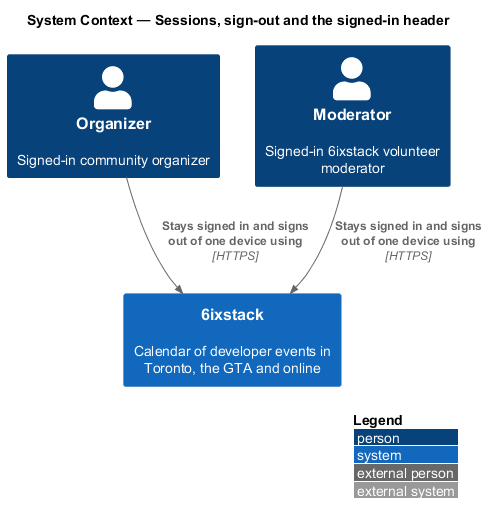
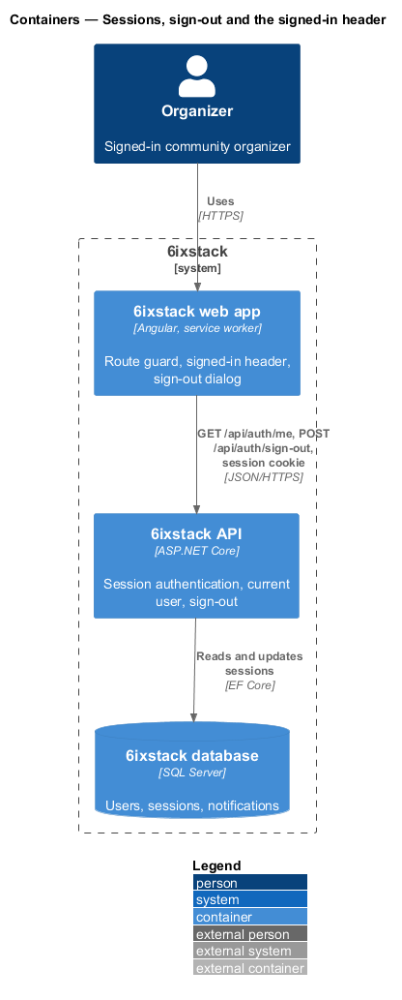
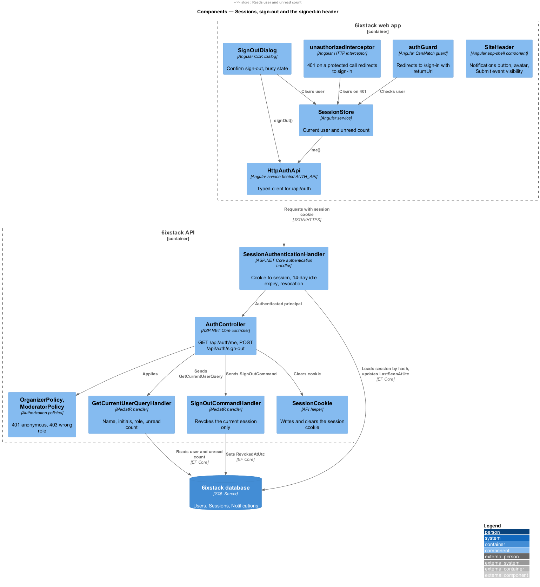
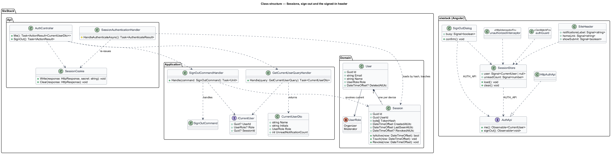
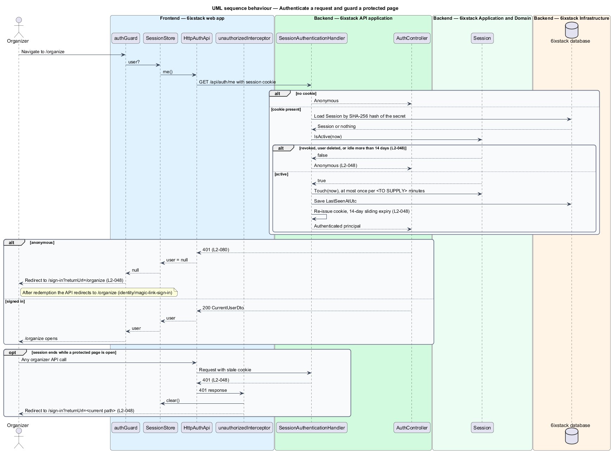
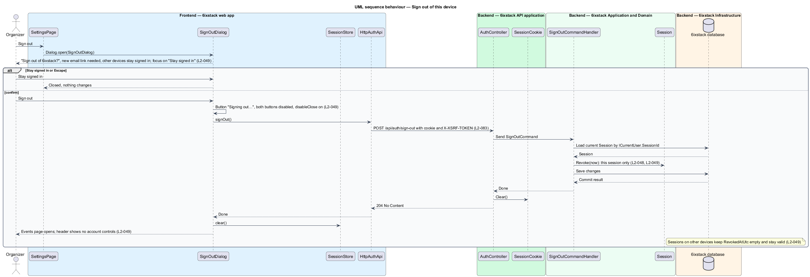
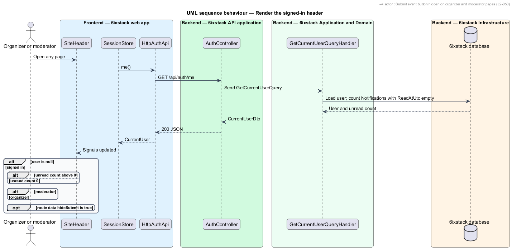

# Sessions, sign-out and the signed-in header

## Overview

6ixstack is a calendar of developer events in Toronto, the Greater Toronto Area
(GTA) and online. Organizers and moderators sign in with an emailed link
(`identity/magic-link-sign-in`). This feature covers what happens after that:
how 6ixstack recognizes a signed-in browser on later requests, when that
recognition ends, how a person signs out of one device, and how the site header
changes for a signed-in user. The sign-out dialog is drawn in
`docs/mocks/dialogs/sign-out/`; the signed-in header appears on every organizer
and moderator page in `docs/mocks/pages/`.

The feature belongs to the `identity` subsystem. The header itself is part of the
app shell (`site/app-shell`); this feature defines its account controls. The
notification count it shows comes from `notifications/in-app-notifications`.

Terms used in this design:

- **session** — record that ties one browser on one device to one signed-in user
- **session cookie** — `Secure`, `HttpOnly`, `SameSite=Lax` cookie carrying the session secret
- **session secret** — random value in the session cookie, stored by 6ixstack only as a hash
- **last activity** — time of the most recent authenticated request on a session
- **idle expiry** — end of a session 14 days after its last activity
- **revoked session** — session ended by sign-out or account deletion, never accepted again
- **protected page** — organizer or moderator page that requires a session, such as `/organize`, `/settings` or `/admin/review`
- **return URL** — local path of the protected page the user asked for, carried to `/sign-in` and back

Each sign-in creates one session for one device. Signing out ends only that
session; other devices stay signed in. A session that is idle for 14 days, or
that has been revoked, is treated as anonymous.

## Description

The slice covers session authentication on every request, the route guard and
header in the web app, and the sign-out command.

### Frontend (project `sixstack`, clients in project `api`)

- **`SessionStore`** — shared app service. It loads the current user from
  `GET /api/auth/me` when the app starts and exposes `user` and `unreadCount`
  signals. A 401 response sets `user` to `null`. The refresh cadence of the
  unread count is `<TO SUPPLY>` and is shared with
  `notifications/in-app-notifications`.
- **`authGuard`** — functional `CanMatch` guard on protected routes. When
  `SessionStore.user` is `null`, it redirects to `/sign-in?returnUrl=<path>`
  (`L2-048`). The moderator routes also check `role` (`L2-080`).
- **`unauthorizedInterceptor`** — HTTP interceptor. A 401 from an organizer or
  moderator endpoint clears `SessionStore` and redirects to
  `/sign-in?returnUrl=<current path>`. This covers a session that expires while a
  page is open.
- **`SiteHeader`** — app-shell component. For a signed-in user it renders the
  account controls for `L2-050`:
  - a notifications button whose accessible name is "Notifications, N unread"
    with a count badge when N is above 0, and "Notifications" with no badge at 0;
  - an avatar with the user's initials, linking to `/organize` for an organizer
    or `/admin/review` for a moderator.

  On organizer and moderator pages it hides the Submit event button. Routes
  declare this through route data `hideSubmit: true`.
- **`SignOutDialog`** — Angular CDK `Dialog` in
  `frontend/projects/sixstack/src/app/dialogs/sign-out/`, opened from the Account
  section of `SettingsPage` (`identity/account-settings`). Its title is "Sign
  out of 6ixstack?" and its body reads "You'll need a new email link to sign back
  in. Other devices stay signed in." "Stay signed in" receives initial focus.
  While busy, the confirm button reads "Signing out…", both buttons are disabled
  and `disableClose` blocks Escape and backdrop dismissal (`L2-049`).
- **`AuthApi`** / **`AUTH_API`** / **`HttpAuthApi`** — client contract,
  injection token and HTTP implementation for `GET /api/auth/me` and
  `POST /api/auth/sign-out`.
- **Library components** — `DialogShell`, `Avatar` and the count `Badge` from
  project `components`.

### Backend

- **`SessionAuthenticationHandler`** — ASP.NET Core authentication handler
  registered as the default scheme. It reads the session cookie, hashes the
  secret, and loads the `Session` by hash. It accepts the session only when
  `RevokedAtUtc` is empty, the user is not deleted, and `LastSeenAtUtc` lies
  within the last 14 days (`L2-048`). Otherwise the request is anonymous. On an
  accepted request it advances `LastSeenAtUtc` and re-issues the cookie with a
  14-day sliding expiry. To limit writes, it advances `LastSeenAtUtc` at most
  once per `<TO SUPPLY>` minutes.
- **Anti-forgery** — every state-changing, cookie-authenticated request carries
  the Angular `X-XSRF-TOKEN` header, checked by ASP.NET Core antiforgery
  (`L2-083`).
- **`OrganizerPolicy`** / **`ModeratorPolicy`** — authorization policies.
  Anonymous callers receive 401, and callers without the required role receive
  403 (`L2-080`).
- **`AuthController`** — `GET /api/auth/me` returns `CurrentUserDto` for a
  signed-in caller and 401 otherwise. `POST /api/auth/sign-out` requires a
  session, sends `SignOutCommand`, clears the cookie through `SessionCookie`, and
  answers 204.
- **`GetCurrentUserQuery`** / **`GetCurrentUserQueryHandler`** — returns
  `CurrentUserDto` with `Name`, `Initials`, `Role` and `UnreadNotificationCount`
  for `ICurrentUser`.
- **`SignOutCommand`** / **`SignOutCommandHandler`** — revokes the current
  session only, by setting `RevokedAtUtc` through `Session.Revoke(now)`. Other
  sessions of the same user are untouched (`L2-049`).
- **`Session`** — entity with `Id`, `UserId`, `TokenHash`, `CreatedAtUtc`,
  `LastSeenAtUtc` and `RevokedAtUtc`. This feature adds `TokenHash` so the
  cookie secret is never stored in plain text. `IsActive(now)` holds the 14-day
  rule.
- **`ICurrentUser`** — application service exposing `UserId`, `Role` and
  `SessionId` from the authenticated principal.

The requirements leave the following points open. The design does not settle
them:

- Whether moderators reach `/settings` and the sign-out dialog. The mock opens
  sign-out from settings only, and `L2-068` describes settings for organizers:
  `<TO SUPPLY>`.
- An absolute maximum session lifetime regardless of activity: `<TO SUPPLY>`.

## Requirements

| L2 ID | Refines (L1) | Requirement |
|-------|--------------|-------------|
| `L2-048` | `L1-011` | Sessions shall expire 14 days after the last activity, apply to one device, and be revocable. |
| `L2-049` | `L1-011` | The "Sign out of 6ixstack?" dialog shall explain that a new email link is needed to sign back in and other devices stay signed in, focus "Stay signed in" first, and end only the current session. |
| `L2-050` | `L1-011` | For signed-in users, the header shall show a notifications button labelled with the unread count and a badge, and an avatar linking to the organizer dashboard (organizer) or review queue (moderator); organizer and moderator pages shall hide the header's Submit event button. |

## Diagrams

### System context

Organizers and moderators stay signed in to 6ixstack on each device until they
sign out or stay idle for 14 days. No external system takes part in this slice.

### Containers

The web app sends the session cookie with each API call. The API checks the
session against the database and records activity.

### Components

`SessionStore`, `authGuard` and `SiteHeader` in the web app read the current user
through `HttpAuthApi`. In the API, `SessionAuthenticationHandler` authenticates
every request before `AuthController` answers `me` or dispatches
`SignOutCommand`.

### Class structure

A `User` owns zero or more `Session` rows, one per device. `SignOutCommandHandler`
revokes one session, and `GetCurrentUserQueryHandler` returns a
`CurrentUserDto`. On the client, `SessionStore` and `SignOutDialog` depend on the
`AuthApi` contract through `AUTH_API`.

### Behaviour — authenticate a request and guard a protected page

An anonymous visitor to `/organize` goes to `/sign-in?returnUrl=/organize`. A
session idle for 14 days or revoked is anonymous, and an open protected page
redirects to sign-in with its return URL (`L2-048`).

### Behaviour — sign out of this device

"Stay signed in" has focus first. Confirming locks the dialog, revokes only the
current session, and opens the events page with no account controls (`L2-049`).

### Behaviour — render the signed-in header

The header names the unread count in the notifications button and shows a badge
only above 0. The avatar leads to the dashboard or the review queue by role, and
protected pages hide Submit event (`L2-050`).

