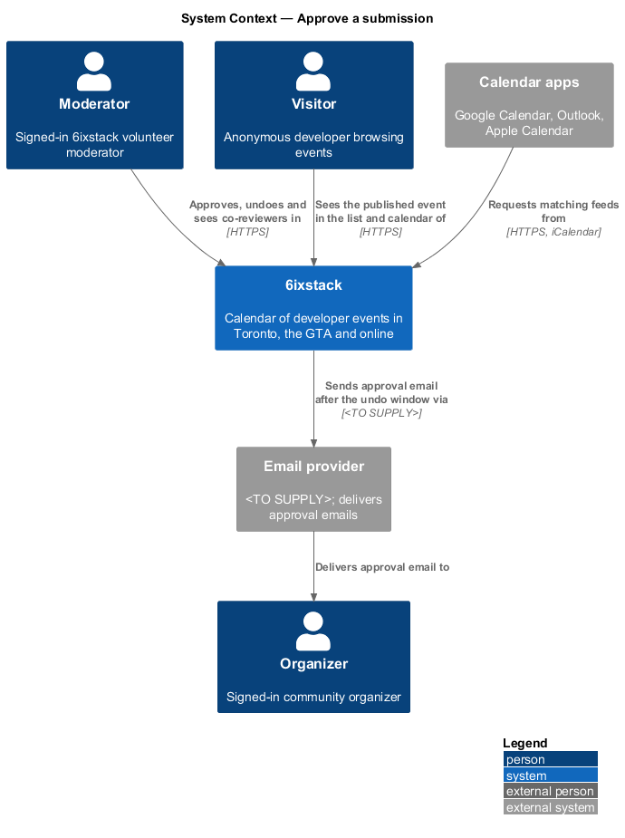
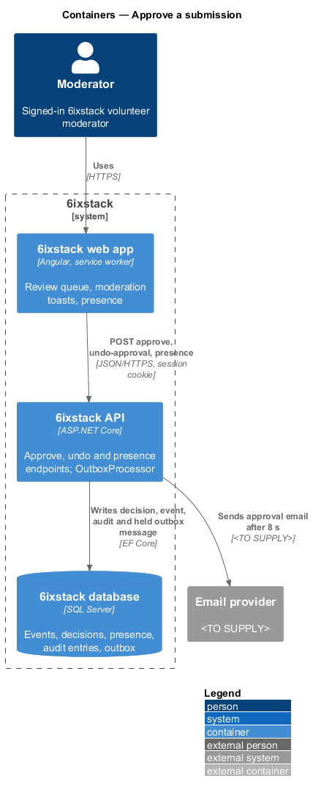
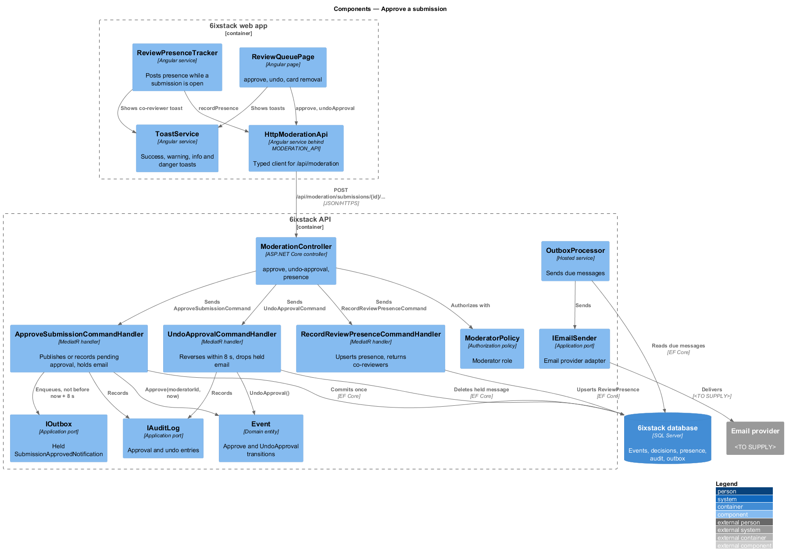
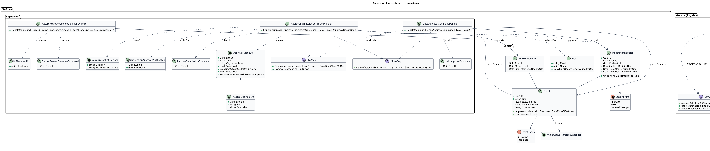
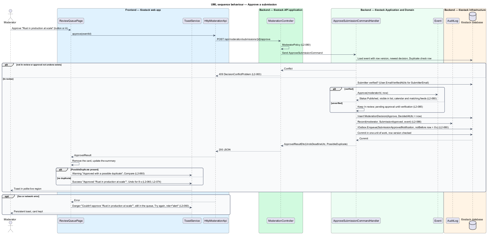
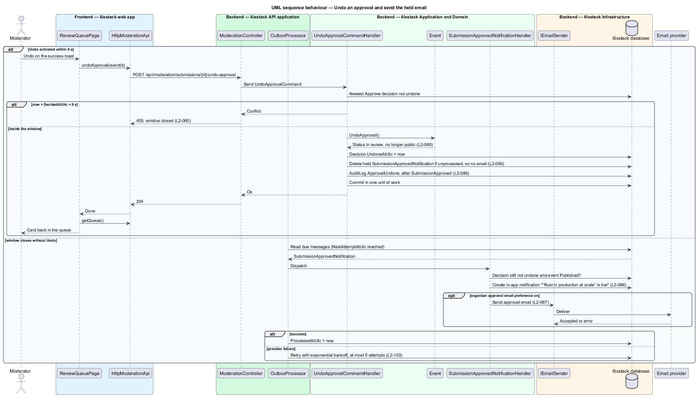
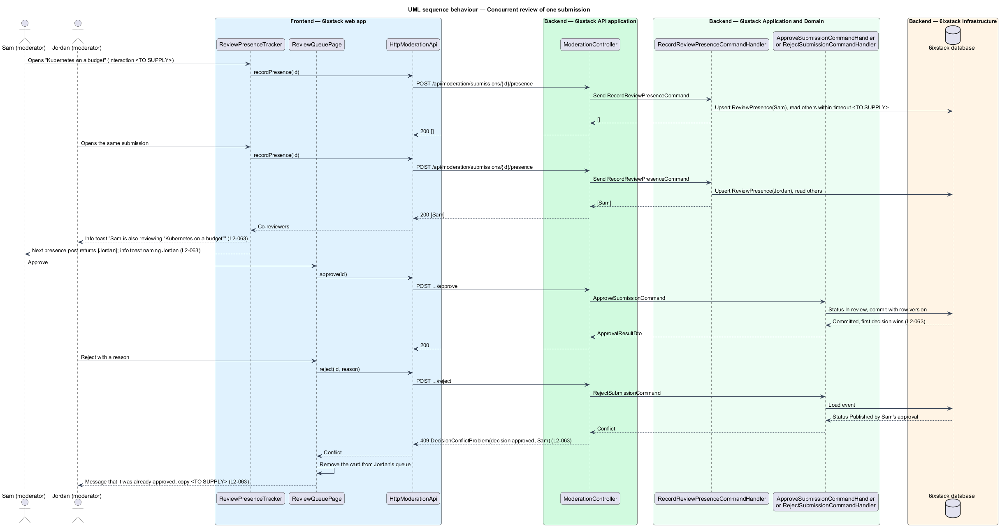

# Approve a submission

## Overview

6ixstack is a calendar of developer events in Toronto, the Greater Toronto Area
(GTA) and online. Every submitted event waits in the review queue until a
volunteer moderator decides on it. Approving is the decision that makes an event
public: it appears in the events list, the month calendar and every calendar
feed whose filters match. This feature covers Approve on a review card, the
Undo that follows it, and the rules for two moderators who look at the same
submission at once. The toasts are drawn in
`docs/mocks/notifications/moderation-toast/`.

The feature belongs to the `moderation` subsystem. Approve starts from a card or
the A shortcut in `moderation/review-queue`. The duplicate warning comes from
`moderation/automated-checks`. The in-app notification and the email that tell
the organizer are created through `notifications/in-app-notifications` and
`notifications/email-notifications`. Rejection, the other decision, is
`moderation/reject-submission`.

Terms used in this design:

- **approval** — moderator decision that publishes a submission, recorded as a `ModerationDecision` of kind `Approve`
- **undo window** — 8 s after an approval during which the deciding moderator may reverse it
- **held notification** — organizer email and in-app notification for an approval, queued in the outbox with a send time at the end of the undo window
- **pending approval** — approval of an event whose submitter email is not yet verified; the event stays unpublished until verification
- **review presence** — record that a moderator is looking at a submission, refreshed while they do
- **first decision wins** — rule that the earliest committed approval or rejection stands and a later conflicting one is refused with 409

Approving publishes the event at once, removes its card and shows the success
toast "Approved “{title}”" with Undo. Undo within 8 s returns the event to In
review and takes it off the public lists. The organizer's email waits until the
window closes, so an undone approval sends nothing. When the duplicate check
warned, the toast is the warning "Approved with a possible duplicate" with
Compare. When approval fails, a danger toast stays until dismissed and offers
Try again.

`L2-085` forbids publishing an event before its contact email is verified. An
approval of an unverified submitter's event is therefore recorded but leaves the
event In review; the identity subsystem publishes it when the address is
verified (`identity/magic-link-sign-in` owns the verification link).

## Description

The slice runs from the queue page through three commands to the database and,
after the undo window, to the email provider through the outbox.

- **`ReviewQueuePage`** — page from `moderation/review-queue`. Its `approve(card)`
  method calls the API, removes the card, and raises the toast. Its `undo(card)`
  method calls the undo endpoint and reloads the queue.
- **`ToastService`** — shared service from `site/toasts-and-banners`. It shows
  the success, warning, info and danger toasts of this slice. Non-danger toasts
  auto-dismiss after 8 s and pause while hovered or focused (`L2-074`).
- **`ReviewPresenceTracker`** — Angular service owned by the page. While a
  submission is open it posts presence for that submission every
  `<TO SUPPLY>` seconds. When the response names another moderator, it raises
  the info toast "{name} is also reviewing “{title}”" with the text "Your
  actions won't clash; the first decision wins." once per pair.
- **`ModerationApi`** / **`MODERATION_API`** / **`HttpModerationApi`** — this
  slice adds `approve(id)`, `undoApproval(id)` and `recordPresence(id)`.
- **`ModerationController`** — exposes
  `POST /api/moderation/submissions/{id}/approve`,
  `POST /api/moderation/submissions/{id}/undo-approval` and
  `POST /api/moderation/submissions/{id}/presence` behind `ModeratorPolicy`.
- **`ApproveSubmissionCommand`** / **`ApproveSubmissionCommandHandler`** — loads
  the event with its row version and refuses any event that is not In review or
  already holds an approval that was not undone (409). It checks the
  submitter's verification state. A verified submitter's event is published
  through `Event.Approve(moderatorId, now)`; an unverified submitter's event
  stays In review with the decision recorded. The handler records the
  `ModerationDecision` and the audit entry `SubmissionApproved`, enqueues the
  held notification with `notBeforeUtc` = now + 8 s, and commits once. It
  returns an `ApprovalResultDto`.
- **`UndoApprovalCommand`** / **`UndoApprovalCommandHandler`** — loads the
  newest approval that was not undone. It refuses with 409 when now is past
  `DecidedAtUtc` + 8 s. Otherwise it calls `Event.UndoApproval()`, sets
  `UndoneAtUtc`, deletes the held outbox message when it is still unprocessed,
  records the audit entry `ApprovalUndone` and commits once.
- **`RecordReviewPresenceCommand`** / **`RecordReviewPresenceCommandHandler`** —
  upserts a `ReviewPresence` row for the caller and the event. It returns the
  other moderators whose presence on that event is fresher than the presence
  timeout, which is `<TO SUPPLY>`.
- **`Event.Approve(moderatorId, now)`** / **`Event.UndoApproval()`** — domain
  methods. `Approve` moves In review to Published; `UndoApproval` moves Published
  back to In review. Both throw `InvalidStatusTransitionException` for any other
  status.
- **`ModerationDecision`** — domain entity recording `DecisionKind.Approve`,
  the moderator and `DecidedAtUtc`; `UndoneAtUtc` marks an undo.
- **`ReviewPresence`** — entity this design adds: `EventId`, `ModeratorId`,
  `LastSeenAtUtc`. Rows older than the presence timeout are ignored and deleted
  by `<TO SUPPLY>`.
- **`SubmissionApprovedNotification`** / **`SubmissionApprovedNotificationHandler`**
  — outbox message and its handler, run after the undo window. The handler
  re-checks that the decision was not undone, then creates the organizer's in-app notification "“{title}” is live"
  (`L2-066`) and, when the organizer's approval email preference is on, sends
  the email (`L2-067`). For a pending approval it is sent after verification
  instead; the trigger belongs to the identity subsystem.
- **`IAuditLog`** — records actor, time, action and target for approval and
  undo, in order (`L2-086`).
- **`ApprovalResultDto`** — `EventId`, `Title`, `OrganizerName`, `DecisionId`,
  `UndoDeadlineUtc`, `IsPublished` and an optional `PossibleDuplicate`
  (`EventId`, `Slug`, `DateLabel`) read from the `Duplicate` check row.
- **`DecisionConflictProblem`** — 409 problem details with `decision`
  (approved, rejected, needs changes) and the deciding moderator's first name.
  The page removes the card and shows that the submission was already decided.

The first decision wins through two guards in the same transaction: the status
check in the handler and the `Event` row version. Two approvals or an approval
and a rejection that race therefore commit once; the loser receives 409
(`L2-063`).

These points are open:

| Point | Gap |
|-------|-----|
| Undo window and hover | `L2-074` pauses a toast while hovered or focused, so Undo may stay visible after 8 s. The server enforces `DecidedAtUtc` + 8 s; whether it allows a grace period is `<TO SUPPLY>`. |
| Toast copy | The success toast text "It's live and Toronto Rust Meetup has been emailed." precedes the held email. The copy for a pending approval (unverified submitter) is also `<TO SUPPLY>`. |
| Undo by another moderator | Whether only the approving moderator may undo is `<TO SUPPLY>`. |
| Compare | No mock draws what Compare opens. The design links to the duplicate's public page; a side-by-side view is `<TO SUPPLY>`. |
| "Opened" | `L2-063` speaks of viewing a submission, but every card is visible on the queue. Which interaction counts as opening (focus, Edit, Reject dialog) is `<TO SUPPLY>`. |
| Queue refresh | `L2-063` refers to the queue updating. The refresh mechanism (polling interval or push) is `<TO SUPPLY>`. |
| Conflict message | The copy and toast kind for a refused conflicting decision are `<TO SUPPLY>`. |
| Feed freshness | Feeds may be cached (`feeds-and-sharing/serve-calendar-feed`); the delay before an approved event reaches a feed is `<TO SUPPLY>`. |

## Requirements

| L2 ID | Refines (L1) | Requirement |
|-------|--------------|-------------|
| `L2-060` | `L1-013` | Approving shall publish the event in the list, calendar and matching feeds, show a success toast with Undo for 8 s, and send the organizer's approval email only after the undo window closes. |
| `L2-063` | `L1-013` | When two moderators view the same submission, each shall see an info toast naming the other; the first decision shall win and a later conflicting decision shall be refused with an explanation. |

## Diagrams

### System context

A moderator approves a submission in 6ixstack. After the undo window, 6ixstack
emails the organizer through the email provider. Visitors and calendar apps see
the published event.

### Containers

The web app posts the approval, the undo and presence to the API. The API writes
the event, the decision, the audit entry and the held outbox message in one
transaction. The outbox processor sends the email after the window.

### Components

`ReviewQueuePage` and `ReviewPresenceTracker` call `HttpModerationApi`. In the
API, three handlers share `Event`, `ModerationDecision` and `IOutbox`; the
presence handler reads and writes `ReviewPresence`.

### Class structure

`ApproveSubmissionCommandHandler` and `UndoApprovalCommandHandler` mutate
`Event` and `ModerationDecision` and manage the held
`SubmissionApprovedNotification`. `RecordReviewPresenceCommandHandler` owns
`ReviewPresence`.

### Behaviour — approve

The handler publishes the event, or records a pending approval for an
unverified submitter (`L2-085`), and holds the notification for 8 s (`L2-060`).
The page shows the success, warning or danger toast from the result.

### Behaviour — undo and the held email

Undo inside the window reverses the status and deletes the held message, so no
email is sent. When the window closes without undo, `OutboxProcessor` sends the
notification and email (`L2-060`).

### Behaviour — concurrent review

Presence posts tell each moderator who else is looking. The status check and
row version let only the first decision commit; the second receives 409 and the
card leaves the queue (`L2-063`).

