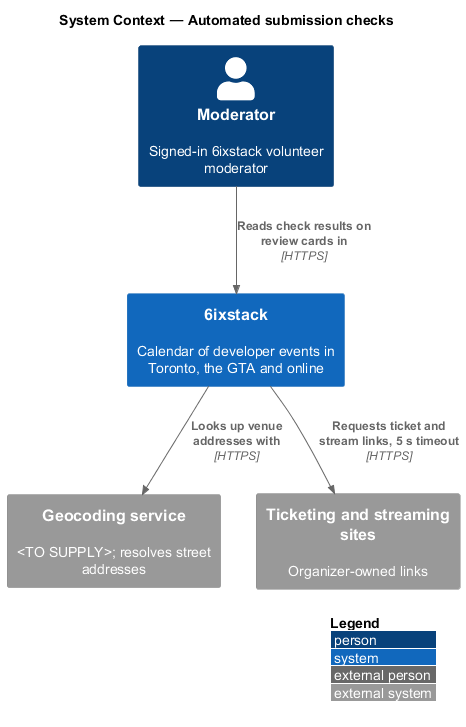
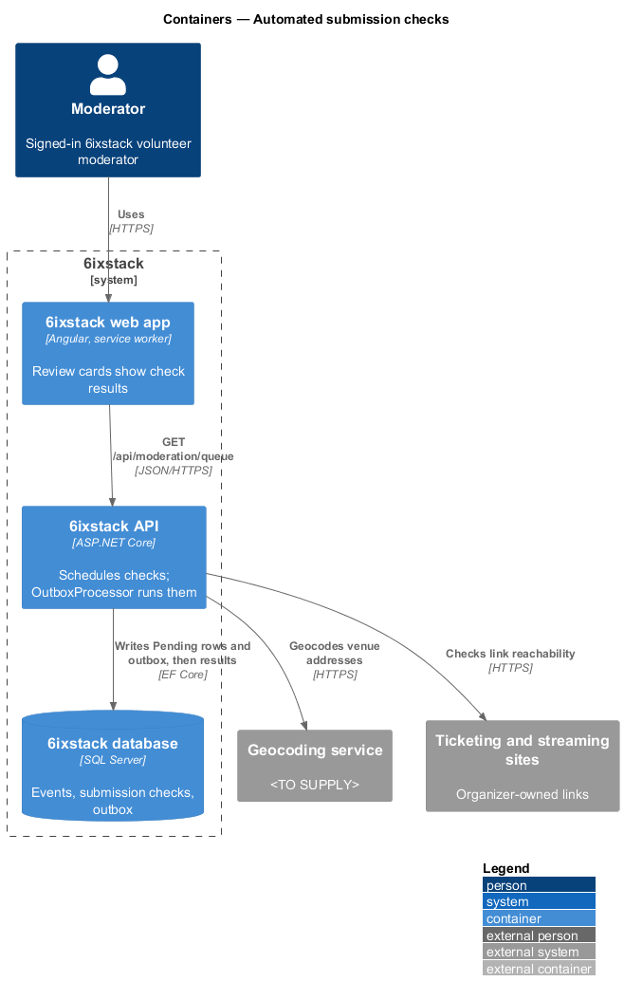
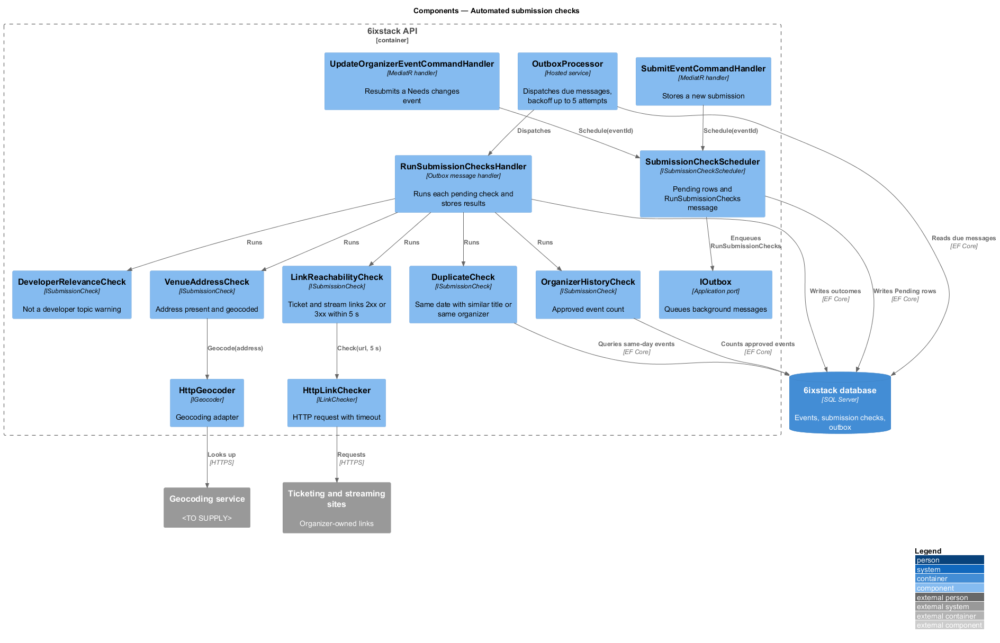
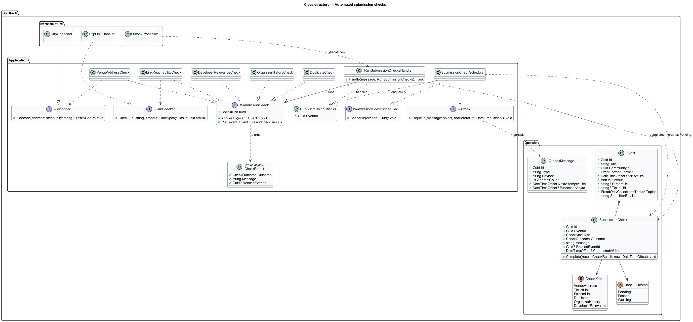
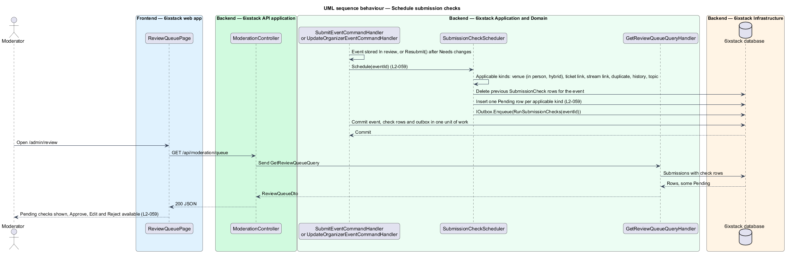
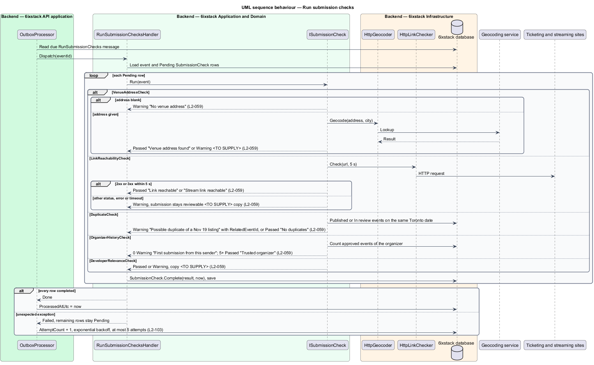

# Automated submission checks

## Overview

6ixstack is a calendar of developer events in Toronto, the Greater Toronto Area
(GTA) and online. Volunteer moderators approve every listing before it goes
public. To speed that review, 6ixstack runs a fixed set of checks on each
submission and shows the results on its review card: whether the venue address
exists, whether the ticket and stream links respond, whether the event looks
like a duplicate, how many events the organizer has had approved, and whether the
event looks like a developer event.

The feature belongs to the `moderation` subsystem. Checks start when an event is
submitted (`submissions/submit-event`) or resubmitted after a Needs changes
decision (`organizer/edit-event`). Their results appear on the cards of
`moderation/review-queue`. The duplicate result also drives the "Approved with a
possible duplicate" toast in `moderation/approve-submission`.

Terms used in this design:

- **check** — one automated test of a submission, stored as a `SubmissionCheck` row with a kind, an outcome and a message
- **check outcome** — Pending (not yet run), Passed or Warning
- **warning** — check result that asks the moderator to look closer; it never blocks a decision
- **reachable link** — URL that answers with HTTP 2xx or 3xx within 5 s
- **possible duplicate** — other published or in-review event on the same Toronto date with a similar title or from the same organizer
- **trusted organizer** — organizer with 5 or more approved events
- **geocoding** — lookup that turns a street address into coordinates

Checks run as background work so a slow geocoder or link never delays the
submission. Until they finish, the card shows them as pending and Approve, Edit
and Reject stay available. A timed-out link check ends as a warning, and the
submission stays reviewable.

## Description

The slice has no page of its own. It runs from the submission and edit handlers,
through the outbox, to the external services and back to the database.

- **`ISubmissionCheckScheduler`** / **`SubmissionCheckScheduler`** — application
  port and its implementation. `Schedule(eventId)` deletes the event's previous
  check rows, inserts one Pending row per applicable check and enqueues a
  `RunSubmissionChecks` message on `IOutbox`, all in the caller's unit of work.
  `SubmitEventCommandHandler` and `UpdateOrganizerEventCommandHandler` (on
  resubmission) call it.
- **`RunSubmissionChecks`** — outbox message carrying `EventId`.
- **`RunSubmissionChecksHandler`** — outbox message handler. It loads the event
  and its Pending rows, runs each `ISubmissionCheck` whose row is still Pending,
  writes each result as it completes and saves. A thrown exception leaves the
  remaining rows Pending; `OutboxProcessor` retries the message with exponential
  backoff up to 5 attempts (`L2-103`). After the fifth failure the remaining
  rows become warnings "Couldn’t run this check".
- **`ISubmissionCheck`** — interface with `Kind`, `AppliesTo(event)` and
  `Run(event)`. Each implementation returns a `CheckResult` of outcome, message
  and optional `RelatedEventId`.
- **`VenueAddressCheck`** — applies to in-person and hybrid events. A blank
  address gives Warning "No venue address". An address that `IGeocoder` resolves
  gives Passed "Venue address found". An address it cannot resolve gives Warning
  "Venue address not found on the map". Storing coordinates for the map arrives with the event map (journey 16).
- **`LinkReachabilityCheck`** — one row per link present: `TicketLink` and
  `StreamLink`. `ILinkChecker` requests the URL with a 5 s timeout. A 2xx or 3xx
  status gives Passed "Link reachable" or "Stream link reachable". Any other
  status, a network error or the timeout gives Warning "Ticket link didn't respond" or "Stream link didn't
  respond". The checker refuses hosts that resolve to loopback, private or link-local addresses (same warning),
  so a submission cannot make the server probe its own network.
- **`DuplicateCheck`** — queries other events in status Published or In review
  that start on the same Toronto calendar day. A match gives Warning "Possible
  duplicate of a {Mon d} listing" and stores the matched event in
  `RelatedEventId`; no match gives Passed "No duplicates". A match is the same submitter
  email, the same community, or titles whose word sets overlap by half or more (Jaccard ≥ 0.5, ignoring case and
  words under three letters).
- **`OrganizerHistoryCheck`** — counts the organizer's events that a moderator
  approved. None gives Warning "First submission from this sender"; 5 or more
  gives Passed "Trusted organizer"; 1 to 4 gives Passed "Organizer has {n}
  approved events".
- **`DeveloperRelevanceCheck`** — matches the title and description against
  the moderator-maintained developer keyword list. No match gives Warning "Not
  a developer topic"; a match gives Passed. The keyword list lives in configuration
  (`SubmissionChecks:DeveloperKeywords`) until a moderator screen exists; matching ignores case and works on
  whole words.
- **`SubmissionCheck`** — domain entity (`Id`, `EventId`, `Kind`, `Outcome`,
  `Message`). This design adds `Guid? RelatedEventId` for the duplicate match
  and `DateTimeOffset? CompletedAtUtc`.
- **`CheckKind`** — enumeration: `VenueAddress`, `TicketLink`, `StreamLink`,
  `Duplicate`, `OrganizerHistory`, `DeveloperRelevance`.
- **`IGeocoder`** / **`HttpGeocoder`**, **`ILinkChecker`** /
  **`HttpLinkChecker`** — ports in `SixStack.Application` and their adapters in
  `SixStack.Infrastructure`. No geocoding provider is chosen yet:
  `LocalGeocoder` resolves an address that has a street number and street name in a GTA city from the reference
  list; a hosted provider can replace it behind `IGeocoder`. In Development, `SubmissionChecks:LinkChecker`
  set to `AssumeReachable` keeps Playwright and demos off the network; elsewhere it is `Http`.

The requirements and mocks left these points open; journey 06 decided them:

| Point | Conflict |
|-------|----------|
| Organizer identity | Decided (journey 06): counts the published events from the same submitter email ("sender"). |
| Trusted threshold | Decided (journey 06): 5 or more is "Trusted organizer", as L2-059 states; the mock's "Organizer has 6 approved events" card is corrected to 4. |

## Requirements

| L2 ID | Refines (L1) | Requirement |
|-------|--------------|-------------|
| `L2-059` | `L1-013` | On submission and resubmission the system shall run and store these checks: venue address found by geocoding (in-person and hybrid), ticket and stream links reachable (HTTP 2xx or 3xx within 5 s), possible duplicate (another published or in-review event on the same date with a similar title or from the same organizer), organizer history (count of approved events; "Trusted organizer" at 5 or more; "First submission from this sender" at none), and developer relevance (a "Not a developer topic" warning when the title and description match none of the moderator-maintained developer keywords). |

## Diagrams

### System context

6ixstack checks each submission against an external geocoding service and the
organizer-owned ticket and streaming sites. Moderators read the results.

### Containers

The API stores Pending rows and an outbox message with the submission. The
outbox processor, hosted in the API, runs the checks later and writes the
results back to the database.

### Components

`SubmissionCheckScheduler` writes the Pending rows and the outbox message.
`OutboxProcessor` dispatches the message to `RunSubmissionChecksHandler`, which
runs the five `ISubmissionCheck` implementations through `IGeocoder`,
`ILinkChecker` and the database.

### Class structure

Each check implements `ISubmissionCheck` and produces one `SubmissionCheck` row
per kind. The handler depends on the interface only, so a new check adds one
class.

### Behaviour — schedule checks

Submission and resubmission write Pending rows in the same transaction as the
event. The review card therefore shows pending checks at once, with every action
available (`L2-059`).

### Behaviour — run checks

The handler runs each check and stores its result. A link timeout ends as a
warning rather than a failure. An unexpected error leaves rows Pending for the
retry (`L2-103`).

