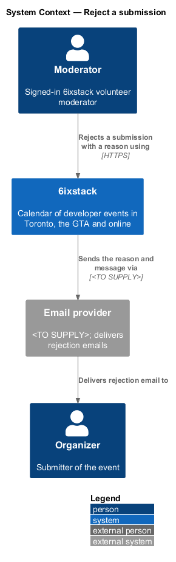
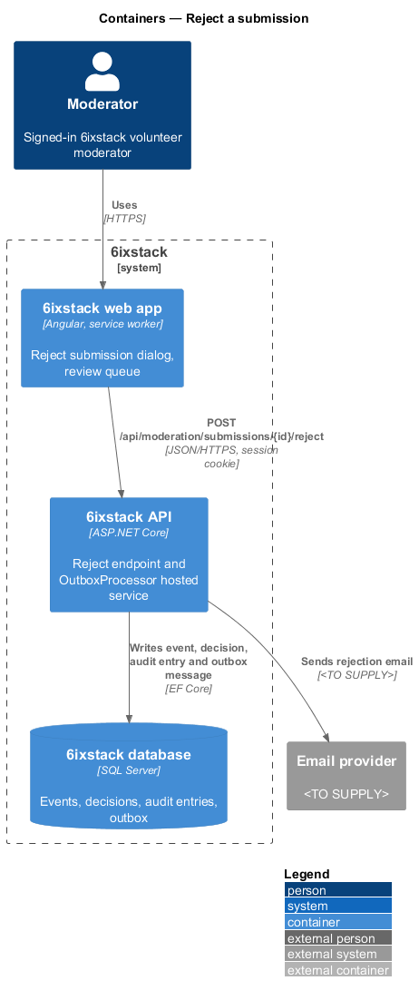
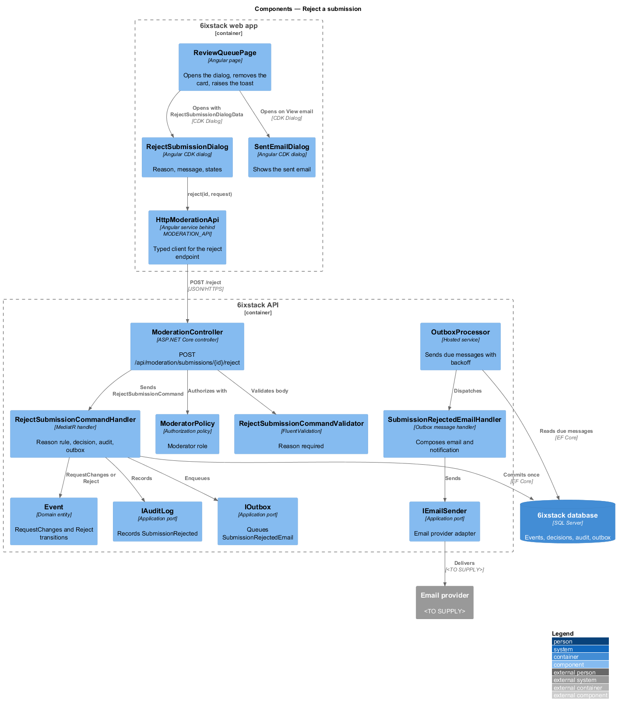
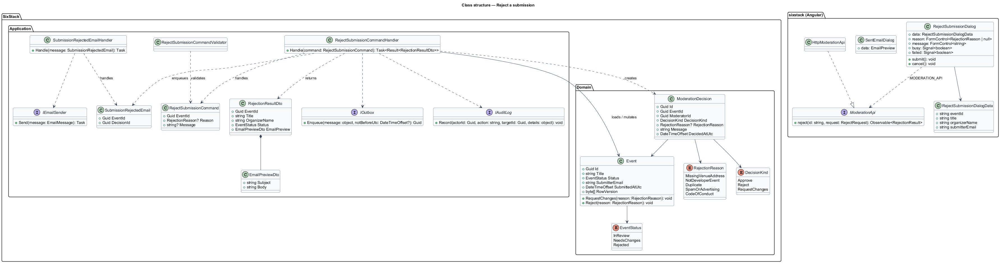
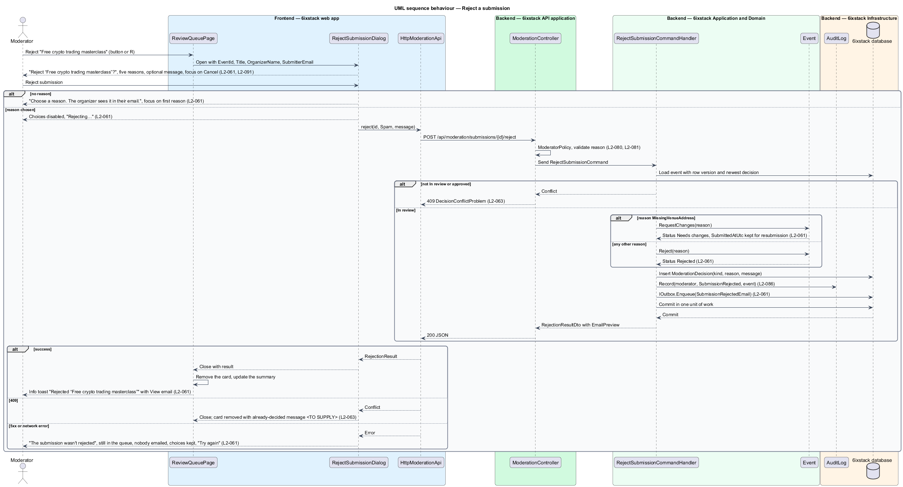
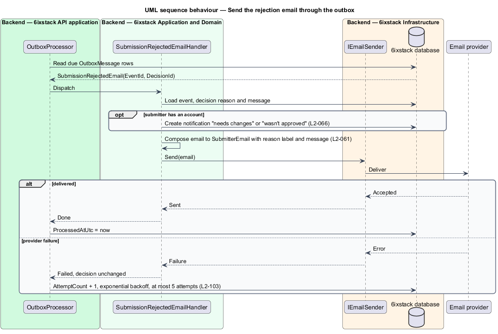

# Reject a submission

## Overview

6ixstack is a calendar of developer events in Toronto, the Greater Toronto Area
(GTA) and online. Volunteer moderators review every submission before it goes
public. Some submissions cannot be published as sent: the venue address is
missing, the event is not for developers, it duplicates a listing, it is spam,
or it breaks the code of conduct. This feature covers the reject dialog drawn in
`docs/mocks/dialogs/reject-submission/`, the decision behind it and the email to
the submitter.

The feature belongs to the `moderation` subsystem. The dialog opens from Reject
on a card, or the R shortcut, in `moderation/review-queue`. The organizer sees
the outcome on the dashboard (`organizer/organizer-dashboard`) and resubmits a
Needs changes event through `organizer/edit-event`.

Terms used in this design:

- **rejection reason** — one of five fixed reasons a moderator picks: missing or unclear venue address; not a developer event; duplicate of an existing listing; spam or advertising; breaks the code of conduct
- **moderator message** — optional free text to the organizer saying what would make the event acceptable
- **needs changes** — status of a submission returned for a fix; the organizer may edit and resubmit it
- **rejected** — status of a submission declined for any reason other than the venue address
- **submitter** — person whose contact email was given on the submission form

A reason is required. The missing-address reason sets Needs changes, and a
resubmission returns the event to the queue with its original submission time.
Every other reason sets Rejected. Either way the submitter receives an email
with the reason and the message, and the card leaves the queue.

## Description

The slice runs from a CDK dialog to the database through one command, then to
the email provider through the outbox.

- **`RejectSubmissionDialog`** — Angular CDK dialog in project `sixstack` at
  `frontend/projects/sixstack/src/app/dialogs/reject-submission/`, built on
  `DialogShell`. It receives `RejectSubmissionDialogData` (`EventId`, `Title`,
  `OrganizerName`, `SubmitterEmail`). It shows the title "Reject “{title}”?",
  the description "Submitted by {organizer} ({email}). They get an email with
  your reason.", the Reason radio group, the optional "Message to the organizer"
  with the hint "Say what would make it acceptable, if anything.", and the
  buttons Cancel and the danger "Reject submission". Cancel holds initial focus,
  as `L2-091` requires for destructive dialogs.
- **Dialog states** — invalid: no reason shows "Choose a reason. The organizer
  sees it in their email." and moves focus to the first reason. Busy: choices
  disabled and the button reads "Rejecting…" with `aria-busy="true"`; Escape
  does not close the dialog. Failed: the alert "The submission wasn't rejected"
  states it is still in the queue and nobody was emailed, the choices are kept
  and the button reads "Try again".
- **`ReviewQueuePage`** — opens the dialog, removes the card on success and
  raises the info toast "Rejected “{title}”" with the text "{organizer} was
  emailed your reason." and the action "View email".
- **`SentEmailDialog`** — CDK dialog opened by View email that shows the subject
  and body returned by the API. No mock draws it; its layout is `<TO SUPPLY>`.
- **`ModerationApi`** / **`MODERATION_API`** / **`HttpModerationApi`** — this
  slice adds `reject(id, request)`.
- **`ModerationController`** — exposes
  `POST /api/moderation/submissions/{id}/reject` behind `ModeratorPolicy`.
- **`RejectSubmissionCommand`** — carries `EventId`, `Reason` and `Message`.
- **`RejectSubmissionCommandValidator`** — requires `Reason` to be a defined
  `RejectionReason` value. The maximum `Message` length is `<TO SUPPLY>`.
- **`RejectSubmissionCommandHandler`** — MediatR handler. It loads the event
  with its row version and refuses with 409 when the event is not In review or
  already holds an approval that was not undone (`L2-063`). It applies the
  reason rule, records the `ModerationDecision` and the audit entry, enqueues the
  rejection email, and commits once. It returns a `RejectionResultDto`.
- **`Event.RequestChanges(reason)`** / **`Event.Reject(reason)`** — domain
  methods that move In review to Needs changes or to Rejected.
- **`RejectionReason`** — enumeration this design adds: `MissingVenueAddress`,
  `NotDeveloperEvent`, `Duplicate`, `SpamOrAdvertising`, `CodeOfConduct`.
- **`ModerationDecision`** — records `DecisionKind.RequestChanges` or
  `DecisionKind.Reject`, the `RejectionReason`, the `Message`, the moderator and
  `DecidedAtUtc`. The dashboard banner reads it to quote the reason with the
  moderator's first name (`L2-053`).
- **`SubmissionRejectedEmail`** / **`SubmissionRejectedEmailHandler`** — outbox
  message and its handler. The handler composes the email to `SubmitterEmail`
  with the reason label and the message, and sends it through `IEmailSender`.
  It also creates the organizer's in-app notification for needs changes or
  rejected (`L2-066`) when the submitter has an account.
- **`IAuditLog`** — records actor, time, action `SubmissionRejected` and target
  (`L2-086`).
- **`RejectionResultDto`** — `EventId`, `Title`, `OrganizerName`, the resulting
  `Status`, and `EmailPreview` (`Subject`, `Body`) for View email.

The handler applies the reason rule:

| Reason | Resulting status | Decision kind |
|--------|------------------|---------------|
| Missing or unclear venue address | Needs changes | `RequestChanges` |
| Not a developer event | Rejected | `Reject` |
| Duplicate of an existing listing | Rejected | `Reject` |
| Spam or advertising | Rejected | `Reject` |
| Breaks the code of conduct | Rejected | `Reject` |

These points are open:

- `L2-067` lets an organizer turn off "event approved or needs changes" emails,
  while `L2-061` requires emailing the submitter. Whether the preference
  suppresses the rejection email is `<TO SUPPLY>`.
- The `submission-banner/danger` mock shows "Edit and resubmit" for a rejected
  event. Whether a Rejected event, as opposed to a Needs changes event, may be
  resubmitted is `<TO SUPPLY>`.
- The reject email is sent as soon as the decision commits; `L2-061` defines no
  undo for rejection.

## Requirements

| L2 ID | Refines (L1) | Requirement |
|-------|--------------|-------------|
| `L2-061` | `L1-013` | The "Reject “{title}”?" dialog shall require a reason (missing or unclear venue address; not a developer event; duplicate of an existing listing; spam or advertising; breaks the code of conduct), accept an optional message, and email the submitter. The missing-address reason shall set the status Needs changes; other reasons shall set Rejected. |

## Diagrams

### System context

A moderator rejects a submission in 6ixstack. 6ixstack emails the submitter the
reason and message through the email provider.

### Containers

The web app posts the rejection to the API. The API writes the event, the
decision, the audit entry and the outbox message in one transaction, and the
outbox processor sends the email.

### Components

`RejectSubmissionDialog` calls `HttpModerationApi`. In the API,
`RejectSubmissionCommandHandler` applies the reason rule on `Event` and writes to
`IAuditLog` and `IOutbox`. `OutboxProcessor` hands the message to
`SubmissionRejectedEmailHandler`.

### Class structure

The handler maps a `RejectionReason` to `Event.RequestChanges` or
`Event.Reject` and records a `ModerationDecision` with the same reason.

### Behaviour — reject from the dialog

The dialog requires a reason before the request. The handler refuses a decided
submission with 409 and otherwise applies the reason rule of `L2-061`. A failure
keeps the choices and offers Try again.

### Behaviour — send the rejection email

`OutboxProcessor` sends the committed message. A provider failure leaves the
decision in place and schedules a retry (`L2-103`).

