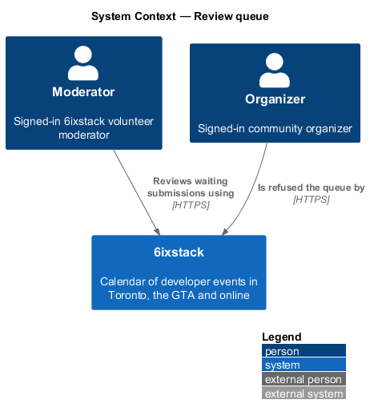
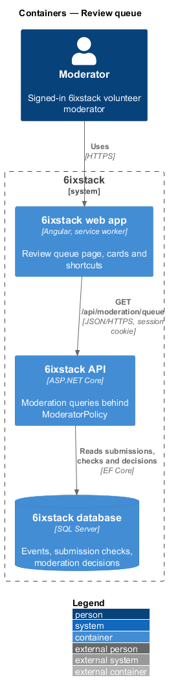
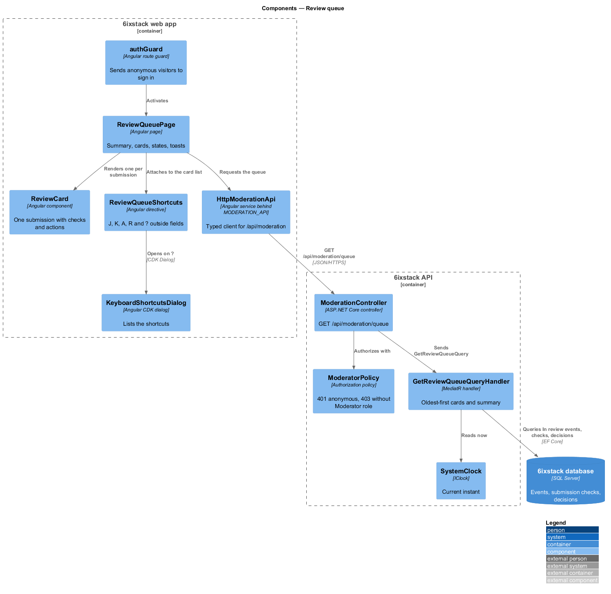
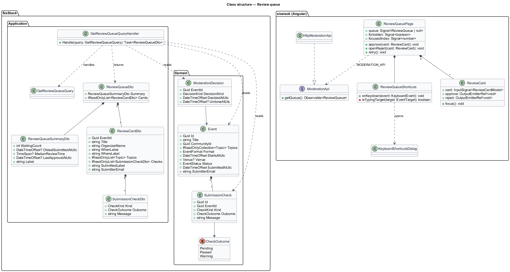
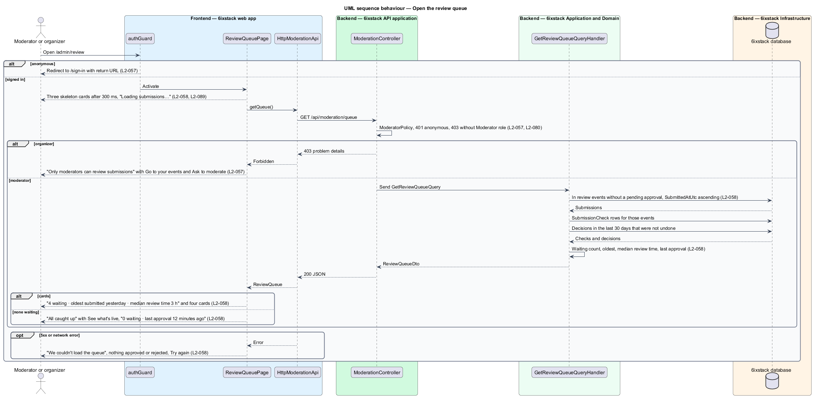
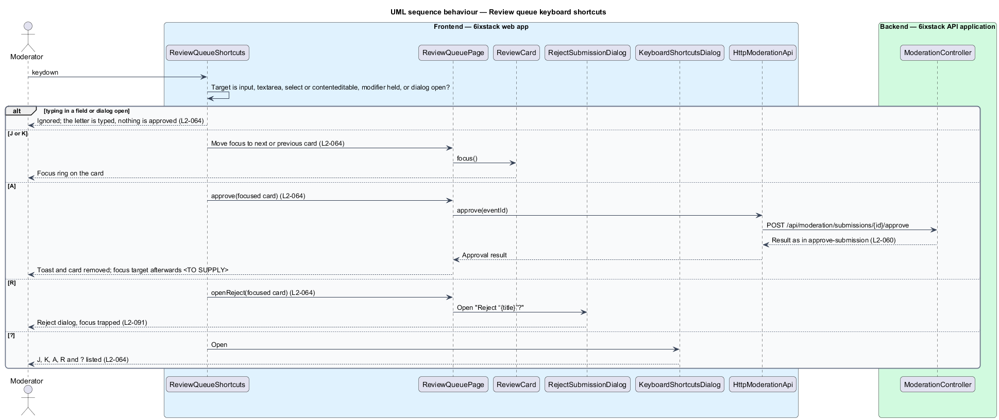

# Review queue

## Overview

6ixstack is a calendar of developer events in Toronto, the Greater Toronto Area
(GTA) and online. Anyone may submit an event, and nothing becomes public until a
volunteer moderator approves it. The review queue at `/admin/review` is the
moderator's work list: every submission waiting for a decision, oldest first,
with the results of the automated checks beside it. This feature covers that
page in the states drawn in `docs/mocks/pages/review-queue/`, its access rules
and its keyboard shortcuts.

The feature belongs to the `moderation` subsystem. The decisions taken from a
card are separate slices: `moderation/approve-submission`,
`moderation/reject-submission` and, for Edit, `organizer/edit-event`. The check
results on each card come from `moderation/automated-checks`.

Terms used in this design:

- **moderator** — signed-in user with the `Moderator` role
- **submission** — event with status In review that waits for a moderator decision
- **review card** — card in the queue that shows one submission and its Approve, Edit and Reject actions
- **queue summary** — lead line stating the waiting count, the age of the oldest submission and the median review time over the last 30 days
- **review time** — interval from a submission's `SubmittedAtUtc` to the moderator decision on it
- **focused card** — review card that holds keyboard focus and receives the A and R shortcuts

Only moderators see the queue. An organizer who opens it sees "Only moderators
can review submissions" with "Go to your events" and "Ask to moderate". An
anonymous visitor is sent to sign in. The API enforces the same rules with 401
and 403.

Each card shows the title, organizer, date and time, venue or "Streaming
online", topics, the automated check results, the
submission time and the submitter's email. The submitter's email is visible to
moderators only.

## Description

The slice runs from the Angular page to the database through one read-only
query. The shortcuts run in the browser.

- **`ReviewQueuePage`** (`sx-review-queue-page`) — Angular page in project
  `sixstack` at `frontend/projects/sixstack/src/app/pages/review-queue/`. It
  renders the title "Review queue", the queue summary and one `ReviewCard` per
  submission in a list. It owns the loading, empty, error and forbidden states
  and hosts the toasts raised by approve and reject.
- **`ReviewCard`** — local component that renders one `ReviewCardDto`. Each
  check shows an icon and its message; a passed check uses the check icon, a
  warning uses the warning icon and a pending check shows "Checking…" with the clock icon
  (`review-queue/checking`). The card is focusable so the shortcuts act on it. Reject
  carries the visually hidden title for screen readers.
- **`ReviewQueueShortcuts`** — Angular directive on the list. It handles J (next
  card), K (previous card), A (approve the focused card), R (open Reject for the
  focused card) and ? (open the shortcut list). It ignores a key when the event
  target is an `input`, `textarea`, `select` or `contenteditable` element, when
  a modifier key is held, or when a dialog is open. After the focused card leaves the queue
  (journeys 07 and 08), the next card takes focus, or the previous one when it was last.
- **`KeyboardShortcutsDialog`** — CDK dialog at
  `frontend/projects/sixstack/src/app/dialogs/keyboard-shortcuts/` that lists
  the five shortcuts. Mock: `dialogs/keyboard-shortcuts` (a
  description list of keys and actions, Close focused).
- **`authGuard`** — route guard that sends an anonymous visitor to `/sign-in`
  with a return URL. It reads `SessionStore`.
- **`ModerationApi`** / **`MODERATION_API`** / **`HttpModerationApi`** — the
  API client contract, its injection token and its HTTP implementation in
  project `api`. This slice adds `getQueue()`.
- **`DelayedSkeleton`** — shows three skeleton cards and the lead "Loading
  submissions…" only when the request is still pending after 300 ms.
- **`ModerationController`** — ASP.NET Core controller exposing
  `GET /api/moderation/queue`. `ModeratorPolicy` answers 401 for an anonymous
  caller and 403 for a signed-in user without the `Moderator` role. The page
  maps 403 to the forbidden state.
- **`GetReviewQueueQuery`** / **`GetReviewQueueQueryHandler`** — MediatR query
  and handler. The handler selects In review events that hold no approval
  awaiting email verification (see `moderation/approve-submission`), ordered by
  `SubmittedAtUtc` ascending. It loads their `SubmissionCheck` rows and computes
  the summary.
- **`ReviewQueueDto`**, **`ReviewQueueSummaryDto`**, **`ReviewCardDto`**,
  **`SubmissionCheckDto`** — response contracts. `ReviewCardDto` carries display
  labels (`WhenLabel`, `WhereLabel`, `SubmittedLabel`) so the card holds no
  formatting rules.
- **`Event`**, **`SubmissionCheck`**, **`ModerationDecision`** — domain entities
  read by the handler.
- **`SystemClock`** (`IClock`) — supplies the current instant for relative
  times and the 30-day window.

The handler computes the summary as follows:

| Value | Rule |
|-------|------|
| Waiting count | Number of cards returned. |
| Oldest | `SubmittedAtUtc` of the first card, as a relative day ("yesterday"). |
| Median review time | Median of `DecidedAtUtc − SubmittedAtUtc` over decisions in the last 30 days that were not undone. Shown in whole hours ("3 h"), or minutes under an hour ("40 min"); every decision counts, including an earlier decision on a resubmitted event. With no decisions in 30 days the median part is left out. |
| Last approval | When nothing waits, the time since the newest approval that was not undone ("last approval 12 minutes ago"). |

The queue lists all waiting submissions in one response. There is no page size: the queue
is short by nature. How the list refreshes while open, so that decisions by other
moderators appear, is described in `moderation/approve-submission`.

Decisions in journey 06:

- The page and API deliver the queue, its states, the checks and the J, K and ? shortcuts. The shortcuts
  dialog lists only the shortcuts that work; A and R join it with journeys 07 and 08 (the mock shows the end state). Approve (A), Reject
  (R), Edit and the card actions arrive with journeys 07, 08 and 14, so no card shows a button that does nothing.
- Review presence and the 409 conflict (`L2-063`) arrive with journey 07, where `moderation/approve-submission`
  designs them.
- `ModerationDecision` (`EventId`, `ModeratorId`, `Kind`, `DecidedAtUtc`, `UndoneAtUtc`) is added now so the
  summary can compute the median and last approval; the seed holds past decisions.
- The API route is `GET /api/moderation/queue`. The page maps 403 to the forbidden state and the guard sends
  anonymous visitors to sign in.

## Requirements

| L2 ID | Refines (L1) | Requirement |
|-------|--------------|-------------|
| `L2-057` | `L1-013` | The review queue (`/admin/review`) shall be available only to moderators; an organizer shall see "Only moderators can review submissions" with "Go to your events" and "Ask to moderate"; an anonymous user shall be sent to sign in. |
| `L2-058` | `L1-013` | The queue shall list In review submissions oldest first as cards with title, organizer, date and time, venue or "Streaming online", topics, automated check results, submission time and submitter email, under a summary of the waiting count, the oldest submission and the median review time over the last 30 days. |
| `L2-064` | `L1-013` | The review queue shall support J and K to move between cards, A to approve the focused card, R to open Reject for it, and ? to list the shortcuts; shortcuts shall not fire while typing in a field. |

## Diagrams

### System context

A moderator reviews waiting submissions in 6ixstack. No external system takes
part in loading the queue.

### Containers

The web app calls `GET /api/moderation/queue` with the session cookie. The API
reads submissions, check results and decisions from the SQL Server database.

### Components

`ReviewQueuePage` renders `ReviewCard` components and attaches
`ReviewQueueShortcuts` to the list. In the API, `ModeratorPolicy` admits only
moderators before `GetReviewQueueQueryHandler` runs.

### Class structure

The handler reads `Event`, `SubmissionCheck` and `ModerationDecision` and returns
a `ReviewQueueDto` made of a summary and cards. On the client the page depends on
the `ModerationApi` contract through the `MODERATION_API` token.

### Behaviour — open the queue

The guard and `ModeratorPolicy` enforce `L2-057` at both ends. A moderator gets
the cards oldest first with the summary of `L2-058`; the page then shows the
default, empty or error state.

### Behaviour — keyboard shortcuts

`ReviewQueueShortcuts` checks the event target before acting, so a letter typed
in a field never approves or rejects (`L2-064`). A hands off to
`moderation/approve-submission`; R opens `RejectSubmissionDialog`.

