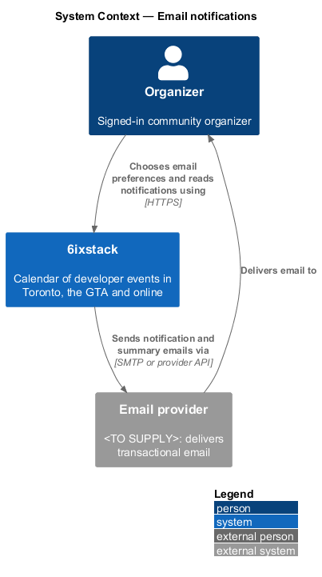
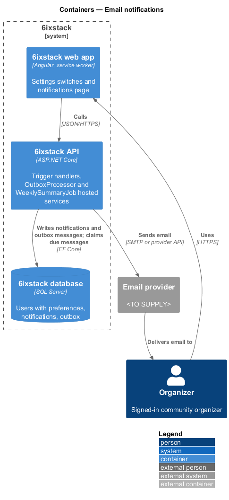
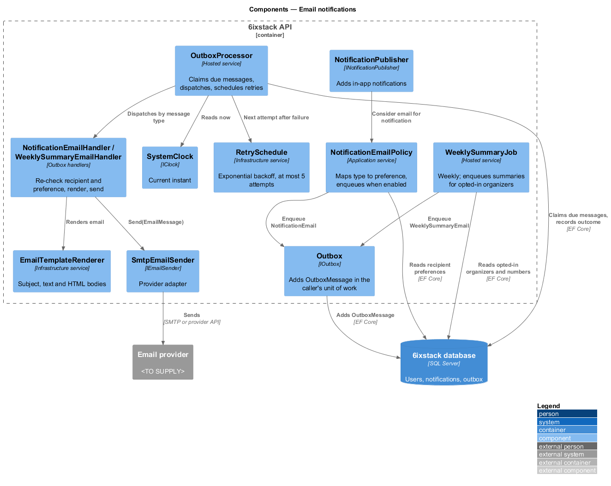
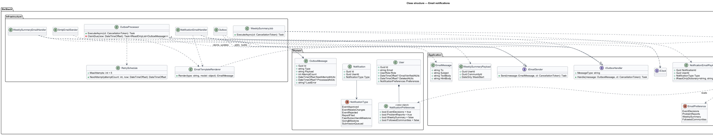
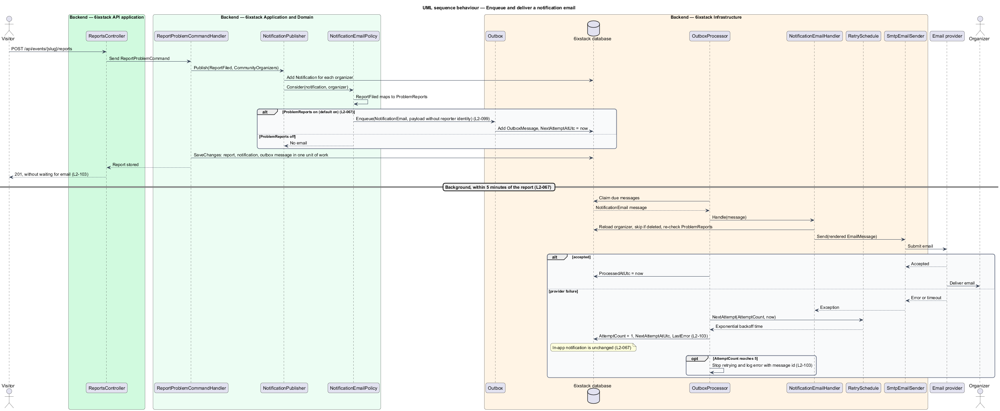
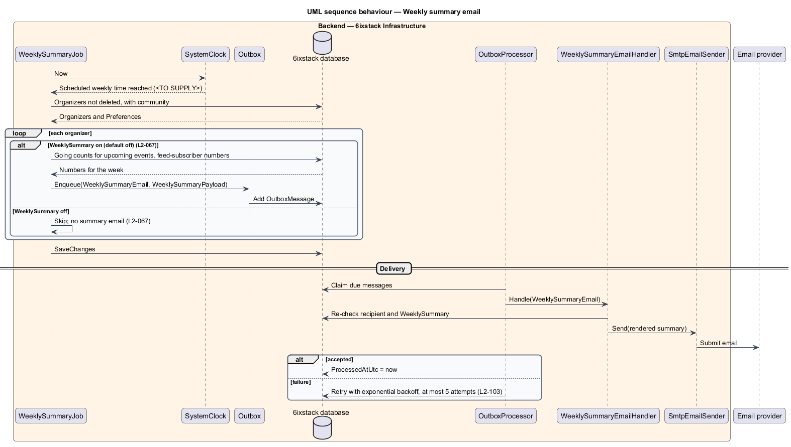

# Email notifications

## Overview

6ixstack is a calendar of developer events in Toronto, the Greater Toronto Area
(GTA) and online. Organizers manage their community's listings but do not keep
6ixstack open all day. This feature sends organizers email for the notification
types they choose, so a review outcome or a problem report reaches them without
a visit to the notifications page.

The feature belongs to the `notifications` subsystem. It extends
`notifications/in-app-notifications`: every email corresponds to a notification
type, and the in-app notification exists whether or not the email is sent or
delivered. The switches that turn each email type on and off live on the
settings page (`L2-069`, `identity/account-settings`); this feature reads them.

Terms used in this design:

- **email preference** — per-organizer switch that enables one email type, stored with the profile
- **outbox** — table of pending background messages written in the same transaction as the change that caused them
- **outbox message** — row in the outbox holding a message type, a JSON payload, an attempt count and the next attempt time
- **weekly summary** — email listing an organizer's going and feed numbers for the past week
- **followed-communities digest** — email listing new events from communities the organizer follows

The four email types and their defaults come from `L2-067`:

| Email preference | Default | Sent for |
|------------------|---------|----------|
| `EventDecisions` — "My event is approved or needs changes" | On | `EventApproved`, `EventNeedsChanges` notifications |
| `ProblemReports` — "Someone reports a problem with my event" | On | `ReportFiled` notifications |
| `WeeklySummary` — "Weekly summary of going and feed numbers" | Off | The weekly summary job |
| `FollowedCommunities` — "New events from communities I follow" | Off | The followed-communities digest |

Emails are background work (`L2-103`). The user action that causes a
notification commits without waiting for the email provider. A failed send
never removes the in-app notification and is retried.

## Description

- **`NotificationEmailPolicy`** — application service called by
  `NotificationPublisher` for each new notification. It maps the
  `NotificationType` to an email preference, reads the recipient's
  `NotificationPreferences`, and enqueues an outbox message only when the
  preference is on. Types with no email preference (`FeedSubscribersMilestone`,
  `GoingMilestone`, `SubmissionQueued`) never enqueue. Moderators receive no
  notification email, since `L2-067` covers organizers only.
- **`NotificationPreferences`** — value object on `User` with four booleans:
  `EventDecisions` (default `true`), `ProblemReports` (default `true`),
  `WeeklySummary` (default `false`) and `FollowedCommunities` (default `false`).
- **`IOutbox`** / **`Outbox`** — `Enqueue(type, payload, notBeforeUtc)` adds an
  `OutboxMessage` to `IAppDbContext`. The message commits with the notification
  in the caller's unit of work, so no email is sent for a rolled-back change.
- **`NotificationEmailPayload`** — outbox payload carrying `NotificationId`,
  `UserId`, `Type` and the template arguments. It holds no reporter identity
  (`L2-099`).
- **`OutboxMessage`** — entity (`Id`, `Type`, `Payload`, `AttemptCount`,
  `NextAttemptAtUtc`, `ProcessedAtUtc`). This design adds `string? LastError`
  for diagnosis.
- **`OutboxProcessor`** — hosted service in `SixStack.Infrastructure`, run by the
  6ixstack API host. Each cycle it claims due messages (`ProcessedAtUtc` empty,
  `NextAttemptAtUtc` at or before now), dispatches each to its handler, and
  records the outcome. The polling interval is `<TO SUPPLY>`; it shall be short
  enough that a report email leaves within 5 minutes of the report.
- **`NotificationEmailHandler`** — outbox handler for `NotificationEmail`
  messages. It reloads the recipient, skips deleted accounts, re-checks the
  preference at send time, renders the email with `EmailTemplateRenderer` and
  calls `IEmailSender`.
- **`EmailTemplateRenderer`** — renders subject, plain-text body and HTML body per
  email type. Email copy and layout are `<TO SUPPLY>`; no email mocks exist in
  `docs/mocks/`. Each email links to the notification target and to
  `/settings#email-notifications`.
- **`IEmailSender`** / **`SmtpEmailSender`** — sends one `EmailMessage` to the
  email provider (`<TO SUPPLY>`). The sender address is `<TO SUPPLY>`.
- **`RetrySchedule`** — computes `NextAttemptAtUtc` after a failure by
  exponential backoff. A message is attempted at most 5 times (`L2-103`). The
  base delay and the factor are `<TO SUPPLY>`. After the fifth failure the
  message stays unprocessed with `AttemptCount = 5` and an error log entry;
  alerting on such messages is `<TO SUPPLY>`.
- **`WeeklySummaryJob`** — hosted service that runs once a week at a time
  `<TO SUPPLY>`. For each organizer with `WeeklySummary` on, it builds a
  `WeeklySummaryPayload` (going counts per upcoming event and feed-subscriber
  numbers for the community) and enqueues one outbox message. Organizers with
  the switch off receive nothing.
- **`FollowedCommunitiesDigestJob`** — placeholder for the followed-communities
  digest. No requirement defines how an organizer follows a community, nor the
  digest's schedule; both are `<TO SUPPLY>`.
- **`SystemClock`** (`IClock`) — supplies the current instant to the processor,
  the retry schedule and the weekly job.

Interaction with approval undo: `L2-060` holds the approval email until the 8 s
undo window closes. The approve handler passes `notBeforeUtc` = approval time
plus 8 s to `IOutbox.Enqueue`, and undo deletes the unsent message
(`moderation/approve-submission`).

Open points the requirements leave undecided:

- `L2-067` lists "approved or needs changes" under `EventDecisions`. Whether a
  `Rejected` outcome is emailed under the same preference is `<TO SUPPLY>`.
  `L2-061` separately requires the submitter to be emailed the rejection reason
  regardless of preferences; that email belongs to `moderation/reject-submission`.
- Delivery is at least once: a provider timeout after acceptance can cause a
  second send. An idempotency key supported by the provider is `<TO SUPPLY>`.
- Whether email goes to an address that is not yet verified (`L2-085`) is
  `<TO SUPPLY>`.

## Requirements

| L2 ID | Refines (L1) | Requirement |
|-------|--------------|-------------|
| `L2-067` | `L1-014` | Organizers shall receive email for the notification types they have enabled: event approved or needs changes (on by default), problem reports (on by default), weekly summary of going and feed numbers (off by default) and new events from followed communities (off by default); rejection emails required by L2-061 shall be sent regardless of these preferences. |

## Diagrams

### System context

6ixstack emails organizers through an external email provider. The organizer
also sees the same notification inside 6ixstack.

### Containers

The API writes the notification and its outbox message to the database in one
transaction. The `OutboxProcessor`, hosted in the API process, later sends the
email through the provider.

### Components

`NotificationPublisher` hands each new notification to
`NotificationEmailPolicy`, which reads the preferences and enqueues through
`IOutbox`. `OutboxProcessor` dispatches due messages to
`NotificationEmailHandler`, which renders and sends through `SmtpEmailSender`.
`WeeklySummaryJob` enqueues summaries on its schedule.

### Class structure

`User` owns a `NotificationPreferences` value. `NotificationEmailPolicy` maps
notification types to preferences and writes `OutboxMessage` rows through
`IOutbox`. `OutboxProcessor` uses `RetrySchedule` and the handlers, and the
handlers use `IEmailSender`.

### Behaviour — enqueue and deliver a notification email

A filed report creates the in-app notification and, with `ProblemReports` on,
an outbox message in the same commit. The processor sends it within 5 minutes.
A provider failure leaves the notification in place and schedules a retry by
exponential backoff, up to 5 attempts.

### Behaviour — weekly summary

The weekly job enqueues a summary only for organizers whose `WeeklySummary`
switch is on. Delivery then follows the same outbox path and retry rules.

## Decisions (journey 20)

- **Preferences** are an owned value on `User`: `EventDecisions` (on), `ProblemReports` (on), `WeeklySummary` (off),
  `FollowedCommunities` (off). The settings screen arrives with journey 25. Until then the defaults apply, and an
  address with no account is treated as having the defaults.
- **What is emailed now**:
  - Approved ("“{title}” is live", after the undo window) and needs changes go out under `EventDecisions`. A
    rejection always goes out (`L2-061`).
  - A moderator's edit of an organizer's event ("A moderator updated “{title}”") goes out under `EventDecisions`.
  - The weekly summary ("Your week on 6ixstack") goes out under `WeeklySummary`, Mondays at 8:00 AM Toronto time.
  - Problem reports and followed communities have their switches but no emails yet. They come with journeys 22 and
    the follow feature.
- **In-app first**: the in-app notification is written with the decision. The email is its own `SendEmail` outbox
  message, retried on failure with exponential backoff (30 s base, doubling, five attempts), so a failed send never
  removes the notification (`L2-067` criterion 3). The outbox polls every few seconds, well within the five-minute
  bound.
- **Sender and copy**: from `hello@6ixstack.dev`; the copy is in `docs/mocks/notifications/email/`. Each email names
  the event and links to it or to the dashboard. A "manage these emails" link joins with the settings screen.
- **Unverified addresses**: decision emails go to the submitter's address whether or not it is verified, since they
  answer the submitter's own request.
- **Moderators** get no notification emails.

