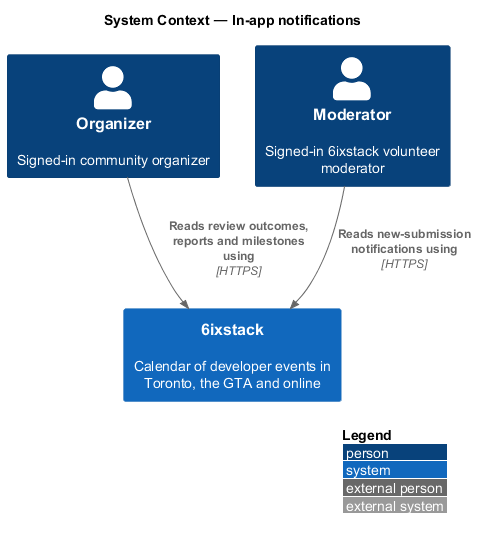
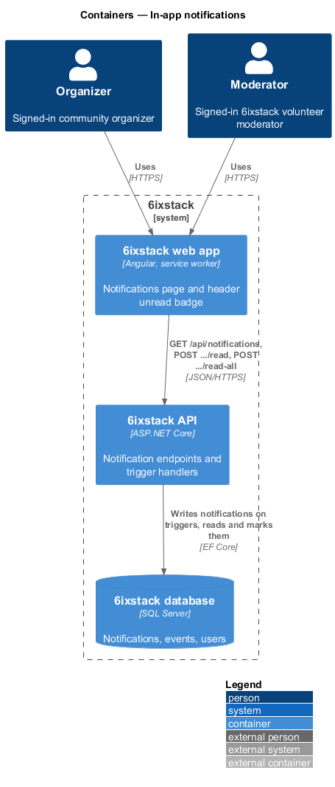
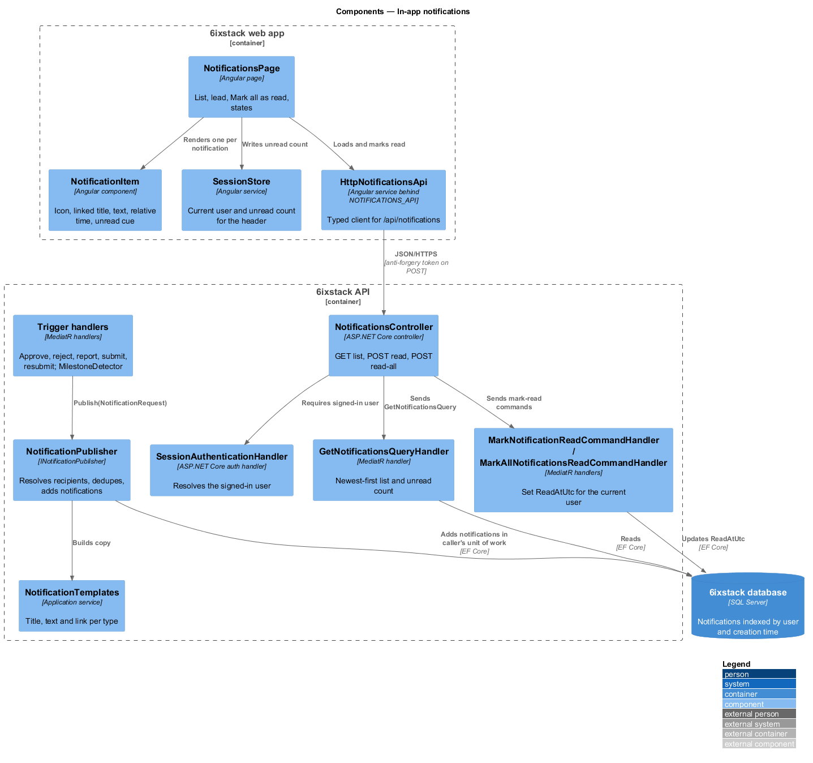
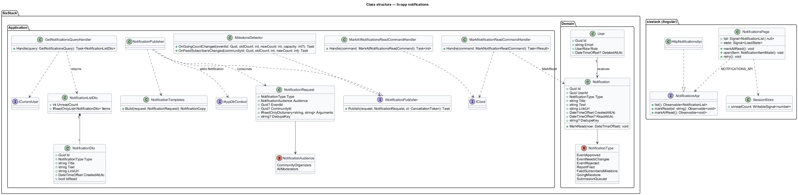
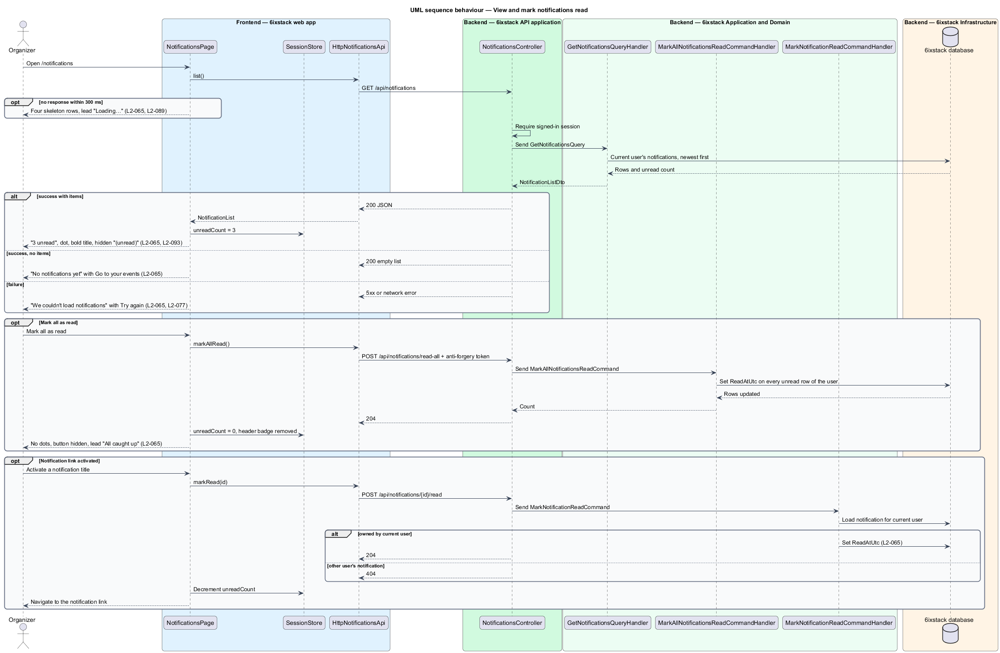
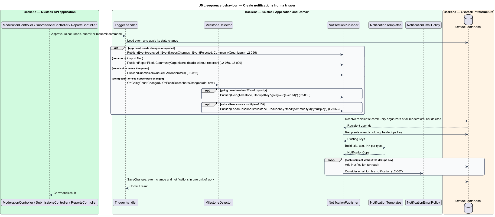

# In-app notifications

## Overview

6ixstack is a calendar of developer events in Toronto, the Greater Toronto Area
(GTA) and online. Organizers list their community's events and moderators review
each submission. Both roles act on things that happen while they are away: a
moderator approves an event, someone reports a wrong start time, an event fills
up. This feature records those happenings as notifications and lists them on the
notifications page at `/notifications`, drawn in `docs/mocks/pages/notifications/`.

The feature belongs to the `notifications` subsystem. Email delivery of the same
notifications is a separate slice (`notifications/email-notifications`). The
header's notifications button and unread badge belong to the signed-in header
(`L2-050`, `identity/sessions-and-sign-out`); this feature supplies the unread
count that button shows.

Terms used in this design:

- **notification** — stored message addressed to one signed-in user about one happening, with a title, text, link and creation time
- **unread notification** — notification whose `ReadAtUtc` is empty
- **trigger** — domain happening that creates notifications, such as an approval or a filed report
- **recipient** — signed-in user a trigger addresses: an organizer of the event's community, or a moderator
- **milestone** — trigger raised when a count crosses a threshold: feed subscribers passing a multiple of 100, or going count passing 75% of capacity
- **dedupe key** — string that identifies a one-time notification so the same milestone never notifies twice

The page lists the signed-in user's notifications newest first. Unread items
carry a dot, a bold title and the hidden text "(unread)", so colour is never the
only cue (`L2-093`). "Mark all as read" appears while any item is unread.
Activating an item's link marks that item read.

## Description

The slice has two halves. The read half runs from the Angular page through
`NotificationsController` to the database. The write half runs inside the API:
each trigger's command handler calls `INotificationPublisher` in the same unit of
work that changes the event.

### Read half (web app and API)

- **`NotificationsPage`** (`sx-notifications-page`) — Angular page in project
  `sixstack` at `/notifications`, behind the signed-in route guard. It renders
  the title, the lead ("3 unread", "All caught up", "Nothing new", "Loading…",
  "Unavailable"), the Mark all as read button, one `NotificationItem` per
  notification and the settings link. It owns the loading, empty, error and
  read states from the mocks.
- **`NotificationItem`** (`sx-notification-item`) — component in project
  `components`. It keeps the mock's BEM classes (`notif`, `notif--unread`,
  `notif__icon--success|warning|danger`, `notif__title`, `notif__text`,
  `notif__time`). The icon follows the notification type. Unread items add the
  visually hidden text " (unread)" after the title link.
- **`RelativeTimePipe`** — Angular pipe that turns `CreatedAtUtc` into the
  relative labels in the mock ("12 min ago", "2 h ago", "Yesterday", "Oct 29")
  in Toronto time through `TorontoTimeFormatter`. The exact cut-over points
  between labels are `<TO SUPPLY>`.
- **`NotificationsApi`** / **`NOTIFICATIONS_API`** / **`HttpNotificationsApi`** —
  API client contract, injection token and HTTP implementation in project `api`.
  The page depends on the token only.
- **`SessionStore`** — shared app service holding the current user and the
  unread count. The page writes the count after each load and each mark-read
  call, so the header badge updates without a reload. How often the header
  refreshes the count while the page is closed is `<TO SUPPLY>`.
- **`DelayedSkeleton`** — shared helper. Four skeleton rows appear only when the
  load is still pending after 300 ms (`L2-089`).
- **`NotificationsController`** — ASP.NET Core controller. It exposes
  `GET /api/notifications`, `POST /api/notifications/{id}/read` and
  `POST /api/notifications/read-all` for any signed-in user through
  `SessionAuthenticationHandler`. The two `POST` routes require the anti-forgery
  token (`L2-083`). The controller holds no business rules.
- **`GetNotificationsQuery`** / **`GetNotificationsQueryHandler`** — returns the
  current user's notifications ordered by `CreatedAtUtc` descending, plus the
  unread count. Paging of long histories is `<TO SUPPLY>`.
- **`MarkNotificationReadCommand`** / **`MarkNotificationReadCommandHandler`** —
  sets `ReadAtUtc` on one notification owned by the current user. A
  notification owned by another user yields 404, so its existence is not
  disclosed. Marking an already read item leaves it unchanged.
- **`MarkAllNotificationsReadCommand`** / **`MarkAllNotificationsReadCommandHandler`** —
  sets `ReadAtUtc` on every unread notification of the current user in one
  statement.
- **`NotificationListDto`** / **`NotificationDto`** — response contracts.
  `NotificationListDto` carries `UnreadCount` and `Items`. `NotificationDto`
  carries `Id`, `Type`, `Title`, `Text`, `LinkUrl`, `CreatedAtUtc` and `IsRead`.

### Write half (API)

- **`INotificationPublisher`** / **`NotificationPublisher`** — application
  service. `Publish(NotificationRequest)` resolves the recipients, skips any
  recipient that already holds the same dedupe key, and adds one `Notification`
  per recipient to `IAppDbContext`. It does not call `SaveChanges`; the calling
  handler commits the notification with its own change. It then hands each new
  notification to `NotificationEmailPolicy` (`notifications/email-notifications`).
- **`NotificationRequest`** — value carrying `Type`, `Audience`, `EventId` or
  `CommunityId`, the template arguments and an optional `DedupeKey`.
- **`NotificationAudience`** — enumeration of `CommunityOrganizers` and
  `AllModerators`.
- **`NotificationTemplates`** — builds `Title`, `Text` and `LinkUrl` per type
  from the mock copy (table below).
- **`MilestoneDetector`** — application service called with the old and new
  value whenever a going count or a community's feed-subscriber count changes.
  It raises `GoingMilestone` when the going count first reaches 75% of capacity,
  and `FeedSubscribersMilestone` each time the subscriber count crosses a
  multiple of 100.
- **`Notification`** — domain entity (`Id`, `UserId`, `Type`, `Title`, `Text`,
  `LinkUrl`, `CreatedAtUtc`, `ReadAtUtc`). This design adds `string? DedupeKey`
  with a unique index on `(UserId, DedupeKey)` and an index on
  `(UserId, CreatedAtUtc)`. `MarkRead(now)` sets `ReadAtUtc` once.
- **`NotificationType`** — enumeration of the trigger types below.

The triggers, their callers and their copy:

| `NotificationType` | Raised by | Recipients | Title (from the mocks) | Link |
|--------------------|-----------|------------|------------------------|------|
| `EventApproved` | `ApproveSubmissionCommandHandler` | Community organizers | "“{title}” is live" | Event detail |
| `EventNeedsChanges` | `RejectSubmissionCommandHandler` (missing-address reason) | Community organizers | "“{title}” needs changes" | Edit event |
| `EventRejected` | `RejectSubmissionCommandHandler` (other reasons) | Community organizers | "“{title}” wasn’t approved" | Edit event |
| `ReportFiled` | `ReportProblemCommandHandler`, non-conduct reasons only (`L2-040`) | Community organizers | "Someone reported {aspect} on {title}" | Edit event |
| `FeedSubscribersMilestone` | `MilestoneDetector` | Community organizers | "{count} people now follow your events in a feed" | Organizer dashboard |
| `GoingMilestone` | `MilestoneDetector` | Community organizers | "{title} passed {threshold} going" | Event detail |
| `SubmissionQueued` | `SubmitEventCommandHandler`, `ResubmitEventCommandHandler` | All moderators | `<TO SUPPLY>` | Review queue (`/admin/review`) |

The report notification quotes the reporter's details and never names the
reporter (`L2-099`). The mapping from report reason to "{aspect}" ("the time")
is `<TO SUPPLY>`. Code of conduct concerns create moderator notifications under
`submissions/report-problem`, not organizer notifications.

Open points the requirements leave undecided:

- Whether every co-organizer of the community receives organizer notifications,
  or only the submitter, is `<TO SUPPLY>`. This design addresses every
  `CommunityOrganizer` of the event's community.
- `L2-060` holds the approval email until the 8 s undo window closes. Whether the
  "is live" notification is also held, or created at approval and removed on
  undo, is `<TO SUPPLY>`.
- The source of going counts and of feed-subscriber counts is `<TO SUPPLY>`;
  `MilestoneDetector` runs wherever those values are written.
- Whether "passes 75% of capacity" means reaching or exceeding the threshold, and
  how a fractional threshold rounds, are `<TO SUPPLY>`.
- Retention of read notifications is `<TO SUPPLY>`.

## Requirements

| L2 ID | Refines (L1) | Requirement |
|-------|--------------|-------------|
| `L2-065` | `L1-014` | The notifications page (`/notifications`) shall list the user's notifications newest first with icon, linked title, text and relative time, mark unread ones visually and for screen readers, and offer "Mark all as read" while any are unread. |
| `L2-066` | `L1-014` | The system shall create a notification for an organizer when their event is approved, needs changes or is rejected, when a non-conduct report is filed about their event, when feed subscribers of their community pass each multiple of 100, and when an event's going count passes 75% of capacity; and for each moderator when a submission enters the queue. |

## Diagrams

### System context

Organizers and moderators read their notifications in 6ixstack. No external
system takes part in this slice; email delivery is in
`notifications/email-notifications`.

### Containers

The web app calls the notification endpoints on the API. The API writes
notifications during trigger commands and reads them for the page, all in the
SQL Server database.

### Components

`NotificationsPage` reads and marks notifications through `HttpNotificationsApi`
and pushes the unread count into `SessionStore`. In the API, trigger handlers
call `NotificationPublisher`, which uses `NotificationTemplates` and writes
`Notification` rows in the caller's unit of work.

### Class structure

`Notification` belongs to one `User` and has one `NotificationType`.
`NotificationPublisher` turns a `NotificationRequest` into notifications for
each recipient. The query handler returns a `NotificationListDto` of
`NotificationDto` items.

### Behaviour — view and mark notifications read

The page loads the list, shows skeletons only after 300 ms, and shows the empty
or error state when needed. Mark all as read clears every unread item, hides the
button, sets the lead to "All caught up" and removes the header badge. Following
an item's link marks that item read.

### Behaviour — create notifications from a trigger

A trigger handler changes the event and publishes in one unit of work. The
publisher fans out to community organizers or to every moderator, and the
dedupe key keeps a going milestone to one notification per event.

## Decisions (journey 21)

- **Recipients** are addressed by email (`Notification.RecipientEmail`), as journeys 07 and 08 already create them,
  so a submitter without an account sees them after signing in with that address.
- **Relative times** come from the API (`NotificationTime`, from `IClock` in Toronto time): "Just now" under a
  minute, "{n} min ago" under an hour, "{n} h ago" earlier today, "Yesterday", then "Oct 29". The browser's clock
  never decides them.
- **Tone** is stored on the notification (neutral, success, warning, danger) and picks the icon.
- **Triggers now**:
  - Approved (success) and needs changes or rejected (danger), from journeys 07 and 08.
  - A new submission notifies every moderator, linking to the queue.
  - Problem reports come with journey 22.
  - Going and feed milestones need sources that change those counts (tickets are sold elsewhere, and feed requests
    are not counted), so the milestone detector waits for them. The seed holds historical milestone notifications
    for the demo.
- **Seed**: Marcus Bell (GTA Azure co-organizer) has the mock's set, three unread and two read. Priya's account keeps
  no unread items, so her pages look as before.
- **No paging** for now; histories are short. The settings line ("Choose which of these also arrive by email")
  joins with the settings page (journey 25).

