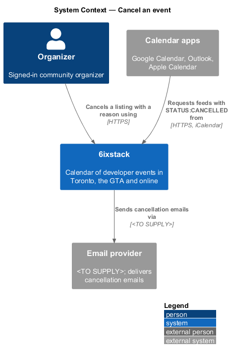
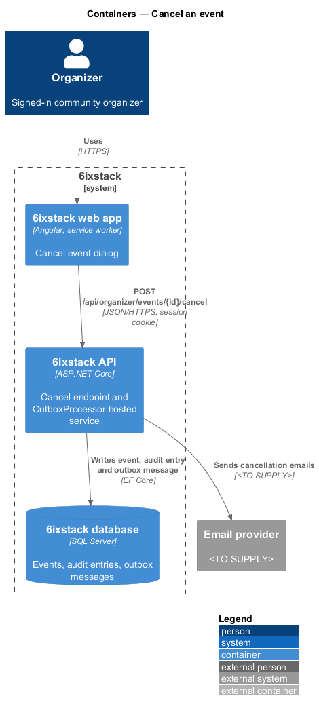
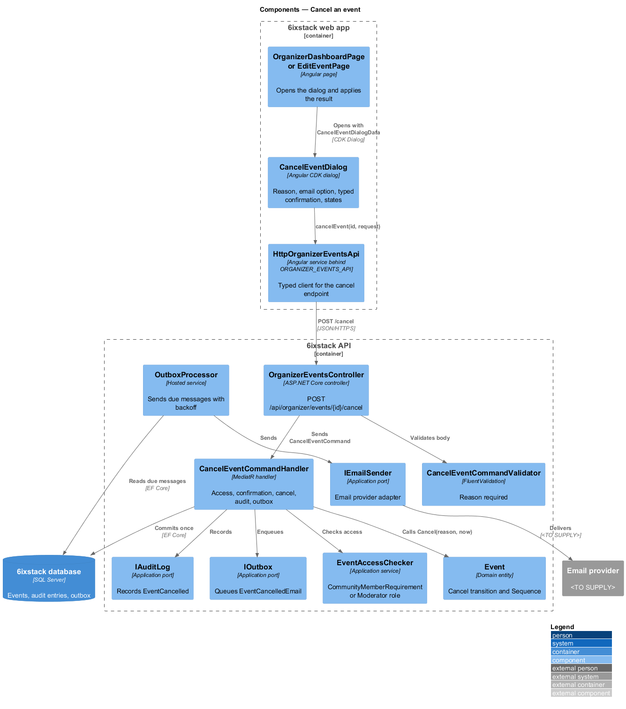
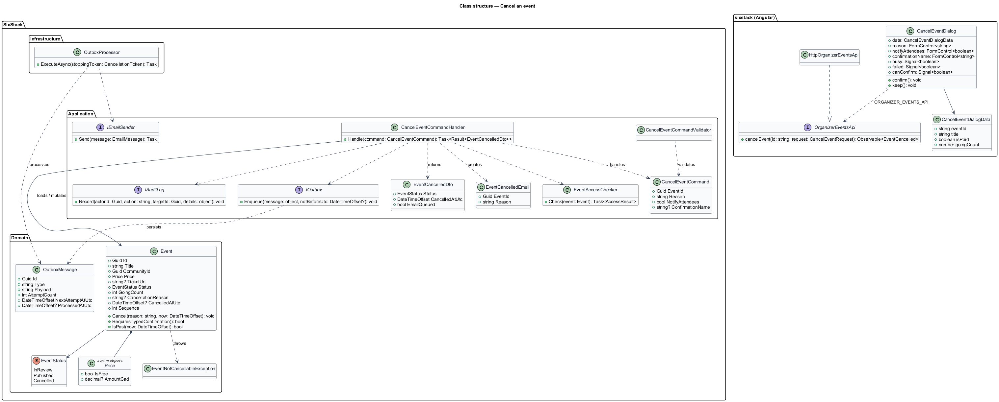
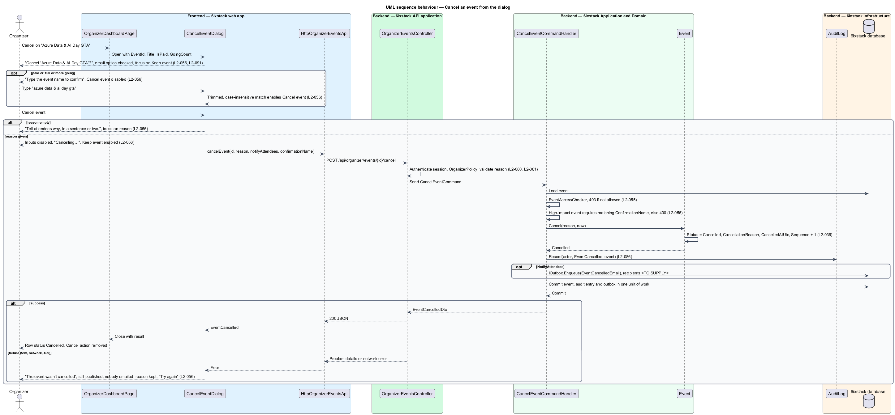
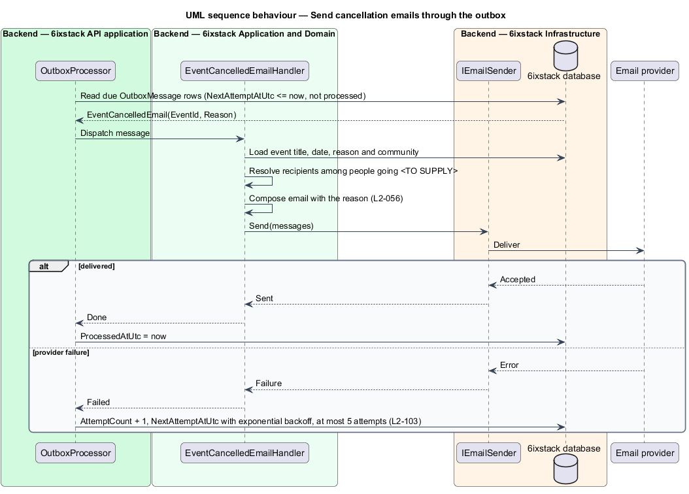

# Cancel an event

## Overview

6ixstack is a calendar of developer events in Toronto, the Greater Toronto Area
(GTA) and online. When an event will not happen, its organizer cancels it rather
than deleting it. The listing stays on 6ixstack marked as cancelled, with the
organizer's reason, so people who planned to attend learn what happened. This
feature covers the cancel dialog drawn in `docs/mocks/dialogs/cancel-event/` and
the state change behind it.

The feature belongs to the `organizer` subsystem. The dialog opens from Cancel
on a dashboard row (`organizer/organizer-dashboard`) and from Cancel event on the
edit page (`organizer/edit-event`). The cancelled listing itself is drawn by
`discovery/view-event-detail`, and the cancelled feed entry by
`feeds-and-sharing/serve-calendar-feed`.

Terms used in this design:

- **cancellation reason** — one or two sentences from the organizer, shown on the listing and in the cancellation email
- **people going** — people counted in the event's going count
- **typed confirmation** — event name typed into the dialog to enable "Cancel event"; matched without regard to case
- **high-impact event** — paid event, or event with 100 or more people going, which requires typed confirmation
- **outbox** — table of pending background messages written in the same transaction as the state change and sent later by `OutboxProcessor`

Cancellation cannot be undone. On success the event's status becomes Cancelled,
the public page drops the ticket link, feeds mark the entry `STATUS:CANCELLED`,
and, when the organizer leaves the email option checked, cancellation emails are
queued. Destructive dialogs focus the safe action first, so "Keep event" holds
focus when the dialog opens.

The recipients of the cancellation email are an open question. 6ixstack does not
sell tickets; tickets live on organizer-owned sites. The source of the going
count and of the attendee email list is `<TO SUPPLY>`.

## Description

The slice runs from a CDK dialog to the database through one command, then to
the email provider through the outbox.

- **`CancelEventDialog`** — Angular CDK dialog in project `sixstack` at
  `frontend/projects/sixstack/src/app/dialogs/cancel-event/`, built on the shared
  `DialogShell`. It receives `CancelEventDialogData` (`EventId`, `Title`,
  `IsPaid`, `GoingCount`). It shows the title "Cancel “{title}”?", the
  description "It stays on 6ixstack marked as cancelled, ticket links are removed
  and feeds update. This can't be undone.", the reason field, the checkbox "Email
  the {n} people going" (checked by default) and, for a high-impact event, the
  field "Type the event name to confirm". The footer holds "Keep event", which
  has initial focus, and the danger button "Cancel event".
- **Dialog states** — invalid: an empty reason shows "Tell attendees why, in a
  sentence or two." and moves focus to the reason. Confirm: "Cancel event" stays
  disabled until the trimmed typed name equals the title without regard to case.
  Busy: inputs disabled, the button reads "Cancelling…" with
  `aria-busy="true"`, and "Keep event" stays enabled. Failed: the alert "The
  event wasn't cancelled" states it is still published and nobody was emailed,
  the reason is kept and the button reads "Try again".
- **`OrganizerEventsApi`** / **`ORGANIZER_EVENTS_API`** /
  **`HttpOrganizerEventsApi`** — this slice adds `cancelEvent(id, request)`.
- **`OrganizerEventsController`** — exposes
  `POST /api/organizer/events/{id}/cancel` behind `OrganizerPolicy`.
- **`CancelEventCommand`** — carries `EventId`, `Reason`, `NotifyAttendees` and
  `ConfirmationName`.
- **`CancelEventCommandValidator`** — requires a non-blank `Reason`. The maximum
  reason length is `<TO SUPPLY>`.
- **`CancelEventCommandHandler`** — MediatR handler. It loads the event, calls
  `EventAccessChecker` (described in `organizer/edit-event`), and re-checks the
  typed confirmation for a high-impact event, answering 400 on a mismatch. It
  then calls `Event.Cancel`, records the audit entry, enqueues the cancellation
  email when `NotifyAttendees` is true, and commits once.
- **`Event.Cancel(reason, now)`** — domain method. It accepts Published and In
  review events, refuses a past or already cancelled event with
  `EventNotCancellableException` (409), sets `Status` to `Cancelled`,
  `CancellationReason` to the reason and `CancelledAtUtc` to now, and increments
  `Sequence` so calendar apps replace the entry.
- **`IAuditLog`** — records actor, time, action `EventCancelled` and target
  (`L2-086`).
- **`IOutbox`** — receives an `EventCancelledEmail` message with the event
  identifier and reason. `OutboxProcessor` sends it through `IEmailSender` to
  the email provider, retrying with exponential backoff up to 5 attempts
  (`L2-103`). Recipients are `<TO SUPPLY>`, as stated above.
- **`EventCancelledEmailHandler`** — outbox message handler in
  `SixStack.Application`. It loads the event, composes the email with the
  reason and hands it to `IEmailSender`.
- **`EventCancelledDto`** — response carrying `Status`, `CancelledAtUtc` and
  `EmailQueued`. The opener updates the row or the page from it. Whether a
  success toast follows is `<TO SUPPLY>`, since no mock draws one.

Two points remain open:

- Cancelling an In review event: `L2-051` offers Cancel for In review rows, but
  a cancelled event is a published event shown with a badge (`L2-010`). Whether
  a cancelled event that was never approved appears publicly is `<TO SUPPLY>`.
- Moderator cancellation: `L2-056` names no actor. Whether moderators may cancel
  through this endpoint, as they may edit (`L2-062`), is `<TO SUPPLY>`. The
  design reuses `EventAccessChecker`, which admits moderators.

"Keep event" stays enabled while the request is in flight. Closing the dialog at
that point does not abort the request; the dashboard shows the outcome on its
next load. Whether the opener reports a late result is `<TO SUPPLY>`.

## Requirements

| L2 ID | Refines (L1) | Requirement |
|-------|--------------|-------------|
| `L2-056` | `L1-012` | The "Cancel “{title}”?" dialog shall require a reason for attendees (shown on the listing and emailed), offer an option, checked by default, to email the people going, focus "Keep event" first, and, for paid events or events with 100 or more going, require typing the event name (case-insensitive) before "Cancel event" enables. |

## Diagrams

### System context

An organizer cancels a listing in 6ixstack. 6ixstack emails the people going
through the email provider and calendar apps receive the cancelled entry in
their feeds.

### Containers

The web app posts the cancellation to the API. The API writes the event, the
audit entry and the outbox message in one transaction. The outbox processor
inside the API then sends the email.

### Components

`CancelEventDialog` calls `HttpOrganizerEventsApi`. In the API,
`CancelEventCommandHandler` checks access and confirmation, mutates `Event`, and
writes to `IAuditLog` and `IOutbox`. `OutboxProcessor` delivers the message
through `IEmailSender`.

### Class structure

The command handler depends on the command, the access checker, the audit log
and the outbox. `Event.Cancel` owns the transition and the `Sequence` increment.

### Behaviour — cancel from the dialog

The dialog enforces the reason and the typed confirmation before the request,
and the handler enforces both again (`L2-056`). A failure keeps the reason and
offers Try again.

### Behaviour — send cancellation emails

`OutboxProcessor` picks up the committed message and sends it. A provider
failure leaves the cancellation in place and schedules a retry (`L2-103`).

