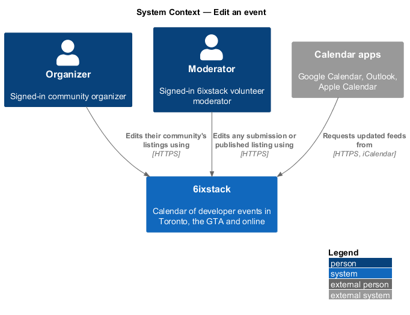
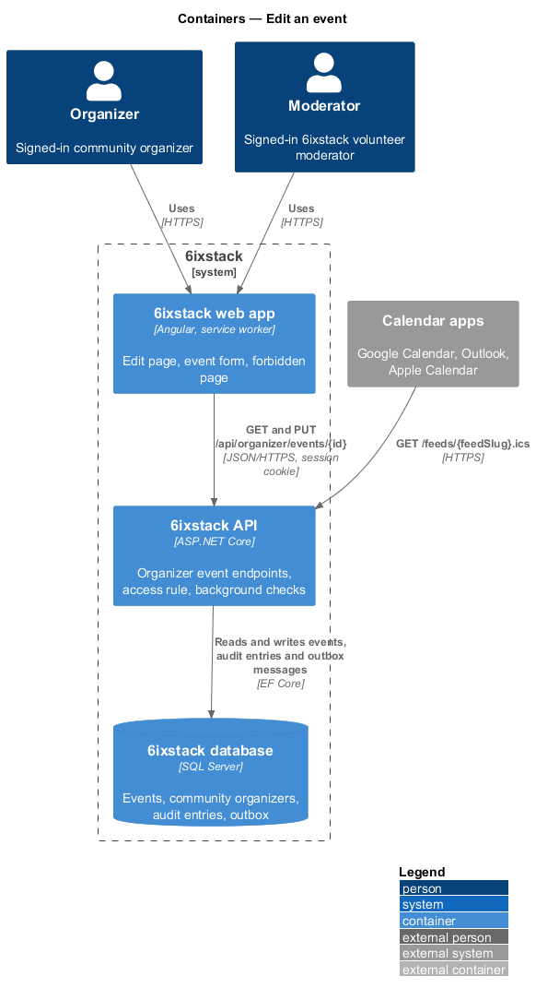
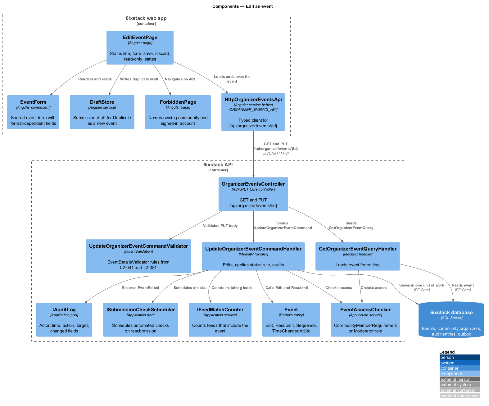
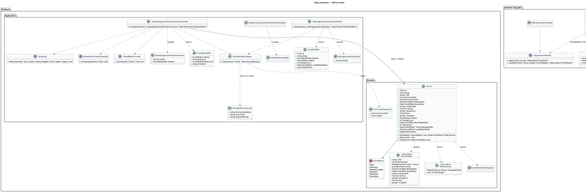
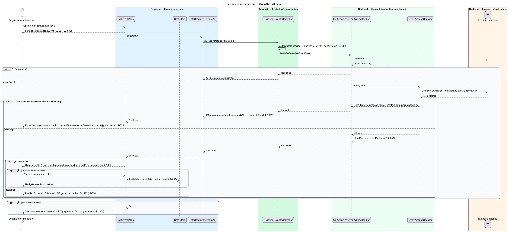
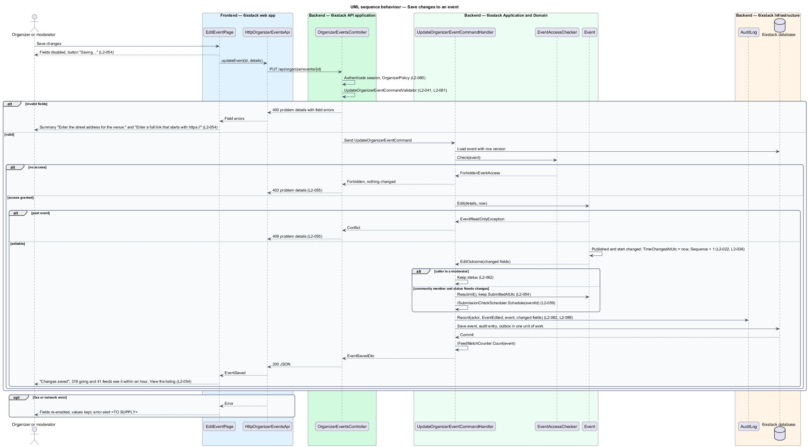

# Edit an event

## Overview

6ixstack is a calendar of developer events in Toronto, the Greater Toronto Area
(GTA) and online. Organizers submit listings, moderators review them, and
approved listings appear in the list, the calendar and calendar feeds. Details
change after submission: a venue moves, a start time shifts, a ticket link
breaks. This feature covers the edit page at `/organize/events/{id}/edit`, drawn
in `docs/mocks/pages/edit-event/`, and the forbidden page drawn in
`docs/mocks/pages/forbidden/`.

The feature belongs to the `organizer` subsystem. Organizers reach the page from
Edit or View on the dashboard (`organizer/organizer-dashboard`); moderators reach
it from Edit on a review queue card (`moderation/review-queue`). The Cancel event
button on the page opens the dialog described in `organizer/cancel-event`.

Terms used in this design:

- **event details** — editable fields of a listing: title, organizer, description, topics, date, time zone, start, end, format, venue, city, street address, livestream link, price and ticket link
- **status line** — one line above the form stating status, going count and last edit date ("Published · 318 going · last edited Oct 28")
- **past event** — event whose end lies before the current instant
- **read-only event** — past event shown with every field disabled and no save actions
- **community member** — organizer listed in `CommunityOrganizer` for the event's community
- **resubmission** — save by an organizer of a Needs changes event, which returns it to the review queue
- **matching feeds** — saved calendar feeds whose filters include the event

Edit rights belong to community members and moderators only. Anyone else sees
the forbidden page, which names the owning community and the signed-in account.
The API refuses the same request with 403 whatever the client shows.

Saving a published event applies the change at once. The public page and the
feeds show the new details, and a start-time change raises the time-change alert
of `L2-022` and increments the iCalendar `SEQUENCE` of `L2-036`. Saving a Needs
changes event as its organizer sends it back to In review. A moderator's save
leaves the status unchanged and is recorded in the audit trail with the
moderator's identity.

## Description

The slice runs from the Angular page to the database through one query and one
command.

- **`EditEventPage`** (`sx-edit-event-page`) — Angular page in project `sixstack`
  at `frontend/projects/sixstack/src/app/pages/edit-event/`. It shows the back
  link "Your events", the status line, the event form, Cancel event, Discard
  changes and Save changes. It owns the loading, error, invalid, submitting,
  success and read-only states. On 403 it navigates to the forbidden page.
- **`EventForm`** — form component shared with `submissions/submit-event`. It
  renders the sections Event basics, When, Where and Tickets, hides the contact
  email section when editing, and applies the format-dependent fields of
  `L2-042`. It disables every input while saving or when read-only.
- **`ErrorSummary`**, **`FormField`**, **`Alert`**, **`Skeleton`** — shared
  components from project `components`. The summary lists each field error and
  links to its field (`L2-092`).
- **`ForbiddenPage`** — status page from `site/status-pages`. This slice passes
  it the owning community name, the event title and the signed-in email, read
  from the 403 problem details.
- **`DraftStore`** — shared service that holds the submission draft of
  `L2-044`. "Duplicate as a new event" writes the event details, without date,
  start and end, into it and navigates to `/submit`.
- **`CancelEventDialog`** — CDK dialog opened by Cancel event; described in
  `organizer/cancel-event`.
- **`OrganizerEventsApi`** / **`ORGANIZER_EVENTS_API`** /
  **`HttpOrganizerEventsApi`** — the API client contract, token and HTTP
  implementation in project `api`. This slice adds `getEvent(id)` and
  `updateEvent(id, details)`.
- **`OrganizerEventsController`** — exposes `GET /api/organizer/events/{id}` and
  `PUT /api/organizer/events/{id}`. `OrganizerPolicy` rejects anonymous callers
  with 401. For these two endpoints the policy admits both the `Organizer` and
  the `Moderator` role.
- **`GetOrganizerEventQuery`** / **`GetOrganizerEventQueryHandler`** — loads the
  event, returns 404 for an unknown identifier and evaluates the access rule
  before mapping any details. It returns an `EventEditDto` with the details, the
  status line values and `IsReadOnly`.
- **`UpdateOrganizerEventCommand`** — carries `EventId` and an
  `EventDetailsDto`.
- **`UpdateOrganizerEventCommandValidator`** — reuses `EventDetailsValidator`,
  shared with the submission command, so the field errors and messages match
  `L2-041` and `L2-081`. Invalid input returns 400 problem details with field
  errors.
- **`UpdateOrganizerEventCommandHandler`** — MediatR handler. It loads the
  event, evaluates the access rule, calls `Event.Edit`, applies the status rule,
  records the audit entry, schedules automated checks on resubmission and saves
  in one unit of work. It returns an `EventSavedDto`.
- **`EventAccessChecker`** — application service that realizes
  `CommunityMemberRequirement`: the caller is a community member of the event's
  community or holds the `Moderator` role. A failed check produces a
  `ForbiddenEventAccess` result that the controller maps to 403 problem details
  with the extensions `communityName`, `eventTitle` and `signedInEmail`.
- **`Event.Edit(EventDetails, now)`** — domain method. It refuses past events
  with `EventReadOnlyException`. It returns an `EditOutcome` listing the changed
  field names. When the event is Published and the start or end changes, it sets
  `TimeChangedAtUtc` to now and increments `Sequence`. It sets `LastEditedAtUtc`
  to now. `LastEditedAtUtc` is a field this design adds to `Event`.
- **`Event.Resubmit()`** — moves a Needs changes event to In review and keeps
  `SubmittedAtUtc`, as `L2-061` requires for resubmissions.
- **`ISubmissionCheckScheduler`** — port from `moderation/automated-checks`. The
  handler calls it on resubmission so the checks of `L2-059` run again.
- **`IAuditLog`** — records actor, time, action `EventEdited`, target and the
  changed field names (`L2-062`, `L2-086`).
- **`IFeedMatchCounter`** — application service that counts matching feeds for
  the "41 feeds" figure. How feed definitions are persisted and matched belongs
  to `feeds-and-sharing/build-custom-feed`; the counting query is `<TO SUPPLY>`.

The handler applies the status rule in this order:

| Editor | Status before save | Status after save |
|--------|--------------------|-------------------|
| Moderator | Any editable status | Unchanged (`L2-062`) |
| Community member | Needs changes | In review, checks scheduled (`L2-054`) |
| Community member | Published, In review | Unchanged |
| Community member | Rejected, Draft, Cancelled | `<TO SUPPLY>` |
| Anyone | Past | Refused with 409; the page never offers save |

The success alert reads "The listing is updated. 318 people going and 41 feeds
that include it will see the new details within an hour." The one-hour bound
depends on the feed cache lifetime set by `feeds-and-sharing/serve-calendar-feed`;
that value is `<TO SUPPLY>`. The 318 comes from `GoingCount`, whose source is
`<TO SUPPLY>` because tickets are sold on organizer-owned sites.

Discard changes navigates to `/organize` without a request. A save that fails
with 5xx re-enables the fields and keeps every value; the copy for that state is
`<TO SUPPLY>`, since `edit-event` has no failed-save mock.

`Event` carries a row version. Two saves that race on the same event resolve
with the second receiving 409; the copy for that state is `<TO SUPPLY>`, since
no mock draws it.

## Requirements

| L2 ID | Refines (L1) | Requirement |
|-------|--------------|-------------|
| `L2-054` | `L1-012` | The edit page (`/organize/events/{id}/edit`) shall prefill the event form, show its status line ("Published · 318 going · last edited Oct 28"), save changes with "Save changes", discard them with "Discard changes", and for published events apply changes immediately and update feeds. |
| `L2-055` | `L1-012` | Only organizers of the event's community and moderators shall edit an event; others shall see the forbidden page naming the owning community and the signed-in account. Past events shall be read-only with a "Duplicate as a new event" action. |
| `L2-062` | `L1-013` | A moderator shall be able to edit any submission or published event through the edit page, and the edit shall be recorded with the moderator's identity. |

## Diagrams

### System context

Organizers edit their community's listings and moderators edit any listing.
Calendar apps pick up the change the next time they request a feed.

### Containers

The web app loads and saves the event through the organizer endpoints of the
API. The API writes the event, the audit entry and any check request to the SQL
Server database in one transaction.

### Components

`EditEventPage` renders the shared `EventForm` and calls
`HttpOrganizerEventsApi`. In the API, both handlers call `EventAccessChecker`
before reading or changing details. The update handler also calls `IAuditLog`
and `ISubmissionCheckScheduler`.

### Class structure

`Event.Edit` returns an `EditOutcome` that the handler writes to the audit log.
`EventEditDto` and `EventSavedDto` carry the values the page shows before and
after a save.

### Behaviour — open the edit page

The query handler answers 404 for an unknown event and 403 with the owning
community for a caller without access (`L2-055`). A past event opens read-only
with "Duplicate as a new event", which fills the submission draft without date
or times.

### Behaviour — save changes

The validator rejects invalid fields with 400 before the handler runs
(`L2-054`). The handler then evaluates access, applies `Event.Edit` and the
status rule, records the audit entry and commits once.

## Decisions (journey 14)

- **Who may edit**: a community member, the address that submitted the event (a new organizer has no community
  yet, as on the dashboard), or a moderator. Anyone else gets 403 with `communityName`, `eventTitle` and
  `signedInEmail`; the page shows the forbidden state from `forbidden/default`.
- **Status rule** (fills the `<TO SUPPLY>` row): an organizer's save of a Needs changes or Rejected event is a
  resubmission. It returns to In review, keeps `SubmittedAtUtc` and schedules the automated checks again.
  Published and In review keep their status, as `L2-054` asks; published changes apply at once rather than going
  back to review. Cancelled and past events are read-only (409 if saved). A moderator's save never changes the
  status (`L2-062`).
- **Success copy**: published events say "The 318 people going and every calendar feed that includes it will see
  the new details within an hour". Feeds are cached for 15 minutes, which is within the hour. Counting matching
  feeds (`IFeedMatchCounter`) waits until feed requests are counted, as on the dashboard. Other statuses say
  "Changes saved", and a resubmission says it is back in review.
- **Failed save** (`edit-event/failed`): "We couldn’t save your changes", with every value kept.
- **Races**: a save that loses a race with another save or a decision gets 409 "Someone else changed this event".
  The page reloads the event and keeps nothing stale. No mock draws this state, so it is a toast with the same
  words.
- **Audit**: every save records `EventEdited` with the actor, time and changed field names. `AuditEntry` gains
  `Details`.
- **Status line**: "{status} · {n} going · last edited {Mon d}". Going appears only for published events, and the
  last edit only once there is one. `Event.LastEditedAtUtc` is new (seeded Oct 28 for Azure Data & AI Day GTA).
- **Reached from**: the dashboard's Edit (non-past rows) and View (past rows, read-only); the Needs changes
  banner's "Add the address"; the Not approved banner's "Edit and resubmit"; the review queue card's Edit.
- **Duplicate as a new event** writes the details, without the date or times, into the submit page's browser draft,
  with the signed-in email as the contact.
- Cancel event stays with journey 15, so the edit page has no Cancel button yet.

