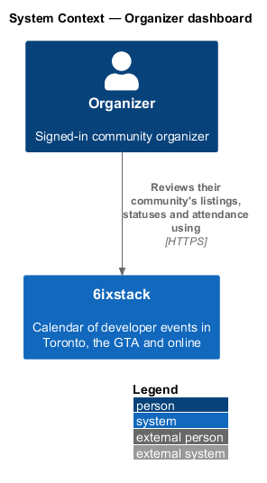
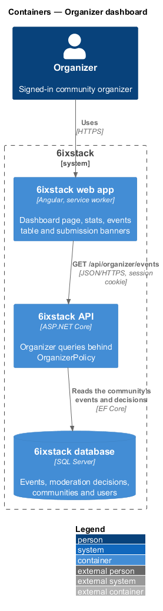
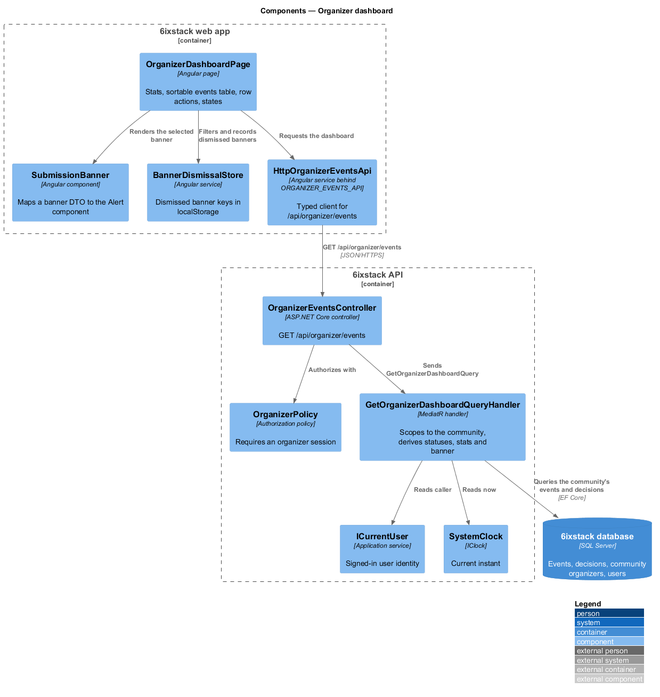
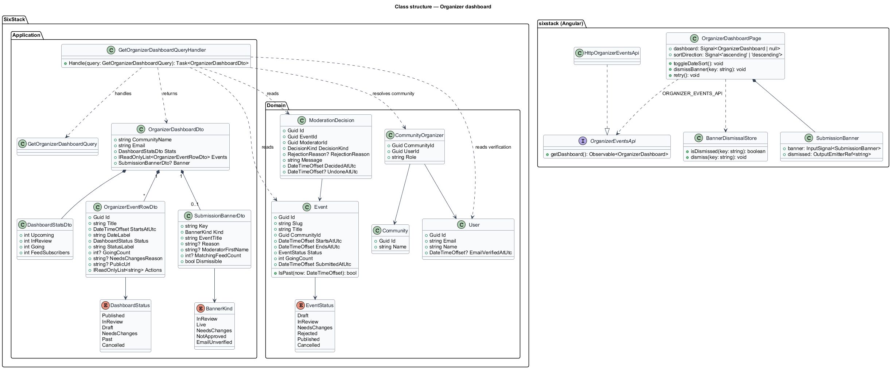
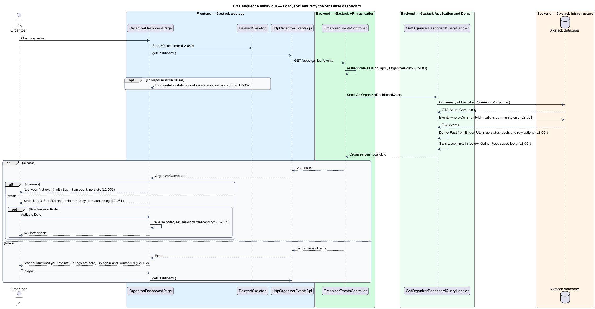
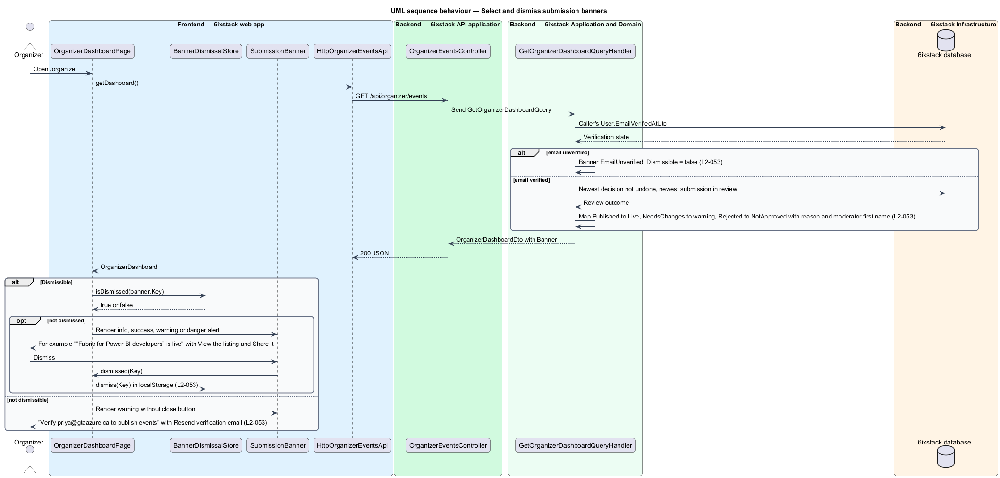

# Organizer dashboard

## Overview

6ixstack is a calendar of developer events in Toronto, the Greater Toronto Area
(GTA) and online. Community organizers list their events on it, and volunteer
moderators review each listing before it goes public. The organizer dashboard at
`/organize` is the signed-in organizer's home: it shows every event of the
organizer's community with its review status and attendance, and it reports the
outcome of the most recent review. This feature covers that page in the states
drawn in `docs/mocks/pages/organizer-dashboard/` and the banners drawn in
`docs/mocks/notifications/submission-banner/`.

The feature belongs to the `organizer` subsystem. Editing a listing
(`organizer/edit-event`) and cancelling one (`organizer/cancel-event`) start from
the row actions on this page but are separate slices. Signing in belongs to
`identity/magic-link-sign-in`.

Terms used in this design:

- **organizer** — signed-in user who manages one community's events
- **community events** — events whose `CommunityId` is the organizer's community, in every status
- **dashboard status** — status label shown per row: Published, In review, Draft, Needs changes, Past or Cancelled
- **past event** — published event whose end lies before the current instant; Past is derived, not stored
- **review outcome** — most recent moderator decision, or pending review, on one of the community's events
- **submission banner** — alert at the top of the dashboard that reports a review outcome or an unverified email
- **going count** — number of people who say they attend an event

An organizer sees only the events of the community they manage. The table sorts
by date, ascending by default. Each row offers actions that depend on its
status: Edit and Cancel for Published and In review events, View for Past
events. The stats row counts upcoming published events, events in review, people
going and feed subscribers.

6ixstack does not sell tickets; tickets live on organizer-owned sites. The
source of the going count and of the feed subscriber count is therefore an open
question, recorded below as `<TO SUPPLY>`.

## Description

The slice runs from the Angular page to the database through one read-only
query. Sorting and banner dismissal happen in the browser.

- **`OrganizerDashboardPage`** (`sx-organizer-dashboard-page`) — Angular page in
  project `sixstack` at `frontend/projects/sixstack/src/app/pages/organizer-dashboard/`.
  It renders the title "Your events", the lead "{community} · signed in as
  {email}", the New event action (links to `/submit`), the submission banner,
  the stats row and the events table. It owns the loading, empty and error
  states. The Date column header is a button that reverses the sort order and
  updates `aria-sort`.
- **`SubmissionBanner`** — local presentational component that maps a
  `SubmissionBannerDto` to the shared `Alert` component: info for in review,
  success for live (View the listing, Share it), warning for needs changes (the
  fix), danger for not approved (quoted reason with the moderator's first name,
  Edit and resubmit, Ask a question) and an undismissable warning for an
  unverified email (Resend verification email).
- **`BannerDismissalStore`** — Angular service that remembers dismissed banner
  keys in `localStorage`. A key is the banner kind plus the decision or event
  identifier, so a newer outcome shows a new banner. Whether a dismissal also
  holds across devices is `<TO SUPPLY>`.
- **`OrganizerEventsApi`** / **`ORGANIZER_EVENTS_API`** /
  **`HttpOrganizerEventsApi`** — the API client contract, its injection token and
  its HTTP implementation in project `api`. The page depends on the token only.
- **`DelayedSkeleton`** — shared helper that shows four skeleton stats and four
  skeleton rows only when the request is still pending after 300 ms.
- **`OrganizerEventsController`** — ASP.NET Core controller exposing
  `GET /api/organizer/events`. The `OrganizerPolicy` authorization policy
  requires an organizer session; an anonymous call receives 401. The controller
  dispatches the query and holds no business rules.
- **`GetOrganizerDashboardQuery`** — query with no parameters; the handler reads
  the caller from `ICurrentUser`.
- **`GetOrganizerDashboardQueryHandler`** — MediatR handler. It resolves the
  caller's community through `CommunityOrganizer`, then loads only that
  community's events. It derives each row's dashboard status, computes the four
  stats and selects the submission banner.
- **`OrganizerDashboardDto`**, **`DashboardStatsDto`**,
  **`OrganizerEventRowDto`**, **`SubmissionBannerDto`** — response contracts.
  `OrganizerEventRowDto` carries `DateLabel` and `StatusLabel` so the table holds
  no formatting rules. It also carries `NeedsChangesReason`, `PublicUrl`
  (Published rows only) and the allowed `Actions`.
- **`DashboardStatus`** — enumeration of the row statuses: `Published`,
  `InReview`, `Draft`, `NeedsChanges`, `Past`, `Cancelled`.
- **`Event`**, **`ModerationDecision`**, **`User`**, **`Community`** — domain
  entities read by the handler.
- **`SystemClock`** (`IClock`) — supplies the current instant, used to derive
  Past and to count upcoming events.

The handler applies these rules:

| Item | Rule |
|------|------|
| Row status | `Published` with `EndsAtUtc` before now becomes `Past`; other statuses map one to one. A `Rejected` event shows as `<TO SUPPLY>`, since `L2-051` lists no Rejected label. |
| Row actions | Published and In review: Edit, Cancel. Past: View. Needs changes, Draft, Cancelled: Edit, Cancel and View rules are `<TO SUPPLY>`; the mock shows Edit only. |
| Needs changes reason | Text shown under the title ("Add the venue address"). Whether it is the rejection reason label, a fixed fix text per reason, or the moderator's message is `<TO SUPPLY>`. |
| Upcoming stat | Published, non-cancelled events whose start is after now. |
| In review stat | Events with status `InReview`. |
| Going stat | Sum of `GoingCount` over upcoming published events. The source of `GoingCount` is `<TO SUPPLY>`. |
| Feed subscribers stat | Subscribers to feeds that include the community's events. How subscribers are counted for iCalendar feeds is `<TO SUPPLY>`. |
| Banner | Unverified email first (`User.EmailVerifiedAtUtc` is null). Otherwise the newer of: the newest `ModerationDecision` on a community event that was not undone, or the newest event submitted for review. |

Server-side `Draft` events require a save-as-draft path that no L2 requirement
defines; the submission draft in `L2-044` lives in browser storage only. The
origin of a server-side Draft is `<TO SUPPLY>`.

The success banner reads "It's in the list, the calendar and 41 matching
feeds." The number of feeds that include an event is computed as in
`organizer/edit-event`.

## Requirements

| L2 ID | Refines (L1) | Requirement |
|-------|--------------|-------------|
| `L2-051` | `L1-012` | The dashboard (`/organize`) shall show the community name and signed-in email, a New event action, stats (Upcoming, In review, Going, Feed subscribers) and a table of the community's events with Event, Date (sortable, ascending by default), Status (Published, In review, Draft, Needs changes, Past, Cancelled), Going and row actions. |
| `L2-052` | `L1-012` | The dashboard shall show a loading skeleton with the same columns, an empty state for an organizer with no events, and an error state with retry and a contact link. |
| `L2-053` | `L1-012` | The dashboard shall show a banner for the organizer's most recent review outcome: in review (info), live (success, with View the listing and Share it), needs changes (warning, with the fix), not approved (danger, with the moderator's quoted reason, Edit and resubmit and Ask a question), and an undismissable warning while the organizer's email is unverified. |

## Diagrams

### System context

An organizer manages their community's listings in 6ixstack. No external system
takes part in loading the dashboard.

### Containers

The web app calls `GET /api/organizer/events` with the session cookie. The API
reads the community's events, decisions and the organizer's account from the SQL
Server database.

### Components

`OrganizerDashboardPage` requests the dashboard through
`HttpOrganizerEventsApi` and filters banners through `BannerDismissalStore`. In
the API, `OrganizerPolicy` admits only organizer sessions, and
`GetOrganizerDashboardQueryHandler` scopes every read to the caller's community.

### Class structure

The handler reads `Event`, `ModerationDecision`, `CommunityOrganizer` and `User`
and returns an `OrganizerDashboardDto` composed of stats, rows and an optional
banner. On the client, `OrganizerDashboardPage` depends on the
`OrganizerEventsApi` contract through the `ORGANIZER_EVENTS_API` token.

### Behaviour — load, sort and retry

The handler resolves the caller's community before any event is read, so other
communities' events never appear (`L2-051`). Skeletons appear only after 300 ms.
A failure shows the error alert with Try again and Contact us (`L2-052`). The
Date header reverses the order in the browser.

### Behaviour — submission banners

The handler selects at most one banner. The unverified-email banner wins and has
no close button. A dismissed banner key is stored in the browser and filtered
out on the next visit (`L2-053`).

