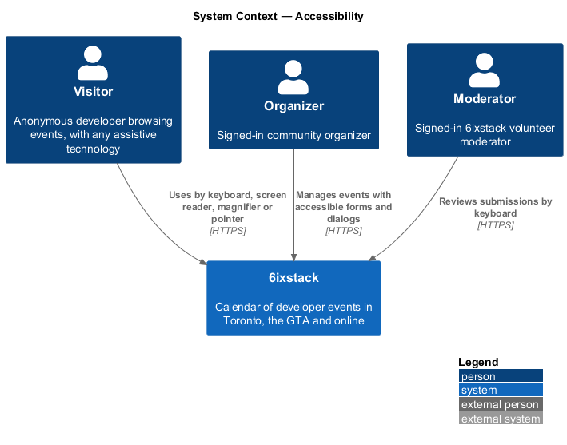
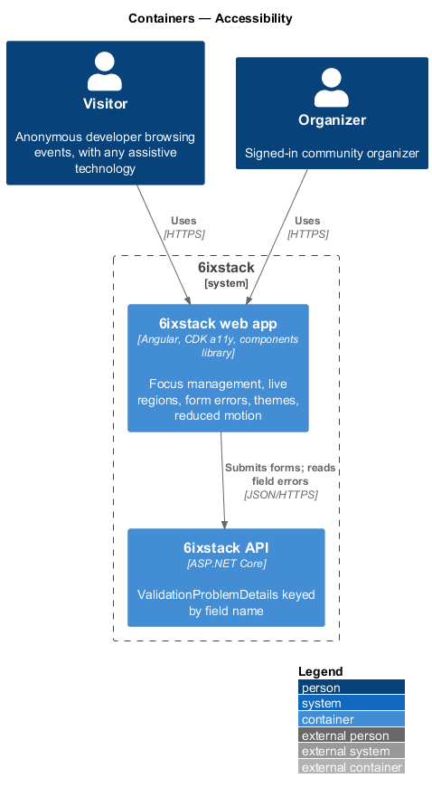
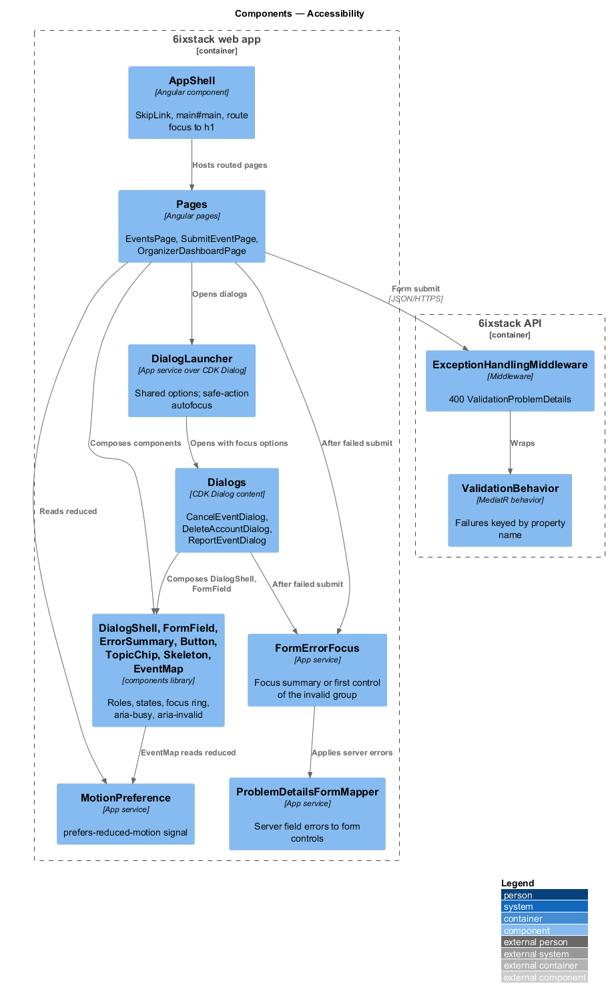
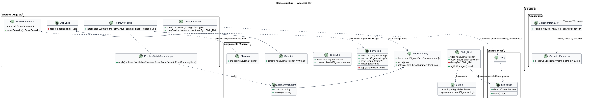
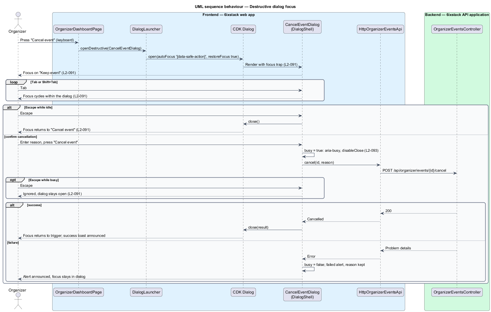
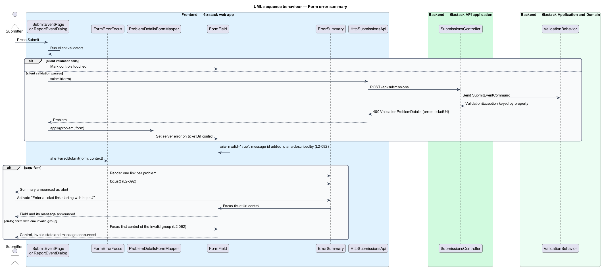
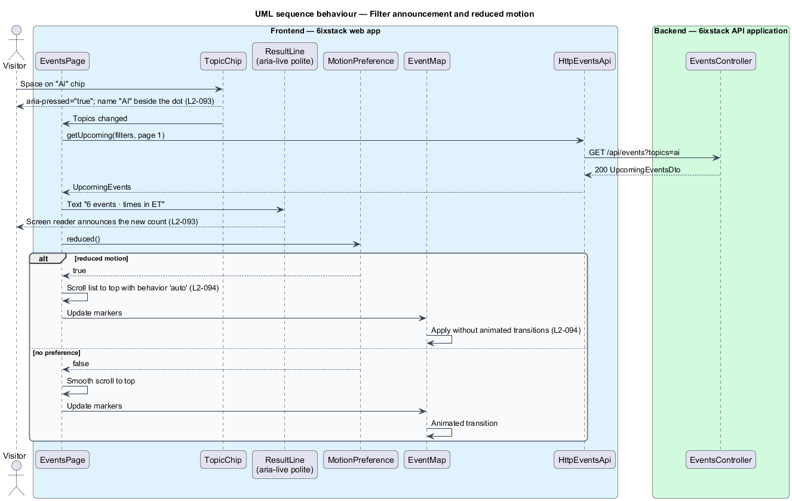

# Accessibility

## Overview

6ixstack serves a developer audience that includes people who use screen
readers, keyboard-only navigation, screen magnification and reduced-motion
settings. Every page, dialog and notification in `docs/mocks/` is drawn with
its accessible semantics: a skip link, labelled landmarks, live regions, error
summaries and focus order. This feature turns those semantics into shared
mechanisms, so each page inherits them instead of reimplementing them.

The feature belongs to the `platform` subsystem. Most of it lives in the
Angular `components` library and the app shell of project `sixstack`. The API
takes part in one place: its validation responses name each invalid field, so
the web app can link an error summary to the right control.

Terms used in this design:

- **WCAG 2.2 AA** — level AA of the Web Content Accessibility Guidelines, version 2.2
- **focus indicator** — visible outline drawn around the element that has keyboard focus
- **skip link** — first focusable link on a page that moves focus to the main content
- **focus trap** — rule that keeps Tab and Shift+Tab inside an open dialog
- **busy dialog** — dialog whose action is in progress, shown with `aria-busy="true"` and a disabled action
- **destructive dialog** — dialog whose primary action deletes, cancels or rejects something: cancel event, delete account and reject submission
- **safe action** — action in a destructive dialog that leaves everything unchanged, such as "Keep event"
- **error summary** — alert at the top of a form that lists each problem as a link to its field
- **live region** — element whose text changes a screen reader announces, politely after current speech
- **reduced motion** — operating system preference, exposed as `prefers-reduced-motion: reduce`, that asks for minimal animation

## Description

### Conformance in both themes (`L2-090`)

- **Design tokens** — colours come only from the Fluent UI v9 token roles in
  `frontend/projects/components/src/lib/tokens/`. Each foreground and
  background pair used for text meets 4.5:1, and large text and UI components
  meet 3:1, in light and dark themes. A change to a token pair is verified
  against these ratios before release.
- **Component semantics** — each component in project `components` keeps the
  mock's BEM classes and its roles and states (`AGENTS.md`). Examples are
  `aria-pressed` on `TopicChip`, `role="radiogroup"` on `SegmentedControl` and
  `aria-current="page"` on navigation links.
- **Event map** — the map's labels are decorative because the list is the
  accessible route to every event (`docs/mocks/README.md`, assumption 8).
  `EventMap` marks its canvas `aria-hidden="true"` and offers its controls as
  buttons.
- **Verification** — every Playwright page object can run `@axe-core/playwright`
  against its current state. The suite visits each mocked state in light and
  dark themes in Chromium and expects no violations.

### Keyboard operation and focus (`L2-091`)

- **Focus indicator** — a global `:focus-visible` rule draws a 2 px outline in
  `var(--colorStrokeFocus2)` with an inner ring in
  `var(--colorStrokeFocus1)`. No component removes the outline.
- **`SkipLink`** (`sx-skip-link`) — first element in `AppShell`. It reads "Skip
  to content" and targets `<main id="main" tabindex="-1">`. Activating it moves
  focus to `main`.
- **Route focus** — after each navigation, `AppShell` moves focus to the new
  page's `h1`, so screen reader users hear the page change.
- **`DialogShell`** (`sx-dialog-shell`) — wraps every dialog content opened
  through the Angular CDK `Dialog`. The CDK supplies the focus trap and returns
  focus to the trigger on close (`restoreFocus: true`). A `busy` input sets
  `aria-busy="true"` and sets `DialogRef.disableClose` to `true`, so Escape and
  backdrop clicks do nothing while busy.
- **`DialogLauncher`** — app service that opens dialogs with shared defaults.
  For a destructive dialog it passes `autoFocus: '[data-safe-action]'`. The
  safe action button carries that attribute, so "Keep event" receives focus
  first. Whether the sign-out dialog counts as destructive is `<TO SUPPLY>`.
- **`MobileNav`** — the mobile menu is a CDK dialog (bottom sheet). Escape
  closes it and returns focus to the menu button.
- **Keyboard shortcuts** — the review queue shortcuts (`L2-064`) belong to
  `moderation/review-queue`. They never fire while focus is in a text field.

### Accessible form errors (`L2-092`)

- **`FormField`** (`sx-form-field`) — wraps a label, a control and its message.
  When its control is invalid and touched, it sets `aria-invalid="true"` on the
  control. It adds the message id to the control's `aria-describedby`, keeping
  any hint id already present.
- **`ErrorSummary`** (`sx-error-summary`) — `role="alert"` region with a
  `tabindex="-1"` heading and one link per problem. Activating a link focuses
  the matching control and scrolls it into view.
- **`FormErrorFocus`** — app service called after a failed submit. In a page
  form it focuses the `ErrorSummary`. In a dialog form whose errors fall in one
  field group, it focuses that group's first control instead. A dialog with
  errors in more than one group shows a summary, matching the
  `dialogs/*/invalid` mocks.
- **`ProblemDetailsFormMapper`** — maps the `errors` dictionary of a 400
  `ValidationProblemDetails` to form control paths. Client and server errors
  therefore render through the same `FormField` and `ErrorSummary`.
- **API side** — `ValidationBehavior` (`platform/security-hardening`) keys each
  failure by the camel-cased property name of the command, which matches the
  form control name.

### Announcements and status (`L2-093`)

- **`ResultLine`** — text such as "12 events · times in ET" inside a
  `aria-live="polite"` element. Pages update its text after each filter
  change, so the new count is announced. The month heading in the calendar uses
  the same pattern.
- **Busy controls** — `Button` (`sx-button`) has a `busy` input that sets
  `aria-busy="true"` and `aria-disabled="true"` and shows a spinner with
  visually hidden text.
- **Never colour alone** — `TopicChip` and the topic dot always render the topic
  name. Status badges carry text ("Cancelled", "Waitlist open", "In review").
  An unread notification shows a dot plus visually hidden text "Unread".
- **Toasts and banners** — `ToastService` and `BannerService` render through
  `role="status"` regions, and danger toasts through `role="alert"`
  (`site/toasts-and-banners`).

### Reduced motion (`L2-094`)

- **Global rule** — `styles/_foundations.scss` sets `scroll-behavior: smooth`
  only inside `@media (prefers-reduced-motion: no-preference)`. Under reduced
  motion, it sets animation and transition durations to zero for shimmer and
  decorative motion.
- **`MotionPreference`** — Angular service exposing `reduced`, a signal that
  tracks `matchMedia('(prefers-reduced-motion: reduce)')`. `EventMap` reads it
  and applies timeline playback and focus changes without animated
  transitions. Scroll calls in pages pass `behavior: 'auto'` when it is
  `true`.
- **`Skeleton`** — the shimmer animation is declared inside the
  `no-preference` media query only, so a reduced-motion user sees a static
  block.

## Requirements

| L2 ID | Refines (L1) | Requirement |
|-------|--------------|-------------|
| `L2-090` | `L1-021` | Every page, dialog and notification in every state shall conform to WCAG 2.2 AA in light and dark themes. |
| `L2-091` | `L1-021` | All functionality shall be operable by keyboard with a visible focus indicator; a skip link shall lead to the main content; dialogs shall trap focus, close on Escape unless busy, and return focus to their trigger; destructive dialogs shall focus the safe action first. |
| `L2-092` | `L1-021` | On a failed submit, forms shall move focus to an error summary listing each problem as a link to its field, mark each invalid field with `aria-invalid="true"` and associate its message with `aria-describedby`; dialog forms with one invalid group shall move focus to that group's first control instead. |
| `L2-093` | `L1-021` | Result counts and month headings shall update in polite live regions; busy controls shall set `aria-busy="true"`; colour shall never be the only way topics, statuses or unread state are conveyed. |
| `L2-094` | `L1-021` | When the user prefers reduced motion, the site shall replace smooth scrolling, map animation and skeleton shimmer with instant changes. |

## Diagrams

### System context

Visitors, organizers and moderators reach 6ixstack through a browser and any
assistive technology they use. The operating system supplies the colour scheme
and reduced-motion preferences.

### Containers

The web app carries nearly all accessibility behaviour. The API's part is a
validation response keyed by field name.

### Components

The app shell owns the skip link and route focus. The components library owns
focus, form and status semantics. App services coordinate dialogs, form error
focus and motion.

### Class structure

`DialogShell`, `FormField`, `ErrorSummary`, `Button` and `Skeleton` are library
components. `DialogLauncher`, `FormErrorFocus`, `ProblemDetailsFormMapper` and
`MotionPreference` are app services that pages call.

### Behaviour — destructive dialog focus

The cancel event dialog opens with "Keep event" focused. Tab stays inside the
dialog. Escape closes it unless it is busy, and focus returns to the trigger.

### Behaviour — form error summary

A submit fails client or server validation. Each invalid field gets
`aria-invalid` and `aria-describedby`. Focus lands on the summary in a page
form, or on the first control of the single invalid group in a dialog form.

### Behaviour — filter announcement and reduced motion

A filter change updates the polite result line, so the count is announced. Under
reduced motion the list scrolls and the map changes without animation.

