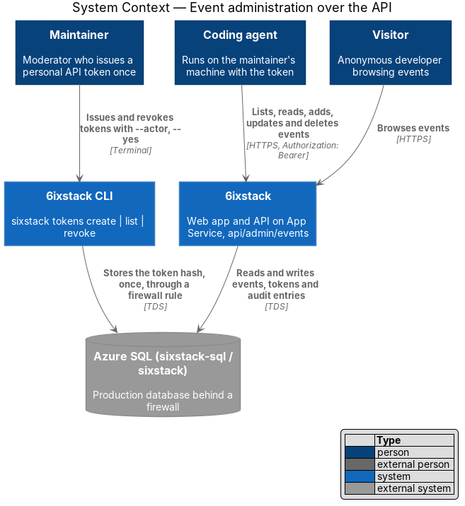
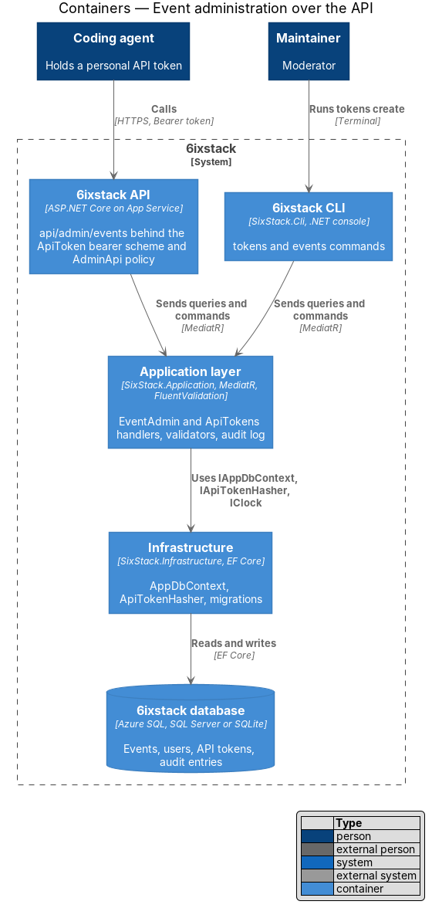
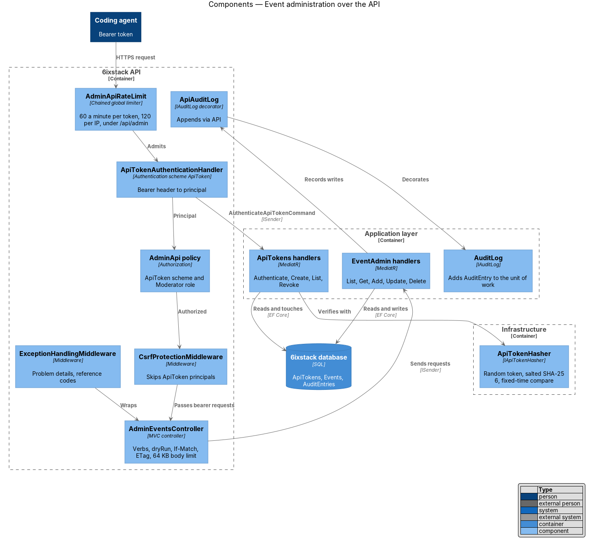
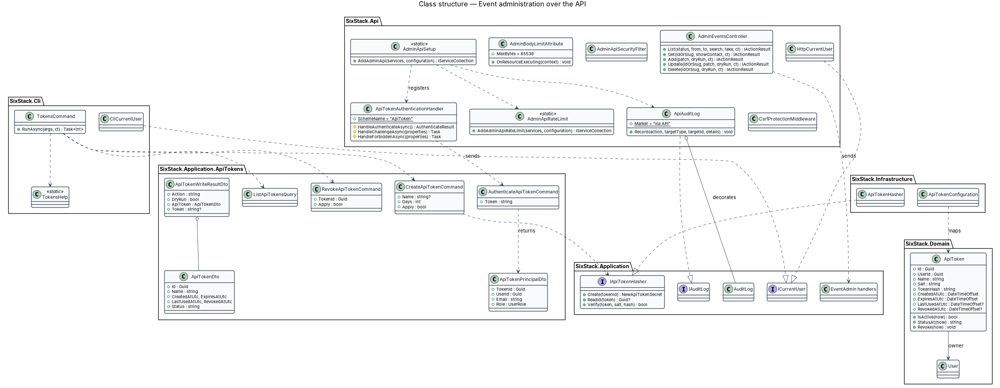
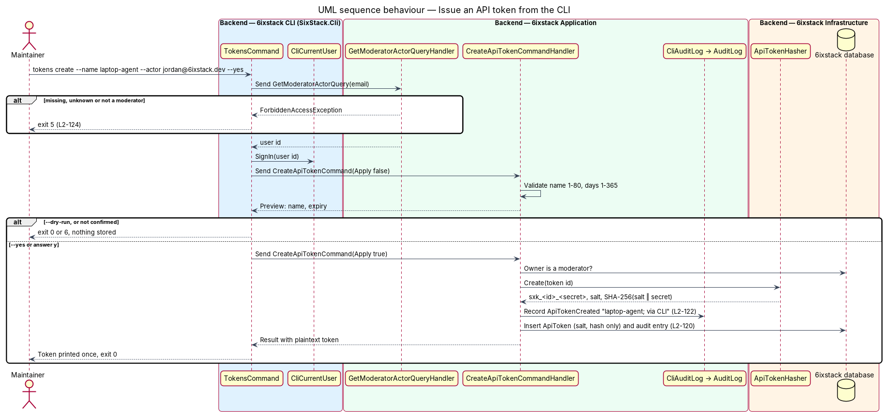
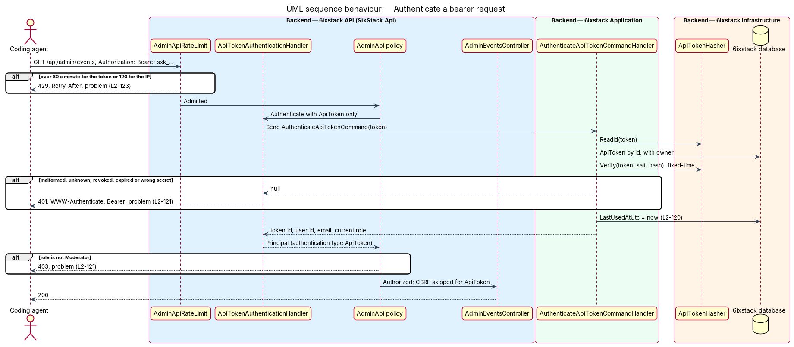
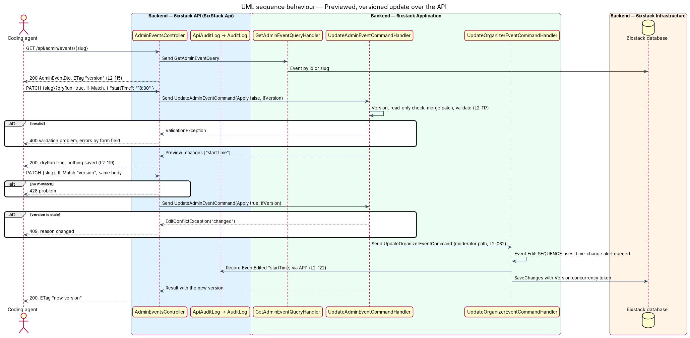

# Event administration over the API

## Overview

The CLI's `events` commands (`docs/detailed-designs/platform/event-admin-cli/`,
ADR 0011) change production events only from a machine that holds the Azure
SQL connection string and has opened a temporary firewall rule. A maintainer,
or a coding agent working for one on the maintainer's machine, should be able
to make the same changes over HTTPS with neither.

This feature adds an `api/admin/events` resource to `SixStack.Api` that runs
the same Application-layer handlers the CLI uses
(`src/SixStack.Application/EventAdmin/`), so the web app's validation,
`Event.Edit`, time-change alerts, iCalendar `SEQUENCE`, soft delete and audit
entries apply unchanged. Callers authenticate with a personal API token: a
moderator issues it for their own account from the CLI
(`sixstack tokens create`), the plaintext is printed once, and the server
keeps only a salted hash. The token travels as `Authorization: Bearer`, never
as a cookie, so the anti-forgery check of `L2-083` does not apply and an agent
needs no browser session.

The organizer and moderation endpoints, the public read endpoints and the
CLI's `events` commands stay as they are.

The change has no user interface. It needs no HTML mock, no design-system or
component-library change, no `docs/screen-composition.md` entry and no
Playwright test. Its acceptance tests are .NET integration tests in
`tests/SixStack.Api.Tests/AdminApi/` (through the API on in-memory SQLite) and
`tests/SixStack.Cli.Tests/` (the `tokens` commands).

Terms used in this design:

- **API token** — a personal bearer credential: `sxk_`, the token id as 32 hex digits, `_`, and 32 random bytes in Base64Url
- **token owner** — the moderator account an API token belongs to; requests made with the token act as that user
- **admin API** — the `api/admin/events` endpoints
- **dry run** — a write with `?dryRun=true`: it validates and returns the planned result without writing
- **version** — `Event.Version`, a `Guid` that changes on every save; the admin API sends it as the `ETag` and expects it back in `If-Match`
- **id-or-slug**, **patch**, **soft delete** — as in the event-admin-cli design

## Description

### Endpoints

| Verb and route | Handler | Success | Requirement |
|----------------|---------|---------|-------------|
| `GET api/admin/events?status&from&to&search&take` | `ListAdminEventsQuery` | 200 `AdminEventListDto` | `L2-115` |
| `GET api/admin/events/{idOrSlug}?showContact` | `GetAdminEventQuery` | 200 `AdminEventDto`, `ETag` | `L2-115`, `L2-123` |
| `POST api/admin/events?dryRun` | `AddAdminEventCommand` | 201 `AdminWriteResultDto`, `Location`; 200 for a dry run | `L2-116`, `L2-119` |
| `PATCH api/admin/events/{idOrSlug}?dryRun` + `If-Match` | `UpdateAdminEventCommand` | 200 `AdminWriteResultDto`, `ETag` | `L2-117`, `L2-119` |
| `DELETE api/admin/events/{idOrSlug}?dryRun` + `If-Match` | `DeleteAdminEventCommand` | 200 `AdminWriteResultDto` | `L2-118`, `L2-119` |

- **Query parameters** — `status` takes the CLI's camelCase status names
  (`AdminEventStatus.ByName`); without it every status but `deleted` is
  listed. `from` and `to` are Toronto dates `yyyy-MM-dd`, inclusive. `take`
  is 1 to 500, default 50. A bad value is a 400 validation problem naming the
  parameter.
- **Bodies** — `POST` and `PATCH` take one JSON object with the edit form's
  property names (`EventDetailsFormDto`): `title`, `organizerName`,
  `description`, `topics`, `date`, `timeZoneId`, `startTime`, `endTime`,
  `format`, `venueName`, `city`, `streetAddress`, `streamUrl`, `isFree`,
  `priceCad`, `ticketUrl`. It binds to `EventDetailsPatch`, which now carries
  `[JsonUnmappedMemberHandling(Disallow)]`, so an unknown property is a 400
  (the CLI already parsed files that way). Every property is optional; an
  absent one keeps its value in a `PATCH` and takes the CLI's default in a
  `POST` (`timeZoneId` America/Toronto; free unless `priceCad` is above zero).
  An empty string clears an optional field.
- **Responses** — the CLI's DTOs, unwrapped: the list is
  `{ "count", "events": [...] }`, one event is the `AdminEventDto` object, a
  write is `{ "action", "dryRun", "changes", "event" }`. `submitterEmail`
  appears only on `GET {idOrSlug}?showContact=true`.

```http
PATCH /api/admin/events/signals-all-the-way-down?dryRun=true HTTP/1.1
Authorization: Bearer sxk_3f2b…_Q8m…
If-Match: "6f1c2d1e-…"
Content-Type: application/json

{ "title": "Signals, all the way down", "startTime": "18:30" }
```

```json
{ "action": "updated", "dryRun": true, "changes": ["title", "startTime"],
  "event": { "id": "…", "slug": "signals-all-the-way-down", "title": "…", "status": "published",
             "cancelled": false, "format": "inPerson", "organizerName": "…",
             "startsAtUtc": "…", "endsAtUtc": "…", "version": "6f1c2d1e-…" } }
```

### Preview and concurrency

- **Dry run** — `?dryRun=true` sends the handler with `Apply = false`; it runs
  the same lookup, version check, read-only check and validation as an applied
  write and returns 200 with `dryRun: true`. Nothing is saved, so no audit
  entry is written.
- **`If-Match`** — `GET {idOrSlug}` and every applied `PATCH` send
  `ETag: "<version>"`. An applied `PATCH` or `DELETE` requires
  `If-Match: "<version>"` (quotes and a `W/` prefix are accepted); without it
  the answer is 428, so an agent can't overwrite blindly. A value that is not a
  `Guid` is 400. The value goes to the handler as `IfVersion`; a different
  current version is `EditConflictException("changed")`, a 409. A dry run
  checks `If-Match` when given and does not require it.
- **Why 409 and not 412** — the web app's edit page, the moderation endpoints
  and the CLI already report "Someone else changed this event." as a conflict
  with `reason: changed`; the admin API keeps that one shape (ADR 0012).

### API tokens

- **`ApiToken`** (Domain) — `Id`, `UserId`, `User`, `Name` (1 to 80
  characters), `Salt`, `TokenHash`, `CreatedAtUtc`, `ExpiresAtUtc`,
  `LastUsedAtUtc`, `RevokedAtUtc`; `IsActive(now)` (not revoked, not expired),
  `StatusAt(now)` (`active`, `revoked`, `expired`) and `Revoke(now)`.
- **`ApiTokenConfiguration`** (Infrastructure) — key `Id`; `Name` max 80,
  `Salt` max 32, `TokenHash` max 64, required; index on `UserId`; the user
  foreign key cascades, so deleting an account (`L2-100`) deletes its tokens.
  Migration `ApiTokens` adds the table. The API does not apply it; the deploy
  workflow runs `sixstack migrate`.
- **`IApiTokenHasher`** (Application interface) / **`ApiTokenHasher`**
  (Infrastructure/Identity) — `Create(tokenId)` returns the plaintext
  `sxk_<id:N>_<secret>` with 32 bytes from `RandomNumberGenerator`, a fresh
  16-byte salt and `SHA-256(salt ‖ secret)` in hex; `ReadId(token)` parses the
  id or returns null for a malformed token; `Verify(token, salt, hash)`
  recomputes the hash and compares it with `CryptographicOperations.FixedTimeEquals`.
  The id prefix makes lookup a primary-key read, and the salt makes each stored
  hash unique even across databases (ADR 0012).
- **`CreateApiTokenCommand(Name, Days, Apply)`** — the owner is
  `ICurrentUser.UserId`, re-read from the database and required to be a
  moderator (`ForbiddenAccessException` otherwise; `ApiTokenOwner` holds that
  check for the create, list and revoke handlers). Validated by
  `CreateApiTokenCommandValidator`: name required and at most 80 characters,
  days 1 to 365 (default 90). With `Apply` true it stores the row, records
  `ApiTokenCreated` (details: the name) and returns the plaintext once.
- **`ListApiTokensQuery`** — the current user's tokens, newest first, as
  `ApiTokenDto` (no hash, no salt, no plaintext).
- **`RevokeApiTokenCommand(TokenId, Apply)`** — the current user's token, or
  `NotFoundException`; an already revoked one is
  `EditConflictException("revoked")`. Sets `RevokedAtUtc` and records
  `ApiTokenRevoked`.
- **`AuthenticateApiTokenCommand(Token)`** — returns `ApiTokenPrincipalDto`
  (`TokenId`, `UserId`, `Email`, `Role`) for an active token whose hash
  verifies, and sets `LastUsedAtUtc`; otherwise null. The owner's role is read
  from the `Users` row on every request, so a demotion takes effect at once.

### Authentication and authorization

- **`ApiTokenAuthenticationHandler`** (`SixStack.Api/Auth`, scheme
  `ApiToken`, `SchemeName`) — reads `Authorization`. No header, or a scheme other than
  `Bearer`, is `NoResult`. Otherwise it sends `AuthenticateApiTokenCommand`;
  null is `Fail`. Success builds a principal whose identity has authentication
  type `ApiToken` and the claims `NameIdentifier`, `Email`, `Role` and
  `token_id`. The challenge answers 401 with `WWW-Authenticate: Bearer` and a
  problem body; the forbid answers 403 with a problem body.
- **Default scheme unchanged** — the cookie scheme stays the default, so every
  other endpoint, and the fallback policy, never look at a bearer token: a
  token on an organizer endpoint is an anonymous call, 401 (`L2-121` #4).
- **`AdminApi` policy** — `AddAuthenticationSchemes("ApiToken")`,
  `RequireAuthenticatedUser()`, `RequireRole("Moderator")`. A policy with its
  own schemes replaces `HttpContext.User` with that scheme's result, so a
  session cookie alone leaves the caller anonymous on the admin API, 401
  (`L2-121` #3). A token whose owner is now an organizer is 403.
- **CSRF** — `CsrfProtectionMiddleware` skips a principal whose authentication
  type is `ApiToken`. A browser cannot attach an `Authorization` header to a
  cross-site request without a CORS preflight, which the API does not allow,
  so a bearer request cannot be forged the way a cookie request can. Cookie
  requests keep the check.
- **Current user** — `HttpCurrentUser` reads `NameIdentifier` and `Role` from
  `HttpContext.User`, so it reports the token owner with no change, and
  `EventAccess` grants the moderator edit path (`L2-062`) as it does for the
  CLI's `CliCurrentUser`.
- **Audit** — `ApiAuditLog` (`SixStack.Api/Auth`) decorates the Application
  `AuditLog`, as `CliAuditLog` does for the CLI, and appends "via API" when the
  request's identity is an `ApiToken` one. Cookie requests are recorded as
  before. `AuditEntry.ActorId` is the token owner's user id.

### Abuse prevention

- **Rate limits** (`AdminApiRateLimit.AddAdminApiRateLimit`, in the style of
  `SignInRateLimit`, called by `AdminApiSetup.AddAdminApi`) —
  a chained global limiter that applies only to paths under `/api/admin`: a
  fixed one-minute window per token id (read from the `sxk_` prefix, before
  authentication; default 60, `AdminApi:PerTokenPerMinute`) and per IP address
  (default 120, `AdminApi:PerIpPerMinute`). Other paths get no limiter from it,
  and their named policies are unchanged. A rejection is 429 with
  `Retry-After` and, under `/api/admin`, a problem body.
- **Body size** — `AdminBodyLimitAttribute` (a resource filter on the
  controller) sets the request's maximum body size to 64 KB where the server
  supports it, so Kestrel refuses a larger chunked body while it is read, and
  answers 413 for a larger `Content-Length` before model binding;
  `ExceptionHandlingMiddleware` maps both to a 413 problem.
- **Errors** — `ExceptionHandlingMiddleware` maps validation to 400 with the
  form's field names, `ForbiddenAccessException` to 403, `NotFoundException`
  to 404, `EditConflictException` to 409 with `reason`, and anything else to
  500 with a reference code (`L2-102`). The controller returns 400 and 428 as
  problem details. No body carries an exception message, a token or a hash.

| Condition | Status | Body |
|-----------|--------|------|
| No, malformed, unknown, revoked or expired token | 401 | problem, `WWW-Authenticate: Bearer` |
| Token owner is not a moderator | 403 | problem |
| Bad query value, bad `If-Match`, unknown property, invalid JSON | 400 | validation problem |
| Event details fail the form rules | 400 | validation problem, `errors.title`, `errors.ticketUrl`, … |
| Unknown or (for update) deleted event | 404 | problem |
| Stale `If-Match`, read-only, already deleted | 409 | problem with `reason` |
| Body over 64 KB | 413 | problem |
| Applied `PATCH` or `DELETE` without `If-Match` | 428 | problem |
| Rate limit | 429 | problem, `Retry-After` |
| Anything else | 500 | problem with `referenceCode` |

### Swagger

`AddSwaggerGen` declares a `Bearer` HTTP security scheme, and
`AdminApiSecurityFilter` adds it as the requirement of every operation whose
endpoint uses the `AdminApi` policy. Swagger stays mapped before
authentication, as `Program.cs` orders it.

### CLI token commands

```text
sixstack tokens create --name <name> [--days <1-365>] [--actor <email>] [--yes | --dry-run] [--json]
sixstack tokens list   [--actor <email>] [--json]
sixstack tokens revoke <token-id> [--actor <email>] [--yes | --dry-run] [--json]
sixstack tokens [<command>] --help
```

- **`TokensCommand`** (`SixStack.Cli`) — mirrors `EventsCommand`: every
  command resolves the actor (`--actor` or `SIXSTACK_ACTOR`,
  `GetModeratorActorQuery`) and signs it in on `CliCurrentUser`, so a token is
  always the actor's own. Writes preview, then stop for `--dry-run`, apply for
  `--yes` or an interactive "y", and otherwise exit 6. Exit codes are
  `ExitCodes`; `--json` prints `{ "tokens" }`, `{ "result" }` or `{ "error" }`.
- **`TokensHelp`** — the `--help` text. `CliApp.Usage` lists `tokens`.
- `create` prints the token once, followed by "Store this token now; it can't
  be shown again." The `--json` result holds it as `token`; `list` never does.
- Audit entries from these commands end with "via CLI" through `CliAuditLog`.

### Production procedure

1. Once, open the firewall as `infra/README.md` describes and run
   `sixstack tokens create --name <machine>-agent --actor <moderator> --yes`
   against production; store the printed token in the machine's secret store
   (`SIXSTACK_API_TOKEN`) and close the firewall rule.
2. From then on call `https://sixstack.azurewebsites.net/api/admin/events`
   with `Authorization: Bearer $SIXSTACK_API_TOKEN`: list or read first, write
   with `?dryRun=true`, then apply with the `If-Match` version.
3. Revoke with `sixstack tokens revoke <id>` (firewall again), or by demoting
   the owner, which turns every request into 403.

## Test plan

| Test class (`tests/`) | Covers |
|-----------------------|--------|
| `SixStack.Cli.Tests/TokensCreateTests` | `L2-120` #1, #5; `L2-122` #3; `L2-124` #1, #2, #3, #6 |
| `SixStack.Cli.Tests/TokensListAndRevokeTests` | `L2-120` #2; `L2-122` #3; `L2-124` #3, #4, #5 |
| `SixStack.Api.Tests/AdminApi/AdminApiAuthenticationTests` | `L2-120` #3, #4 and account deletion; `L2-121` #1 to #5 |
| `SixStack.Api.Tests/AdminApi/AdminEventsReadTests` | `L2-115` #1 to #5; `L2-123` #4 |
| `SixStack.Api.Tests/AdminApi/AdminEventsAddTests` | `L2-116` #1 to #3; `L2-119` #1, #2; `L2-122` #1, #2 |
| `SixStack.Api.Tests/AdminApi/AdminEventsUpdateTests` | `L2-117` #1 to #4; `L2-119` #1, #3, #4, #5 |
| `SixStack.Api.Tests/AdminApi/AdminEventsDeleteTests` | `L2-118` #1 to #3; `L2-119` #1, #3, #4; `L2-122` #1 |
| `SixStack.Api.Tests/AdminApi/AdminApiAbuseTests` | `L2-123` #1 to #3, #5, #6 |

The API tests run on the per-fixture in-memory SQLite database with the clock
fixed at Monday, November 2, 2026, 9:00 AM ET, sequentially, and issue tokens
through `IApiTokenHasher` from the fixture's services.

## Open questions

- **Token issuance from the web app** — deferred. A page to issue and revoke
  tokens needs a mock and a design-system entry; the CLI covers the need.
- **Revoking someone else's token** — `tokens revoke` acts on the actor's own
  tokens only. Demoting the owner (403) or a database update covers a lost
  maintainer; a moderator-wide revoke is a follow-up (`<TO SUPPLY>`).
- **CORS** — the API sends no CORS headers, so browsers on other origins
  cannot call the admin API; agents and `curl` are not browsers and are not
  affected. No change is planned.
- **A `--api` transport for the CLI's `events` commands** — deferred.
- **Rate limits across instances** — the limiter is in memory per App Service
  instance; production runs one instance. A shared store is a follow-up if it
  scales out.

## Requirements

| L2 ID | Refines (L1) | Requirement |
|-------|--------------|-------------|
| `L2-115` | `L1-026` | `GET /api/admin/events` shall return the events of `L2-105` with the same filters as query parameters (`status`, `from`, `to`, `search`, `take`), and `GET /api/admin/events/{idOrSlug}` shall return the one event of `L2-106`, deleted or not, with its version as a quoted `ETag`. |
| `L2-116` | `L1-026` | `POST /api/admin/events` shall create an event from a JSON body with the edit form's property names under the rules, defaults and slug of `L2-107`, published at once as the token's moderator's approval, with no submitter email. |
| `L2-117` | `L1-026` | `PATCH /api/admin/events/{idOrSlug}` shall apply the properties present in the JSON body over the event's current details through the moderator edit rules of `L2-108` (`L2-054`, `L2-055`, `L2-062`). |
| `L2-118` | `L1-026` | `DELETE /api/admin/events/{idOrSlug}` shall soft-delete the event as `L2-109` describes. |
| `L2-119` | `L1-026` | Writes shall accept `?dryRun=true`, which validates and returns the planned result without writing; an applied `PATCH` or `DELETE` shall require `If-Match` with the event's version and fail with 409 `changed` when it is stale. |
| `L2-120` | `L1-026` | A moderator shall be able to issue personal API tokens with a name and a lifetime of 1 to 365 days, shown once and stored only as a salted one-way hash, which stop working when revoked, expired or when the owner's account is deleted. |
| `L2-121` | `L1-026` | Every admin endpoint shall require `Authorization: Bearer` with an active token whose owner is a moderator (401 otherwise, 403 for a non-moderator owner); a session cookie shall not authenticate these endpoints and a token shall not authenticate any other. |
| `L2-122` | `L1-026` | Every applied API write shall record one audit entry with the token owner's id and details ending "via API"; issuing and revoking a token shall record `ApiTokenCreated` and `ApiTokenRevoked`. |
| `L2-123` | `L1-026` | The admin API shall limit requests to 60 a minute per token and 120 a minute per IP address, refuse bodies over 64 KB, answer every error with problem details, and never return a token, a hash, a secret, or a submitter email unless `showContact=true` is given. |
| `L2-124` | `L1-026` | `sixstack tokens create`, `list` and `revoke` shall issue, list and revoke the actor's own API tokens, require a moderator actor, guard writes as `L2-111` does, and use the exit codes of `L2-110`. |

## Diagrams

### System context

An agent on the maintainer's machine calls the admin API over HTTPS with a
bearer token. The CLI, which issues the token, is the only part that still
needs the database firewall, and only once.



### Containers

The API composes the same Application and Infrastructure layers as the CLI,
and both reach the one database.



### Components

The token scheme authenticates the request, the `AdminApi` policy admits only
moderators, and `AdminEventsController` sends the existing `EventAdmin`
requests. `ApiAuditLog` marks the audit entries.



### Class structure

The token entity lives in the domain, its handlers and the hasher contract in
the Application layer, the hasher and EF configuration in Infrastructure, and
the scheme, policy, controller and filters in the API.



### Behaviour — issue a token from the CLI

`tokens create` resolves the actor, previews, then stores the hashed token and
prints the plaintext once.



### Behaviour — authenticate a bearer request

Every admin request is rate-limited, then the token scheme verifies the token
and the policy checks the owner's current role.



### Behaviour — update with a preview and a version

The agent reads the event's version, previews with `?dryRun=true`, then
applies with `If-Match`; the moderator edit path saves and audits it.


