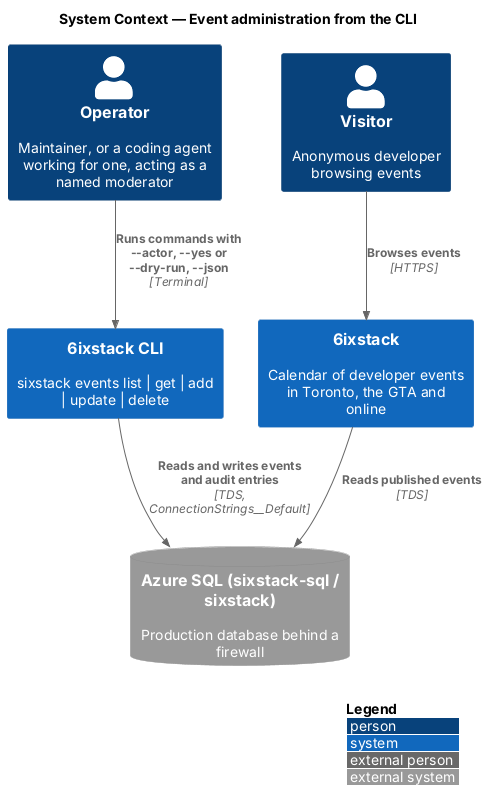
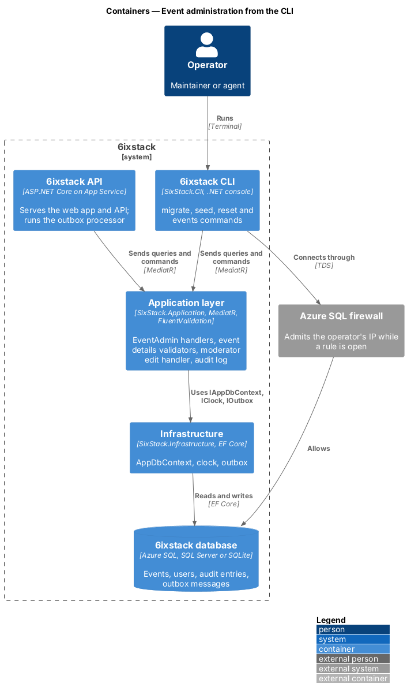
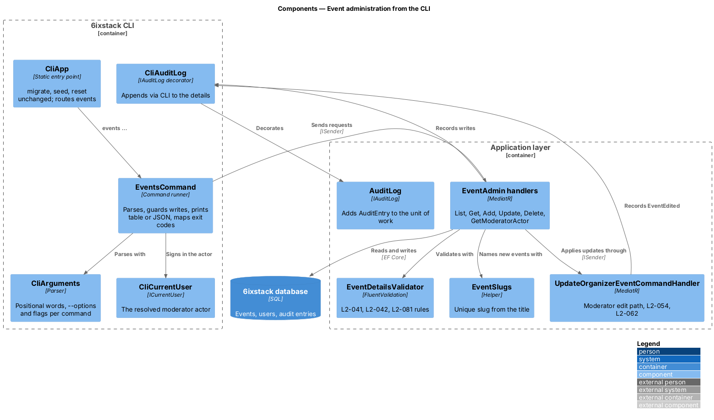
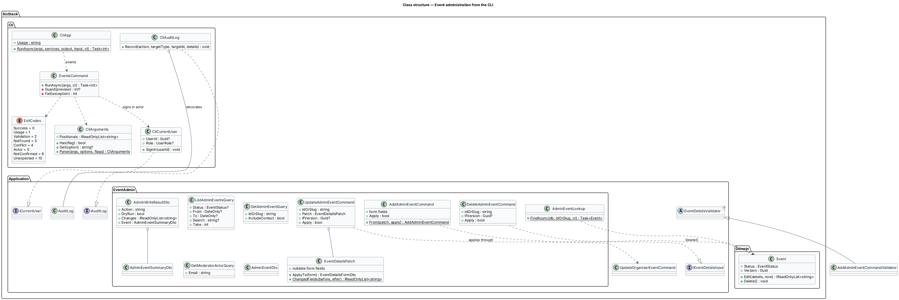
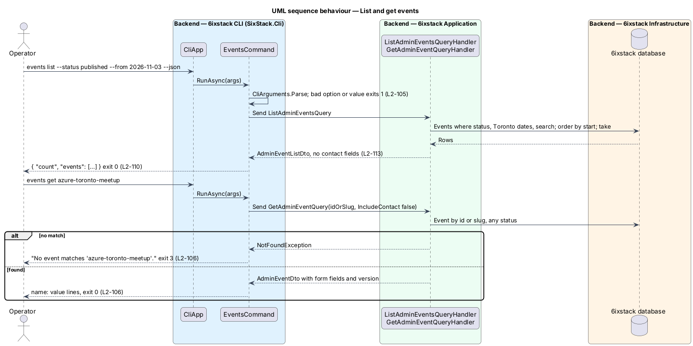
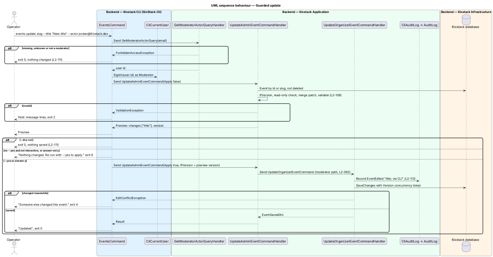
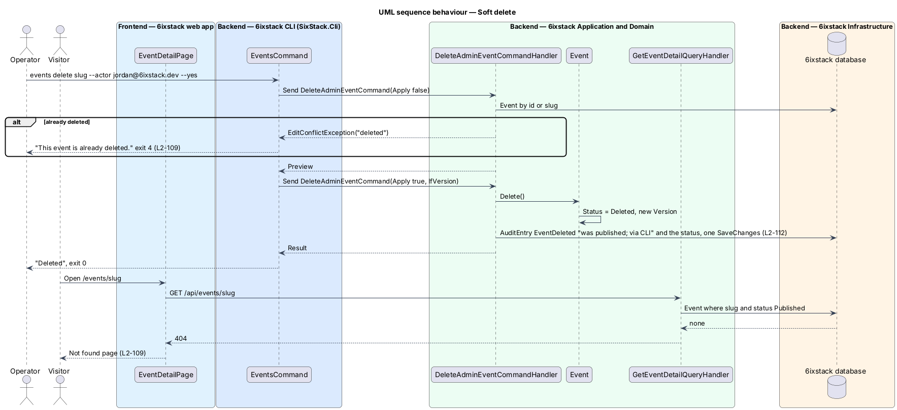

# Event administration from the CLI

## Overview

6ixstack keeps its events in one SQL database: Azure SQL in production
(`sixstack-sql` / `sixstack` in `rg-sixstack-prod`, see `infra/README.md`), SQL
Server or SQLite on a developer machine. The web app is the only way to change
an event today, and it reaches only the screens the mocks define. A maintainer,
or a coding agent working for one, sometimes needs to fix, add or remove an
event directly: a typo a moderator cannot reach, an event added on an
organizer's behalf, a spam listing to remove.

This feature extends the existing `SixStack.Cli` console, which already runs
`migrate`, `seed` and `reset`, with an `events` command group: `list`, `get`,
`add`, `update` and `delete`. The commands run the same Application-layer
validators and handlers as the web app, write an audit entry for every change,
soft-delete instead of removing rows, refuse to write without a named actor and
an explicit confirmation, and print either a table or one stable JSON document.
The feature belongs to the `platform` subsystem because it is operator tooling
that cuts across the `submissions`, `organizer` and `moderation` slices.

The change has no user interface. It needs no HTML mock, no design-system or
component-library change, no `docs/screen-composition.md` entry and no
Playwright test. Its acceptance tests are .NET tests in
`tests/SixStack.Cli.Tests/` (through `CliApp`) and
`tests/SixStack.Application.Tests/` (handlers).

Terms used in this design:

- **operator** — a maintainer, or an agent acting for one, who runs the CLI against a database
- **actor** — the moderator account the operator names with `--actor` or `SIXSTACK_ACTOR`; audit entries carry its user id
- **id-or-slug** — an event's `Guid` id or its unique URL slug; the CLI accepts either
- **patch** — the subset of event fields an `update` sets, from a JSON file and option flags
- **preview** — the planned change a write prints before applying it: the event summary and the changed field names
- **dry run** — a write run with `--dry-run`: it validates and previews, then stops without writing
- **soft delete** — setting an event's status to `Deleted`; the row, its audit entries and moderation history stay

## Description

### Command grammar

```text
sixstack migrate | seed | reset
sixstack events list   [--status <status>] [--from <yyyy-MM-dd>] [--to <yyyy-MM-dd>] [--search <text>] [--take <n>] [--json]
sixstack events get    <id-or-slug> [--show-contact] [--json]
sixstack events add    [--file <event.json>] [field flags] [--actor <email>] [--yes | --dry-run] [--json]
sixstack events update <id-or-slug> [--file <patch.json>] [field flags] [--if-version <version>] [--actor <email>] [--yes | --dry-run] [--json]
sixstack events delete <id-or-slug> [--if-version <version>] [--actor <email>] [--yes | --dry-run] [--json]
sixstack events [<command>] --help
```

- **Statuses** — `draft`, `inReview`, `published`, `rejected`, `deleted`,
  `needsChanges`, the camelCase names of `EventStatus`. `list` without
  `--status` shows every status except `deleted`. Cancellation is not a status:
  a cancelled event keeps its status and shows `cancelled: true`.
- **Dates** — `--from` and `--to` are Toronto calendar dates, inclusive, matched
  against the event's start (`TorontoTime`).
- **`--take`** — 1 to 500 (`ListAdminEventsQuery.MaxTake`), default 50.
- **Field flags** — `--title`, `--organizer`, `--description`,
  `--topics <a,b>`, `--date`, `--start <HH:mm>`, `--end <HH:mm>`,
  `--time-zone`, `--format <inPerson|streaming|hybrid>`, `--venue`, `--city`,
  `--address`, `--stream-url`, `--ticket-url`, `--price <cad>`. `--price 0`
  makes the event free. An empty value (`--ticket-url ""`) clears an optional
  field.
- **Event file** — a JSON object whose property names are the edit form's
  (`EventDetailsFormDto`): `title`, `organizerName`, `description`, `topics`,
  `date`, `timeZoneId`, `startTime`, `endTime`, `format`, `venueName`, `city`,
  `streetAddress`, `streamUrl`, `isFree`, `priceCad`, `ticketUrl`. Every
  property is optional in a patch. An unknown property, or a file that is not
  JSON, is a usage error. Flags override the file.
- **Defaults for `add`** — `timeZoneId` is `America/Toronto`; `isFree` is true
  unless `priceCad` is above zero.

### Argument parsing

`CliArguments` in `SixStack.Cli` parses the arguments by hand, as `CliApp` does
today: positional words, `--name value` options and value-less flags (`--json`,
`--yes`, `--dry-run`, `--show-contact`, `--help`). Each command declares the
options it accepts; any other option is a usage error that names it. A new
dependency such as `System.CommandLine` is not justified for five commands
(ADR 0011).

### Exit codes and output

| Code | `error.code` | Meaning | Raised by |
|------|--------------|---------|-----------|
| 0 | — | Success, including a dry run | — |
| 1 | `usage` | Unknown command or option, bad option value, unreadable or invalid file | `CliArguments`, `EventsCommand` |
| 2 | `validation` | A field failed the event details rules | `ValidationException` |
| 3 | `notFound` | No event matches the id or slug | `NotFoundException` |
| 4 | `conflict` | Changed since `--if-version`, past, cancelled or already deleted | `EditConflictException`, `InvalidStatusTransitionException` |
| 5 | `actor` | No actor, or the actor is not a moderator | `ForbiddenAccessException` |
| 6 | `notConfirmed` | Neither `--yes` nor `--dry-run`, and no interactive "y" | `EventsCommand` |
| 10 | `unexpected` | Anything else, such as an unreachable database | `EventsCommand` |

Without `--json`, `list` prints a table (ID, SLUG, STATUS, STARTS in Toronto
time, TITLE), `get` prints one `name: value` line per field, and a write prints
its preview, then "Added", "Updated" or "Deleted". Errors go to the same writer
as one line per problem; validation errors print one `field: message` line per
failure.

With `--json`, every command prints exactly one indented JSON document with
camelCase names (`System.Text.Json`, `JsonSerializerDefaults.Web`):

```json
{ "count": 1, "events": [ { "id": "…", "slug": "…", "title": "…", "status": "published", "cancelled": false,
  "format": "inPerson", "organizerName": "…", "startsAtUtc": "2026-11-03T23:00:00+00:00", "endsAtUtc": "…", "version": "…" } ] }
{ "event": { "id": "…", "slug": "…", "status": "published", "cancelled": false, "cancellationReason": null,
  "startsAtUtc": "…", "endsAtUtc": "…", "version": "…", "title": "…", "organizerName": "…", "description": "…",
  "topics": ["azure"], "date": "2026-11-03", "timeZoneId": "America/Toronto", "startTime": "18:00",
  "endTime": "20:00", "format": "inPerson", "venueName": "…", "city": "Toronto", "streetAddress": "…",
  "streamUrl": null, "isFree": true, "priceCad": null, "ticketUrl": null } }
{ "result": { "action": "updated", "dryRun": false, "changes": ["title"], "event": { …summary… } } }
{ "error": { "code": "validation", "message": "…", "fields": { "title": ["Enter a title for the event."] } } }
```

`submitterEmail` appears in `event` only with `--show-contact`. A `--json` run
never prompts. `changes` lists the form fields a write sets or changes; a delete
reports `["status"]`. Every summary carries `version`, which `--if-version`
accepts.

### Application layer

New types live in `src/SixStack.Application/EventAdmin/`. They reuse the
existing rules rather than restating them.

- **`AdminEventStatus`** — maps between `EventStatus` and the camelCase names.
- **`AdminEventLookup`** — finds an event by id-or-slug: a `Guid` matches `Id`,
  anything else matches `Slug`. Throws `NotFoundException`
  ("No event matches '{id-or-slug}'.").
- **`ListAdminEventsQuery`** / handler — filters by status (all but `Deleted`
  when none), Toronto date range, search text and `Take`, ordered by start.
  Returns `AdminEventListDto` of `AdminEventSummaryDto`. No contact fields.
- **`GetAdminEventQuery(IdOrSlug, IncludeContact)`** / handler — returns
  `AdminEventDto`, whose detail fields come from
  `GetOrganizerEventQueryHandler.ToDto(...).Details`, so `get` prints exactly
  the edit form's values. Deleted events are returned.
- **`EventDetailsPatch`** — every form field as optional; `ApplyTo(EventDetailsFormDto)`
  merges it over current values, and `ChangedFields(before, after)` lists the
  form names that differ.
- **`AddAdminEventCommand`** — implements `IEventDetailsInput`;
  `AddAdminEventCommandValidator` derives from `EventDetailsValidator<T>`, the
  same rules as `SubmitEventCommandValidator` and
  `UpdateOrganizerEventCommandValidator` (`L2-041`, `L2-042`, `L2-081`). The
  handler builds the event from `IEventDetailsInput.ToDetails()`, gives it a
  slug through `EventSlugs.UniqueAsync` (extracted from
  `SubmitEventCommandHandler`, together with `EventSlugs.NewEvent`, which maps
  validated details to a new `Event` for both), publishes it with `ApprovedAtUtc` and
  `PublishedAtUtc` set to now, and records `EventAdded`. A moderator adding an
  event is its approval, so it skips the review queue; it has no
  `SubmitterEmail`, so no confirmation or verification email is sent. With
  `Apply` false it returns the preview without saving.
- **`UpdateAdminEventCommand(IdOrSlug, Patch, IfVersion, Apply)`** — loads the
  event (deleted is not found), compares `IfVersion` with `Event.Version`
  (`EditConflictException("changed")`), refuses past and cancelled events
  (`EditConflictException("read-only")`), merges the patch over the current
  form values, runs `IValidator<UpdateOrganizerEventCommand>`, and lists the
  changed fields. With `Apply` true it sends `UpdateOrganizerEventCommand`
  through `ISender`, so the moderator edit path of `L2-054` and `L2-062` applies
  unchanged: `Event.Edit`, time-change alert, `SEQUENCE`, the owner's
  "a moderator updated" email through the outbox, the `EventEdited` audit entry
  and the `Version` concurrency token.
- **`DeleteAdminEventCommand(IdOrSlug, IfVersion, Apply)`** — loads the event,
  refuses an already deleted one (`EditConflictException("deleted")`), checks
  `IfVersion`, calls `Event.Delete()` and records `EventDeleted` with the
  previous status. A `DbUpdateConcurrencyException` becomes
  `EditConflictException("changed")`.
- **`GetModeratorActorQuery(Email)`** — returns the user id of the moderator
  with that email, or throws `ForbiddenAccessException` for an unknown address
  or a non-moderator.

`Event.Delete()` in `SixStack.Domain` sets `Status = Deleted` and a new
`Version`, and throws `InvalidStatusTransitionException` when the event is
already deleted. Every public query already filters on `Published`, and the
organizer queries exclude `Deleted`, so a deleted event leaves the site, feeds
and dashboards with no query change.

### CLI composition

- **`CliApp`** — still dispatches `migrate`, `seed` and `reset` exactly as
  before. `events` goes to `EventsCommand`. `Usage` lists all commands.
- **`EventsCommand`** — parses the command, resolves the actor for writes,
  sends the MediatR request, prints the result and maps exceptions to exit
  codes. It holds no business rule.
- **`CliArguments`** / **`CliUsageException`** — the parser and its usage error.
- **`ExitCodes`** — the exit code constants.
- **`EventsHelp`** — the `events --help` and `events <command> --help` text.
- **`CliCurrentUser`** — scoped `ICurrentUser`; after the actor is resolved it
  reports that user id and the `Moderator` role, so `EventAccess` and
  `AuditLog` see a moderator.
- **`CliAuditLog`** — decorates the Application `AuditLog`, appending
  "via CLI" to the details, so every entry written from the CLI is marked.
- **`CliServices.AddEventAdministration`** — registers `AddApplication()`,
  `CliCurrentUser` and `CliAuditLog`. `Program.cs` calls it after
  `AddInfrastructure`, and passes `Console.In` as input only when standard
  input is a terminal.

### Actor and audit

Writes require an actor: `--actor <email>` or `SIXSTACK_ACTOR`. The actor must
be an existing moderator account, which ties the change to a person who already
holds the right to edit any event (`L2-062`) and gives `AuditEntry.ActorId` a
real user id with no schema change. Each applied write records exactly one
audit entry (`L2-086`) in the same `SaveChanges` as the change. A dry run, a
refused write and a failed write save nothing, so they leave no entry.

### Safety rails

- **Write guard** — every write builds its preview first (the handler with
  `Apply` false), prints it, then: `--dry-run` stops with 0; `--yes` applies; an
  interactive run asks "Apply? [y/N]"; otherwise it stops with 6 and "Nothing
  changed. Re-run with --yes to apply." The apply passes the previewed
  `Version` as `IfVersion`, so a change made between preview and apply is a
  conflict, not a silent overwrite.
- **Soft delete** — `delete` never removes a row. Undoing a delete is deferred.
- **No secrets** — the CLI never prints configuration, the connection string or
  a driver exception's message. An unexpected exception prints only its type
  name and exits 10. Logging stays at warning level (`appsettings.json`) and
  goes to standard error, so standard output holds only the result.
- **No contact details** — `list` never includes `SubmitterEmail`; `get` adds
  it only with `--show-contact` (`L2-099`).

### Connecting to production

The CLI reads `ConnectionStrings__Default` and `Database__Provider` from the
environment, as the deploy workflow does for `migrate`.

1. Open the Azure SQL firewall for the operator's IP address with
   `az sql server firewall-rule create`, as `.github/workflows/deploy.yml` does
   for the runner, under a rule name that identifies the operator.
2. Set `ConnectionStrings__Default` without writing it to shell history.
   **SQL authentication** uses the server administrator login from
   `infra/main.bicep` (the value of the `SQL_CONNECTION_STRING` secret).
   **Entra ID authentication** uses
   `Authentication=Active Directory Default`, which `Microsoft.Data.SqlClient`
   resolves through the operator's `az login`; it needs an Entra administrator
   or contained user on `sixstack-sql`, which `infra/main.bicep` does not
   configure yet (`<TO SUPPLY>`).
3. Run `events list` first, then writes with `--dry-run`, then `--yes`.
4. Delete the firewall rule.

The procedure lives in `infra/README.md` under "Managing production events".
For day-to-day changes, the same procedure is needed only once, to issue a
personal API token with `sixstack tokens create`; the agent then calls the
admin API over HTTPS with no firewall rule and no connection string
(`platform/event-admin-api`, ADR 0012).

### Token commands

`sixstack tokens create|list|revoke` issue, list and revoke the actor's own
API tokens for the admin API. They follow this design's actor, write guard,
`--json` and exit-code rules; their grammar and handlers are in
`platform/event-admin-api`. `CliApp.Usage` lists them.

### Follow-up risks

- `reset` drops and recreates the configured database and has no guard against
  production. A confirmation or an environment check is a follow-up
  (`<TO SUPPLY>`).
- Emails queued by a CLI update (the owner's "a moderator updated" email) are
  sent by the API's outbox processor, which shares the database.

## Requirements

| L2 ID | Refines (L1) | Requirement |
|-------|--------------|-------------|
| `L2-105` | `L1-025` | `sixstack events list` shall print the events in the configured database ordered by start time, filtered by `--status`, `--from`, `--to`, `--search` and `--take` (default 50, 1 to 500); deleted events shall be listed only when `--status deleted` is given. |
| `L2-106` | `L1-025` | `sixstack events get <id-or-slug>` shall print one event, deleted or not, with its id, slug, status, cancellation, start and end in UTC, version and every field that `events add` and `events update` accept, under the names they accept. |
| `L2-107` | `L1-025` | `sixstack events add` shall create an event from `--file <event.json>` and option flags (flags win over the file), apply the event details rules of the submit and edit forms (`L2-041`, `L2-042`, `L2-081`), give it a unique slug, and publish it at once as the actor's approval, with no submitter email. |
| `L2-108` | `L1-025` | `sixstack events update <id-or-slug>` shall apply the fields given by `--file <patch.json>` and option flags over the event's current details and save them through the moderator edit rules (`L2-054`, `L2-055`, `L2-062`); `--if-version <version>` shall make the update fail when the event changed since that version was read. |
| `L2-109` | `L1-025` | `sixstack events delete <id-or-slug>` shall soft-delete the event; a deleted event shall disappear from every public page, list and feed, from organizer views, and from `events list` unless `--status deleted` is given; `events get` shall still show it with status `deleted`. |
| `L2-110` | `L1-025` | Every `events` command shall print a human-readable table or summary by default and, with `--json`, exactly one JSON document with stable camelCase names; exit codes 0 success, 1 usage, 2 validation, 3 not found, 4 conflict, 5 actor, 6 not confirmed, 10 unexpected. |
| `L2-111` | `L1-025` | `events add`, `events update` and `events delete` shall require a moderator actor from `--actor` or `SIXSTACK_ACTOR`, show what will change, validate without writing under `--dry-run`, apply under `--yes`, ask "Apply? [y/N]" when interactive, and otherwise write nothing. |
| `L2-112` | `L1-025` | Every applied CLI write shall record one audit entry (`L2-086`) in the same unit of work with the actor's user id, the time, the action, the event as target, and details that end with "via CLI"; a dry run, a refused write or a failed write shall record none. |
| `L2-113` | `L1-025` | The CLI shall never print the connection string, a password or an exception's message from the database driver, and shall not print a submitter's email address unless `events get` is given `--show-contact` (`L2-099`, `L1-023`). |
| `L2-114` | `L1-025` | `sixstack migrate`, `sixstack seed` and `sixstack reset` shall keep their behaviour, output and exit codes, and the usage shall list the `events` commands. |

## Diagrams

### System context

An operator runs the CLI on a workstation against the production database or a
local one. The web app and the API share the same database, so a CLI change is
visible on the site at once.



### Containers

The CLI and the API both compose the Application and Infrastructure layers.
The Azure SQL firewall admits the operator's IP address only while a rule is
open.



### Components

`CliApp` routes `events` to `EventsCommand`, which parses with `CliArguments`
and sends MediatR requests. The `EventAdmin` handlers reuse the event details
validator, the moderator edit handler, the audit log and the slug helper.



### Class structure

The CLI types live in `SixStack.Cli`; the queries, commands, DTOs and patch live
in `SixStack.Application.EventAdmin`; `Event.Delete()` lives in the domain.



### Behaviour — list and get

`list` and `get` are read-only: no actor, no guard, no audit entry. An unknown
id or slug ends with exit code 3.



### Behaviour — update with the write guard

The update resolves the actor, previews through the handler with `Apply` false,
asks for confirmation, then applies through `UpdateOrganizerEventCommand` with
the previewed version.



### Behaviour — soft delete

Delete changes the status to `Deleted` and records `EventDeleted`. The public
event page then answers not found, while `events get` still shows the event.


