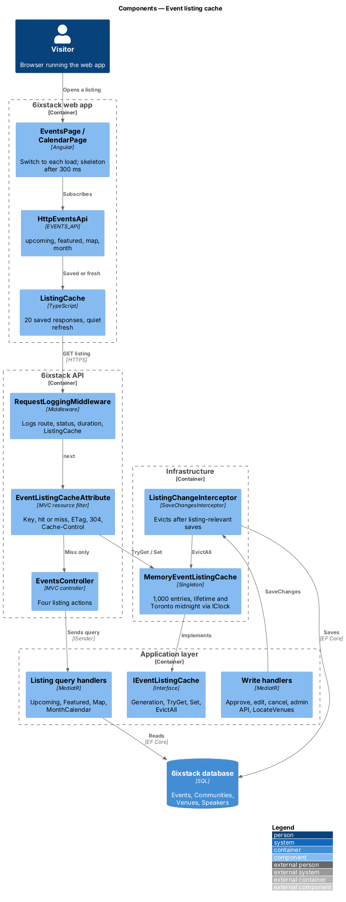
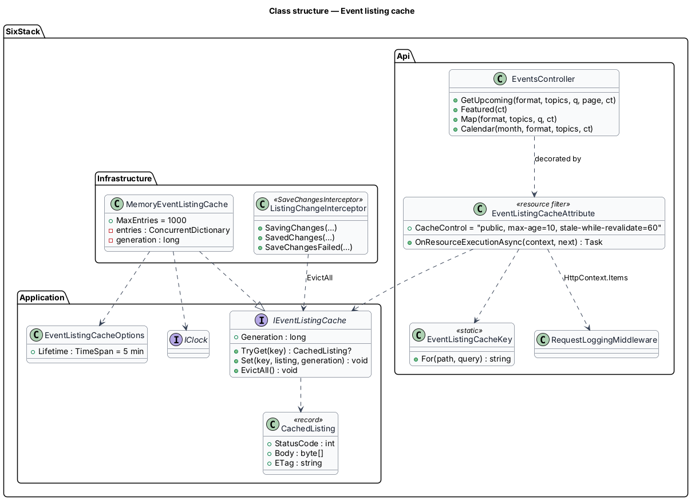
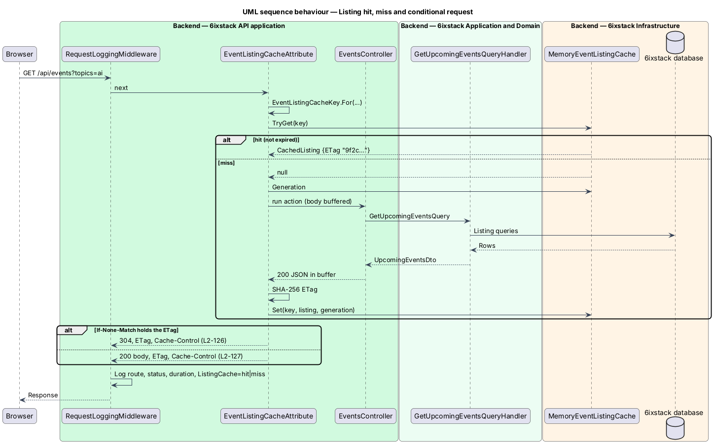
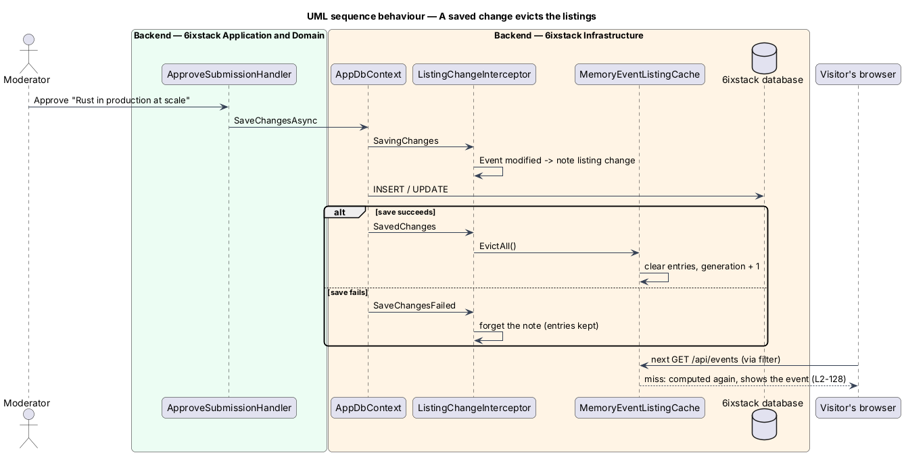

# Event listing cache

## Overview

Every visit to the events list, the map, the month calendar and the featured
card ran the listing queries against the database, although the listings change
only when an event, its community, venue or speakers change, or when the Toronto
day rolls over. This feature serves repeated reads of those listings from memory
in the API and in the browser, and evicts them the moment a change is saved, so
the pages feel instant and `L2-087`'s list budget holds with room to spare.

It belongs to the `platform` subsystem and refines the performance budgets
(`platform/performance-budgets`). Response shapes, filters, paging, ordering,
event detail, feeds, and every authenticated, organizer, moderation and admin
endpoint stay as they are. Key decisions are recorded in ADR 0014.

Terms used in this design:

- **listing** — the response of `GET /api/events`, `/api/events/featured`, `/api/events/map` or `/api/events/calendar`
- **entry** — one stored listing: status, body bytes, `ETag` and expiry
- **cache key** — the path and the normalised filters of a listing request
- **eviction** — dropping every entry at once after a change is saved
- **generation** — a counter that eviction increases; a miss stores its result only if the generation is unchanged
- **saved listing** — a listing the web app keeps in memory for the visit
- **quiet refresh** — the web app's background request that replaces a saved listing

## Description

### API cache (`L2-125`, `L2-126`, `L2-127`)

- **`EventListingCacheAttribute`** — an MVC resource filter (`IAsyncResourceFilter`)
  in `SixStack.Api/Platform`, placed on `GetUpcoming`, `Featured`, `Map` and
  `Calendar` in `EventsController`. It runs after authentication and CSRF and
  before model binding, so a hit skips binding, validation, the handler and the
  database.
- **Cache key** — `EventListingCacheKey.For(path, query)`: the lower-cased path,
  then `format` lower-cased, `topics` lower-cased, de-duplicated and sorted
  (topic keys are case-insensitive), `q` trimmed and cut to 100 characters,
  `page`, and `month` as sent. Other query parameters do not bind and are
  ignored. Normalising never turns an invalid request into a valid one.
- **Hit** — the filter writes the stored status, body and `ETag`, or 304 with no
  body when `If-None-Match` holds the tag, alone, in a list or as `*`.
- **Miss** — the filter reads the generation, swaps `Response.Body` for a buffer
  and runs the action. For 200 and 204 it hashes the buffer (first 16 bytes of
  SHA-256, lower-case hex, quoted, as `FeedCache` does), stores the entry under
  that generation, sets the headers and writes the body or 304. Any other status
  is written through unchanged. An exception (for example a validation failure,
  answered 400 by `ExceptionHandlingMiddleware`) restores the body stream and
  propagates, so errors are never stored.
- **Headers** — 200, 204 and 304 carry the `ETag` and
  `Cache-Control: public, max-age=10, stale-while-revalidate=60`. Nothing else
  changes these headers.
- **Signed-in visitors** — listings hold no user-specific data, so they share
  entries with anonymous visitors.

### Store and expiry (`L2-129`)

- **`IEventListingCache`** (`SixStack.Application/Common/Interfaces`) —
  `Generation`, `TryGet(key)`, `Set(key, listing, generation)` and `EvictAll()`,
  with `CachedListing(StatusCode, ContentType, Body, ETag)`.
- **`MemoryEventListingCache`** (`SixStack.Infrastructure/Caching`, singleton) —
  a `ConcurrentDictionary` capped at 1,000 entries; when it is full a new key is
  served but not stored. `Set` stores an entry only while the generation is the
  one read before the miss ran, so a request that started before a change cannot
  store a stale listing after the eviction. Each entry expires at
  `min(storedAt + Lifetime, next Toronto midnight)`, both from `IClock`, and
  `TryGet` drops an expired entry.
- **`EventListingCacheOptions`** — `EventListingCache:Lifetime`, default
  `00:05:00`.

### Eviction (`L2-128`)

- **`ListingChangeInterceptor`** (`SixStack.Infrastructure/Caching`) — an EF Core
  `SaveChangesInterceptor` added to `AppDbContext`. In `SavingChanges` it notes
  whether the change tracker holds an added, modified or deleted `Event`,
  `Community`, `Venue`, `Speaker` or `EventSpeaker`; in `SavedChanges` it calls
  `EvictAll()` if so; in `SaveChangesFailed` it forgets the note, so a failed save
  keeps the entries.
- This covers every write path in the API process without touching it:
  approval and rejection, moderator and organizer edits, cancellation, the
  admin API, the featured flag and `LocateVenuesCommand`'s coordinates.
- **Other processes** — the CLI writes through its own `AppDbContext`, so its
  saves evict only the CLI's own (unused) cache. The API shows them when the
  entry's lifetime ends, within 5 minutes (ADR 0014).

### Web app (`L2-130`)

- **`ListingCache`** (`frontend/projects/api/src/lib/events/listing-cache.ts`) —
  a least-recently-used map of up to 20 responses keyed by the request URL with
  its sorted parameters. `cached(key, request$)` returns an observable that:
  - with nothing saved, emits the response, saves it and completes, or fails as
    before;
  - with a saved response, emits it at once, then runs the quiet refresh, emits
    the new response only if its JSON differs, saves it and completes; a failed
    quiet refresh completes without an error, so the saved listing stays.
- **`HttpEventsApi`** uses it for `upcoming` (first page only; later pages append
  and must emit once), `featured`, `map` and `month`. Pages keep depending on
  `EVENTS_API`.
- **Pages** need no change: the events page and the calendar already switch to
  each new load and show a skeleton only after 300 ms (`L2-089`), so a saved
  listing that emits at once shows no skeleton and a second emission replaces it
  in place. A network failure in the quiet refresh still reaches the error
  interceptor, which raises the "We can't reach 6ixstack" banner (`L2-075`).
- Responses live only in memory and go when the tab closes (`L2-098`). The
  offline saved list of `L2-078` is separate and unchanged.

### Observability

The filter records `hit` or `miss` in `HttpContext.Items`, and
`RequestLoggingMiddleware` adds it to the request's log scope as `ListingCache`,
so hit rates per route come from the same logs as p95 latency
(`platform/observability`).

## Test plan

| Test class (`tests/`, `frontend/e2e/tests/`) | Covers |
|-----------------------|--------|
| `SixStack.Api.Tests/Events/EventListingCacheTests` | `L2-125` #1 to #6; `L2-126` #1 to #4; `L2-127` #1 to #3 |
| `SixStack.Api.Tests/Events/EventListingEvictionTests` | `L2-128` #1 to #6 |
| `SixStack.Api.Tests/Events/EventListingExpiryTests` | `L2-129` #1 to #4 (a movable clock) |
| `events-saved-listings.spec.ts` | `L2-130` #1 to #4 |
| `calendar.spec.ts` | `L2-130` #5 |

Hits are proven by changing a row with `ExecuteUpdate`, which bypasses the
interceptor, and reading the old value back. The Playwright tests slow or fail
the API with `page.route` through the events and calendar page objects.

## Open questions

- **Shared cache** — production runs one instance. If it scales out, a shared
  store with tag eviction replaces `MemoryEventListingCache` (ADR 0014).
- **Immediate CLI changes** — bounded by the 5-minute lifetime; a database
  version stamp is the follow-up if that is too slow.
- **Event detail, communities, speakers** — not cached here; the same filter can
  extend to them with their own eviction sets.

## Requirements

| L2 ID | Refines (L1) | Requirement |
|-------|--------------|-------------|
| `L2-125` | `L1-020` | The API shall keep the four public event listings in memory, keyed by path and normalised filters, answer repeats without the database, store only 200 and 204, and share entries between signed-in and anonymous visitors. |
| `L2-126` | `L1-020` | Every listing 200 shall carry a strong SHA-256 `ETag`, and a matching `If-None-Match` shall be answered 304. |
| `L2-127` | `L1-020` | Listing 200, 204 and 304 responses shall carry `Cache-Control: public, max-age=10, stale-while-revalidate=60`; errors and other endpoints shall not. |
| `L2-128` | `L1-020` | Any saved change that can alter a listing shall evict every entry; changes from other processes shall show within the lifetime. |
| `L2-129` | `L1-020`, `L1-018` | Entries shall expire after 5 minutes by default and at the next Toronto midnight. |
| `L2-130` | `L1-020`, `L1-017` | The web app shall keep 20 listing responses for the visit, show a saved one at once with no skeleton, refresh it quietly and keep it if the refresh fails. |

## Diagrams

### Components

The resource filter answers from the store or runs the action and stores its
body; the interceptor evicts the store after any save that touches a listing.

### Class structure

The contract lives in the Application layer, the store and the interceptor in
Infrastructure, and the filter and its key in the API.

### Behaviour — hit, miss and conditional request

### Behaviour — a saved change evicts the listings

