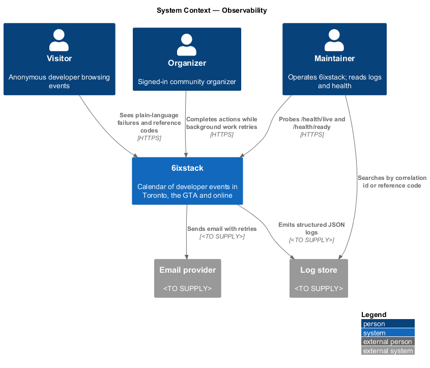
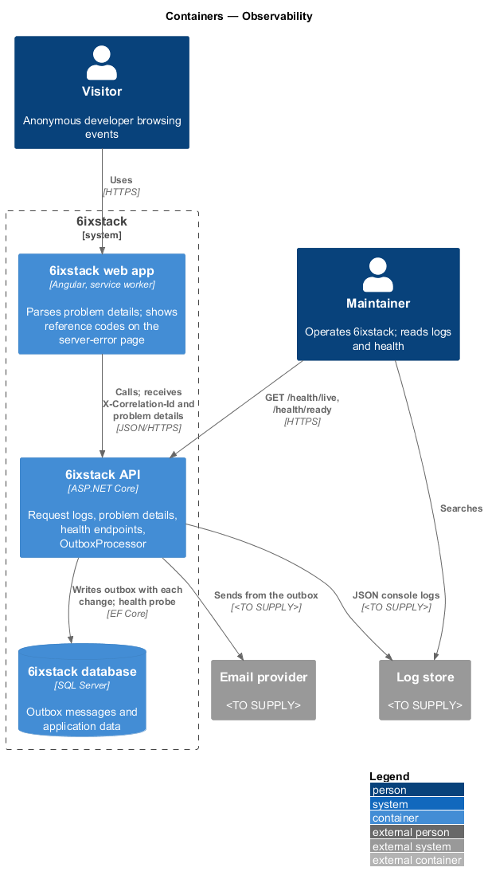
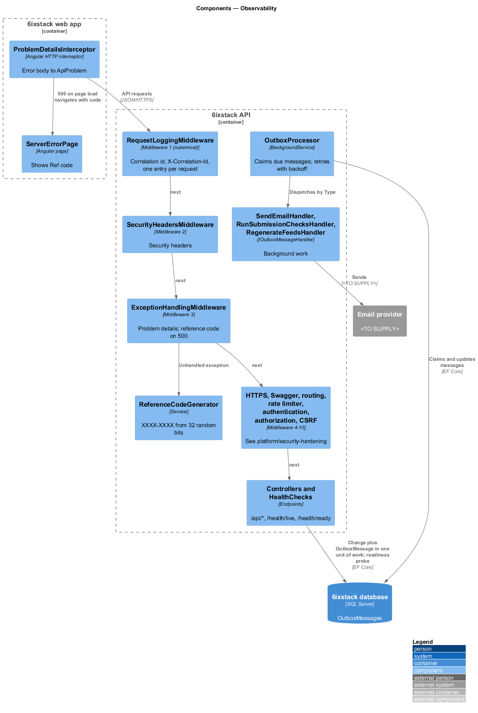
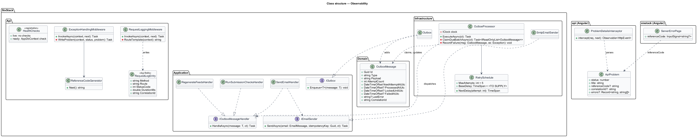
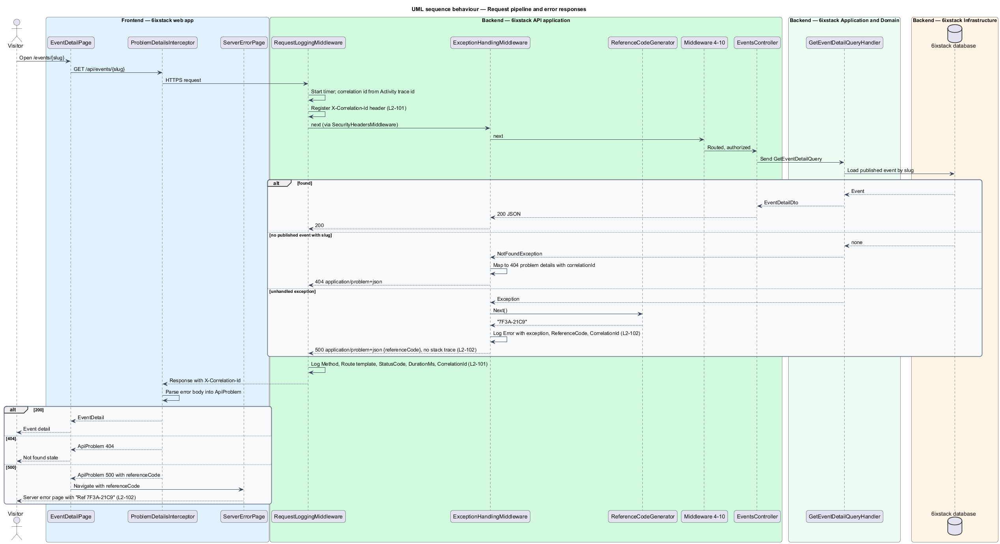
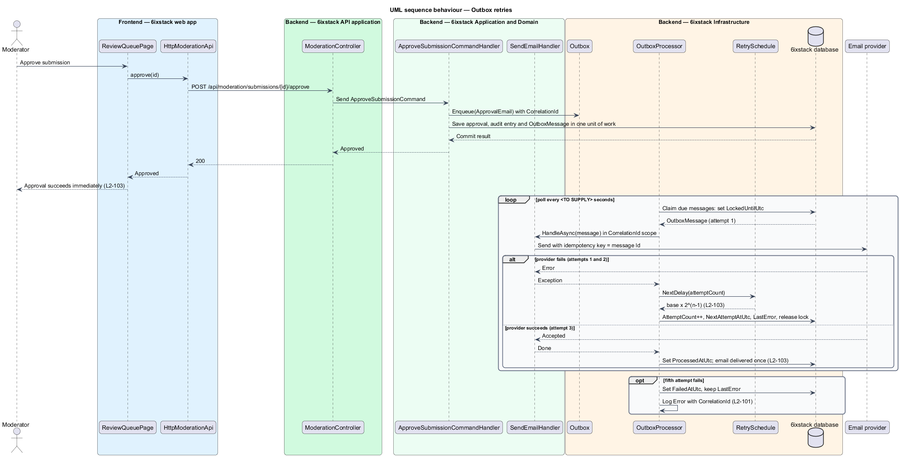
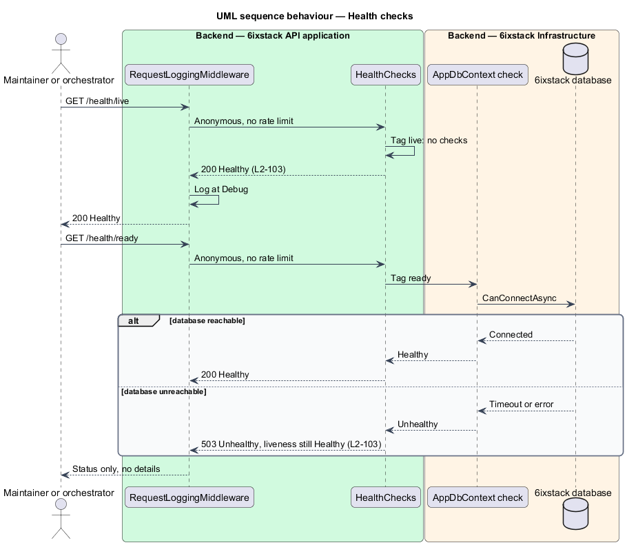

# Observability

## Overview

A failure in 6ixstack has two audiences. The visitor or organizer receives a
plain-language message and, for a server fault, a short code to quote to
support. The maintainer finds the matching log entry, sees the request that
caused it and checks whether the system is healthy. Background
work such as sending email also fails at times. A failure there shall not fail
the action the user already completed.

This feature defines how the 6ixstack API records requests, reports errors,
exposes health and runs background work with retries. It belongs to the
`platform` subsystem and applies to every endpoint. The pages that display
failures belong to `site/status-pages` and `site/toasts-and-banners`. The
security controls that share the request pipeline belong to
`platform/security-hardening`.

Terms used in this design:

- **structured log** — log entry written as named fields rather than free text, so tools can filter and aggregate it
- **correlation id** — identifier assigned to one request, written to each log entry for that request and returned to the client
- **problem details** — RFC 9457 JSON error body with `type`, `title` and `status`, sent as `application/problem+json`
- **reference code** — short code such as `7F3A-21C9` that identifies one unhandled error, shown to the user and logged with the exception
- **handled error** — failure the API expects and maps to a status, such as 400, 403, 404 or 429
- **unhandled error** — exception with no mapping, answered with 500
- **liveness** — report that the API process is running and able to answer
- **readiness** — report that the API can serve requests, including reaching its database
- **outbox** — table of pending background work written in the same transaction as the change that caused it
- **exponential backoff** — retry schedule in which each wait doubles the previous one

## Description

### Middleware pipeline order

`Program.cs` composes the pipeline in this order. The same list appears in
`platform/security-hardening`.

1. `RequestLoggingMiddleware`
2. `SecurityHeadersMiddleware`
3. `ExceptionHandlingMiddleware`
4. `UseHsts`, `UseHttpsRedirection`
5. Swagger (`UseSwagger`, `UseSwaggerUI`), before authentication
6. `UseRouting`
7. `UseRateLimiter`
8. `UseAuthentication` (`SessionAuthenticationHandler`)
9. `UseAuthorization`
10. `CsrfProtectionMiddleware`
11. `MapControllers()`, `MapHealthChecks("/health/live")`,
    `MapHealthChecks("/health/ready")`

`RequestLoggingMiddleware` sits outside `ExceptionHandlingMiddleware`. It
therefore sees the final status that the exception handler wrote. A handled 404
is logged as 404, and an unhandled exception is logged as 500. The API never
applies EF Core migrations at startup. The CLI `migrate` command applies them,
and readiness reports unhealthy until the database is reachable.

### Structured logging and correlation (`L2-101`)

- **Logging provider** — `Microsoft.Extensions.Logging` with the JSON console
  formatter, one JSON object per line. The log store and its retention are
  `<TO SUPPLY>`.
- **`RequestLoggingMiddleware`** — reads the trace id of the current
  `Activity` as the correlation id. It stores it in `HttpContext.TraceIdentifier`
  and opens a logging scope with `CorrelationId`. It adds the
  `X-Correlation-Id` response header through `Response.OnStarting`. After the
  rest of the pipeline returns, it writes one entry with `Method`, `Route`,
  `StatusCode`, `DurationMs` and `CorrelationId`.
- **Route field** — the middleware logs the endpoint's route template, such as
  `/api/events/{slug}`. It never logs the raw path, query string or body. This
  keeps sign-in tokens from `/auth/redeem?token=` and email addresses out of
  the logs (`platform/privacy-and-retention`). A request that matched no
  endpoint is logged with route `(unmatched)`.
- **Log level** — 5xx entries are `Error`. All other entries are
  `Information`, except health check requests, which are logged at `Debug`.
- **Incoming correlation ids** — whether the API adopts a client-supplied
  `X-Correlation-Id` or `traceparent` header is `<TO SUPPLY>`. Until then it
  honours `traceparent` only, as ASP.NET Core does by default.

### Error responses and reference codes (`L2-102`)

- **`ExceptionHandlingMiddleware`** — catches every exception from the inner
  pipeline. It clears any partial response and writes problem details with
  `Content-Type: application/problem+json`. Each body carries the
  `correlationId` extension member.
- **Handled mappings** — `ValidationException` to 400
  `ValidationProblemDetails`, `ForbiddenAccessException` to 403,
  `NotFoundException` to 404, an oversized body to 413 and
  `RateLimitExceededException` to 429 with `Retry-After`. These are logged at
  `Information` without a stack trace.
- **Unhandled errors** — any other exception gets a reference code from
  **`ReferenceCodeGenerator`**. The middleware logs the exception at `Error`
  with `ReferenceCode` and `CorrelationId`. It then returns status 500 with
  a generic `title` and the `referenceCode` extension member. The body never contains the exception message or stack trace.
- **`ReferenceCodeGenerator`** — draws 32 bits from
  `RandomNumberGenerator` and formats them as 2 groups of 4 uppercase hex
  digits joined by a hyphen (`7F3A-21C9`). Codes are not guaranteed unique. A
  search therefore uses the code together with the time of the report.
- **Client side** — **`ProblemDetailsInterceptor`** in project `api` parses
  every error body into a typed `ApiProblem` with `status`, `title`,
  `referenceCode` and `correlationId`. When a page-level load fails with 500,
  the page navigates to `ServerErrorPage` (`site/status-pages`) with the
  reference code. The page shows it as "Ref 7F3A-21C9" in its support
  sentence. Inline failures follow `L2-077` and stay on the page.

### Health checks (`L2-103`)

- **`HealthChecks`** — registered with `AddHealthChecks()`. The `live` tag has
  no checks, so `/health/live` answers `Healthy` while the process runs. The
  `ready` tag adds `AddDbContextCheck<AppDbContext>()`, so `/health/ready`
  answers `Unhealthy` with status 503 when the database is unreachable.
- **Access** — both endpoints allow anonymous callers and have no rate-limit
  policy. Their responses carry only the status, no details.

### Background work with retries (`L2-103`)

- **`IOutbox`** — application contract. A handler calls
  `Enqueue(message)` to add an `OutboxMessage` to the same `AppDbContext`, so
  the message commits with the user's change. The handler then returns
  without waiting for the work.
- **`OutboxMessage`** — entity with `Guid Id`, `string Type`, `string Payload`,
  `int AttemptCount`, `DateTimeOffset NextAttemptAtUtc`,
  `DateTimeOffset? ProcessedAtUtc`, plus `DateTimeOffset? LockedUntilUtc`,
  `DateTimeOffset? FailedAtUtc`, `string? LastError` and
  `string CorrelationId` added by this design.
- **`OutboxProcessor`** — `BackgroundService` hosted by the API. It polls every
  `<TO SUPPLY>` seconds. It claims a batch of due messages, those with
  `ProcessedAtUtc` and `FailedAtUtc` both null, `NextAttemptAtUtc` reached and
  no live lock, by setting `LockedUntilUtc` in one `UPDATE`. It dispatches each
  message to its `IOutboxMessageHandler` inside a logging scope with the
  original `CorrelationId`.
- **Handlers** — `SendEmailHandler` (through `IEmailSender`),
  `RunSubmissionChecksHandler` (`moderation/automated-checks`) and
  `RegenerateFeedsHandler` (`platform/performance-budgets`).
- **Retry policy** — **`RetrySchedule`** allows 5 attempts. After a failed
  attempt `n`, the next attempt waits `base × 2^(n-1)`. The base delay is
  `<TO SUPPLY>`. After the fifth failure the processor sets `FailedAtUtc`,
  keeps `LastError` and logs at `Error`. How an operator learns of such a
  failure is `<TO SUPPLY>`.
- **Delivered once** — on success the processor sets `ProcessedAtUtc`
  immediately. If the provider accepted the email but the update failed, a
  retry could send it again. `SendEmailHandler` therefore passes the message
  `Id` as an idempotency key when the provider supports one. Provider support
  is `<TO SUPPLY>`.

## Requirements

| L2 ID | Refines (L1) | Requirement |
|-------|--------------|-------------|
| `L2-101` | `L1-024` | The API shall emit structured logs for each request with method, route, status, duration and a correlation id, logged outside the exception-handling middleware so handled error statuses are recorded, and shall return the correlation id in a response header. |
| `L2-102` | `L1-024` | Unhandled API errors shall return RFC 9457 problem details with status 500 and a short reference code (for example `7F3A-21C9`) that is logged with the exception, and the server-error page shall display it. |
| `L2-103` | `L1-024` | The API shall expose liveness and readiness endpoints; email sending, automated checks and feed regeneration shall run as background work retried with exponential backoff up to 5 attempts, without failing the user's action. |

## Diagrams

### System context

Users see reference codes. The maintainer reads logs and health. The email
provider is the external dependency that background work retries against.

### Containers

The web app shows problem details and reference codes. The API writes
structured logs, exposes health endpoints and runs the outbox processor. The
database holds the outbox.

### Components

The middleware chain runs in the order listed under Middleware pipeline order.
`ReferenceCodeGenerator` serves the exception handler. `OutboxProcessor`
dispatches to the 3 background handlers.

### Class structure

The middleware types live in `SixStack.Api`. `IOutbox` and
`IOutboxMessageHandler` are application contracts. `OutboxProcessor` and
`RetrySchedule` live in `SixStack.Infrastructure`. The client parses errors
into `ApiProblem`.

### Behaviour — request pipeline and errors

One request passes the pipeline. A handled 404 and an unhandled exception both
return problem details. The request entry records the final status, and the
response carries `X-Correlation-Id`.

### Behaviour — outbox retries

A moderator approves a submission. The approval commits with its email message
and returns at once. The provider fails twice, then succeeds on the third
attempt, and the email goes out once.

### Behaviour — health checks

Liveness answers without checks. Readiness checks the database and answers 503
while it is unreachable.

