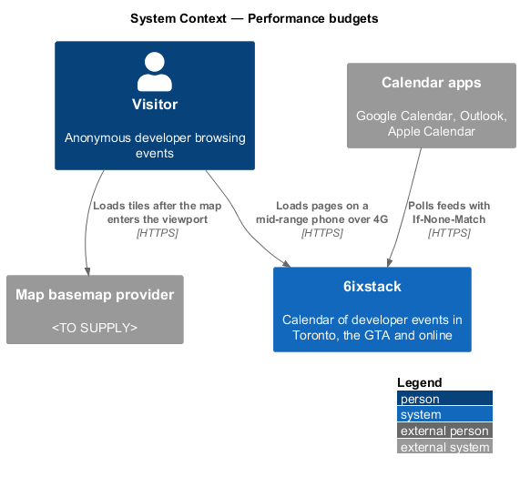
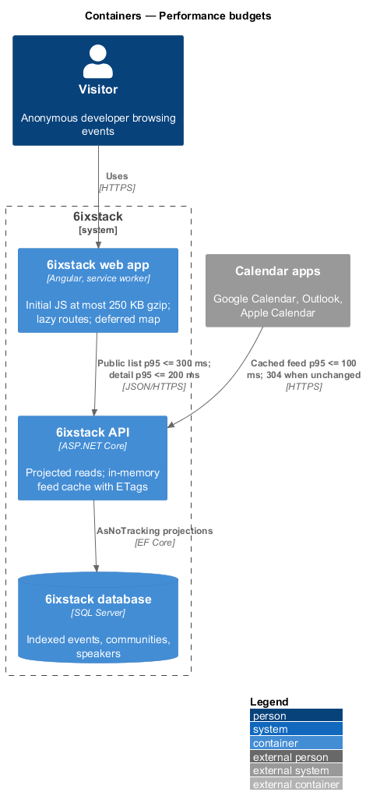
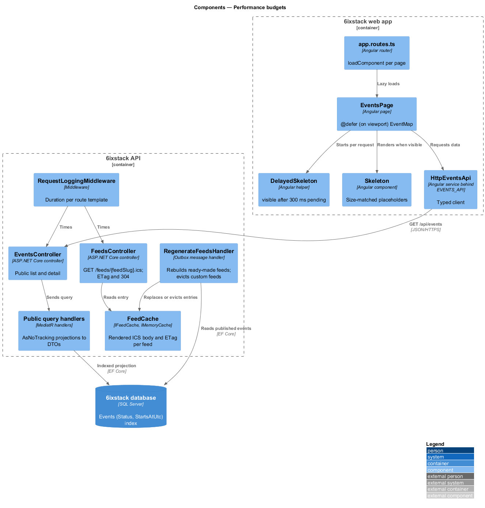
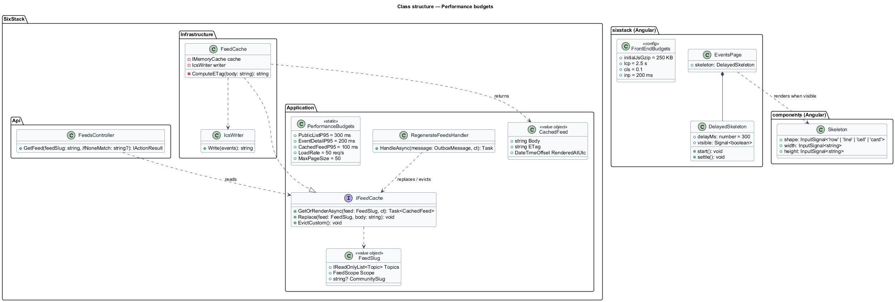
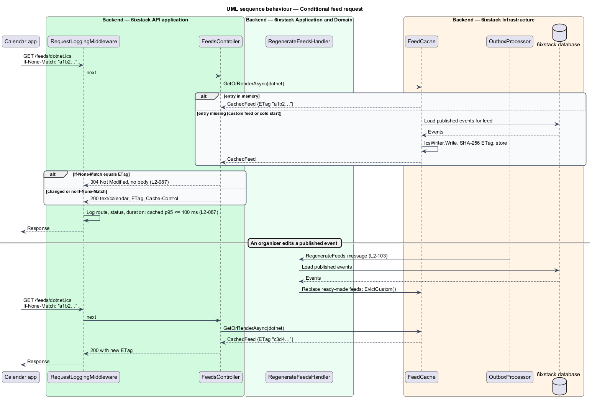
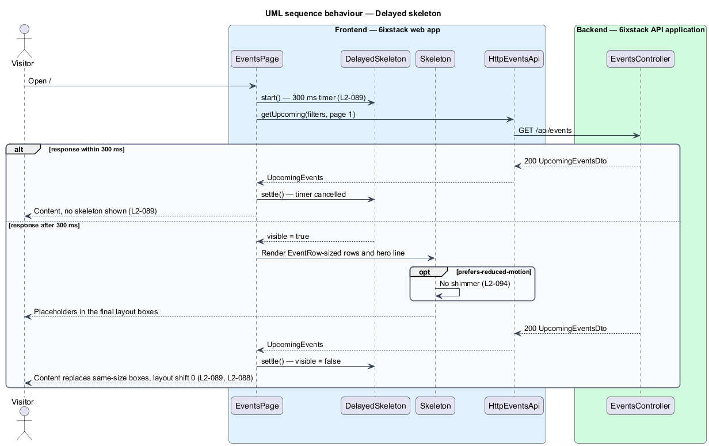

# Performance budgets

## Overview

Most 6ixstack visitors open the site on a phone, often between talks or on
transit. Calendar apps poll the feeds on their own schedule, repeatedly each day,
for every subscriber. Public reads therefore stay fast, pages stay light and
the layout holds still while data arrives.

This feature sets the performance budgets and the mechanisms that keep the
system inside them. It belongs to the `platform` subsystem. Each page and
endpoint design inherits the budgets. This design defines the shared
techniques, the caching of feeds, the loading-state rules and the checks that
measure each budget.

Terms used in this design:

- **performance budget** — measurable limit a page or endpoint shall stay within
- **p95 latency** — response time that 95 % of requests meet or beat
- **public list endpoint** — anonymous endpoint that returns a list: `GET /api/events`, `GET /api/events/calendar`, `GET /api/communities`, `GET /api/speakers`
- **conditional request** — request carrying `If-None-Match` with a previously received entity tag, answered with 304 when the content is unchanged
- **entity tag (ETag)** — opaque version identifier of a response body
- **Largest Contentful Paint (LCP)** — time until the largest visible element renders
- **Cumulative Layout Shift (CLS)** — sum of unexpected layout movement scores during the page's life
- **Interaction to Next Paint (INP)** — latency from a user input to the next frame that reflects it
- **initial JavaScript** — scripts the browser shall download before the first route renders, measured gzip-compressed
- **skeleton** — placeholder shape shown in place of content that is still loading

## Description

### API latency (`L2-087`)

- **Read-only projections** — every public query handler uses `AsNoTracking`
  and projects straight to its DTO with `Select`. No handler loads full entity
  graphs for a list.
- **Indexes** — `AppDbContext` configures the indexes the public queries rely
  on: `Events (Status, StartsAtUtc)`, a unique index on `Events (Slug)`, unique
  indexes on `Communities (Slug)` and `Speakers (Slug)`, and
  `EventSpeakers (SpeakerId)`. Each slice design names any further index it
  uses.
- **Paging** — list endpoints cap `pageSize` at 50 in their validators.
- **`FeedCache`** — `IFeedCache` implementation in `SixStack.Infrastructure`. It
  holds the rendered ICS body of each feed in `IMemoryCache` with a strong
  ETag. The ETag is the first 16 bytes of the body's SHA-256 hash, as hex. Feed
  regeneration runs as outbox work after any change to a published event
  (`L2-103`). It replaces the entry for each ready-made feed and evicts custom
  feeds, which render on their next request.
- **`FeedsController`** — for `GET /feeds/{feedSlug}.ics`, it reads the entry
  from `FeedCache`. It answers 304 with no body when `If-None-Match` matches the
  ETag. Otherwise it answers 200 with the body, `ETag` and
  `Cache-Control: public, max-age=<TO SUPPLY>`.
- **Measurement** — `RequestLoggingMiddleware` logs the duration of each request
  by route template (`platform/observability`), so p95 per route is computed
  from logs. A load test runs 50 requests per second for 10 minutes against
  `GET /api/events`, `GET /api/events/{slug}` and a cached feed. The load tool
  and the test environment's size are `<TO SUPPLY>`.

The in-memory feed cache is per API instance. Each instance regenerates its own
entries. A shared cache is `<TO SUPPLY>` if more than one instance runs.

### Front-end performance (`L2-088`)

- **Route-level code splitting** — every page in `app.routes.ts` uses
  `loadComponent`, so the initial bundle holds only the shell, the router and
  the events page's first view.
- **Deferred map** — `EventsPage` wraps `EventMap` in `@defer (on viewport)`
  with a placeholder of the same size. The map code and basemap tiles stay out
  of the LCP path.
- **Fonts** — Inter is self-hosted as WOFF2 with `font-display: swap`. The
  weights used above the fold are preloaded.
- **Change detection** — the app is zoneless and uses signals with `OnPush`
  components, which keeps filter interactions within the INP budget.
- **Bundle budget** — `angular.json` sets an `initial` budget. Angular measures
  raw size, so a CI step **`check-bundle-size`** gzips the initial chunks and
  fails above 250 KB.
- **Lighthouse CI** — a CI job runs Lighthouse with the mobile preset (Moto G
  Power emulation, slow 4G throttling) against `/` served by the API with the
  seeded SQLite database. It asserts LCP at most 2.5 s and CLS at most 0.1.
  INP depends on a real interaction, so a Playwright test measures it with the
  `event-timing` performance entries after pressing a filter chip.
- **Component scenarios** — the `perf-test` project measures render cost per
  component (`AGENTS.md`), so a slow component shows up before it reaches a
  page.

The "mid-range phone over 4G" in `L2-088` maps to the Lighthouse mobile preset.
Whether field data from real devices is also collected is `<TO SUPPLY>`; any
such collection shall stay first-party under `L2-098`.

### Stable loading states (`L2-089`)

- **`DelayedSkeleton`** — shared Angular helper. A page starts it with each
  request. It exposes `visible`, a signal that turns `true` only if the request
  is still pending after 300 ms. A response within 300 ms therefore renders
  with no skeleton.
- **`Skeleton`** — component in project `components`. Each page composes it
  into shapes with the same box size as the content it replaces: a
  `EventRow`-sized row, a hero-count line and a calendar cell. Sizes come from
  the same design tokens and fixed row heights as the real components.
- **Reserved space** — images and the map frame carry explicit width and height
  or `aspect-ratio`. Content that loads later replaces a placeholder of the
  same box, so CLS of the swap is 0.
- **Shimmer** — the skeleton shimmer animation stops under reduced motion
  (`platform/accessibility`, `L2-094`).

## Requirements

| L2 ID | Refines (L1) | Requirement |
|-------|--------------|-------------|
| `L2-087` | `L1-020` | At 50 requests per second, public list endpoints shall respond within 300 ms and event detail within 200 ms at the 95th percentile; feed requests served from cache shall respond within 100 ms at the 95th percentile and support conditional requests. |
| `L2-088` | `L1-020` | On a mid-range phone over 4G, public pages shall reach Largest Contentful Paint within 2.5 s, keep Cumulative Layout Shift at or below 0.1 and Interaction to Next Paint at or below 200 ms; the initial JavaScript shall not exceed 250 KB compressed. |
| `L2-089` | `L1-020` | Skeletons shall appear only after 300 ms and shall match the size of the loaded content so nothing moves when data arrives. |

## Diagrams

### System context

Visitors load pages on phones and desktops. Calendar apps poll feeds and send
conditional requests.

### Containers

The web app loads a small initial bundle and defers the map. The API serves
public reads from indexed projections and feeds from an in-memory cache.

### Components

`DelayedSkeleton` and `Skeleton` govern loading states in the web app.
`FeedsController` reads `FeedCache`, which the outbox-driven regeneration
handler fills. Public query handlers read through indexed projections.

### Class structure

`IFeedCache` returns a `CachedFeed` with body and ETag. `DelayedSkeleton`
exposes a `visible` signal. `PerformanceBudgets` names the limits the CI checks
assert.

### Behaviour — conditional feed request

A calendar app sends the ETag from its last fetch. An unchanged feed returns 304
from memory. A change to a published event regenerates the entry, so the next
request returns 200 with a new ETag.

### Behaviour — delayed skeleton

A response within 300 ms renders content with no skeleton. A slower response
shows size-matched skeletons, then swaps them for content without layout
shift.

