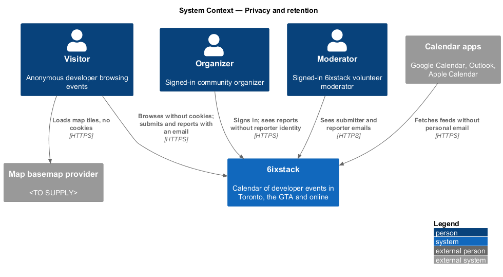
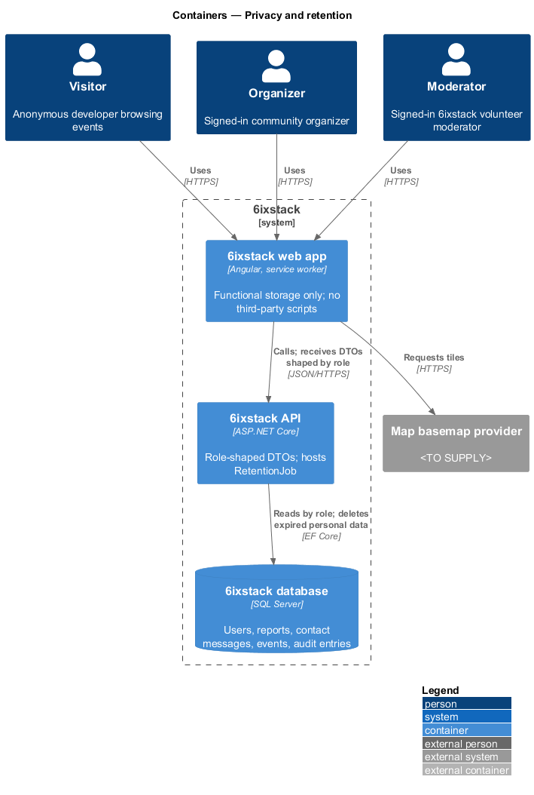
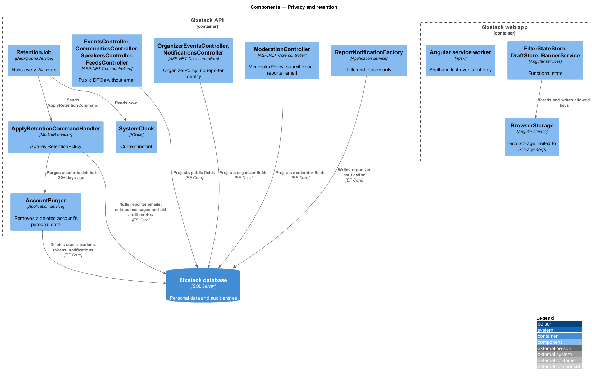
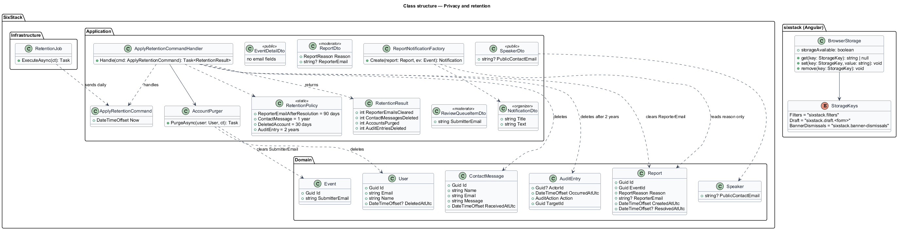
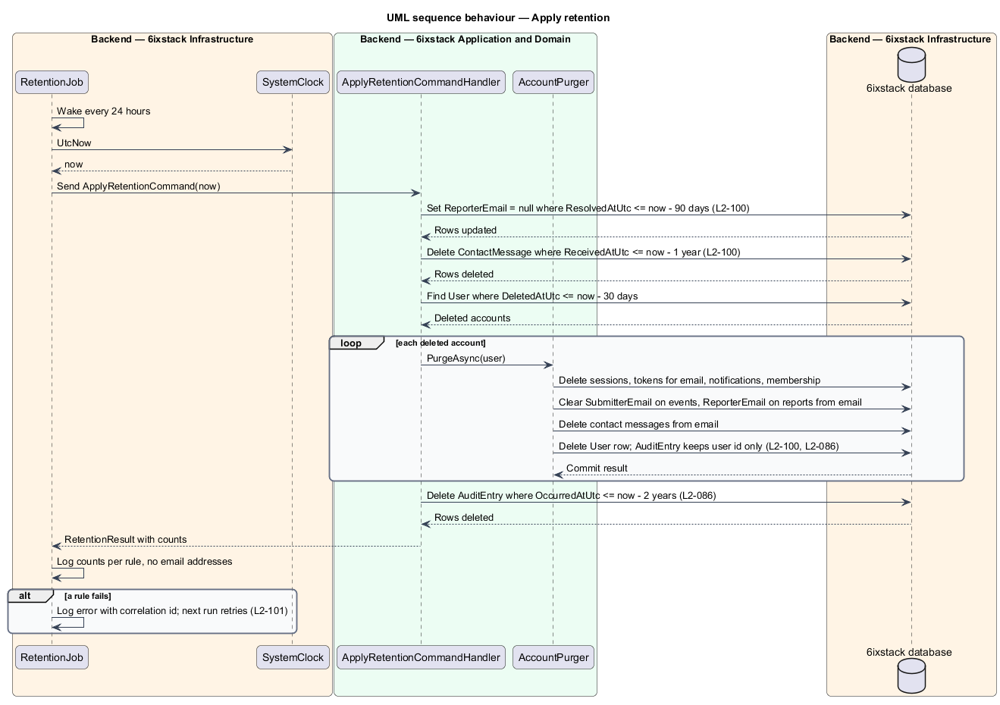
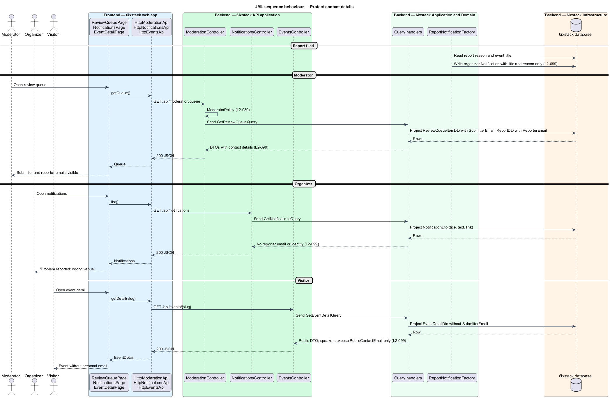

# Privacy and retention

## Overview

6ixstack collects 4 kinds of personal data, mostly from
people who never sign in. A submitter gives an email address with an event. A
reporter may give an email address with a problem report. A sender of a
contact message gives one too. An organizer account holds a name and an email
address. These addresses let moderators follow up. They shall never reach the
public, and an organizer shall never learn who reported an event.

This feature defines three privacy controls that cut across the system. First,
the site sets no tracking cookies or scripts, and browser storage holds only
functional data. Second, contact details stay inside moderator-only responses.
Third, a scheduled job deletes personal data when its retention period ends.
The feature belongs to the `platform` subsystem. Account deletion itself is
started in `identity/delete-account`. Report handling lives in
`submissions/report-problem`, and the contact form in `site/contact-form`.

Terms used in this design:

- **personal data** — name or email address that identifies a submitter, reporter, contact-form sender or account holder
- **contact details** — submitter, reporter and contact-form email addresses
- **published speaker contact** — email address a speaker chose to show publicly (`Speaker.PublicContactEmail`)
- **functional storage** — browser storage that holds only filters, form drafts, banner dismissals and the offline cache
- **tracking** — any cookie, script or request that lets an advertiser or analytics service follow a visitor
- **retention period** — time after which a record or field shall be deleted
- **retention job** — scheduled background work that deletes data whose retention period has ended
- **public response** — any API response or feed that an anonymous caller can receive

## Description

### No tracking (`L2-098`)

- **No third-party scripts** — the web app bundles all its code and loads no
  analytics, advertising or tag-manager script. Fonts are self-hosted
  (`docs/mocks/README.md`, assumption 10). The Content Security Policy from
  `platform/security-hardening` (`script-src 'self'`, `connect-src 'self'`)
  makes the browser block any script or request to another origin.
- **Map basemap** — the event map loads tiles from the map basemap provider.
  The provider is `<TO SUPPLY>`. It shall not be an analytics or advertising
  domain, and its tile requests shall set no cookies.
- **Cookies** — anonymous visitors receive no cookies. A signed-in user receives
  only the session cookie and the `XSRF-TOKEN` anti-forgery cookie. The API
  registers no other cookie-writing feature: no ASP.NET Core session state, no
  TempData cookie and no default antiforgery cookie.
- **`BrowserStorage`** — Angular service in project `sixstack`. It is the only
  code that touches `localStorage`. It accepts only the keys in
  **`StorageKeys`**: `sixstack.filters`, `sixstack.draft.<form>` and
  `sixstack.banner-dismissals`. It wraps every access in `try`/`catch`, so a
  blocked storage area reports `storageAvailable = false`.
  `FilterStateStore`, `DraftStore` and `BannerService` use it.
- **Offline cache** — the Angular service worker caches the application shell
  and the last events list response (`site/status-pages`, `L2-078`). It caches
  no authenticated API response.

### Protection of contact details (`L2-099`)

- **DTO separation** — public DTOs have no email field. `EventSummaryDto`,
  `EventDetailDto`, `CommunityDto`, `SpeakerDto` and the ICS output omit
  `SubmitterEmail`, `ReporterEmail` and user email addresses. The only email in
  a public response is `SpeakerDto.PublicContactEmail`.
- **Moderator DTOs** — `ReviewQueueItemDto` carries `SubmitterEmail`, and
  `ReportDto` carries `ReporterEmail`. `ModerationController` returns them
  under `ModeratorPolicy`. Contact messages reach the team by email
  (`site/contact-form`). Whether moderators also read them in the app is
  `<TO SUPPLY>`.
- **Organizer DTOs** — `OrganizerEventDto` and `NotificationDto` carry no
  reporter identity. **`ReportNotificationFactory`** builds the organizer's
  report notification from the event title and the report reason only.
- **Logs** — `RequestLoggingMiddleware` logs the route template, not the query
  string or body (`platform/observability`). Handlers log entity ids, never
  email addresses.

### Data retention and deletion (`L2-100`)

- **`RetentionJob`** — `BackgroundService` in `SixStack.Infrastructure`, hosted
  by the API. It runs once every 24 hours. It reads the current instant from
  `IClock` and sends `ApplyRetentionCommand`. Every rule is an idempotent bulk
  update or delete, so overlapping runs on more than one API instance give the same result.
- **`ApplyRetentionCommandHandler`** — applies **`RetentionPolicy`** in one
  pass and logs the count per rule:
  - reports resolved 90 days ago or earlier: `Report.ReporterEmail` set to
    `null`;
  - contact messages received 1 year ago or earlier: `ContactMessage` deleted;
  - accounts deleted 30 days ago or earlier: personal data purged by
    **`AccountPurger`**;
  - audit entries older than 2 years: `AuditEntry` deleted (`L2-086`, owned by
    `platform/security-hardening`).
- **Account deletion** — `identity/delete-account` sets `User.DeletedAtUtc`,
  revokes sessions and records the `AccountDeletion` audit entry by user id. The
  purge then clears what remains within the 30-day period, so a purge on day 30
  still meets the limit.
- **`AccountPurger`** — deletes the `User` row, its `Session` rows,
  `SecurityToken` rows for its email, its `Notification` rows and its
  `CommunityOrganizer` link. It sets `Event.SubmitterEmail` to an empty value on
  events that the deleted email submitted. It nulls `ReporterEmail` on reports
  from that email and deletes contact messages from it. `AuditEntry` rows hold
  only the user id, so they stay.
- **`ContactMessage`** — entity with `Guid Id`, `string Name`, `string Email`,
  `string Message` and `DateTimeOffset ReceivedAtUtc`.

The design leaves these retention questions open:

- What happens to the events of a deleted organizer's community, beyond
  removing the submitter email, is `<TO SUPPLY>`.
- Retention of expired or used `SecurityToken` rows, which hold an email, is
  `<TO SUPPLY>`.
- Retention of processed `OutboxMessage` rows, whose payloads may hold an
  email, is `<TO SUPPLY>`.
- Retention of logs and of database backups, which may still hold purged data,
  is `<TO SUPPLY>`.
- Whether a report from an anonymous reporter that is never resolved keeps its
  email indefinitely is `<TO SUPPLY>`. `L2-100` starts the 90 days at
  resolution.
- The time of day of the job run is `<TO SUPPLY>`.

## Requirements

| L2 ID | Refines (L1) | Requirement |
|-------|--------------|-------------|
| `L2-098` | `L1-023` | The site shall set no advertising or cross-site tracking cookies or scripts, and browser storage shall hold only functional data: filters, form drafts, banner dismissals and the offline cache. |
| `L2-099` | `L1-023` | Submitter, reporter and contact-form email addresses shall be visible only to moderators; organizers shall never see who reported their event; public pages and feeds shall expose no personal email except a speaker's published contact. |
| `L2-100` | `L1-023` | The system shall delete reporter emails 90 days after a report is resolved, contact messages after 1 year, and a deleted account's personal data within 30 days, keeping audit entries without personal email. |

## Diagrams

### System context

Visitors and organizers use 6ixstack without tracking. Moderators are the only
people who see contact details. The map basemap provider receives tile
requests only. No analytics or advertising system takes part.

### Containers

The web app keeps functional storage in the browser. The API filters contact
details by role and runs the retention job. The database holds the personal
data the job deletes.

### Components

`BrowserStorage` guards browser storage on the client. On the server, the
public, organizer and moderator controllers return different DTOs.
`RetentionJob` drives `ApplyRetentionCommandHandler` and `AccountPurger`.

### Class structure

`RetentionPolicy` holds the 4 periods. The handler applies them to `Report`,
`ContactMessage`, `User` and `AuditEntry`. Public and organizer DTOs have no
email field. Moderator DTOs do.

### Behaviour — apply retention

The daily run removes reporter emails, contact messages, deleted accounts and
old audit entries in turn. A report resolved 91 days ago loses its email. An
account deleted 31 days ago leaves no name or email behind.

### Behaviour — protect contact details

The same report reaches 3 audiences with 3 shapes. The moderator sees the
reporter email. The organizer sees only the reason. A public response carries
no submitter or reporter email.

