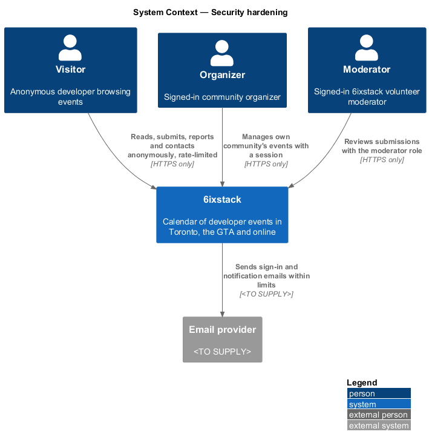
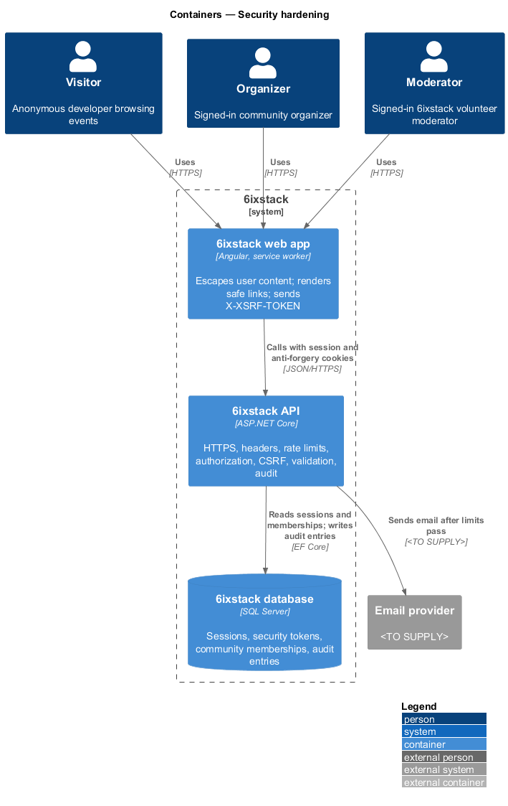
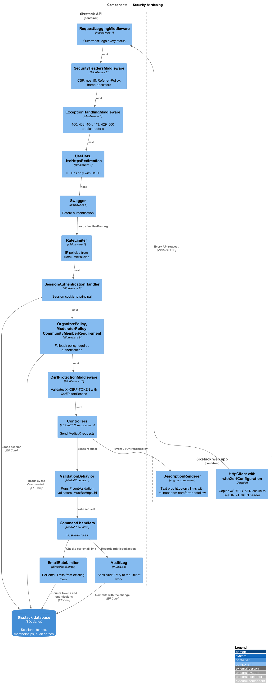
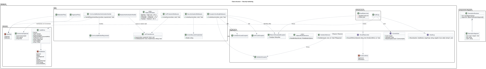
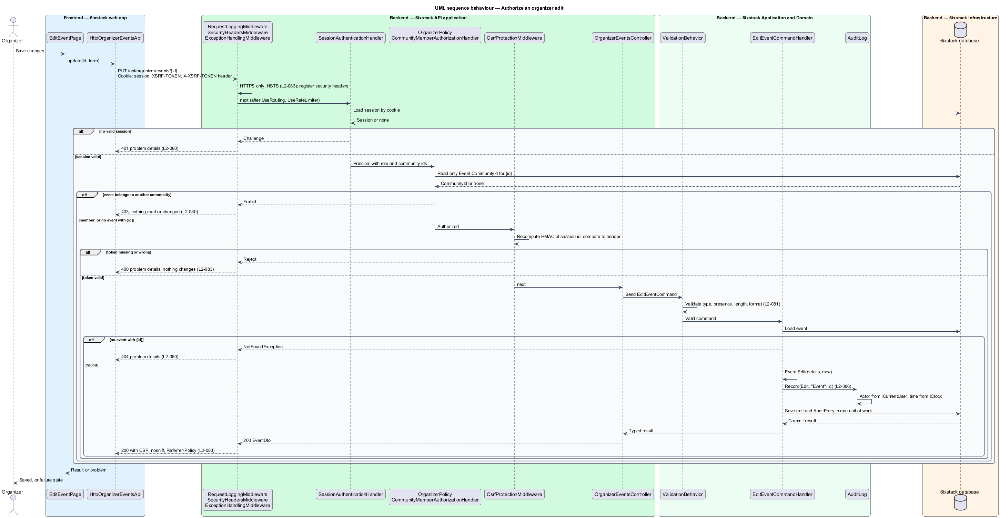
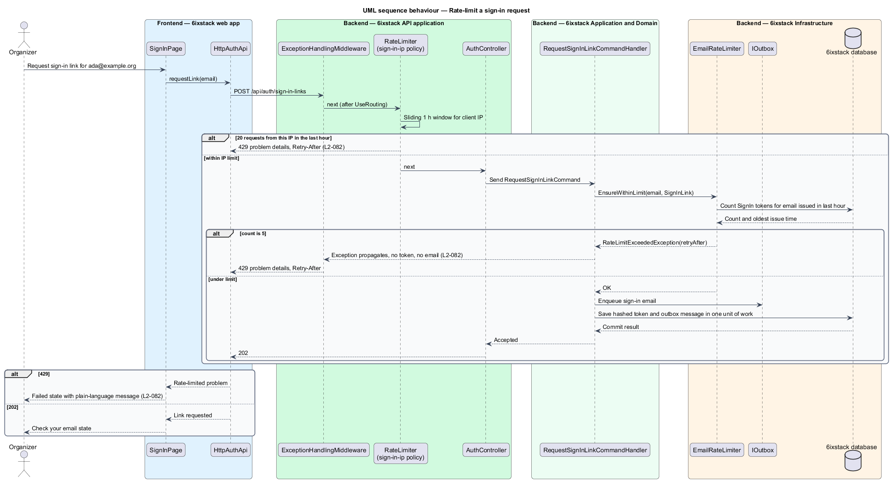
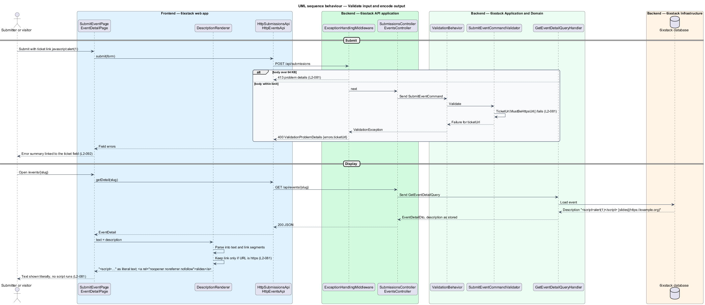

# Security hardening

## Overview

6ixstack is a public calendar of developer events. Anyone may browse, subscribe
to feeds, submit an event, report a problem or send a message without an
account. Organizers sign in with an emailed link to manage their community's
events. Moderators sign in to review submissions. Each group may reach a
different set of operations, and the anonymous write paths attract spam and
abuse.

This feature defines the protections that apply to every request the
6ixstack API serves: who may call each endpoint, what input is accepted, how
fast anonymous callers may write, how the browser is told to treat responses,
and which privileged actions leave a permanent record. It belongs to the
`platform` subsystem. Each business slice declares its own policy, validator
and rate limit, and this design defines the mechanisms those declarations use.
Sign-in token handling (`L2-084`) and email verification (`L2-085`) belong to
`identity/magic-link-sign-in` and `submissions/submit-event`.

Terms used in this design:

- **request pipeline** — ordered chain of ASP.NET Core middleware a request passes through before and after its controller action
- **authorization policy** — named rule set that ASP.NET Core evaluates before an action runs
- **community membership** — link between an organizer and the one community whose events the organizer manages (`CommunityOrganizer`)
- **anonymous write endpoint** — endpoint that changes state and accepts callers without a session: submissions, reports, contact messages and feed creation
- **rate limit** — maximum number of requests a caller may make in a time window, partitioned by IP address or by email address
- **CSRF** — cross-site request forgery, in which another site makes the browser send a state-changing request with the user's cookie
- **anti-forgery token** — value bound to the session that a cookie-authenticated state-changing request carries in a header to prove it came from 6ixstack
- **Content Security Policy (CSP)** — response header listing the origins from which a page may load scripts, styles, images and connections
- **audit entry** — append-only record of a privileged action with actor, time, action and target

## Description

### Request pipeline

`Program.cs` in `SixStack.Api` composes the middleware in a fixed order. The
order is part of the design, and `platform/observability` uses the same list.

1. **`RequestLoggingMiddleware`** — outermost, so every response status is
   logged, including handled errors (see `platform/observability`).
2. **`SecurityHeadersMiddleware`** — registers an `OnStarting` callback that
   adds the security headers to every response, including error responses.
3. **`ExceptionHandlingMiddleware`** — converts exceptions to problem details.
   It maps `ValidationException` to 400, `ForbiddenAccessException` to 403,
   `NotFoundException` to 404, a request body over the limit to 413 and
   `RateLimitExceededException` to 429 with `Retry-After`.
4. **`UseHsts`** and **`UseHttpsRedirection`** — redirect HTTP to HTTPS and
   send `Strict-Transport-Security`. The HSTS `max-age` is `<TO SUPPLY>`.
5. **Swagger** (`UseSwagger`, `UseSwaggerUI`) — mapped before authentication,
   so the document and UI stay reachable without a session. This order shall be
   preserved when the authentication setup changes. The environments that
   expose Swagger are `<TO SUPPLY>`.
6. **`UseRouting`** — selects the endpoint so the later stages can read its
   metadata.
7. **`UseRateLimiter`** — applies the IP-partitioned policies named on each
   endpoint.
8. **`UseAuthentication`** — runs `SessionAuthenticationHandler`, which reads
   the session cookie and builds the principal (see
   `identity/sessions-and-sign-out`).
9. **`UseAuthorization`** — evaluates the endpoint's policies.
10. **`CsrfProtectionMiddleware`** — validates the anti-forgery token on
    state-changing cookie-authenticated requests.
11. **Endpoints** — `MapControllers()` and the health checks. Each controller
    sends a MediatR request. `ValidationBehavior` runs every FluentValidation
    validator before the handler.

Authorization runs before CSRF validation. An anonymous call to an organizer
endpoint therefore receives 401, not an anti-forgery error.

### Authorization (`L2-080`)

- **Fallback policy** — `AuthorizationOptions.FallbackPolicy` requires an
  authenticated user. An endpoint without an explicit attribute is therefore
  closed. Public endpoints opt out with `[AllowAnonymous]`: the public event,
  community, speaker and reference-data reads, feeds, submissions, reports,
  contact, short links, auth and health.
- **`OrganizerPolicy`** — requires an authenticated session whose user has the
  `Organizer` role. `OrganizerEventsController`, `AccountController` and
  `NotificationsController` apply it. Whether a moderator also satisfies this
  policy is `<TO SUPPLY>`.
- **`CommunityMemberRequirement`** — authorization requirement applied to
  `OrganizerEventsController` actions with an `{id}` route value. Its handler,
  **`CommunityMemberAuthorizationHandler`**, reads only the event's
  `CommunityId` through `IAppDbContext`. It succeeds when the current user's
  community memberships contain that community. It fails otherwise, which
  yields 403 before the action reads or changes anything. When no event has the
  id, it succeeds, and the command or query handler returns 404.
- **`ModeratorPolicy`** — requires the `Moderator` role. `ModerationController`
  applies it, so an organizer receives 403.
- **`ICurrentUser`** — application-layer view of the principal: `UserId`,
  `Role` and `CommunityIds`. Handlers use it to stamp actors on audit entries.

### Input validation and output encoding (`L2-081`)

- **Body size** — Kestrel `MaxRequestBodySize` is 65,536 bytes. A larger body
  fails before model binding, and `ExceptionHandlingMiddleware` returns 413.
- **`ValidationBehavior<TRequest, TResponse>`** — MediatR pipeline behavior that
  runs every validator for the request. It throws `ValidationException`, which
  becomes a 400 `ValidationProblemDetails` keyed by field name.
- **`<Verb><Noun>CommandValidator`** — one FluentValidation validator per
  command and query. Each validator states type, presence, length and format
  for every field. The per-field limits live in each slice's design.
- **`MustBeHttpsUrl()`** — shared FluentValidation rule extension. It accepts an
  absolute URI whose scheme is `https` and rejects every other scheme, including
  `javascript:`, `data:` and `http:`. Ticket, stream, website, recording and
  slides links use it.
- **Output encoding** — Angular interpolation escapes all user text, and no page
  binds user content to `innerHTML`. **`DescriptionRenderer`** in project
  `components` parses a description into `DescriptionSegment` values: plain
  text, line breaks and links. It emits a link only for the Markdown form
  `[label](https://…)` whose URL passes the same `https` rule. The template
  renders each link as `<a rel="noopener noreferrer nofollow">`. All other
  Markdown stays literal text. `IcsWriter` escapes text per RFC 5545 for feeds.

### Abuse prevention (`L2-082`)

- **IP-partitioned limits** — ASP.NET Core rate limiting policies declared in
  **`RateLimitPolicies`** and applied with `[EnableRateLimiting]`. Each policy
  uses a sliding window of 1 hour partitioned by client IP address:
  `sign-in-ip` (20), `reports-ip` (10), `contact-ip` (5) and `feeds-ip` (30).
  The `OnRejected` callback writes a 429 problem response with `Retry-After`
  from the lease metadata.
- **Email-partitioned limits** — the email address is in the request body, so
  the command handler enforces these through **`IEmailRateLimiter`**. Its
  implementation, **`EmailRateLimiter`**, counts existing rows instead of
  keeping counters. Sign-in links count `SecurityToken` rows with purpose
  `SignIn` issued for the email in the last hour, with a limit of 5. Submissions
  count `Event` rows with that `SubmitterEmail` since the window start, with a
  limit of 10. When the limit is reached, it throws
  `RateLimitExceededException` with the time until the oldest counted row
  leaves the window. The handler checks before it issues a token or sends an
  email.
- **Client messages** — the web app maps a 429 to the failed or error state of
  the dialog or form that sent it, with a plain-language message
  (`site/toasts-and-banners`).

`L2-082` states "10 per day per email" for submissions. Whether a day is a
rolling 24 hours or a Toronto calendar day is `<TO SUPPLY>`. The in-memory
limiter counts per API instance. The number of instances, and whether limits
are shared across them, are `<TO SUPPLY>`. The client IP comes from the
connection, or from forwarded headers when a reverse proxy is present. The
proxy topology is `<TO SUPPLY>`.

### Transport, cookies, headers and CSRF (`L2-083`)

- **Session cookie** — `SessionAuthenticationHandler` issues it with `Secure`,
  `HttpOnly`, `SameSite=Lax` and `Path=/`. Its name is `<TO SUPPLY>`.
- **`XsrfTokenService`** — computes the anti-forgery token as an HMAC-SHA256 of
  the session id with a key from ASP.NET Core Data Protection. It writes the
  token to the `XSRF-TOKEN` cookie (`Secure`, `SameSite=Strict`, readable by
  script) when a session starts. Visitors without a session therefore receive
  no cookies (`L2-098`). The key ring storage is `<TO SUPPLY>`.
- **Angular client** — `HttpClient` with `withXsrfConfiguration` copies the
  cookie into the `X-XSRF-TOKEN` header on `POST`, `PUT`, `PATCH` and `DELETE`.
- **`CsrfProtectionMiddleware`** — for an unsafe method on a request that the
  session cookie authenticated, it recomputes the token and compares it to the
  header in constant time. A missing or wrong token yields a 400 problem
  response before the action runs. Anonymous requests carry no session to
  forge, so they pass.
- **`SecurityHeadersMiddleware`** — adds `Content-Security-Policy`,
  `X-Content-Type-Options: nosniff` and
  `Referrer-Policy: strict-origin-when-cross-origin`. The policy is built by
  **`ContentSecurityPolicyBuilder`**: `default-src 'self'`,
  `script-src 'self'`, `connect-src 'self'`, `object-src 'none'`,
  `base-uri 'self'`, `form-action 'self'` and `frame-ancestors 'none'`. The
  `img-src` entry for the map basemap provider is `<TO SUPPLY>`. Angular
  component styles require either a nonce or `style-src 'unsafe-inline'`; the
  choice is `<TO SUPPLY>`.

`L2-083` requires the headers on every page response. The API adds them to its
own responses. If the API also serves the built web app, the same middleware
covers `index.html`. If a separate host serves it, that host's configuration
shall send the same headers. The hosting choice is `<TO SUPPLY>`.

### Audit trail (`L2-086`)

- **`AuditEntry`** — entity with `Guid Id`, `Guid? ActorId`,
  `string ActorRole`, `DateTimeOffset OccurredAtUtc`, `AuditAction Action`,
  `string TargetType`, `Guid TargetId` and `string? Detail`. It holds no email
  address and no name.
- **`AuditAction`** — `Approve`, `Reject`, `UndoApproval`, `Edit`, `Cancel`,
  `FeaturedChange`, `RoleChange` and `AccountDeletion`.
- **`IAuditLog`** / **`AuditLog`** — the handler for each listed action calls
  `Record(action, targetType, targetId, detail)`. `AuditLog` stamps the actor
  from `ICurrentUser` and the time from `IClock`. It adds the entry to the same
  `AppDbContext`, so the entry and the change commit together or not at all.
- **Account deletion** — the entry stores the deleted user's id as `ActorId`
  and target. The email never enters the entry.
- **Retention** — `RetentionJob` in `platform/privacy-and-retention` deletes
  entries older than 2 years.

The design defines no screen or endpoint that reads the audit trail. How
moderators read it is `<TO SUPPLY>`. No mocked screen changes roles or the
featured event, so the source of `RoleChange` and `FeaturedChange` entries is
`<TO SUPPLY>`. One option is the CLI.

## Requirements

| L2 ID | Refines (L1) | Requirement |
|-------|--------------|-------------|
| `L2-080` | `L1-019` | The API shall authorize every endpoint server-side: public read endpoints, feeds, submissions, reports and contact allow anonymous callers; organizer endpoints require an organizer session and, for event endpoints, membership of the event's community; moderation endpoints require the moderator role. |
| `L2-081` | `L1-019` | The API shall validate every request field for type, presence, length and format; accept only `https://` URLs for ticket, stream, website and recording links; render Markdown links in descriptions as sanitized anchors only; and encode all user content on output. |
| `L2-082` | `L1-019` | The API shall rate-limit anonymous write endpoints and sign-in requests and respond 429 with `Retry-After` when exceeded: sign-in links at 5 per hour per email and 20 per hour per IP; submissions at 10 per day per email; reports at 10 per hour per IP; contact messages at 5 per hour per IP; feed creation at 30 per hour per IP. |
| `L2-083` | `L1-019` | The system shall serve only HTTPS with HSTS; set session cookies `Secure`, `HttpOnly` and `SameSite=Lax`; protect state-changing cookie-authenticated requests against CSRF; and send a Content Security Policy, `X-Content-Type-Options: nosniff`, `Referrer-Policy: strict-origin-when-cross-origin` and `frame-ancestors 'none'`. |
| `L2-086` | `L1-019` | The system shall record an audit entry with actor, time, action and target for approvals, rejections, undo, edits, cancellations, featured changes, role changes and account deletions, retained for 2 years. |

## Diagrams

### System context

Visitors, organizers and moderators reach 6ixstack only over HTTPS. Each group
reaches a different set of endpoints. The email provider receives messages only
after a request passes its rate limit.

### Containers

The web app attaches the anti-forgery header to its API calls. The API enforces
every control. The database holds sessions, tokens and audit entries.

### Components

The middleware chain runs in the order listed under Request pipeline. Policies
and the community membership handler run inside authorization. Validators, the
email rate limiter and the audit log run inside the MediatR pipeline.

### Class structure

Authorization types live in `SixStack.Api`. The validation behavior, the rate
limit contract and the audit contract live in `SixStack.Application`. Their
implementations live in `SixStack.Infrastructure`. `AuditEntry` is a domain
entity without personal data.

### Behaviour — authorize an organizer edit

An organizer saves an event. The request passes the pipeline in order. The
alternates show 401 for no session, 403 for another community's event, 400 for
a missing anti-forgery token and 404 for an unknown id. The happy path writes
the edit and its audit entry in one unit of work.

### Behaviour — rate-limit a sign-in request

The IP policy runs in middleware before the body is read. The email limit runs
in the handler before a token is issued. Either limit returns 429 with
`Retry-After` and sends no email.

### Behaviour — validate input and encode output

A submission with a `javascript:` ticket link fails validation with 400. A
stored description is rendered as text, and only `https` Markdown links become
anchors with `rel="noopener noreferrer nofollow"`.

