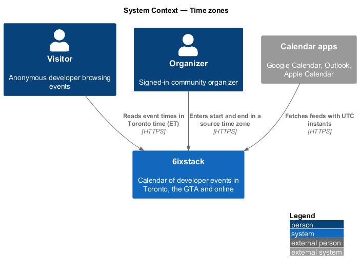
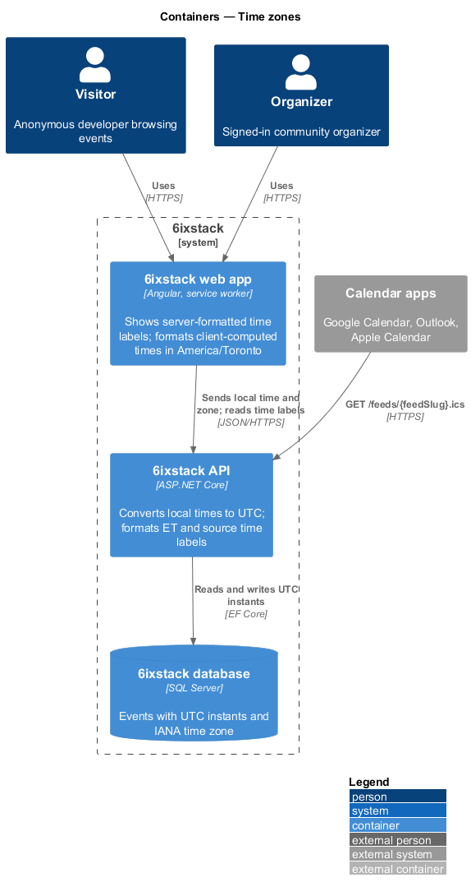
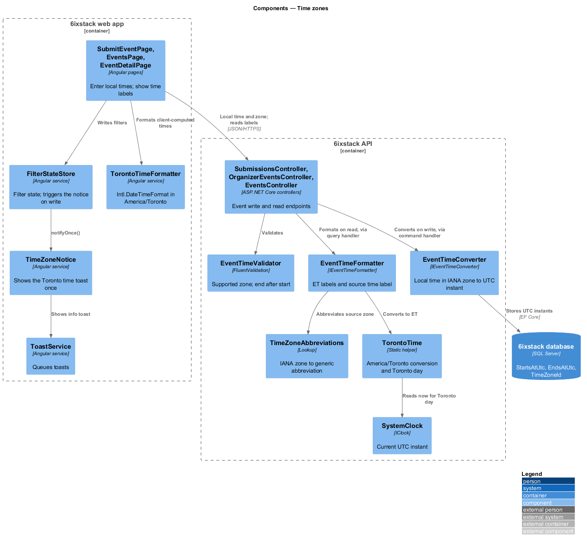
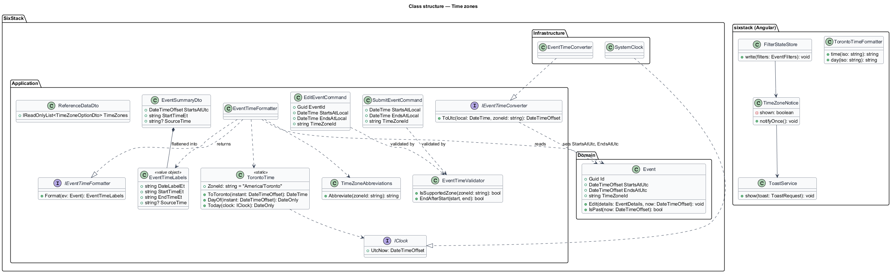
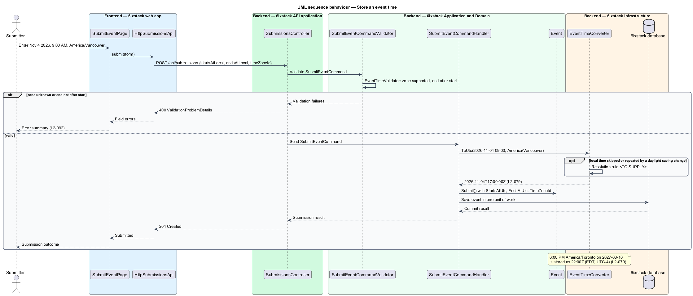
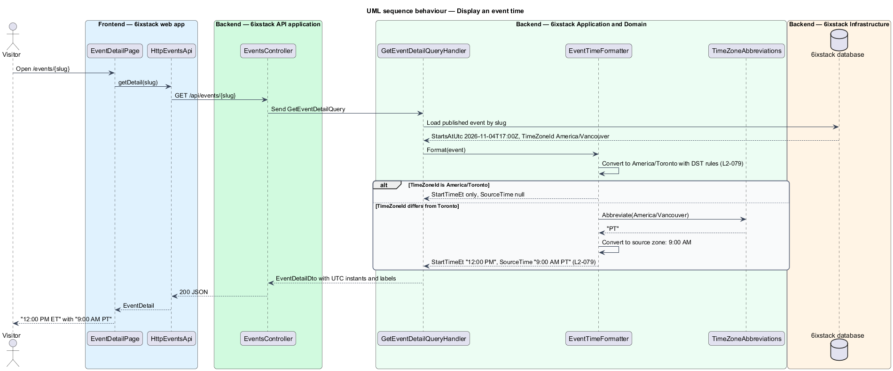
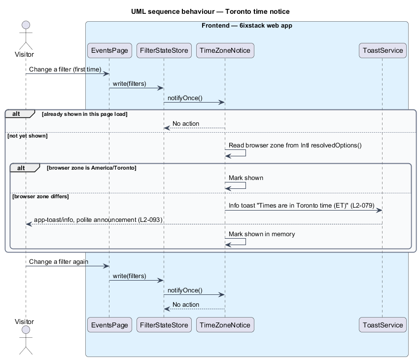

# Time zones

## Overview

6ixstack lists developer events in Toronto, the Greater Toronto Area (GTA) and
online. Most events happen in Toronto, but streamed events are often hosted
elsewhere, for example a talk broadcast from Vancouver. A visitor in Toronto
compares events on one consistent clock, and a streamed event's organizer
thinks in the time of the city that hosts the stream.

This feature defines how the system stores, converts and displays event times.
It belongs to the `platform` subsystem because every slice that shows a time
depends on it: the events list (`discovery/browse-events`), the event detail
page, the month calendar, the calendar feeds, the organizer dashboard and the
notifications.

Terms used in this design:

- **UTC instant** — point in time expressed in Coordinated Universal Time, independent of any location
- **IANA time zone** — named zone from the IANA time zone database, such as `America/Toronto` or `America/Vancouver`
- **source time zone** — IANA time zone the organizer chose when entering the event's start and end
- **Toronto time (ET)** — wall-clock time in `America/Toronto`, with daylight saving applied
- **source time** — wall-clock time of the event in its source time zone, shown with a zone abbreviation such as "PT"
- **Toronto day** — calendar date in Toronto time; day groups, the upcoming window and "today" use it

The rule has three parts. The database holds UTC instants plus the source
time zone. Every screen shows Toronto time. An event whose source time zone is
not `America/Toronto` also shows its source time, for example "12:00 PM" with
"9:00 AM PT".

## Description

The slice spans entry (organizer or submitter), storage, server-side
formatting and client-side formatting.

### Storage

- **`Event`** — domain entity. `StartsAtUtc` and `EndsAtUtc` are
  `DateTimeOffset` values with a zero offset. `TimeZoneId` holds the source
  time zone as an IANA identifier.
- **`AppDbContext`** — maps `StartsAtUtc` and `EndsAtUtc` to SQL Server
  `datetimeoffset` columns and `TimeZoneId` to `nvarchar(64)`. The SQLite
  database used by API and Infrastructure tests cannot order or compare
  `DateTimeOffset` values. The test configuration therefore applies a value
  converter that stores UTC ticks as a 64-bit integer.

### Conversion on entry

- **`SubmitEventCommand`** and **`EditEventCommand`** — carry the entered local
  `DateTime StartsAtLocal` and `DateTime EndsAtLocal` (kind `Unspecified`) and
  `string TimeZoneId`. Neither command carries a UTC value from the client.
- **`EventTimeValidator`** — FluentValidation rule set shared by both command
  validators. It rejects a `TimeZoneId` that is not in the supported list and an
  end that is not after the start.
- **`IEventTimeConverter`** / **`EventTimeConverter`** — converts a local date
  and time in an IANA zone to a UTC instant. It uses `TimeZoneInfo` with IANA
  identifiers through ICU, so Windows and Linux hosts resolve the same zones.
  The handling of a local time that a daylight saving change skips or repeats
  is `<TO SUPPLY>`.

### Formatting on output

- **`TorontoTime`** — static helper in `SixStack.Application`. It holds the
  constant `ZoneId = "America/Toronto"`. It converts a UTC instant to Toronto
  time and derives the Toronto day of an instant.
- **`IClock`** / **`SystemClock`** — supplies the current UTC instant.
  `TorontoTime.Today(clock)` gives the current Toronto day, so tests fix
  "today" at Monday, November 2, 2026.
- **`IEventTimeFormatter`** / **`EventTimeFormatter`** — builds an
  `EventTimeLabels` value for an event. `StartTimeEt` and `EndTimeEt` read
  "12:00 PM". `DateLabelEt` reads "Wednesday, November 4". `SourceTime` reads
  "9:00 AM PT" and is `null` when `TimeZoneId` is `America/Toronto`.
- **`TimeZoneAbbreviations`** — lookup from IANA zone to the generic
  abbreviation shown with a source time ("PT", "MT", "CT", "ET", "AT", "NT").
  Generic abbreviations do not change with daylight saving, matching the mocks.
  Abbreviations for zones outside North America are `<TO SUPPLY>`.
- **`EventSummaryDto`** and **`EventDetailDto`** — carry both the raw
  `StartsAtUtc` and `EndsAtUtc` instants and the formatted labels. Pages show
  the labels, so the formatting rules live in one place on the server.
- **`ReferenceDataDto.TimeZones`** — the supported source time zones returned
  by `GET /api/reference-data` for the submission and edit forms. The list
  itself is `<TO SUPPLY>`.

Calendar feeds write `DTSTART` and `DTEND` from the UTC instants. The feed
encoding itself belongs to `feeds-and-sharing/serve-calendar-feed`.

### Client side

- **`TorontoTimeFormatter`** — shared Angular service in project `sixstack`. It
  formats instants the client computes itself, such as month-grid cells and
  relative notification times. It uses `Intl.DateTimeFormat` with
  `timeZone: 'America/Toronto'`. It never uses the browser's own zone.
- **`TimeZoneNotice`** — Angular service in project `sixstack`. On the first
  filter change it compares the browser zone from
  `Intl.DateTimeFormat().resolvedOptions().timeZone` with `America/Toronto`. When
  they differ, it asks `ToastService` for the info toast "Times are in Toronto
  time (ET)" (`app-toast/info`). It then records in memory that the toast was
  shown.
- **`FilterStateStore`** — calls `TimeZoneNotice.notifyOnce()` from its write
  path, so every page with filters triggers the notice the same way.

`L2-079` does not state whether "once" lasts for one page load or across
visits. Persisting the flag across visits would add a browser storage entry
that `L2-098` does not list. The design keeps the flag in memory until this
ambiguity is resolved: `<TO SUPPLY>`.

`L1-018` speaks of streamed events only. `L2-079` applies the source time to
every event whose zone differs from Toronto. The design follows `L2-079`.

## Requirements

| L2 ID | Refines (L1) | Requirement |
|-------|--------------|-------------|
| `L2-079` | `L1-018` | The system shall store each event's start and end as UTC instants with the organizer's IANA time zone, display all times in `America/Toronto` with daylight saving applied, and, for events whose time zone differs from Toronto, also display the source time with its zone abbreviation. |

## Diagrams

### System context

Visitors read event times in Toronto time. Organizers enter times in their
source time zone. Calendar apps receive UTC instants through feeds.

### Containers

The web app sends local times with a zone and shows labels the API formats. The
API converts to UTC before storing in the database.

### Components

`EventTimeConverter` sits on the write path and `EventTimeFormatter` on the read
path. Both rely on `TorontoTime`, `TimeZoneAbbreviations` and `SystemClock`. In
the web app, `TorontoTimeFormatter` and `TimeZoneNotice` cover client-side
formatting and the one-time toast.

### Class structure

`Event` owns the UTC instants and the zone identifier. The converter and
formatter are interfaces in `SixStack.Application` so handlers depend on
contracts. `EventTimeLabels` is the value the formatter returns and the DTOs
embed.

### Behaviour — store an event time

The submitter enters 9:00 AM on November 4, 2026 in `America/Vancouver`. The
validator checks the zone. The converter stores 17:00 UTC. A Toronto event on
March 16, 2027 at 6:00 PM is stored as 22:00 UTC, because daylight saving has
started.

### Behaviour — display an event time

The handler loads the event and asks the formatter for labels. A Vancouver event
reads "12:00 PM" with "9:00 AM PT". A Toronto event reads its Toronto time
without a source time.

### Behaviour — Toronto time notice

The first filter change in a browser outside Toronto shows the info toast once.
Later filter changes in the same page load show nothing.

