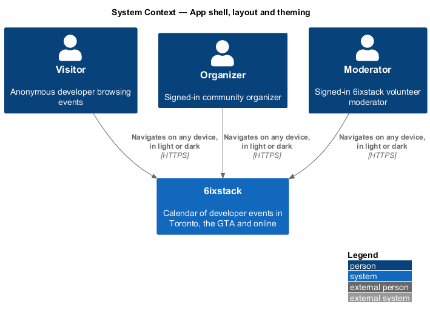
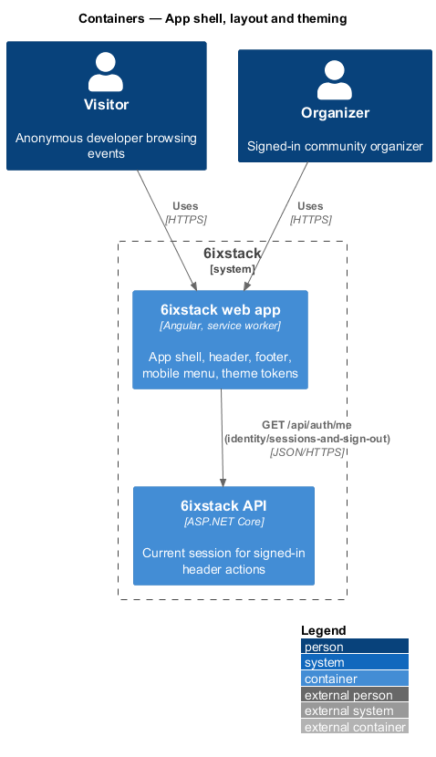
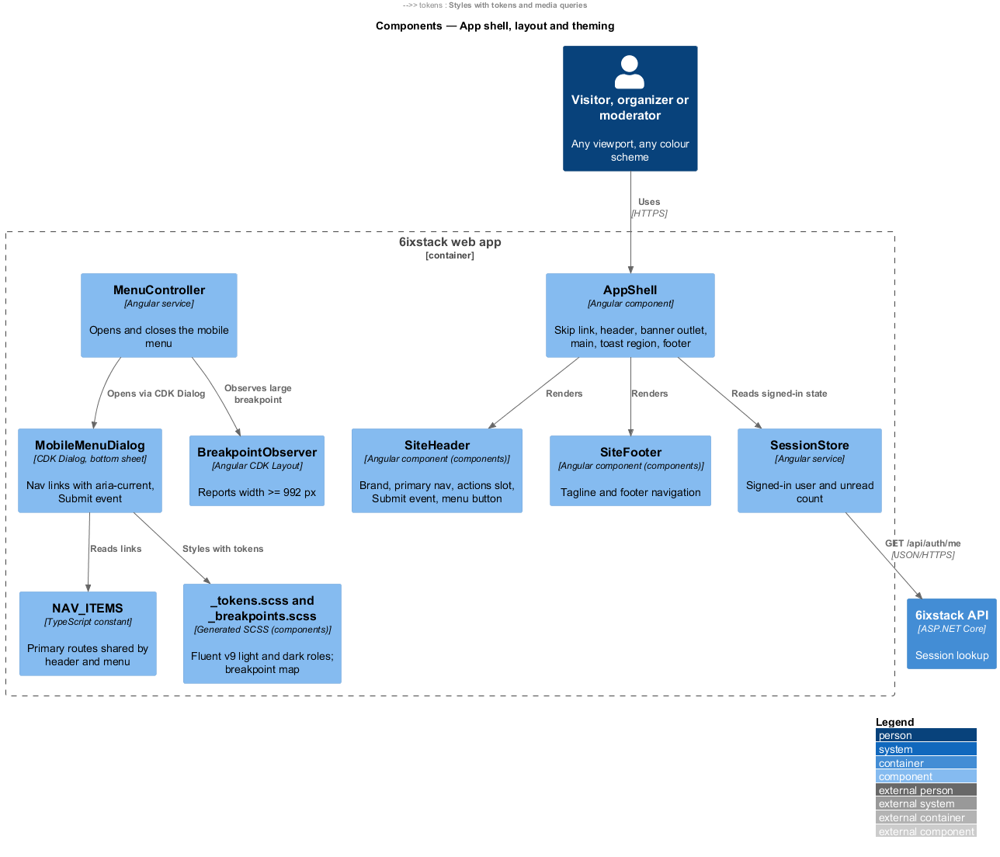
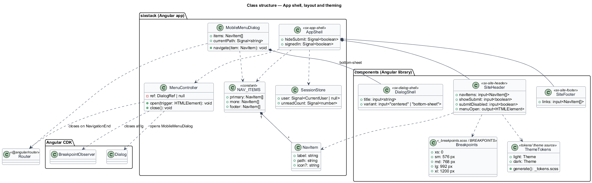
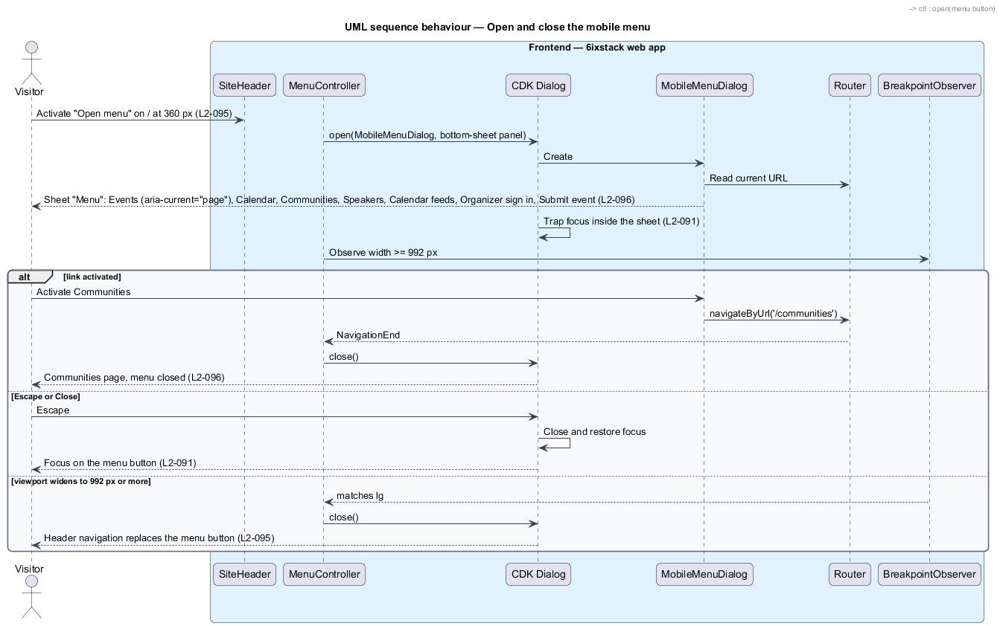
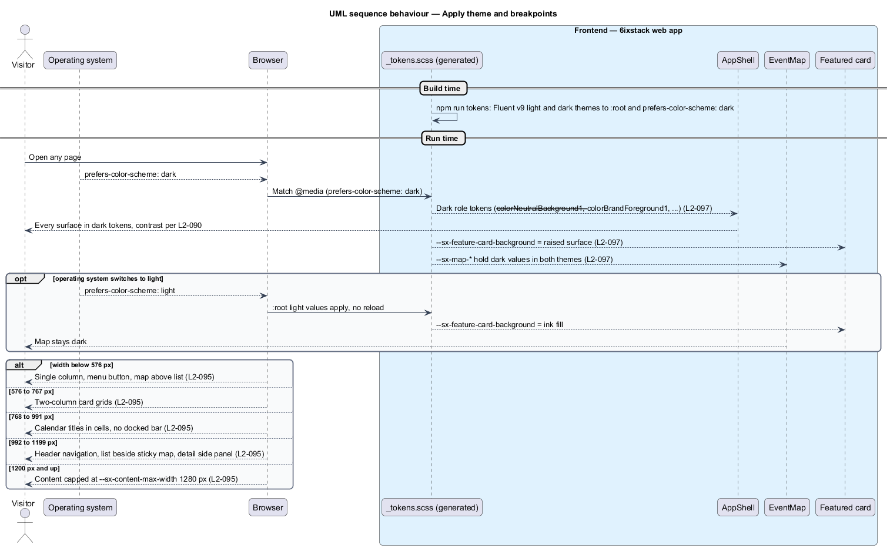

# App shell, layout and theming

## Overview

6ixstack is a calendar of developer events in Toronto, the Greater Toronto Area
(GTA) and online. Every page of the web app sits inside the same frame: a header
with the brand and navigation, a banner slot under it, the page content, and a
footer. This feature covers that frame, the phone menu that replaces the header
navigation on narrow screens, the breakpoints every page follows, and the light
and dark themes. The mocks draw the frame on every page and the menu in
`docs/mocks/dialogs/mobile-nav/`.

The feature belongs to the `site` subsystem. It is a frontend-only slice. The
signed-in header actions (notifications button and avatar, `L2-050`) belong to
`identity/sessions-and-sign-out`; the banner slot and the toast region it hosts
are filled by `site/toasts-and-banners`. Page-specific responsive behaviour,
such as the docked event bar or the calendar cells, belongs to the pages that
own it; this feature supplies the breakpoints they use.

Terms used in this design:

- **app shell** — header, banner slot, main region, toast region and footer shared by every page
- **breakpoint** — minimum viewport width at which a layout rule starts to apply
- **bottom sheet** — dialog anchored to the bottom edge of the viewport and spanning its width
- **design token** — named CSS custom property that carries one design decision, such as a colour role
- **colour scheme** — light or dark preference reported by the operating system through `prefers-color-scheme`

The breakpoints from `L2-095`:

| Name | Range | Shell and layout behaviour |
|------|-------|----------------------------|
| Extra small | below 576 px | Single column; menu button opens the bottom-sheet menu; map above the list; docked event actions |
| Small | 576 px and up | Two-column card grids |
| Medium | 768 px and up | Calendar titles in cells; no docked bar |
| Large | 992 px and up | Header navigation replaces the menu button; list beside a sticky map; detail pages with a side panel |
| Extra large | 1200 px and up | Content capped at 1280 px |

No width from 320 px upward scrolls horizontally. Wide content, such as the
organizer events table, scrolls inside its own container.

## Description

- **`AppShell`** (`sx-app-shell`) — root layout component in project `sixstack`.
  It renders the skip link ("Skip to content", target `#main`), `SiteHeader`,
  the `SiteBannerOutlet`, `<main id="main" class="page">` with the router
  outlet, the `ToastRegion` and `SiteFooter`. It reads route data
  `hideSubmit: true` on organizer and moderator routes and passes it to the
  header (`L2-050`).
- **`SiteHeader`** (`sx-site-header`) — component in project `components`. It
  keeps the mock's classes (`site-header`, `site-header__inner`,
  `site-header__nav`, `site-header__actions`, `site-header__menu`,
  `site-header__submit-label`). It shows the brand link (accessible name
  "6ixstack home"), the Primary navigation (Events, Calendar, Communities,
  Speakers) with `aria-current="page"` on the active link, a content slot for
  signed-in actions, the Submit event button, and the menu button ("Open menu").
  CSS hides the navigation and shows the menu button below 992 px. Below 576 px
  the Submit event button keeps its icon and accessible name and hides its text
  label.
- **`SiteFooter`** (`sx-site-footer`) — component in project `components`. It
  shows "Made in Toronto, for the people building in the 6ix." and the Footer
  navigation: About, Code of conduct, Contact, Calendar feeds, Organizer sign
  in.
- **`MobileMenuDialog`** — dialog in `frontend/projects/sixstack/src/app/dialogs/mobile-menu/`,
  opened with Angular CDK `Dialog` and styled as a bottom sheet through
  `DialogShell`. Its title is "Menu". It lists Events, Calendar, Communities and
  Speakers, then Calendar feeds and Organizer sign in, then a full-width Submit
  event action. The link for the current route carries `aria-current="page"`.
  CDK `Dialog` traps focus, closes on Escape and returns focus to the menu button
  (`L2-091`). Activating any link navigates and closes the dialog.
- **`MenuController`** — app service that opens `MobileMenuDialog` from the menu
  button. It closes the open menu on `NavigationEnd` and when CDK
  `BreakpointObserver` reports a width of 992 px or more, so the sheet never
  remains open beside the header navigation.
- **`NAV_ITEMS`** — constant list of primary routes shared by `SiteHeader` and
  `MobileMenuDialog`, so the two menus cannot drift.
- **`_breakpoints.scss`** — SCSS map in project `components` (`xs` 0, `sm`
  576 px, `md` 768 px, `lg` 992 px, `xl` 1200 px) with a `media-up($name)`
  mixin. CSS custom properties cannot appear in media queries, so breakpoints
  are SCSS values. `BREAKPOINTS` in TypeScript mirrors the same numbers for
  `BreakpointObserver`.
- **`--sx-content-max-width`** — component-scoped layout knob set to 1280 px
  and applied to `site-header__inner`, `.page` and `site-footer__inner`.
- **Theme tokens** — the Fluent UI v9 theme in
  `frontend/projects/components/src/lib/tokens/` defines a light and a dark
  theme for the 6ixstack brand ramp. `npm run tokens` generates
  `styles/_tokens.scss`, which emits the light values on `:root` and the dark
  values under `@media (prefers-color-scheme: dark)`. The document declares
  `<meta name="color-scheme" content="light dark">`. No in-app theme switch
  exists; the operating system preference decides (`L2-097`). Components read
  tokens by role, never by hex value.
- **Fixed-dark surfaces** — `EventMap` reads a separate set of map knobs
  (`--sx-map-*`) that hold dark values in both themes. The featured card reads
  `--sx-feature-card-background`, which maps to the ink fill in light and to a
  raised neutral surface in dark (`L2-097`). The exact Fluent token chosen for
  the raised surface is `<TO SUPPLY>`.

Open points the requirements leave undecided:

- `L2-096` lists "Organizer sign in" in the menu. The menu content for a
  signed-in organizer or moderator is `<TO SUPPLY>`.
- The header on extra-small screens shows brand, signed-in actions, Submit event
  and the menu button. Whether all of them fit at 320 px for a signed-in user is
  a visual check for the Playwright parity suite; no rule is stated.

## Requirements

| L2 ID | Refines (L1) | Requirement |
|-------|--------------|-------------|
| `L2-095` | `L1-022` | The site shall adapt at these breakpoints without horizontal scrolling at any width from 320 px: extra small (<576 px) single column, menu button opening a bottom-sheet menu, map above the list, docked event actions; small (>=576 px) two-column card grids; medium (>=768 px) calendar titles in cells and no docked bar; large (>=992 px) header navigation, list beside a sticky map, detail pages with a side panel; extra large (>=1200 px) content capped at 1280 px. |
| `L2-096` | `L1-022` | Below 992 px, the menu button shall open a bottom-sheet dialog with Events, Calendar, Communities, Speakers, Calendar feeds, Organizer sign in and a Submit event action, marking the current page. |
| `L2-097` | `L1-022` | The site shall follow the operating system colour scheme, render every screen in light and dark themes using design tokens, and keep the event map dark in both. |

## Diagrams

### System context

Every visitor, organizer and moderator meets the app shell first. The shell
needs no external system.

### Containers

The shell lives in the web app. It calls the API only through `SessionStore`
(`GET /api/auth/me`) to decide whether to show signed-in actions; the call
itself belongs to `identity/sessions-and-sign-out`.

### Components

`AppShell` composes `SiteHeader`, the banner outlet, the router outlet, the
toast region and `SiteFooter`. `MenuController` opens `MobileMenuDialog` through
CDK `Dialog` and closes it on navigation or when `BreakpointObserver` reports
the large breakpoint. Every component reads the generated theme tokens.

### Class structure

`SiteHeader` and `MobileMenuDialog` share `NAV_ITEMS`. `MenuController` depends
on CDK `Dialog`, `Router` and `BreakpointObserver`. The token pipeline turns the
Fluent theme into `_tokens.scss` with light and dark values.

### Behaviour — open and close the mobile menu

Below 992 px the menu button opens the bottom sheet with the current page
marked. A link navigates and closes the sheet. Escape closes it and returns
focus to the menu button. Widening the viewport past 992 px closes it.

### Behaviour — apply theme and breakpoints

The browser applies the light or dark token set from the operating system
preference without script, and re-applies it when the preference changes. Media
queries switch the layout at each breakpoint, and the event map keeps its dark
knobs in both themes.

