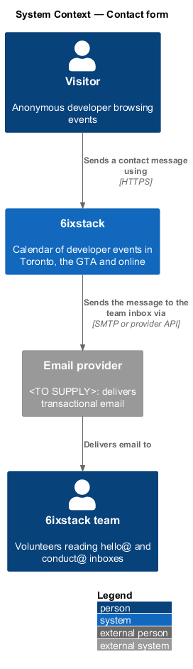
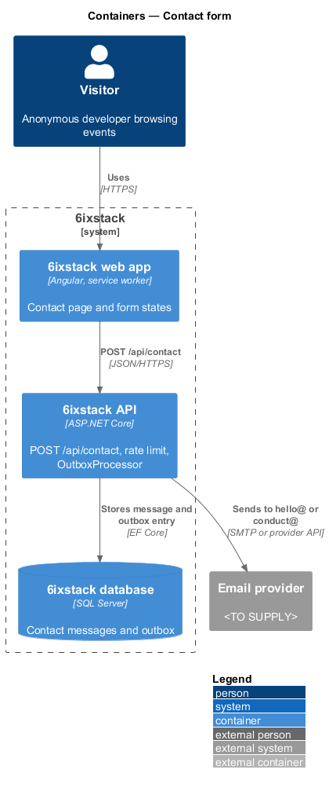
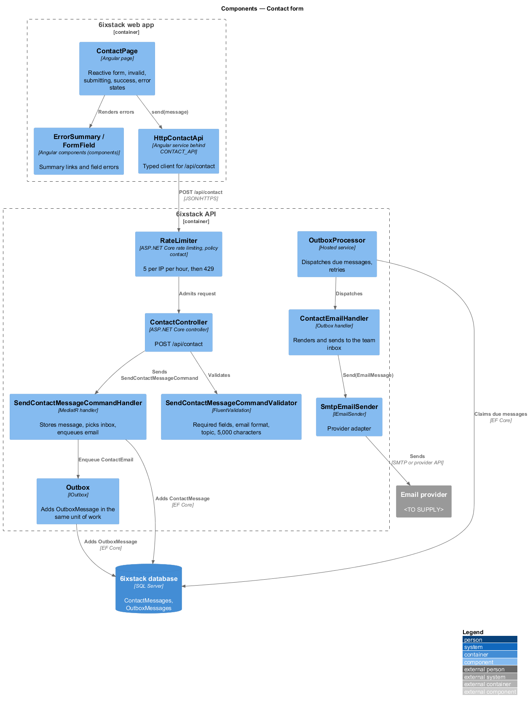
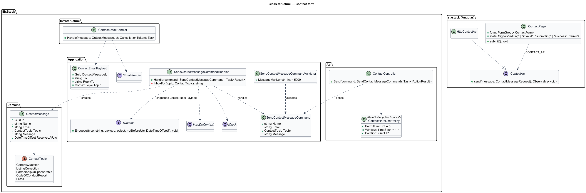
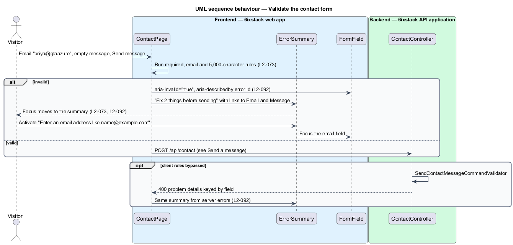
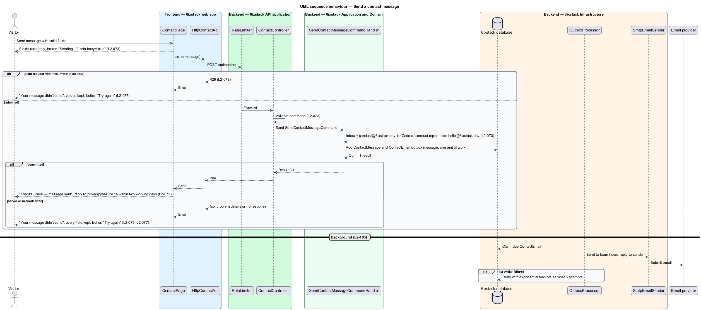

# Contact form

## Overview

6ixstack is a calendar of developer events in Toronto, the Greater Toronto Area
(GTA) and online, run by a small group of volunteers. The contact page at
`/contact` is how anyone reaches that team: a form for a name, an email, a topic
and a message, beside a list of other ways to get in touch. Its states are drawn
in `docs/mocks/pages/contact/`: default, invalid, submitting, success and error.

The feature belongs to the `site` subsystem. It runs from the Angular page to the
API, the database and, through the outbox, the email provider. Report a problem
on an event page (`submissions/report-problem`) is a separate and faster route
for wrong event details; the contact page points to it.

Terms used in this design:

- **contact message** — stored copy of one submitted contact form, delivered to the team by email
- **contact topic** — fixed category chosen on the form: General question, Listing correction, Partnership or sponsorship, Code of conduct report, Press
- **team inbox** — address a contact message is delivered to: `conduct@6ixstack.dev` for code of conduct reports, `hello@6ixstack.dev` for every other topic
- **error summary** — alert at the top of a form that lists each invalid field as a link to it (`L2-092`)

The page validates in the browser first and the API validates again. Sending
stores the message and queues its email in one transaction, then confirms to the
sender. The email itself leaves in the background (`L2-103`), so a slow email
provider never fails the form.

## Description

- **`ContactPage`** (`sx-contact-page`) — Angular page in project `sixstack` at
  `/contact`. Its title is "Contact" with the lead "Questions, corrections or
  ideas — a person reads every message." It holds a typed reactive form with
  `name`, `email`, `topic` (default General question) and `message`. The aside
  lists hello@6ixstack.dev ("We reply within two working days"),
  conduct@6ixstack.dev ("Code of conduct reports, answered within 24 hours")
  and "Wrong event details?" pointing to Report a problem. The page is a form
  page, not button-triggered editing, so it renders the form inline.
- **Page states**:
  - *invalid* — on a failed submit the page shows `ErrorSummary` titled
    "Fix 2 things before sending" (count-aware: "Fix 1 thing before sending"),
    moves focus to it, and links each item to its field. Each invalid control
    gets `aria-invalid="true"` and `aria-describedby` pointing to its message
    (`L2-092`). Messages from the mock: "Enter an email address like
    name@example.com" and "Write a message so we know how to help". The name
    message is `<TO SUPPLY>`.
  - *submitting* — the fieldset is disabled, so fields are read-only, and the
    button reads "Sending…" with `aria-busy="true"`. The button keeps its width
    so nothing moves.
  - *success* — the form is replaced by a `role="status"` panel: "Thanks,
    {first name} — message sent", "We’ll reply to {email} within two working
    days. Listing corrections are usually fixed the same day.", with Back to
    events and Send another message. How the first name is taken from the name
    field is `<TO SUPPLY>`.
  - *error* — a danger alert with `role="alert"` reads "Your message didn't
    send" and "6ixstack didn't respond. Nothing you wrote was lost — try again,
    or email hello@6ixstack.dev." Every field keeps its value and the button
    reads "Try again" (`L2-077`).
- **`ErrorSummary`**, **`FormField`**, **`Alert`** — components in project
  `components` that keep the mock's classes (`form-summary`, `field`,
  `field__error`, `alert--danger`, `success-panel`).
- **`ContactApi`** / **`CONTACT_API`** / **`HttpContactApi`** — API client
  contract, injection token and HTTP implementation in project `api`.
  `send(message)` posts to `/api/contact`.
- **`ContactController`** — ASP.NET Core controller exposing `POST /api/contact`
  to anonymous callers. The `contact` rate-limiting policy allows 5 requests per
  client IP address per hour and answers the sixth with 429 (`L2-073`). The
  controller holds no business rules. The page treats 429 like any other
  failure and shows the error state; dedicated copy for 429 is `<TO SUPPLY>`.
- **`SendContactMessageCommand`** — command carrying `Name`, `Email`, `Topic`
  and `Message`.
- **`SendContactMessageCommandValidator`** — FluentValidation rules: name
  required; email required and a valid address; topic one of the five
  `ContactTopic` values; message required and at most 5,000 characters. Maximum
  lengths for name and email are `<TO SUPPLY>`. A failure returns 400
  validation problem details keyed by field.
- **`SendContactMessageCommandHandler`** — MediatR handler. It adds a
  `ContactMessage`, picks the team inbox from the topic, and calls
  `IOutbox.Enqueue` with a `ContactEmailPayload`. Both commit in one unit of
  work. The email's reply-to is the sender's address.
- **`ContactTopic`** — enumeration `GeneralQuestion`, `ListingCorrection`,
  `PartnershipOrSponsorship`, `CodeOfConductReport`, `Press`.
- **`ContactMessage`** — domain entity (`Id`, `Name`, `Email`, `Topic`,
  `Message`, `ReceivedAtUtc`). Its email is visible only to moderators
  (`L2-099`), and the message is deleted after 1 year (`L2-100`,
  `platform/privacy-and-retention`).
- **`ContactEmailHandler`** — outbox handler that renders and sends the message
  to the team inbox through `IEmailSender`. Retries follow `RetrySchedule`: at
  most 5 attempts with exponential backoff (`L2-103`).

Whether the form draft survives a page reload is not stated in the
requirements; this design keeps the values only for the life of the page.

## Requirements

| L2 ID | Refines (L1) | Requirement |
|-------|--------------|-------------|
| `L2-073` | `L1-016` | The contact page (`/contact`) shall accept name (required), email (required, valid), topic (General question, Listing correction, Partnership or sponsorship, Code of conduct report, Press) and message (required, up to 5,000 characters), deliver it to hello@6ixstack.dev (or conduct@6ixstack.dev for code of conduct reports), and list other ways to reach the team. |

## Diagrams

### System context

A visitor sends a message to the 6ixstack team. 6ixstack delivers it to the team
inbox through the email provider.

### Containers

The web app posts the form to the API. The API stores the message and its
outbox entry in the database. The `OutboxProcessor` in the API later sends the
email through the provider.

### Components

`ContactPage` validates and sends through `HttpContactApi`. `ContactController`
applies the rate limit and the validator, then sends the command. The handler
stores the `ContactMessage` and enqueues the email that `OutboxProcessor` and
`ContactEmailHandler` deliver.

### Class structure

`SendContactMessageCommandHandler` handles `SendContactMessageCommand`, creates
a `ContactMessage` and enqueues a `ContactEmailPayload` through `IOutbox`.
`ContactPage` depends on the `ContactApi` contract through `CONTACT_API`.

### Behaviour — validate the form

A submit with an invalid email and an empty message stops in the browser. Focus
moves to the error summary, and each item links to its field.

### Behaviour — send a message

A valid submit disables the fields and shows "Sending…". Success shows the
confirmation; a server error, network error or 429 keeps every value and offers
Try again. The email to the team inbox leaves in the background.

## Decisions (journey 28)

- **Endpoint**: `POST /api/contact`, anonymous. It answers 202 with the first name and reply address, 400 with field
  errors, or 429 after five messages an hour from one IP address (`Contact:PerIpPerHour`).
- **Topics** (API values): `general`, `listing`, `partnership`, `conduct` and `press`.
- **Delivery**: each message is stored (`ContactMessage`) and emailed through the outbox, so a provider failure is
  retried and never loses the message. It goes to hello@6ixstack.dev, or conduct@6ixstack.dev for code of conduct
  reports, with the sender's address as the reply-to line in the body.
- **Validation messages** follow the mocks ("Enter an email address like name@example.com", "Write a message so we
  know how to help"). The summary reads "Fix {n} things before sending".
- **Retention**: contact messages are kept for a year (L2-100). The deletion job joins with the retention work
  deferred in journey 26.

