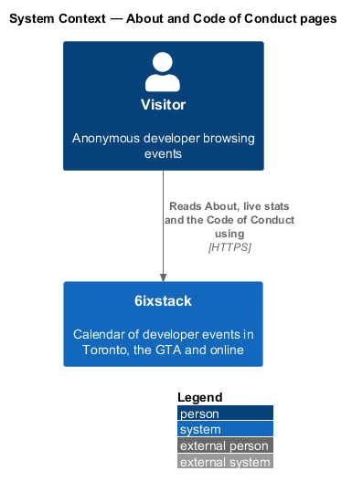
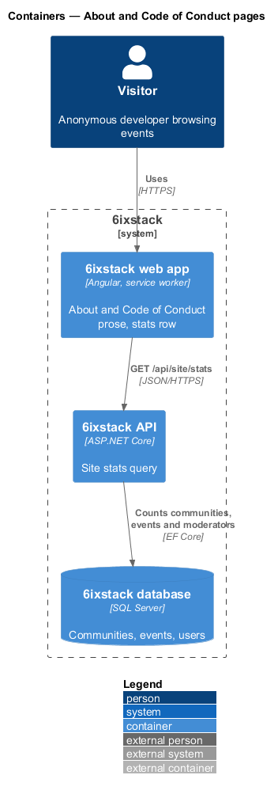
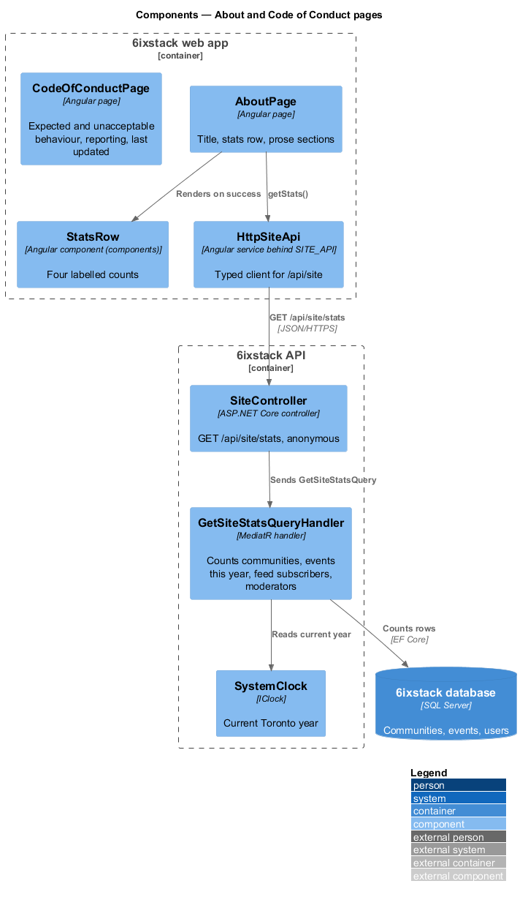
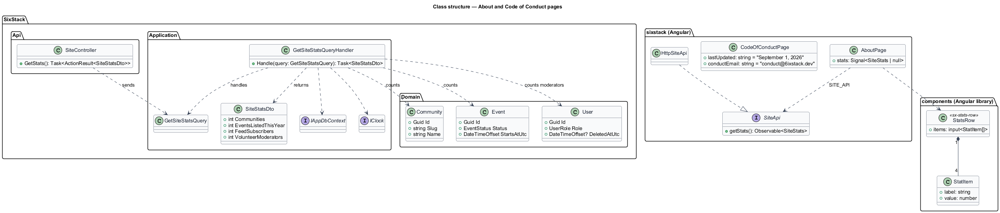
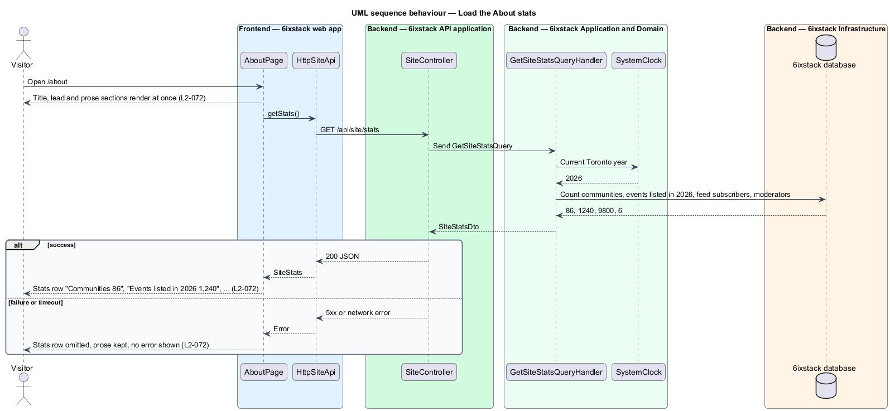

# About and Code of Conduct pages

## Overview

6ixstack is a calendar of developer events in Toronto, the Greater Toronto Area
(GTA) and online. Two pages explain the site itself rather than its events. The
About page at `/about` says what 6ixstack is, how listings are reviewed, what it
does not do and who runs it, with a row of live numbers. The Code of Conduct
page at `/code-of-conduct` states the behaviour every listed event agrees to and
how to report a concern. Both are drawn in `docs/mocks/pages/about/` and
`docs/mocks/pages/code-of-conduct/`.

The feature belongs to the `site` subsystem. Both pages render inside the app
shell (`site/app-shell`) and are linked from its footer. Report a problem, which
the Code of Conduct page points to, belongs to `submissions/report-problem`.

Terms used in this design:

- **static content** — prose shipped inside the web app bundle, with no data request before it can render
- **stats row** — row of four live counts on the About page: communities, events listed this year, feed subscribers and volunteer moderators

The prose on both pages is static content. Only the stats row on About is
loaded from the API. A failed stats load omits the row and leaves the prose in
place, with no error message (`L2-072`). Static content cannot fail on its own,
so neither page has an empty or error state; a server failure while loading the
web app itself shows the server-error page (`site/status-pages`).

## Description

- **`AboutPage`** (`sx-about-page`) — Angular page in project `sixstack` at
  `/about`. Its title block reads "About 6ixstack" with the lead "Made in
  Toronto, for the people building in the 6ix." It renders the stats row and the
  prose sections "How listings work", "What we don’t do" and "Who runs it" from
  the mock, with a link to `/contact`. The stats row appears only after a
  successful load.
- **`StatsRow`** (`sx-stats-row`) / **`Stat`** — components in project
  `components` that keep the mock's classes (`stats-row`, `stat`,
  `stat__label`, `stat__value`). Values are formatted with the `en-CA` number
  format ("1,240").
- **`CodeOfConductPage`** (`sx-code-of-conduct-page`) — Angular page at
  `/code-of-conduct`. Its lead reads "Applies to every event listed on 6ixstack,
  in person and online." It renders the sections "Expected behaviour", "Not
  acceptable", "Reporting", "What happens next" and the last-updated line
  ("Last updated September 1, 2026"). The conduct address is a
  `mailto:conduct@6ixstack.dev` link. The Reporting section explains that
  Report a problem, with the "Code of conduct concern" reason, is on every event
  page. The last-updated date is a constant beside the page content, changed in
  the same commit as the text.
- **`SiteApi`** / **`SITE_API`** / **`HttpSiteApi`** — API client contract,
  injection token and HTTP implementation in project `api`. `getStats()` calls
  `GET /api/site/stats`.
- **`SiteController`** — ASP.NET Core controller exposing `GET /api/site/stats`
  to anonymous callers. It dispatches the query and holds no business rules.
- **`GetSiteStatsQuery`** / **`GetSiteStatsQueryHandler`** — MediatR handler
  that computes the four counts in one round trip:
  - `Communities` — number of `Community` rows.
  - `EventsListedThisYear` — published events counted for the current Toronto
    calendar year, read from `SystemClock`. Whether "listed this year" counts by
    approval date or by start date is `<TO SUPPLY>`.
  - `FeedSubscribers` — total feed subscribers. How subscribers to anonymous
    `.ics` feeds are counted is `<TO SUPPLY>`, and is owned by
    `feeds-and-sharing/serve-calendar-feed`.
  - `VolunteerModerators` — users with role `Moderator` and no `DeletedAtUtc`.
- **`SiteStatsDto`** — response contract with the four integers.
- **Response caching** — the stats change slowly, so the endpoint may send a
  short `Cache-Control` max-age. The duration is `<TO SUPPLY>`.

While the stats request is pending, the row is not drawn. Whether the row
reserves its height during loading, to keep layout shift at 0 under `L2-089`,
is `<TO SUPPLY>`.

## Requirements

| L2 ID | Refines (L1) | Requirement |
|-------|--------------|-------------|
| `L2-072` | `L1-016` | The About page (`/about`) shall describe 6ixstack, how listings work, what it does not do and who runs it, with live stats for communities, events listed this year, feed subscribers and volunteer moderators. The Code of Conduct page (`/code-of-conduct`) shall state expected and unacceptable behaviour, how to report (conduct@6ixstack.dev or Report a problem), what happens next and its last-updated date. |

## Diagrams

### System context

A visitor reads the About and Code of Conduct pages in 6ixstack. No external
system takes part.

### Containers

The web app ships both pages' prose. Only About calls the API, for
`GET /api/site/stats`, which reads counts from the database.

### Components

`AboutPage` requests stats through `HttpSiteApi`. `SiteController` sends
`GetSiteStatsQuery` to its handler, which reads the clock and counts rows.
`CodeOfConductPage` has no dependencies beyond the shell.

### Class structure

`GetSiteStatsQueryHandler` returns a `SiteStatsDto`. `AboutPage` depends on the
`SiteApi` contract through `SITE_API` and renders a `StatsRow`.

### Behaviour — load the About stats

The prose renders at once. A successful stats response adds the row of four
numbers. Any failure leaves the row out and shows no error.

## Decisions (journey 29)

- **Events listed this year** counts published events that start in the current Toronto calendar year, so the
  number matches what the calendar shows for the year. The response carries `year`, and the label reads "Events
  listed in {year}".
- **Feed subscribers** is the sum of each community's `FeedSubscriberCount`. Anonymous `.ics` subscribers are not
  counted until `feeds-and-sharing/serve-calendar-feed` records them.
- **Volunteer moderators** counts users with role `Moderator`. Deleted accounts are removed outright (journey 26),
  so no `DeletedAtUtc` filter is needed.
- **Caching**: `Cache-Control: public, max-age=300`.
- **Loading**: the row is not drawn until the stats arrive and is omitted if they fail. The prose renders at once.
- **Report a problem** is named in plain text on the Code of Conduct page: the dialog reports a specific event, so
  it opens from an event page, as the sentence says.

