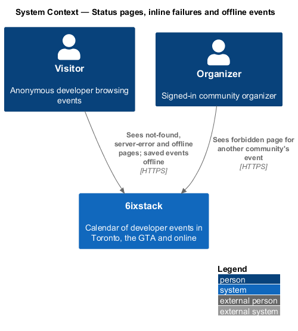
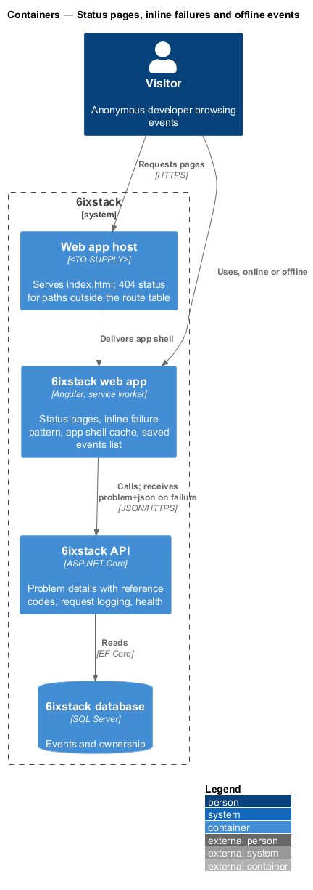
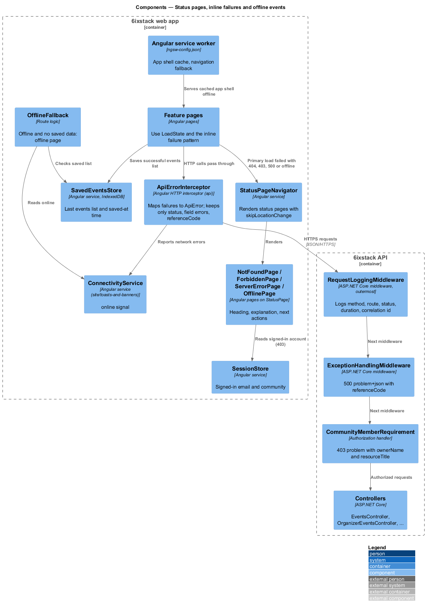
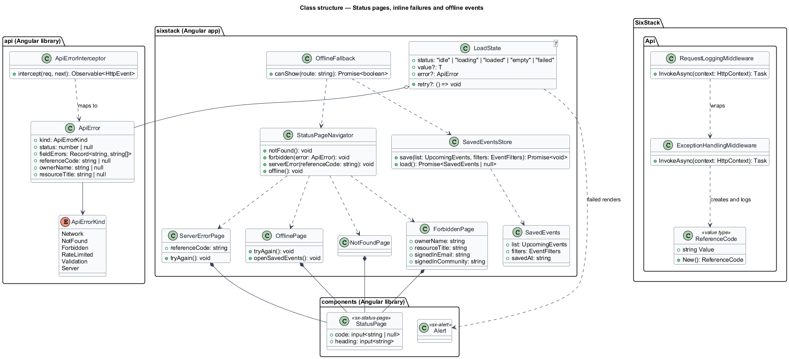
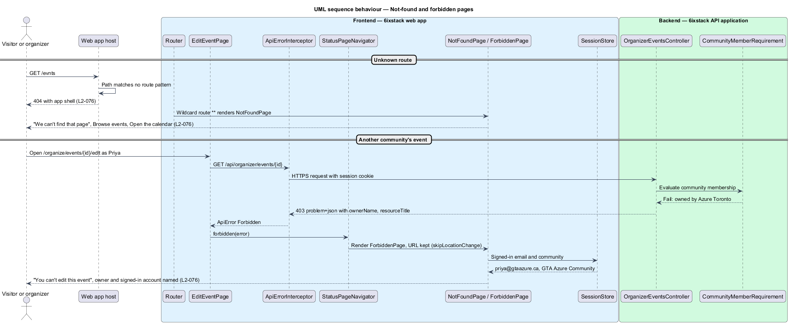
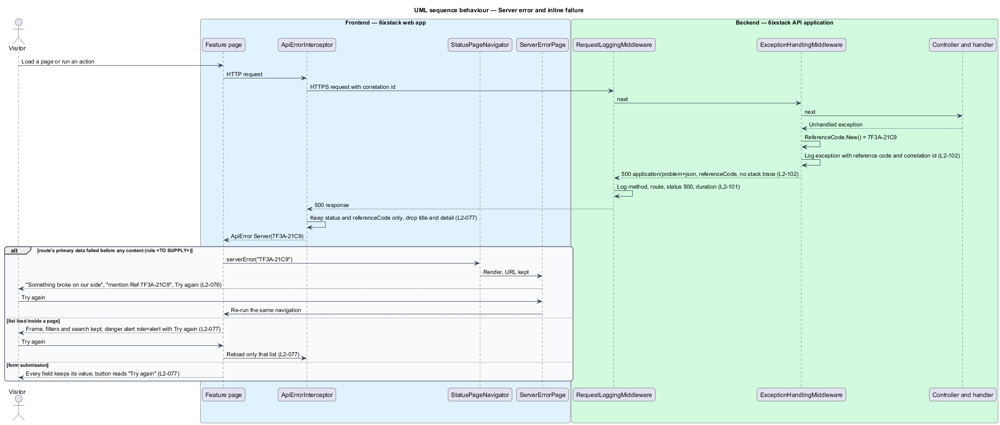
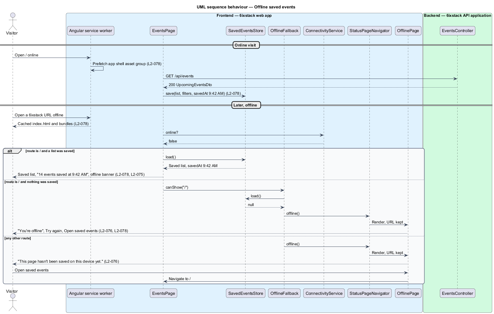

# Status pages, inline failures and offline events

## Overview

6ixstack is a calendar of developer events in Toronto, the Greater Toronto Area
(GTA) and online. Some requests cannot show the page that was asked for: the
address does not exist, the signed-in user may not open it, the server failed,
or the device is offline. This feature covers the four full-page answers to
those cases, the shared pattern every page uses when one list or one action
fails, and the offline cache that keeps the last events list readable without a
connection. The pages are drawn in `docs/mocks/pages/not-found/`,
`docs/mocks/pages/forbidden/`, `docs/mocks/pages/server-error/` and
`docs/mocks/pages/offline/`.

The feature belongs to the `site` subsystem. The banners that accompany offline
and unreachable states belong to `site/toasts-and-banners`; problem details,
reference codes and request logging on the API side are specified in `L2-101`
and `L2-102` and designed in `platform/observability`. This feature shows how
the web app consumes them.

Terms used in this design:

- **status page** — full page in the app shell that replaces the requested page's content with a code, a heading, an explanation and next actions
- **inline failure** — failure of one list load or one action that is shown inside the page, keeping its frame and input
- **reference code** — short code such as `7F3A-21C9` that the API logs with an unhandled exception and returns in problem details
- **app shell cache** — service-worker cache of the web app's HTML, scripts, styles, fonts and icons
- **saved events list** — last events list a visitor loaded successfully, stored on the device with the time it was saved

The four status pages and their copy from the mocks:

| Page | Heading | Actions |
|------|---------|---------|
| Not found (404) | "We can't find that page" | Browse events, Open the calendar |
| Forbidden (403) | "You can't edit this event" — names the owning community and the signed-in account | Back to your events, Use another account, Contact us |
| Server error (500) | "Something broke on our side" — "mention Ref 7F3A-21C9" | Try again, Go to events |
| Offline | "You're offline" — "This page hasn't been saved on this device yet." | Try again, Open saved events |

## Description

### Status pages (web app)

- **`StatusPage`** (`sx-status-page`) — component in project `components` that
  keeps the mock's classes (`status-page`, `status-page__code`). The large code
  ("404.") is decorative and hidden from assistive technology; the `<h1>` holds
  the heading.
- **`NotFoundPage`** (`sx-not-found-page`) — app page bound to the wildcard
  route `**`. Detail pages also show it when their load returns 404, for
  example an event removed by its organizer.
- **`ForbiddenPage`** (`sx-forbidden-page`) — app page shown when an API call
  returns 403 for a signed-in user. It reads the owning community and the
  resource title from the problem details extensions `ownerName` and
  `resourceTitle`, and the signed-in email and community from `SessionStore`.
  The API's `CommunityMemberRequirement` handler supplies those extensions;
  their exact field names are this design's proposal.
- **`ServerErrorPage`** (`sx-server-error-page`) — app page that shows the
  `referenceCode` from the 500 problem details in the sentence "If it keeps
  happening, email hello@6ixstack.dev and mention Ref {code}." Try again
  re-runs the navigation that failed.
- **`OfflinePage`** (`sx-offline-page`) — app page shown when the device is
  offline and the requested page has no saved data. Try again re-runs the
  navigation. Open saved events navigates to `/`.
- **`StatusPageNavigator`** — app service with `notFound()`,
  `forbidden(problem)`, `serverError(referenceCode)` and `offline()`. Each
  renders the status page with `skipLocationChange`, so the address bar keeps
  the requested URL and Try again or a reload repeats it.
- **`ApiErrorInterceptor`** — HTTP interceptor in project `api`. It maps each
  failed response to a typed `ApiError` (`Network`, `NotFound`, `Forbidden`,
  `RateLimited`, `Validation`, `Server`). It keeps only the status, the field
  errors and the `referenceCode`; it discards server `title` and `detail` text,
  so no exception type or internal identifier reaches the screen (`L2-077`).
  It also reports `Network` errors to `ConnectivityService`.
- **HTTP 404 for unknown routes** — `L2-076` requires status 404 for an unknown
  route, which a single-page app cannot set by itself. The host that serves
  `index.html` shall answer paths outside the route table with status 404 and
  the app shell, which then renders `NotFoundPage`. The build emits the route
  table as a list of path patterns for the host. The hosting arrangement for the
  web app is `<TO SUPPLY>`. A known route whose entity does not exist, such as
  an unknown event slug, renders `NotFoundPage` client-side; whether that
  document also needs status 404 is `<TO SUPPLY>`.

### Inline failure pattern (web app)

- **`LoadState<T>`** — discriminated union used by every list and form:
  `idle`, `loading`, `loaded`, `empty`, `failed`. `failed` carries the
  `ApiError` and a `retry` callback that reloads only that region.
- **Rules every page follows** (`L2-077`):
  - The page frame, header, filters and search keep their values; only the
    failing region shows the failure.
  - The failure renders as `Alert` kind danger with `role="alert"`, a plain
    title in the "We couldn’t load …" form, a sentence that does not blame the
    user, and a Try again action.
  - A failed form submit never resets the form; the submit button reads "Try
    again".
  - No message shows a stack trace, exception type or internal identifier; a
    reference code is the only identifier shown.
- Each feature supplies its own copy; this feature supplies the pattern and the
  error mapping.

Which failures show `ServerErrorPage` instead of an inline failure is not fixed
by the requirements. `L2-077` requires every failed load to keep the page frame,
while `L2-076` requires a 500 page for an unhandled server error. This design
shows `ServerErrorPage` only when a route's primary data fails with 500 before
any page content exists, and the inline pattern otherwise; the rule is
`<TO SUPPLY>` for confirmation.

### Offline cache (web app)

- **`ngsw-config.json`** — Angular service worker configuration. An `app` asset
  group prefetches the app shell (index, scripts, styles); an `assets` group
  lazily caches fonts and icons. Navigation requests fall back to the cached
  `index.html`, so the app starts offline (`L2-078`).
- **`SavedEventsStore`** — app service over IndexedDB. After each successful
  first-page load, `EventsPage` calls `save(result, filters)` with the time
  saved, replacing the previous entry. `load()` returns the saved list and its
  `savedAt` time. Storage holds only this functional cache (`L2-098`). Whether
  a saved list is shown when the offline visitor's filters differ from the
  saved filters is `<TO SUPPLY>`; this design shows the saved list with its own
  filters.
- **`OfflineFallback`** — route-level logic. When `ConnectivityService.online` is
  `false` and the route has no saved data, it calls `StatusPageNavigator.offline()`.
  Only `/` has saved data. Event detail and other pages are not cached
  (`L2-078`).

When no events list has ever been saved, Open saved events leads to `/`, which
then shows the offline page again. The intended behaviour of that action in this
case is `<TO SUPPLY>`.

### API side

- **`ExceptionHandlingMiddleware`** — catches unhandled exceptions, creates a
  reference code with `ReferenceCode.New()`, logs the exception with that code
  and the correlation id, and returns `application/problem+json` with status
  500, a `referenceCode` extension and no stack trace (`L2-102`).
- **`RequestLoggingMiddleware`** — outermost middleware, so it records the
  handled 500 status (`L2-101`).
- **`ReferenceCode`** — value type formatting 32 random bits as two groups of
  four upper-case hexadecimal digits (`7F3A-21C9`).
- **`HealthChecks`** — `GET /health/live`, used by `ConnectivityService`.

"We've been notified" on the server-error page implies alerting on unhandled
errors; the alerting channel is `<TO SUPPLY>`.

## Requirements

| L2 ID | Refines (L1) | Requirement |
|-------|--------------|-------------|
| `L2-076` | `L1-017` | The site shall show a not-found page (404) with "Browse events" and "Open the calendar", a forbidden page (403) that names the owner and the signed-in account, a server-error page (500) with "Try again" and a reference code, and an offline page for unsaved pages with "Try again" and "Open saved events". |
| `L2-077` | `L1-017` | Every failed load or action shall keep the page frame, keep the user's filters and input, explain the failure in plain language without blaming the user, and offer a retry. |
| `L2-078` | `L1-017` | The site shall cache the application shell and the last events list a visitor opened so they are available offline. |

## Diagrams

### System context

Visitors and signed-in users see a status page when a page cannot be shown. No
external system takes part.

### Containers

The web app and its service worker render status pages and keep the offline
cache. The API returns problem details with reference codes and logs them.

### Components

`ApiErrorInterceptor` maps failures to `ApiError`. Pages either render the
inline pattern or ask `StatusPageNavigator` for a status page. The service
worker and `SavedEventsStore` keep the shell and the last list. In the API,
`ExceptionHandlingMiddleware` creates the reference code inside
`RequestLoggingMiddleware`.

### Class structure

`ApiError` is the single failure type the pages see. `LoadState` carries it for
inline failures. `StatusPageNavigator` renders the four status pages, each built
on `StatusPage`.

### Behaviour — not found and forbidden

An unknown path returns status 404 from the host and renders `NotFoundPage`. An
organizer opening another community's event receives 403 with the owner's name,
and `ForbiddenPage` names both the owner and the signed-in account.

### Behaviour — server error and inline failure

An unhandled exception becomes a 500 problem response with a logged reference
code. A failed route load shows `ServerErrorPage` with that code; a failed list
or action inside a page keeps the frame and input and offers Try again.

### Behaviour — offline saved events

Online visits save the app shell and the last events list. Offline, `/` shows
the saved list with the offline banner; a page with no saved data shows the
offline page.

