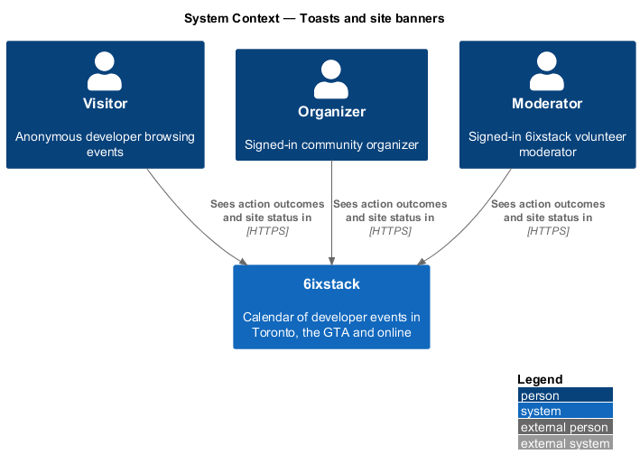
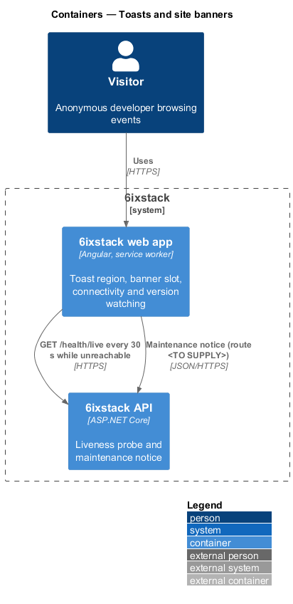
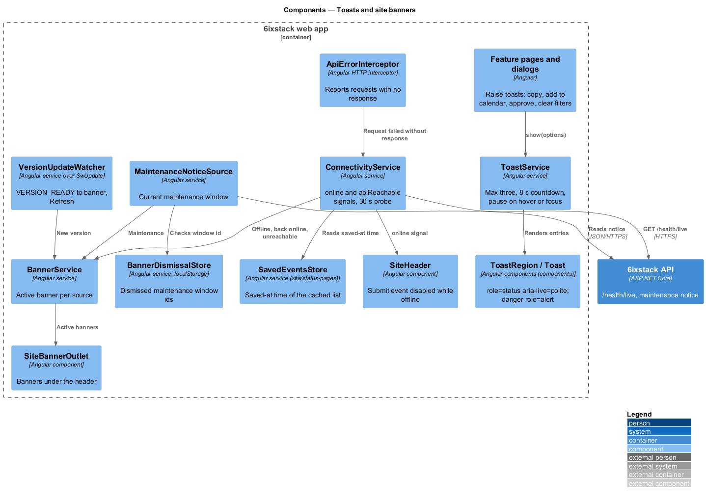
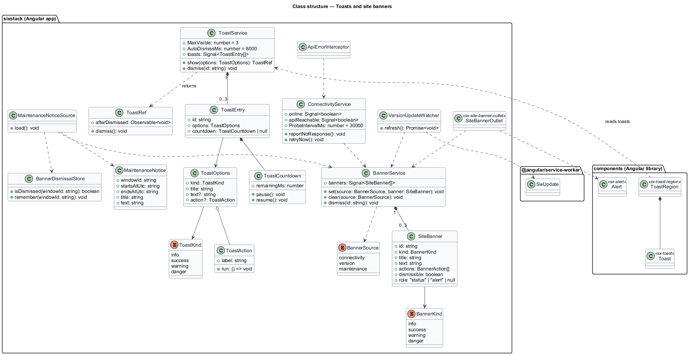
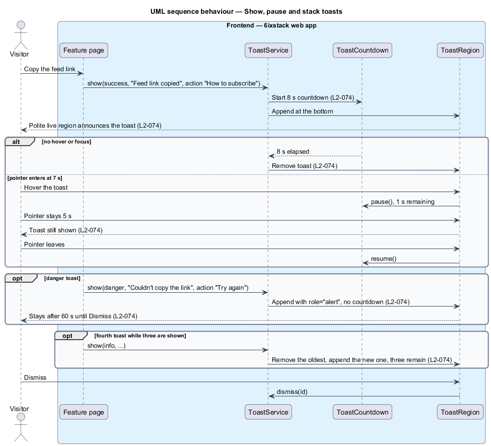
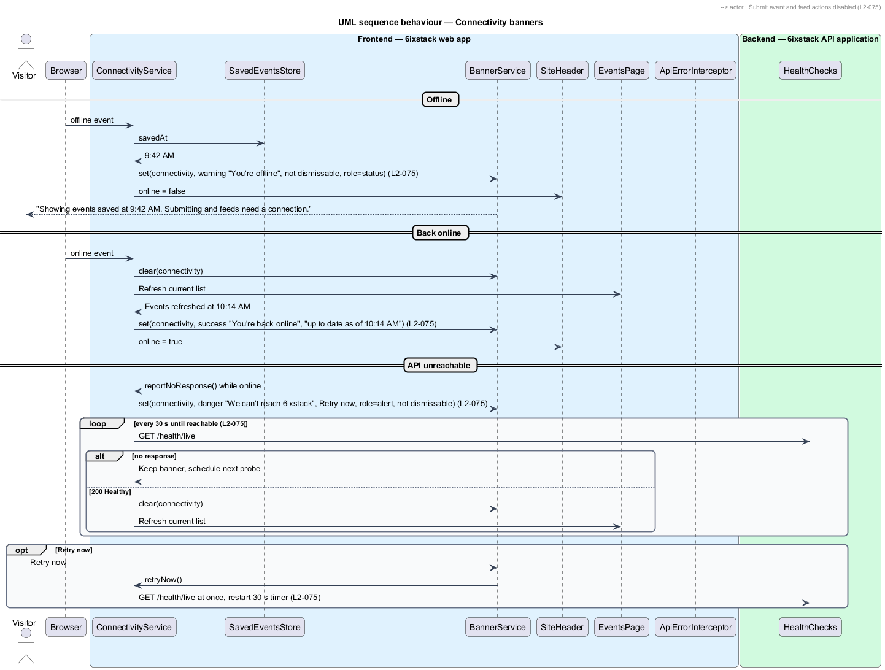
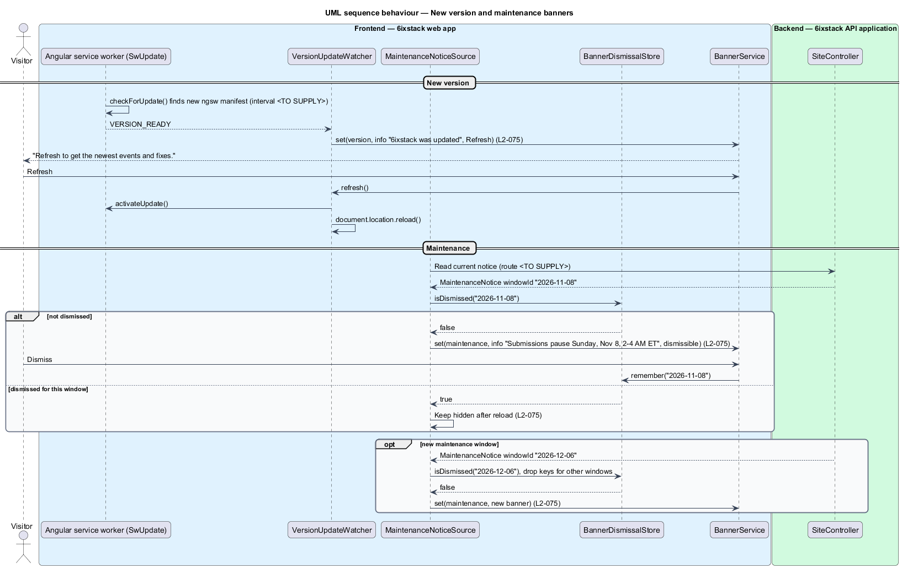

# Toasts and site banners

## Overview

6ixstack is a calendar of developer events in Toronto, the Greater Toronto Area
(GTA) and online. The web app tells people about outcomes and conditions in two
ways that sit outside any one page's content. A toast is a short message about
something that just happened, such as "Feed link copied". A site banner is a
message about the state of the whole site, such as being offline or a new
version. The toasts are drawn in `docs/mocks/notifications/app-toast/` and the
banners in `docs/mocks/notifications/site-banner/`.

The feature belongs to the `site` subsystem and is frontend-only apart from a
reachability probe and the maintenance notice it reads from the API. The app
shell (`site/app-shell`) hosts the toast region and the banner slot; every other
feature raises toasts through `ToastService`. Inline alerts tied to one page
(event status alerts, submission banners) belong to the pages that show them.
The offline cache and the offline page belong to `site/status-pages`.

Terms used in this design:

- **toast** — transient message in the toast region with a kind, a title, optional text, an optional action and a Dismiss button
- **toast kind** — one of info, success, warning, danger; sets icon, colour and dismissal rules
- **toast region** — fixed container in the app shell, `role="status"` with `aria-live="polite"`, that holds up to three toasts
- **site banner** — full-width alert directly under the header that describes a site-wide condition
- **maintenance window** — announced period during which some functions pause, identified by an id
- **API unreachable** — condition in which the browser is online but requests to the 6ixstack API fail without a response

Toast rules from `L2-074`: non-danger toasts dismiss themselves after 8 s, and
the countdown pauses while the pointer is over the toast or focus is inside it.
Danger toasts use `role="alert"` and stay until dismissed. At most three toasts
show, newest at the bottom; a fourth removes the oldest.

The five banners from `L2-075`:

| Banner | Kind | Copy (from the mocks) | Dismissable | Role |
|--------|------|-----------------------|-------------|------|
| New version | info | "6ixstack was updated" — "Refresh to get the newest events and fixes." with Refresh | Yes | none |
| Offline | warning | "You're offline" — "Showing events saved at 9:42 AM. Submitting and feeds need a connection." | No | `status` |
| Back online | success | "You're back online" — "Events are up to date as of 10:14 AM." | Yes | `status` |
| API unreachable | danger | "We can't reach 6ixstack" — "Retrying in 30 seconds. The events below may be out of date." with Retry now | No | `alert` |
| Maintenance | info | "Submissions pause Sunday, Nov 8, 2–4 AM ET" — "Browsing and feeds keep working during maintenance." | Yes, remembered for that window | none |

## Description

### Toasts

- **`ToastService`** — root Angular service in project `sixstack`.
  `show(options)` appends a toast and returns a `ToastRef`. When three toasts
  are already shown, it removes the oldest first (`L2-074`). It starts an 8 s
  countdown for every kind except danger.
- **`ToastOptions`** — `kind`, `title`, optional `text`, optional `action`
  (`label` and a callback, such as Undo or Try again).
- **`ToastRef`** — handle with `dismiss()` and an `afterDismissed` observable,
  used by callers such as approval Undo (`moderation/approve-submission`).
- **`ToastCountdown`** — per-toast timer that tracks remaining time. `pause()`
  runs on `mouseenter` and `focusin`; `resume()` runs on `mouseleave` and on
  `focusout` when focus leaves the toast. Resuming continues from the remaining
  time, so a toast hovered at 7 s stays while hovered and then has 1 s left.
- **`ToastRegion`** (`sx-toast-region`) — component in project `components`
  rendered once by `AppShell`. It is present from start-up so screen readers
  register the live region before any toast arrives. It keeps the mock class
  `toast-region` and stacks toasts 12 px apart, newest last.
- **`Toast`** (`sx-toast`) — component in project `components` that keeps the
  mock's classes (`toast`, `toast--info|success|warning|danger`, `toast__body`,
  `toast__title`, `toast__text`, `toast__action`, `toast__progress`). A danger
  toast sets `role="alert"` and has no progress bar. Under reduced motion the
  progress bar does not animate (`L2-094`). Dismiss is a button with the
  accessible name "Dismiss".

The toast mock notes that older toasts "collapse into the notification history".
`L2-074` says only that the oldest is removed, and no toast history appears in
any requirement or mock. A toast history is `<TO SUPPLY>`; this design removes
the oldest toast.

### Banners

- **`BannerService`** — root Angular service holding the active banner for each
  source: connectivity, version and maintenance. `set(source, banner)` and
  `clear(source)` update it. Whether several sources show at once, stacked, or
  only the most severe is `<TO SUPPLY>`; this design renders the active banners
  in the order connectivity, version, maintenance.
- **`SiteBanner`** — model with `id`, `kind`, `title`, `text`, `actions`,
  `dismissible` and `role`.
- **`SiteBannerOutlet`** (`sx-site-banner-outlet`) — app component rendered by
  `AppShell` between the header and `<main>`. It renders each banner with
  `Alert` and the mock class `site-banner`. Only dismissable banners render the
  Dismiss button.
- **`ConnectivityService`** — root service exposing `online` and
  `apiReachable` signals.
  - `online` follows the browser `online` and `offline` events. While it is
    `false`, the service sets the offline banner with the saved time from
    `SavedEventsStore` (`site/status-pages`). The header's Submit event button
    and every feed action read `online` and are disabled (`L2-075`).
  - When the browser comes back online, the service clears the offline banner
    and asks the current page to refresh. When the events list refreshes, the
    service sets the back-online banner with the refresh time from
    `TorontoTimeFormatter`. How long that banner stays is `<TO SUPPLY>`.
  - `ApiErrorInterceptor` reports a request that fails with no response while
    `online` is `true`. The service then sets `apiReachable` to `false`, shows
    the API-unreachable banner, and probes `GET /health/live` every 30 s.
    Retry now probes at once and restarts the 30 s timer. A successful probe
    clears the banner and refreshes the current page. Whether 5xx responses
    also count as unreachable is `<TO SUPPLY>`.
- **`VersionUpdateWatcher`** — service over the Angular service worker's
  `SwUpdate`. On a `VERSION_READY` event it sets the new-version banner. Refresh
  calls `activateUpdate()` and then reloads the document. The interval of
  `checkForUpdate()` calls is `<TO SUPPLY>`.
- **`MaintenanceNoticeSource`** — reads the current maintenance notice
  (`MaintenanceNotice`: `WindowId`, `StartsAtUtc`, `EndsAtUtc`, `Title`,
  `Text`) at start-up. Neither the requirements nor the brief name its source;
  this design assumes a `SiteController` endpoint whose route is `<TO SUPPLY>`.
- **`BannerDismissalStore`** — remembers a dismissed maintenance banner in
  `localStorage` under a key that includes the `WindowId`. A reload in the same
  window keeps the banner hidden; a new `WindowId` shows a new banner
  (`L2-075`). Keys for other windows are removed on read. Banner dismissals are
  functional storage permitted by `L2-098`. When storage is blocked, the
  dismissal lasts for the life of the page.

The offline banner's copy names saved events. Its copy on pages other than the
events list is `<TO SUPPLY>`.

## Requirements

| L2 ID | Refines (L1) | Requirement |
|-------|--------------|-------------|
| `L2-074` | `L1-017` | Toasts shall appear in a polite live region in four kinds (info, success, warning, danger), each with a title, optional text, an optional action and a Dismiss button; non-danger toasts shall auto-dismiss after 8 s, pausing while hovered or focused; danger toasts shall use `role="alert"` and stay until dismissed; at most three shall show, newest at the bottom. |
| `L2-075` | `L1-017` | The site shall show a banner under the header for: a new version ("6ixstack was updated" with Refresh), being offline (cached events with the time saved; submitting and feeds disabled; not dismissable), coming back online (with the refresh time), the API being unreachable (automatic retry every 30 s with "Retry now"; not dismissable), and scheduled maintenance (dismissable, remembered for that maintenance window only). |

## Diagrams

### System context

Visitors and signed-in users see toasts and banners in 6ixstack. No external
system takes part.

### Containers

Toasts live entirely in the web app. Banners use the web app's service worker
for version updates and call the API for the health probe and the maintenance
notice.

### Components

Features call `ToastService`, which feeds `ToastRegion`. `ConnectivityService`,
`VersionUpdateWatcher` and `MaintenanceNoticeSource` feed `BannerService`, which
feeds `SiteBannerOutlet`. `BannerDismissalStore` remembers maintenance
dismissals.

### Class structure

`ToastService` owns up to three `ToastEntry` records, each with a
`ToastCountdown`. `BannerService` holds one `SiteBanner` per `BannerSource`, set
by the three banner sources.

### Behaviour — show, pause and stack toasts

An info toast counts down 8 s and pauses while hovered or focused. A danger
toast has no countdown. A fourth toast removes the oldest.

### Behaviour — connectivity banners

Going offline shows the not-dismissable offline banner and disables Submit event
and feeds. Coming back online refreshes the list and shows the refresh time. An
unreachable API shows the danger banner and probes every 30 s, or at once on
Retry now.

### Behaviour — new version and maintenance banners

The service worker reports a new version and Refresh activates it. A maintenance
notice shows unless its window id was dismissed, and a new window shows again.

