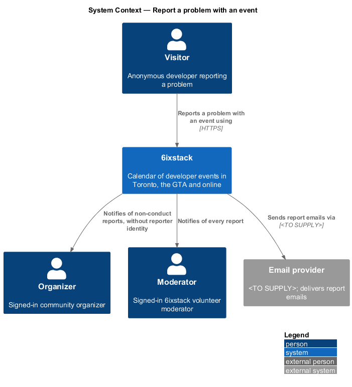
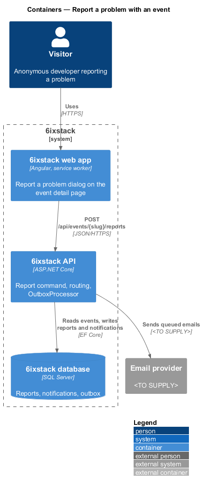
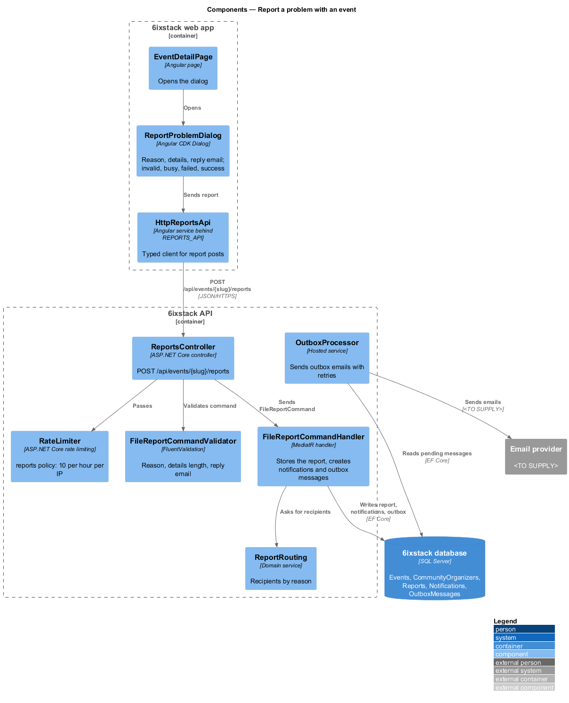
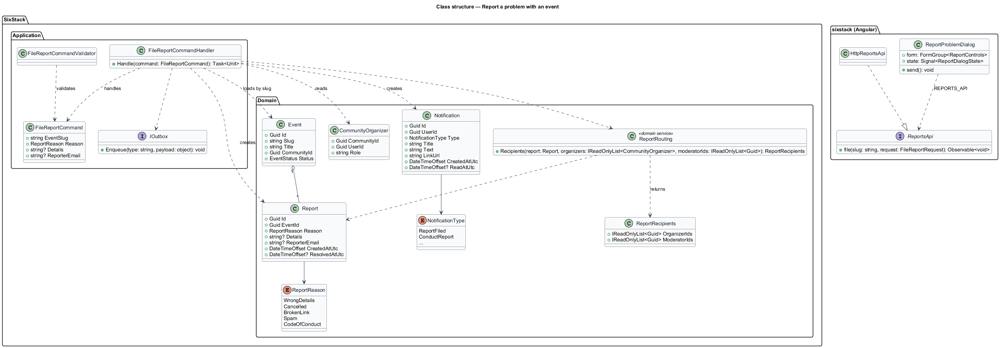
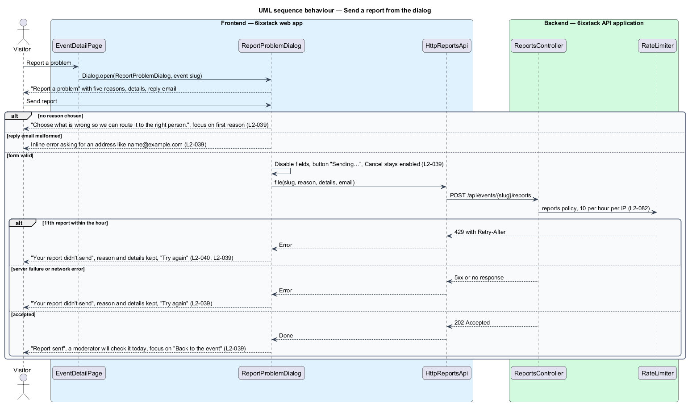
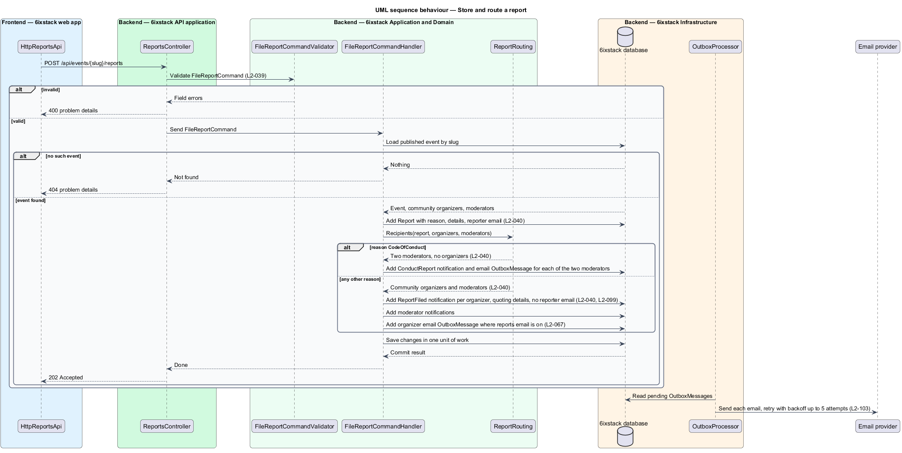

# Report a problem with an event

## Overview

6ixstack is a calendar of developer events in Toronto, the Greater Toronto Area
(GTA) and online. Listings go stale: a venue moves, a ticket link breaks, an
event is cancelled without notice, or a listing turns out to be spam. This
feature lets anyone tell the 6ixstack moderators about such a problem from the
event detail page, without an account. The dialog and its states are drawn in
`docs/mocks/dialogs/report-event/`.

The feature belongs to the `submissions` subsystem because it is one of the two
anonymous write paths into 6ixstack. The event detail page that opens the dialog
belongs to `discovery/view-event-detail`. The notifications this slice creates
are displayed by `notifications/in-app-notifications` and emailed by
`notifications/email-notifications`.

Terms used in this design:

- **report** — message from anyone about one event, with a reason, optional details and an optional reply email
- **reporter** — person who sends a report, never identified to the event's organizers
- **report reason** — one of five fixed categories that decides where the report is routed
- **code of conduct concern** — report reason that goes to two moderators and never to the organizer
- **routing** — choice of who is notified about a report, made from its reason

Every report is stored and reaches moderators. Reports other than code of
conduct concerns also reach the organizers of the event's community. Those
organizers see the reason and the details but never the reporter's email or any
other identifying data.

## Description

The slice runs from the dialog through one command to the database and the
outbox.

### Frontend (project `sixstack`, clients in project `api`)

- **`ReportProblemDialog`** — Angular CDK `Dialog` in
  `frontend/projects/sixstack/src/app/dialogs/report-problem/`, opened from the
  "Report a problem" button on `EventDetailPage`. It renders the "What is
  wrong?" radio group with five reasons, a Details textarea limited to 2,000
  characters, and a "Your email" field marked optional. It owns the default,
  invalid, busy, failed and success states.
  - Invalid: "Send report" with no reason shows "Choose what is wrong so we can
    route it to the right person." and moves focus to the first reason. A
    malformed reply email shows an inline error asking for an address like
    name@example.com.
  - Busy: fields are disabled, the button reads "Sending…" and Cancel stays
    enabled.
  - Failed: the alert "Your report didn't send" appears above the kept reason
    and details, and the button reads "Try again".
  - Success: the title becomes "Report sent", the body says a moderator will
    check it today, and "Back to the event" receives focus.
- **`ReportsApi`** / **`REPORTS_API`** / **`HttpReportsApi`** — client
  contract, injection token and HTTP implementation for
  `POST /api/events/{slug}/reports`. Any non-2xx response, including 429,
  resolves to the failed state.
- **Library components** — `DialogShell`, `FormField`, `Alert` and the choice
  radio group from project `components`.

### Backend

- **`ReportsController`** — ASP.NET Core controller exposing
  `POST /api/events/{slug}/reports` to anonymous callers (`L2-080`). The
  `reports` rate-limit policy allows 10 reports per hour per IP address and
  answers 429 with `Retry-After` beyond that (`L2-082`). The anti-forgery check
  applies (`L2-083`). The controller dispatches the command and holds no
  business rules.
- **`FileReportCommand`** — request carrying `EventSlug`, `Reason`, `Details`
  and `ReporterEmail`.
- **`FileReportCommandValidator`** — FluentValidation rules for `L2-039`: reason
  is a defined `ReportReason`, details are at most 2,000 characters, and the
  reply email, when present, is a valid address. Failures return 400 problem
  details with field errors.
- **`FileReportCommandHandler`** — MediatR handler. It loads the published event
  by slug and answers 404 when none exists. It stores a `Report`, applies the
  routing rule for `L2-040`, creates the `Notification` rows and appends outbox
  messages for the related emails. All writes commit in one unit of work.
  - Every reason except `CodeOfConduct`: one `Notification` of type
    `ReportFiled` for each `CommunityOrganizer` of the event's community, and a
    moderator notification. The organizer text names the event and quotes the
    details, as in "Someone reported the time on Azure Data & AI Day GTA". It
    never contains `ReporterEmail` (`L2-099`).
  - `CodeOfConduct`: no organizer notification. Exactly two moderators receive
    a `ConductReport` notification and an email. The rule that picks the two
    moderators is `<TO SUPPLY>`.
- **`Report`** — domain entity with `Id`, `EventId`, `Reason`, `Details`,
  `ReporterEmail`, `CreatedAtUtc` and `ResolvedAtUtc`. Moderators resolve
  reports; the reporter email is removed 90 days after resolution by the
  retention job in `platform/privacy-and-retention` (`L2-100`).
- **`ReportReason`** — enumeration `WrongDetails`, `Cancelled`, `BrokenLink`,
  `Spam`, `CodeOfConduct`, matching the five dialog options in order.
- **`ReportRouting`** — domain service that maps a `Report` and the event's
  organizers and moderators to the list of recipients, so the rule in `L2-040`
  is tested without the database.
- **`IOutbox`** / **`OutboxProcessor`** — the handler appends one outbox message
  per email. The hosted `OutboxProcessor` sends each one through `IEmailSender`
  to the email provider. Organizer emails respect the "Someone reports a problem
  with my event" preference (`L2-067`, `identity/account-settings`).

The requirements leave the following points open. The design does not settle
them:

- Which moderators receive non-conduct reports (all moderators or a subset):
  `<TO SUPPLY>`.
- How two moderators are chosen for a code of conduct concern: `<TO SUPPLY>`.
- The organizer notification wording for reasons other than "Wrong date, time or
  venue": `<TO SUPPLY>`.
- Whether past and cancelled events accept reports: `<TO SUPPLY>`.

## Requirements

| L2 ID | Refines (L1) | Requirement |
|-------|--------------|-------------|
| `L2-039` | `L1-009` | The "Report a problem" dialog shall require one reason (wrong date, time or venue; the event is cancelled; ticket or stream link is broken; spam or not a dev event; code of conduct concern) and accept optional details (up to 2,000 characters) and an optional reply email. |
| `L2-040` | `L1-009` | The system shall store each report, notify moderators, and notify the event's organizers of reports other than code of conduct concerns without revealing the reporter's identity; code of conduct concerns shall go to two moderators and never to the organizer. |

## Diagrams

### System context

A visitor reports a problem with an event. 6ixstack notifies the event's
organizers and its moderators, and sends their emails through the external email
provider.

### Containers

The web app posts the report to the API. The API stores the report, the
notifications and the outbox messages in the database, and its `OutboxProcessor`
hands the emails to the email provider.

### Components

`ReportProblemDialog` posts through `HttpReportsApi`. In the API,
`ReportsController` passes the rate limiter and the validator before
`FileReportCommandHandler` stores the report and asks `ReportRouting` who is
notified.

### Class structure

`FileReportCommandHandler` handles `FileReportCommand`, creates a `Report` for an
`Event`, and uses `ReportRouting` to create `Notification` rows. On the client,
`ReportProblemDialog` depends on the `ReportsApi` contract through `REPORTS_API`.

### Behaviour — send a report from the dialog

The dialog validates the reason and the reply email first (`L2-039`). While
sending, Cancel stays enabled. A failure or a 429 keeps the reason and the
details and offers Try again. Success moves focus to "Back to the event".

### Behaviour — store and route a report

The handler stores the report and routes it by reason (`L2-040`). A code of
conduct concern reaches two moderators only. Every other reason reaches the
community's organizers without the reporter's email, and reaches moderators.

## Decisions (journey 22)

- **Endpoint**: `POST /api/events/{slug}/reports`, anonymous, for published events. It answers 202, 400 with field
  errors (`reason`, `details`, `replyEmail`), 404, or 429 after ten reports an hour from one IP address
  (`Reports:PerIpPerHour`).
- **Reasons** (API values): `wrongDetails`, `cancelled`, `brokenLink`, `spam`, `codeOfConduct`.
- **Who hears**:
  - Every moderator is notified, linking to the edit page, where moderators act on the report (`L2-062`).
  - The event's community organizers and its submitter are notified, quoting the details and never naming the
    reporter. They also get an email when report emails are on (`L2-067`).
  - A conduct concern goes to two moderators only (the first two by address) and never to the organizer.
- **Titles**: "Someone reported the time on {title}" (wrong date, time or venue), "Someone says {title} is
  cancelled", "Someone reported a broken link on {title}", "Someone reported {title} as spam" and "Code of conduct
  concern about {title}".
- The reply address is stored for moderators only, and no response or notification includes it (`L2-099`).
- A moderator screen that lists reports is not part of this journey; moderators act from the notification.

