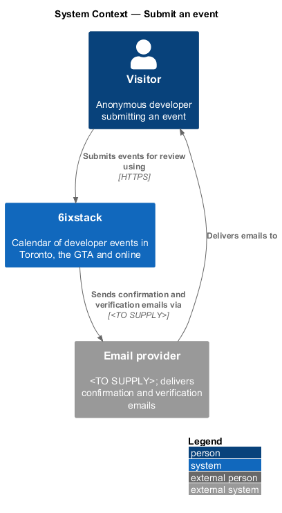
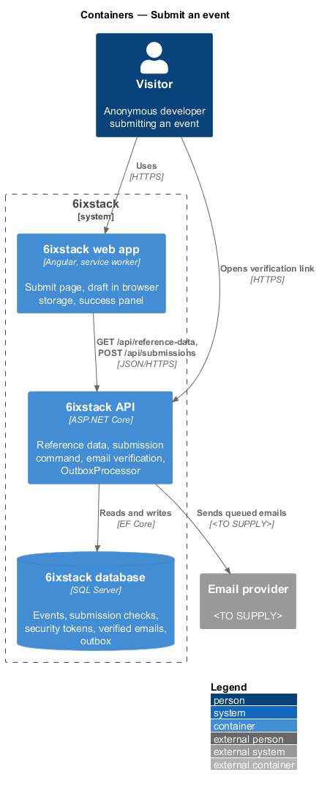
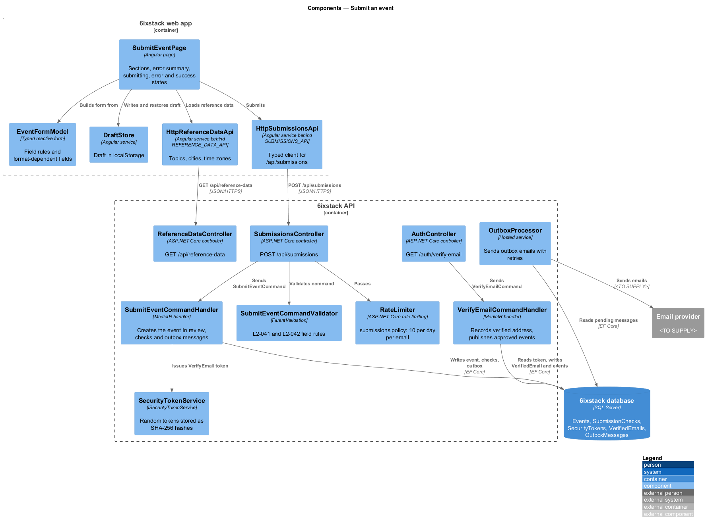
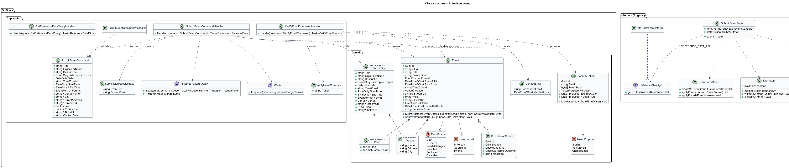
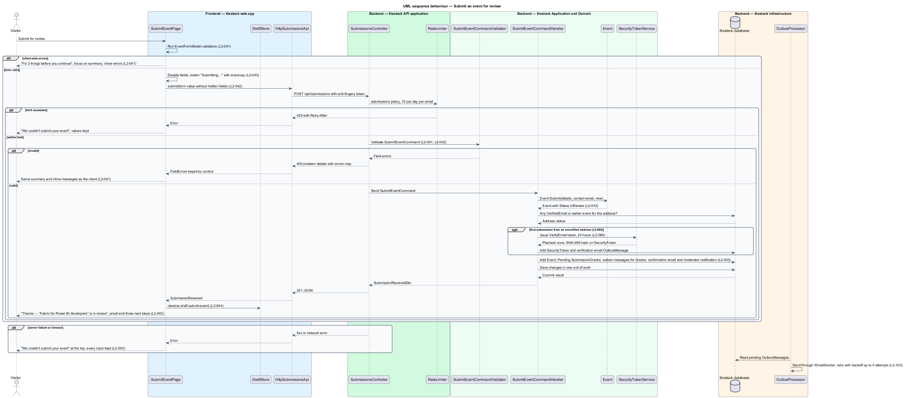
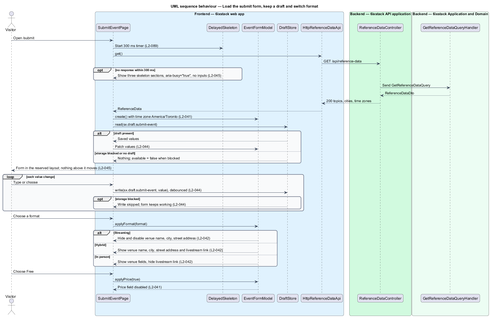
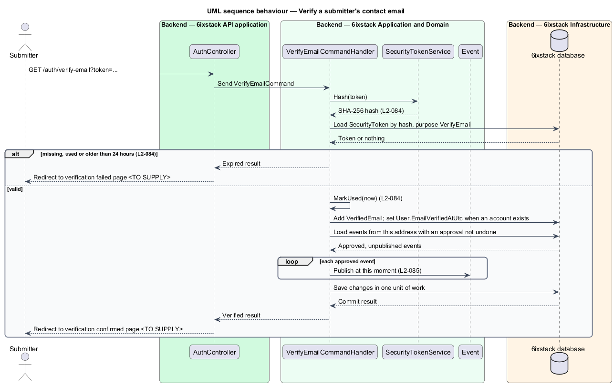

# Submit an event

## Overview

6ixstack is a calendar of developer events in Toronto, the Greater Toronto Area
(GTA) and online. Its listings come from the people who run those events. This
feature covers the submit page at `/submit`: the form anyone fills in to list an
event for free, with only an email address and no account. It also covers what
happens after a valid submission and the email verification that gates
publishing. The screens and states are drawn in `docs/mocks/pages/submit-event/`.

The feature belongs to the `submissions` subsystem. The review that follows a
submission belongs to the `moderation` subsystem (`moderation/review-queue`,
`moderation/automated-checks`, `moderation/approve-submission`). Editing an event
after submission belongs to `organizer/edit-event`, which reuses the
format-dependent field rules described here.

Terms used in this design:

- **submission** — event sent through the submit page, stored with status In review until a moderator decides on it
- **submitter** — person who sends a submission, identified only by the contact email they enter
- **contact email** — address entered in the "Your contact email" section, visible only to moderators
- **reference data** — topic, city and time zone lists the form needs before it can render
- **draft** — copy of the unsent form values kept in browser storage on the submitter's device
- **format-dependent fields** — venue name, city, street address and livestream link, shown or hidden by the chosen format
- **verified address** — contact email whose owner has opened the verification link sent on its first submission

A valid submission is stored as an event with status In review. It never appears
on public lists until a moderator approves it and its contact email is verified.
The submitter receives a confirmation email at once. When the address has never
submitted before, the submitter also receives a verification link valid for
24 hours.

## Description

The slice runs from the Angular page through one command to the database and the
outbox. A second, small path redeems the verification link.

### Frontend (project `sixstack`, clients in project `api`)

- **`SubmitEventPage`** (`sx-submit-event-page`, route `/submit`) — Angular page
  that renders the sections "Event basics", "When", "Where", "Tickets" and "Your contact
  email", the actions Cancel and Submit for review, and the success panel. It
  owns the loading, invalid, submitting, error and success states. The header's
  Submit event button is hidden on this page.
- **`EventFormModel`** — typed reactive form builder shared with
  `organizer/edit-event`. It declares the field validators that mirror the
  server rules in `L2-041`. It also toggles the format-dependent fields for
  `L2-042`: Streaming disables and hides venue, city and street address; In
  person hides the livestream link; Hybrid shows all four. A hidden control is
  disabled, so Angular omits it from the submitted value. Choosing Free disables
  the price field.
- **`DraftStore`** — shared app service. Under key `sx.draft.submit-event` it
  writes the form value on each change, debounced by `<TO SUPPLY>` ms. It
  restores the value when the page opens and clears the key after a successful
  submission. When storage access throws, it sets `available` to `false` and
  the form keeps working without a draft (`L2-044`).
- **`DelayedSkeleton`** — shared helper. The page shows three skeleton sections
  with `aria-busy="true"` only when reference data is still pending after
  300 ms (`L2-045`). The skeleton sections reserve the final layout height so
  nothing above the form moves when it appears.
- **`ReferenceDataApi`** / **`REFERENCE_DATA_API`** / **`HttpReferenceDataApi`**
  — client contract, injection token and HTTP implementation for
  `GET /api/reference-data`.
- **`SubmissionsApi`** / **`SUBMISSIONS_API`** / **`HttpSubmissionsApi`** —
  client contract, injection token and HTTP implementation for
  `POST /api/submissions`. A 400 response maps to a `FieldErrors` map keyed by
  form control name, so server errors show in the same places as client errors.
- **Library components** — `FormField`, `ErrorSummary`, `Alert`, `Skeleton`,
  `TopicChip` and the format choice cards from project `components`. The error
  summary reads "Fix N things before you continue", receives focus on submit and
  links each message to its field.

### Backend

- **`ReferenceDataController`** — ASP.NET Core controller exposing
  `GET /api/reference-data` to anonymous callers. It sends
  `GetReferenceDataQuery` and returns `ReferenceDataDto` with topics, cities and
  time zones. The response is cacheable for `<TO SUPPLY>` seconds.
- **`SubmissionsController`** — ASP.NET Core controller exposing
  `POST /api/submissions` to anonymous callers (`L2-080`). It is protected by the
  anti-forgery check (`L2-083`) and by the `submissions` rate-limit policy of
  10 submissions per day per contact email (`L2-082`). It dispatches the command
  and holds no business rules.
- **`SubmitEventCommand`** — request carrying `Title`, `OrganizerName`,
  `Description`, `Topics`, `Date`, `TimeZoneId`, `StartTime`, `EndTime`,
  `Format`, `VenueName`, `City`, `StreetAddress`, `StreamUrl`, `IsFree`,
  `PriceCad`, `TicketUrl` and `ContactEmail`.
- **`SubmitEventCommandValidator`** — FluentValidation rules for `L2-041` and
  `L2-042`. Title is required, up to 90 characters. Organizer name is required,
  up to 120. Description is required, up to 2,000. At least one topic is
  required. Date and start time are required, and the date is not in the past.
  End time is after start time. Venue name and street address are required for
  In person and Hybrid. Venue fields are rejected for Streaming. A paid event
  needs a positive CAD amount. Stream and ticket links start with `https://`
  (`L2-081`). Contact email is a valid address. Messages match the form copy, for
  example "Enter a title for the event." and "End time must be after the 6:30 PM
  start." Failures return 400 problem details with an `errors` map keyed by
  field name.
- **`SubmitEventCommandHandler`** — MediatR handler. In one unit of work it
  creates the `Event` through `Event.Submit()` with status `InReview`, creates
  one `Pending` `SubmissionCheck` per check kind, and appends outbox messages:
  the confirmation email, the automated-checks job (`moderation/automated-checks`)
  and the moderator queue notification (`notifications/in-app-notifications`).
  When the contact email has no `VerifiedEmail` row and no earlier event carries
  it, the handler also issues a `VerifyEmail` `SecurityToken` and appends the
  verification email (`L2-085`). It returns `SubmissionReceivedDto`.
- **`SubmissionReceivedDto`** — response carrying `EventTitle` and
  `ContactEmail` for the success panel.
- **`Event`** — domain entity. `Event.Submit(details, submitterEmail, now)`
  creates the event with `Status = InReview`, `SubmittedAtUtc = now` and a slug.
  It converts the local date and times in `TimeZoneId` into `StartsAtUtc` and
  `EndsAtUtc`.
- **`EventDetails`** — value object holding the editable fields, shared with
  `organizer/edit-event`.
- **`VerifiedEmail`** — feature-specific entity with `string NormalizedEmail`
  and `DateTimeOffset VerifiedAtUtc`. It records that an address is verified
  independent of any account, because submitters need no account.
- **`ISecurityTokenService`** / **`SecurityTokenService`** — shared with
  `identity/magic-link-sign-in`. It generates 32 random bytes, returns the
  Base64Url plaintext once for the email, and stores only the SHA-256 hash on
  `SecurityToken` (`L2-084`). Verification tokens expire after 24 hours.
- **`IOutbox`** / **`OutboxProcessor`** — the handler writes `OutboxMessage` rows
  in the same transaction as the event. The hosted `OutboxProcessor` sends them
  through `IEmailSender` to the email provider, retried with exponential backoff
  up to 5 attempts (`L2-103`). An email failure therefore never fails the
  submission.
- **`AuthController`** — exposes `GET /auth/verify-email?token=`. It sends
  `VerifyEmailCommand` and redirects to the verification result page
  `<TO SUPPLY>`.
- **`VerifyEmailCommandHandler`** — hashes the token and loads the unused,
  unexpired `SecurityToken`. For purpose `VerifyEmail` it marks the token used,
  inserts the `VerifiedEmail` row and sets `User.EmailVerifiedAtUtc` when an
  account exists. It then publishes each event from that address that a
  moderator has already approved (`L2-085`). The same handler serves purpose
  `ChangeEmail`, described in `identity/account-settings`.

The submitted event carries `OrganizerName` as free text. Linking the event to a
`Community` (`Event.CommunityId`) happens during moderation; the rule for that
match is `<TO SUPPLY>`. Until approval the event is invisible to every public
query, because those queries select `Published` events only (`L2-043`).

The requirements leave the following points open. The design does not settle
them:

- Whether the end time is required, and the end instant stored when it is
  absent: `<TO SUPPLY>`. `L2-041` marks end time only as "after start".
- The time zone in which "not in the past" is judged (Toronto or the selected
  time zone): `<TO SUPPLY>`.
- Whether a Streaming event requires a livestream link: `<TO SUPPLY>`.
- An upper bound on the CAD price: `<TO SUPPLY>`.
- How a submitter without an account obtains a new verification link once the
  first link expires: `<TO SUPPLY>`. `L2-085` sends a link only on the first
  submission from an address.
- Whether redeeming a sign-in link (`identity/magic-link-sign-in`) also counts
  as verifying the address: `<TO SUPPLY>`.
- How an approved but unverified event is represented until verification. The
  design assumes the event keeps status `InReview` with an approval
  `ModerationDecision` that is not undone. This shall be agreed with
  `moderation/approve-submission`.

## Requirements

| L2 ID | Refines (L1) | Requirement |
|-------|--------------|-------------|
| `L2-041` | `L1-010` | The submit page (`/submit`) shall collect, in sections Event basics, When, Where, Tickets and Your contact email: title (required, up to 90 characters), community or organizer (required, up to 120), description (required, up to 2,000, Markdown links allowed), topics (at least one), date (required, not in the past), time zone (default America/Toronto), start time (required), end time (after start), format (In person, Streaming, Hybrid), venue name, city, street address, livestream link (optional), price (Free or Paid with a CAD amount), registration or ticket link (optional) and contact email (required). |
| `L2-042` | `L1-010` | The submit and edit forms shall hide venue name, city and street address when the format is Streaming, and show venue and livestream fields when the format is Hybrid. |
| `L2-043` | `L1-010` | A valid submission shall be stored with status In review, run the automated checks, send a confirmation email to the contact address, and show a success panel naming the event, the email and the next steps. |
| `L2-044` | `L1-010` | The submit form shall save a draft in browser storage as the user types, restore it on return, and clear it after a successful submission. |
| `L2-045` | `L1-010` | While topic, city and time zone lists take more than 300 ms to load, the submit form shall show skeleton sections that match the final layout (`submit-event/loading`). |
| `L2-085` | `L1-019` | An event shall not be published until its contact email is verified through a link sent on the first submission from that address. |

## Diagrams

### System context

A visitor submits an event to 6ixstack without an account. 6ixstack sends the
confirmation and verification emails through the external email provider.

### Containers

The web app loads reference data and posts the submission to the API. The API
stores the event, its checks and the outbox messages in the database, and its
`OutboxProcessor` hands the emails to the email provider.

### Components

`SubmitEventPage` builds its form from `EventFormModel`, keeps the draft in
`DraftStore` and calls the two API clients. In the API, `SubmissionsController`
passes the rate limiter and the validator before `SubmitEventCommandHandler`
writes the event, the checks and the outbox messages in one unit of work.
`VerifyEmailCommandHandler` redeems the verification link later.

### Class structure

`SubmitEventCommandHandler` handles `SubmitEventCommand`, creates an `Event` with
its `EventDetails`, and issues a `SecurityToken` through `ISecurityTokenService`
for unverified addresses. `VerifyEmailCommandHandler` records a `VerifiedEmail`.
On the client, `SubmitEventPage` depends on the `SubmissionsApi` and
`ReferenceDataApi` contracts through their tokens.

### Behaviour — submit for review

The page validates on the client first. The API validates the same rules again
and answers 400 with matching field errors for direct calls (`L2-041`). A valid
command stores the event In review, queues the checks and the confirmation email,
and queues a verification email for a first-time address (`L2-043`, `L2-085`). A
server failure keeps every value in the form.

### Behaviour — load the form, restore the draft and switch format

Skeletons appear only when reference data takes longer than 300 ms (`L2-045`).
The draft is restored once the form exists, and each change writes it back
(`L2-044`). Choosing a format shows or hides the venue and livestream fields
(`L2-042`).

### Behaviour — verify the contact email

Opening the verification link records the address as verified. Any event from
that address that a moderator already approved becomes published at that moment
(`L2-085`). An expired or used link changes nothing.

